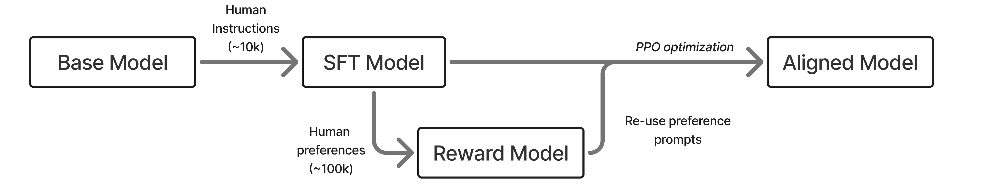
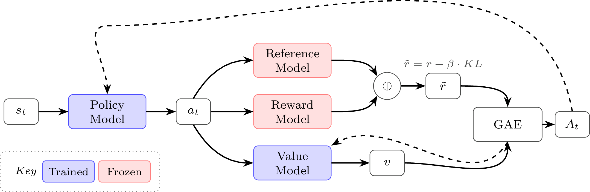
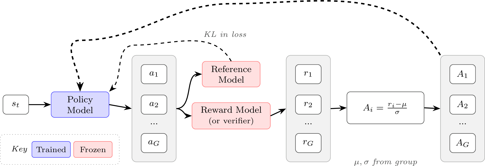

# Lec 3: RL Motivation and Math

> Corresponding lecture: Lec 3 — RL Motivation & Math · Chapter 6 Part 1 · Watch/PDF/Slides/Source at [rlhfbook.com/course](https://rlhfbook.com/course)

This chapter covers the mathematics and theory of reinforcement learning (RL) for language models. The next chapter turns these algorithms into working code. We focus on the policy-gradient family — REINFORCE, REINFORCE Leave-One-Out (RLOO), Proximal Policy Optimization (PPO), Group Relative Policy Optimization (GRPO), and recent variants such as Group Sequence Policy Optimization (GSPO) and Clipped Importance Sampling Policy Optimization (CISPO) — because they are the load-bearing algorithms in modern RLHF and in the emerging reasoning era.

## Why RL matters

In the overall post-training pipeline, RL sits after instruction tuning and reward modeling. The policy (the model being trained) generates completions, the reward model scores them, and the RL optimizer uses those scores to update the policy parameters. After two lectures on supervised fine-tuning, reward models, and rejection sampling, we now add the gradient-based optimization step.



RL is harder to implement than rejection sampling or direct alignment, but it brings benefits that are difficult to measure yet widely observed: it can smooth rough edges in model outputs, improve formatting, make generations more compatible with serving frameworks such as vLLM, and target a narrow prompt distribution without squashing general capabilities. RL losses are robust, scalable, and flexible, which is why they opened large new fields of experimentation after the original RLHF work.

More importantly, RL is now the load-bearing step in training the most capable models. Reasoning models such as OpenAI o1 and DeepSeek R1 are trained with these same algorithms on verifiable rewards. Two scaling ideas dominate the current landscape:

- **Train-time compute scaling via RL**: more RL training compute yields better reasoning.
- **Test-time compute scaling via extended reasoning**: the model generates longer chains of thought at inference time.


The same algorithms power both RLHF and **reinforcement learning with verifiable rewards (RLVR)**. In RLHF, a reward model scores subjective quality. In RLVR, a verification function checks correctness for math or code. The policy-gradient machinery is identical; only the reward source changes. We will cover reasoning-specific tricks in a later lecture.


## RL foundations review

### Classical RL versus RLHF

In classical RL, an agent interacts with a Markov decision process (MDP) $(\\mathcal{S}, \\mathcal{A}, P, r, \\gamma)$. The reward $r(s, a)$ is a known function from the environment, and the goal is to maximize cumulative discounted return:

$$J(\\pi) = \\mathbb{E}\_{\\tau \\sim p\_\\pi}\\!\\left[\\sum\_{t} \\gamma^t r(s\_t, a\_t)\\right].$$

In RLHF there is no environment. Prompts are drawn from a dataset, and the reward is **learned** from human preferences. The reward is usually **response-level**, and optimization is regularized with a KL penalty against a reference model:

$$J(\\pi) = \\mathbb{E}\\left[ r\_\\theta(x, y) \\right] - \\beta \\, D\_{\\text{KL}}\\!\\left(\\pi \\| \\pi\_{\\text{ref}}\\right).$$


### Notation

This chapter uses $(s, a)$ notation from the RL literature: $s$ denotes states and $a$ denotes actions. In the language-model context you will often see $(x, y)$, where $x$ is the prompt and $y$ is the completion. The $(s, a)$ framing is more general — these algorithms were designed for sequential decision problems — but many RLHF implementations treat the entire completion as a single action, so $(x, y)$ is equally valid. We use $r\_t$ for per-step rewards, $R(\\tau)$ for trajectory returns, and $\\rho\_t$ for importance-sampling ratios.

### Language models as episodic MDPs

| MDP concept | Language model |
|-------------|----------------|
| State $s\_t$ | Prompt + tokens so far: $(x, y\_{<t})$ |
| Action $a\_t$ | Next token $y\_t$ |
| Transition | Deterministic: append token to sequence |
| Policy $\\pi\_\\theta(a\_t \\mid s\_t)$ | LM next-token distribution |
| Episode | One prompt → completion |
| Terminal reward | Reward-model score or verifier output |
| Discount $\\gamma$ | Typically $1.0$ (no discounting) |

There are two views. In the **token-level** view each token is a separate action; this is the view PPO uses with Generalized Advantage Estimation (GAE). In the **sequence-level** view the entire completion is one action; this is the view REINFORCE and GRPO use.

### What are we optimizing?

We choose policy parameters $\\theta$ that maximize expected reward under the current policy. Let $p\_\\theta(\\tau)$ be the trajectory distribution induced by the policy. The objective is

$$J(\\theta) = \\mathbb{E}\_{\\tau \\sim p\_\\theta}[R(\\tau)].$$

In practice we estimate this expectation by sampling rollouts:

$$J(\\theta) \\approx \\frac{1}{N}\\sum\_{i=1}^{N} R(\\tau\_i), \\qquad \\tau\_i \\sim p\_\\theta.$$

The rest of the chapter is about constructing a gradient that lets us optimize this expectation.

### How a policy gradient works

The core update has the following intuitive form:

$$\\Delta \\theta \\propto \\Psi\_t \\, \\nabla\_\\theta \\log \\pi\_\\theta(a\_t \\mid s\_t).$$

Read it as two questions answered at once:

- $\\nabla\_\\theta \\log \\pi\_\\theta(a\_t \\mid s\_t)$ asks **which action?** It points in parameter space in the direction that makes $a\_t$ more likely.
- $\\Psi\_t$ asks **how good was it?** It is a scalar scoring the outcome. Positive means reinforce, negative means suppress, and the magnitude says how much.

Multiplying them means: if $\\Psi\_t > 0$, update parameters to make $a\_t$ more likely; if $\\Psi\_t < 0$, update them to make it less likely. The rest of the chapter is about choosing a smart $\\Psi\_t$.

The general policy-gradient equation is

$$\\nabla\_\\theta J(\\theta) = \\mathbb{E}\_{\\tau \\sim p\_\\theta}\\!\\left[\\sum\_{t=0}^{T} \\Psi\_t \\nabla\_\\theta \\log \\pi\_\\theta(a\_t \\mid s\_t)\\right].$$

The choice of $\\Psi\_t$ determines variance, bias, and compute cost.

### Key RL quantities

Three quantities appear throughout:

**Value function** $V(s)$: expected future return from state $s$,

$$V(s) = \\mathbb{E}\\big[G\_t \\mid S\_t = s\\big] \\quad \\text{where } G\_t = \\sum\_{k=0}^{\\infty} \\gamma^k r\_{t+k}.$$

**Action-value function** $Q(s, a)$: expected return after taking action $a$ in state $s$,

$$Q(s, a) = \\mathbb{E}[G\_t \\mid S\_t = s, A\_t = a].$$

**Advantage function** $A(s, a) = Q(s, a) - V(s)$: how much better is $a$ than the average action in $s$? Positive advantages reinforce, negative advantages suppress, and zero advantages produce no update. In RLHF, $\\gamma = 1$ is common because the unit of optimization is the full completion.

### Choices for the learning signal $\\Psi\_t$

Schulman et al. 2015 list several popular choices for $\\Psi\_t$ (rewards may also be discounted by $\\gamma$):

| | $\\Psi\_t$ | Description | Variance | Bias |
|:-:|-----------|-------------|:--------:|:----:|
| 1. | $R(\\tau) = \\sum\_{t=0}^{T} r\_t$ | Total trajectory reward | Highest | None |
| 2. | $\\sum\_{t'=t}^{T} r\_{t'}$ | Future return from $t$, i.e. $G\_t$ | High | None |
| 3. | $G\_t - b(s\_t)$ | Baselined return | Lower | None |
| 4. | $Q^{\\pi}(s\_t, a\_t)$ | State-action value function | Medium | Depends |
| 5. | $A^{\\pi}(s\_t, a\_t) = Q - V$ | Advantage function | Low (with good $V$) | None |
| 6. | $r\_t + \\gamma V(s\_{t+1}) - V(s\_t)$ | TD residual | Low | Some |

A **baseline** $b(s\_t)$ is any function of state subtracted from the reward signal to reduce variance. We show below that this does not change the expected gradient.

## Deriving the policy gradient

### Differentiating an expectation

We want $\\nabla\_\\theta J(\\theta)$. Written as an integral,

$$J(\\theta) = \\mathbb{E}\_{\\tau \\sim p\_\\theta}[R(\\tau)] = \\int\_\\tau p\_\\theta(\\tau) R(\\tau) \\, d\\tau.$$

Taking the gradient directly gives

$$\\nabla\_\\theta J(\\theta) = \\int\_\\tau \\nabla\_\\theta p\_\\theta(\\tau) R(\\tau) \\, d\\tau.$$

We can sample trajectories from $p\_\\theta(\\tau)$, but not from $\\nabla\_\\theta p\_\\theta(\\tau)$, because the latter is not a probability distribution. The derivation uses a few key tricks to make this sampleable.

### The log-derivative trick

Substituting the log-derivative identity into the gradient:

$$
\\begin{aligned}
\\nabla\_\\theta J(\\theta)
&= \\int\_\\tau \\nabla\_\\theta p\_\\theta(\\tau) R(\\tau) \\, d\\tau
&& \\text{differentiate the objective} \\\\
&= \\int\_\\tau p\_\\theta(\\tau) R(\\tau) \\nabla\_\\theta \\log p\_\\theta(\\tau) \\, d\\tau
&& \\text{log-derivative identity} \\\\
&= \\mathbb{E}\_{\\tau \\sim p\_\\theta}\\!\\left[R(\\tau) \\nabla\_\\theta \\log p\_\\theta(\\tau)\\right]
&& \\text{expectation form}.
\\end{aligned}
$$

The only non-obvious step is the identity itself:

$$
\\begin{aligned}
\\nabla\_\\theta \\log p\_\\theta(\\tau)
&= \\frac{\\nabla\_\\theta p\_\\theta(\\tau)}{p\_\\theta(\\tau)} \\\\
\\Rightarrow \\quad \\nabla\_\\theta p\_\\theta(\\tau)
&= p\_\\theta(\\tau) \\nabla\_\\theta \\log p\_\\theta(\\tau).
\\end{aligned}
$$

This is the **log-derivative trick**, derived from the chain rule for $\\log$. It rewrites the gradient of a probability in terms of a log-probability, which is much easier to work with.

Where did the $p\_\\theta(\\tau)$ term go? It became the **sampling distribution** inside the expectation:

$$\\int p\_\\theta(\\tau) f(\\tau)\\, d\\tau = \\mathbb{E}\_{\\tau \\sim p\_\\theta}[f(\\tau)].$$

Monte Carlo estimates this expectation by sampling trajectories from the policy:

$$\\mathbb{E}\_{\\tau \\sim p\_\\theta}[f(\\tau)] \\approx \\frac{1}{N}\\sum\_{i=1}^{N} f(\\tau\_i), \\qquad \\tau\_i \\sim p\_\\theta.$$

So there is no explicit $p\_\\theta(\\tau\_i)$ term in code: more likely trajectories already appear more often in the sampled batch. Rollout generation handles the sampling, and the loss code handles $R(\\tau\_i)\\,\\nabla\_\\theta \\log p\_\\theta(\\tau\_i)$.

### Expanding the trajectory log-probability

The trajectory probability factorizes:

$$p\_\\theta(\\tau) = d\_0(s\_0) \\prod\_{t=0}^{T} \\pi\_\\theta(a\_t \\mid s\_t) \\, p(s\_{t+1} \\mid s\_t, a\_t).$$

Taking the log:

$$\\log p\_\\theta(\\tau) = \\log d\_0(s\_0) + \\sum\_{t=0}^{T} \\log \\pi\_\\theta(a\_t \\mid s\_t) + \\sum\_{t=0}^{T} \\log p(s\_{t+1} \\mid s\_t, a\_t).$$

For language models, this is the familiar autoregressive pattern: a sequence log-probability is a sum of token log-probabilities. Now take the gradient with respect to $\\theta$:

- $\\nabla\_\\theta \\log d\_0(s\_0) = 0$ — the initial state distribution does not depend on $\\theta$.
- $\\nabla\_\\theta \\log p(s\_{t+1} \\mid s\_t, a\_t) = 0$ — environment dynamics do not depend on $\\theta$.
- Only $\\nabla\_\\theta \\log \\pi\_\\theta(a\_t \\mid s\_t)$ survives.

Therefore,

$$\\nabla\_\\theta \\log p\_\\theta(\\tau) = \\sum\_{t=0}^{T} \\nabla\_\\theta \\log \\pi\_\\theta(a\_t \\mid s\_t).$$

In language-model code this is why you repeatedly see:

```python
seq_log_probs = (token_log_probs * completion_mask).sum(dim=-1)
loss = -(seq_log_probs * advantages).mean()
loss.backward()
```

Autodiff turns the summed log-probability into the corresponding sum of per-token gradients.

### From full return to future rewards

An action at time $t$ cannot affect past rewards. So instead of weighting every token by the full trajectory reward $R(\\tau)$,

$$\\nabla\_\\theta J = \\mathbb{E}\_{\\tau \\sim p\_\\theta}\\!\\left[\\sum\_{t=0}^{T} R(\\tau) \\nabla\_\\theta \\log \\pi\_\\theta(a\_t \\mid s\_t)\\right],$$

we can replace $R(\\tau)$ with the **return-to-go** $G\_t = \\sum\_{t'=t}^{T} r\_{t'}$:

$$\\nabla\_\\theta J = \\mathbb{E}\_{\\tau \\sim p\_\\theta}\\!\\left[\\sum\_{t=0}^{T} G\_t \\nabla\_\\theta \\log \\pi\_\\theta(a\_t \\mid s\_t)\\right].$$

This does not change the expected gradient, but it removes noise from past rewards that the current action could not have influenced. This is the step from option 1 to option 2 in the taxonomy above.

### Baselines keep the estimator unbiased

Raw returns are noisy: the same action can appear in trajectories with very different total rewards because of later sampled actions and environment randomness. A baseline **centers** the signal. Instead of asking "was the return high?", we ask "was it higher or lower than expected for this state?"

Use a centered return:

$$\\Psi\_t = G\_t - b(s\_t),$$

where $b(s\_t)$ depends only on the state, not on the sampled action. Subtracting this baseline does not change the expected gradient:

$$
\\mathbb{E}[(G\_t - b(s)) \\nabla\_\\theta \\log \\pi\_\\theta(a \\mid s)]
= \\mathbb{E}[G\_t \\nabla\_\\theta \\log \\pi\_\\theta(a \\mid s)]
\\- \\mathbb{E}[b(s) \\nabla\_\\theta \\log \\pi\_\\theta(a \\mid s)].
$$

The first term is the original estimator. The second vanishes:

$$
\\begin{aligned}
\\mathbb{E}[b(s) \\nabla\_\\theta \\log \\pi\_\\theta(a \\mid s)]
&= b(s) \\cdot \\sum\_a \\pi\_\\theta(a \\mid s) \\nabla\_\\theta \\log \\pi\_\\theta(a \\mid s) \\\\
&= b(s) \\cdot \\sum\_a \\nabla\_\\theta \\pi\_\\theta(a \\mid s) \\\\
&= b(s) \\cdot \\nabla\_\\theta \\underbrace{\\sum\_a \\pi\_\\theta(a \\mid s)}\_{= 1} \\\\
&= 0.
\\end{aligned}
$$

The gradient of a normalized distribution sums to zero, so we are free to subtract any function of state as a baseline. This is why options 3–5 reduce variance without introducing bias.

### Policy gradient derivation recap

Putting the pieces together:

$$
\\begin{aligned}
J(\\theta)
&= \\mathbb{E}\_{\\tau \\sim p\_\\theta}[R(\\tau)]
&& \\text{objective} \\\\
\\nabla\_\\theta J(\\theta)
&= \\int\_\\tau \\nabla\_\\theta p\_\\theta(\\tau) R(\\tau)\\, d\\tau
&& \\text{differentiate} \\\\
&= \\mathbb{E}\_{\\tau \\sim p\_\\theta}\\!\\left[\\sum\_{t=0}^{T} \\Psi\_t \\nabla\_\\theta \\log \\pi\_\\theta(a\_t \\mid s\_t)\\right]
&& \\text{final estimator}.
\\end{aligned}
$$

- The log-derivative trick turns $\\nabla p\_\\theta(\\tau)$ into a sampleable expectation.
- Expanding $\\log p\_\\theta(\\tau)$ gives a sum of policy log-probability terms.
- $\\Psi\_t$ is the learning signal: return, advantage, or TD-style estimate.
- In code: sample rollouts, sum token log-probs, weight by $\\Psi\_t$, average.

## Wiring RLHF for language models

Before diving into specific algorithms, revisit the full RLHF setup they plug into. After instruction tuning and reward-model training, the RL step updates the policy against the learned reward signal.


### The reference model and KL regularization

The **reference model** $\\pi\_\\text{ref}$ is a frozen copy of the policy at the start of RL training, typically the SFT checkpoint. It anchors the policy so it does not drift too far during optimization. Without it, the policy can exploit the reward model, finding high-scoring outputs that are degenerate or repetitive — a phenomenon known as **reward hacking**.

The KL penalty measures how far the current policy has drifted from the reference at each token:

$$\\text{KL}\_t = \\log \\pi\_\\theta(a\_t \\mid s\_t) - \\log \\pi\_\\text{ref}(a\_t \\mid s\_t).$$

In practice: generate a completion from $\\pi\_\\theta$, compute log-probs of those same tokens under both $\\pi\_\\theta$ and $\\pi\_\\text{ref}$, and subtract to get the per-token KL. The shaped reward becomes $\\tilde{r}\_t = -\\beta \\, \\text{KL}\_t$ for intermediate tokens and $\\tilde{r}\_T = R(\\tau) - \\beta \\, \\text{KL}\_T$ for the final token.

### KL in RLHF versus RLVR

In **RLHF**, the KL penalty is critical because the reward model is a learned proxy and the policy will exploit any imperfections without regularization. In **RLVR**, where rewards are verifiable, KL is often reduced or removed entirely. The reward is ground truth, so there is less to exploit. Some RLVR setups, such as DeepSeek R1, drop the reference model altogether to save memory. As reward signals become more reliable, the need for KL regularization decreases.

### Two "old" policies

Do not confuse $\\pi\_{\\theta\_\\text{old}}$ with $\\pi\_\\text{ref}$:

| | $\\pi\_{\\theta\_\\text{old}}$ | $\\pi\_\\text{ref}$ |
|---|---|---|
| What | Policy at last rollout | Policy at start of RL training (SFT checkpoint) |
| Updates | Every batch (or every $K$ steps) | Never (frozen) |
| Used for | Importance-sampling ratio $\\rho\_t$ | KL penalty |
| If dropped | Must use one gradient step per batch (on-policy) | Risk of reward hacking |

In some implementations, "old logprobs" simply means the log-probs computed at generation time; the model has been updated since they were computed.

## REINFORCE

REINFORCE, introduced by Williams 1992, is the simplest instantiation of the policy gradient. It is the **Monte Carlo form**: sample trajectories, compute their returns, and use those sampled returns to weight the log-probability gradients. The name is a backronym for "REward Increment = Nonnegative Factor X Offset Reinforcement X Characteristic Eligibility." The three components are:

1. **Nonnegative factor** ($\\alpha$): the learning rate.
2. **Offset reinforcement** ($G\_t - b(s\_t)$): a centered return for stability.
3. **Characteristic eligibility** ($\\nabla \\log \\pi$): how to attribute learning to each parameter.

The update rule is

$$\\Delta\\theta = \\alpha \\, (G\_t - b(s\_t)) \\nabla\_\\theta \\log \\pi\_\\theta(a\_t \\mid s\_t).$$

Without a baseline, the gradient weights each action by its raw return $G\_t$. This does not tell you whether the action was better or worse than expected — only how good the overall outcome was. The gradient is high variance because raw returns mix action quality with state quality.

Subtracting a baseline $b(s)$ centers the signal. Because $b(s)$ does not depend on which action was sampled, it factors out and cancels:

$$\\mathbb{E}\_{a \\sim \\pi(\\cdot \\mid s)}[b(s) \\nabla\_\\theta \\log \\pi\_\\theta(a \\mid s)] = 0.$$

The expected gradient is unchanged, but the variance drops dramatically.

The full REINFORCE gradient is therefore

$$\\nabla\_\\theta J(\\theta) = \\mathbb{E}\_{\\tau \\sim p\_\\theta}\\!\\left[\\sum\_{t=0}^{T} (G\_t - b(s\_t)) \\nabla\_\\theta \\log \\pi\_\\theta(a\_t \\mid s\_t)\\right].$$

Common baselines include the average reward over the batch, a moving average of recent rewards, and a learned value function $V\_\\phi(s)$. Basic REINFORCE needs no critic; adding a learned value function reduces variance but introduces the complexity of training a second model, moving toward actor-critic methods such as PPO.


## REINFORCE Leave-One-Out (RLOO)

RLOO, studied by Ahmadian et al. 2024 and Wang et al. 2024, uses a leave-one-out baseline. The key idea is to generate $K$ completions per prompt and use the other $K-1$ rewards as the baseline:

$$b(s, a\_k) = \\frac{1}{K-1}\\sum\_{i=1,\\, i \\neq k}^{K} R(s, a\_i).$$

The advantage for completion $k$ is

$$\\hat{A}(s, a\_k) = R(s, a\_k) - b(s, a\_k).$$

This is a **per-prompt** baseline that naturally captures prompt difficulty: hard prompts get low rewards across all completions, so the baseline is low. Like REINFORCE without a critic, the same sequence-level advantage is broadcast to every token in the completion.

For example, with $K = 4$ completions and rewards $[0.8, 0.3, 0.6, 0.5]$:

| Completion | Reward | Baseline (avg of others) | Advantage |
|:----------:|:------:|:------------------------:|:---------:|
| 1 | 0.8 | $(0.3 + 0.6 + 0.5)/3 = 0.467$ | $+0.333$ |
| 2 | 0.3 | $(0.8 + 0.6 + 0.5)/3 = 0.633$ | $-0.333$ |
| 3 | 0.6 | $(0.8 + 0.3 + 0.5)/3 = 0.533$ | $+0.067$ |
| 4 | 0.5 | $(0.8 + 0.3 + 0.6)/3 = 0.567$ | $-0.067$ |

Completion 1 (best) gets reinforced; completion 2 (worst) gets suppressed; completions 3 and 4 get small updates.

RLOO is REINFORCE plus a smart per-prompt leave-one-out baseline. Both are foundations for what follows: they are linked intuitively to GRPO and other grouped-completion algorithms, require no value function, are simple to implement, and are strong baselines in practice.


## Proximal Policy Optimization (PPO)

### Why PPO?

All the algorithms in this chapter are **on-policy**: they generate fresh rollouts from the current policy each batch, then update on those rollouts. This contrasts with off-policy methods such as DQN that store and replay old experience.

Vanilla policy gradient is sensitive to step size. Too large an update and the policy can collapse; too small and training is painfully slow. Trust Region Policy Optimization (TRPO), introduced by Schulman et al. 2015, solved this with a hard trust-region constraint, but required expensive second-order optimization. Proximal Policy Optimization (PPO), introduced by Schulman et al. 2017, gets TRPO-like stability with a simple clipped objective. Because clipping keeps updates conservative, you can safely take multiple gradient steps per batch of rollouts, improving sample efficiency.

### Constrained updates and importance sampling

Large gradient steps can destroy the policy. The solution is a **trust region**: limit how far the policy can move in a single update. To take multiple gradient steps on a batch, define the **importance-sampling ratio**

$$\\rho\_t(\\theta) = \\frac{\\pi\_\\theta(a\_t \\mid s\_t)}{\\pi\_{\\theta\_\\text{old}}(a\_t \\mid s\_t)}.$$

- If $\\rho\_t = 1$: current and old policy agree on this action.
- If $\\rho\_t > 1$: current policy assigns higher probability than old.
- If $\\rho\_t < 1$: current policy assigns lower probability than old.

This ratio reweights old-policy samples to estimate new-policy gradients. Plugging it into the policy-gradient form gives a surrogate objective.

### The PPO clipped objective

PPO clips the ratio to prevent large updates. The objective is

$$J(\\theta) = \\mathbb{E}\_t\\!\\left[\\min\\!\\left(\\rho\_t(\\theta) \\hat{A}\_t,\\; \\text{clip}(\\rho\_t(\\theta),\\, 1-\\varepsilon,\\, 1+\\varepsilon)\\, \\hat{A}\_t\\right)\\right],$$

where $\\varepsilon$ is typically $0.1$–$0.2$. The $\\min$ selects the **more conservative** estimate.

#### Positive advantage ($\\hat{A}\_t > 0$)

The action is better than average — we want to increase its likelihood:

1. $\\rho\_t < 1 - \\varepsilon$: action is less likely under new policy. Objective is $\\rho\_t \\hat{A}\_t$; normal gradient pushes probability up.
2. $1 - \\varepsilon \\leq \\rho\_t \\leq 1 + \\varepsilon$: action is roughly equally likely. Objective is $\\rho\_t \\hat{A}\_t$; normal gradient pushes probability up.
3. $\\rho\_t > 1 + \\varepsilon$: action is already more likely under new policy. Objective is $(1+\\varepsilon)\\hat{A}\_t$; gradient is **zero** — **clipped**.

#### Negative advantage ($\\hat{A}\_t < 0$)

The action is worse than average — we want to decrease its likelihood:

1. $\\rho\_t < 1 - \\varepsilon$: action is already less likely under new policy. Objective is $(1-\\varepsilon)\\hat{A}\_t$; gradient is **zero** — **clipped**.
2. $1 - \\varepsilon \\leq \\rho\_t \\leq 1 + \\varepsilon$: action is roughly equally likely. Objective is $\\rho\_t \\hat{A}\_t$; normal gradient pushes probability down.
3. $\\rho\_t > 1 + \\varepsilon$: action is more likely under new policy. Objective is $\\rho\_t \\hat{A}\_t$; normal gradient pushes probability down.

#### Zero advantage ($\\hat{A}\_t = 0$)

The action is exactly as good as expected. The loss is zero — no update.

#### Clipping summary

| Advantage | Within trust region | Outside trust region |
|-----------|-------------------|---------------------|
| $\\hat{A}\_t > 0$ | Normal gradient (reinforce) | Zero gradient if $\\rho\_t > 1+\\varepsilon$ |
| $\\hat{A}\_t < 0$ | Normal gradient (suppress) | Zero gradient if $\\rho\_t < 1-\\varepsilon$ |
| $\\hat{A}\_t = 0$ | No update | No update |

The clipping is one-sided per advantage sign: it caps movement when the policy has already moved enough in the beneficial direction, but never blocks correction in the detrimental direction.


### The value function (critic)

PPO trains a **value function** $V\_\\phi(s)$ alongside the policy. It predicts the expected future return from state $s\_t$:

$$V\_\\phi(s\_t) = \\mathbb{E}\\left[\\sum\_{k=0}^{T-t} \\gamma^k r\_{t+k} \\;\\middle|\\; s\_t\\right].$$

It has separate parameters $\\phi$ (often initialized from the reward model or the SFT model), predicts the post-KL shaped future return at each token position, and is trained via MSE against post-KL returns:

$$\\mathcal{L}\_V = \\frac{1}{2}(V\_\\phi(s\_t) - G\_t)^2.$$

The value function serves as a learned baseline for advantage estimation.

### How PPO-RLHF gets token-level credit

PPO-style RLHF often starts with one scalar reward for the whole completion. That becomes a per-token training signal in three steps:

1. **KL penalty shapes intermediate tokens**: at each token $t$, subtract $\\beta \\cdot \\text{KL}\_t$ from the reward.
2. **Final token gets the RM score**: $r\_T = R(\\tau) - \\beta \\, \\text{KL}\_T$; all other tokens get $r\_t = -\\beta \\, \\text{KL}\_t$.
3. **GAE propagates credit backward**: the value function plus TD residuals assign per-token advantages from these shaped rewards.

This is how PPO-RLHF turns a sequence-level reward into token-level training.

### Advantage estimation and the TD residual

The simplest advantage is

$$\\hat{A}\_t = G\_t - V\_\\phi(s\_t).$$

Advantages help because they **center** the signal — we ask "how much better is this action than average?" rather than "how good was the total return?" — and because they enable **credit assignment** with per-token values.

The temporal difference (TD) residual measures how much the actual reward exceeded the value prediction:

$$\\delta\_t^V = r\_t + \\gamma V\_\\phi(s\_{t+1}) - V\_\\phi(s\_t).$$

This is the 1-step advantage estimate: low variance (uses learned $V\_\\phi$) but potentially high bias (if $V\_\\phi$ is inaccurate).

### Generalized Advantage Estimation (GAE)

We can extend to $K$ steps:

$$
\\begin{aligned}
\\hat{A}\_t^{(1)} &= \\delta\_t^V && \\text{(1-step: low variance, high bias)} \\\\
\\hat{A}\_t^{(2)} &= \\delta\_t^V + \\gamma \\delta\_{t+1}^V && \\text{(2-step)} \\\\
\\hat{A}\_t^{(k)} &= \\sum\_{l=0}^{k-1} \\gamma^l \\delta\_{t+l}^V && \\text{($k$-step: more variance, less bias)}.
\\end{aligned}
$$

As $k \\to \\infty$, we recover the full Monte Carlo advantage $G\_t - V\_\\phi(s\_t)$ (no bias, highest variance).

GAE uses an exponentially weighted average across all $K$-step estimates:

$$\\hat{A}\_t^{\\text{GAE}} = \\sum\_{l=0}^{\\infty} (\\gamma\\lambda)^l \\delta\_{t+l}^V,$$

where $\\lambda \\in [0, 1]$ controls the bias-variance tradeoff:

| $\\lambda$ | Behavior | Variance | Bias |
|:---------:|----------|:--------:|:----:|
| $0$ | Pure TD (1-step) | Lowest | Highest |
| $0.95$ | Typical default for LLMs | Balanced | Balanced |
| $1$ | Monte Carlo advantage | Highest | None |

For language models, $\\gamma$ is typically $1.0$ (no discounting).

### PPO-RLHF: full policy objective

A high-level view of PPO-RLHF combines the clipped PPO objective with a KL regularizer:

$$J(\\theta) \\approx L^{CLIP}(\\theta) - \\beta \\, D\_{\\text{KL}}\\!\\left[\\pi\_\\theta \\| \\pi\_{\\text{ref}}\\right].$$

There are two layers of regularization:

1. **Clipping** limits how far the policy moves per batch (trust region).
2. **KL penalty** limits total drift from the reference policy across training.

These serve different purposes and are not redundant.

### PPO training loop and memory

The PPO training loop is:

1. **Generate**: sample prompts and generate completions with the current policy $\\pi\_\\theta$.
2. **Score**: compute rewards with the reward model plus KL penalty from $\\pi\_\\text{ref}$.
3. **Estimate advantages**: compute GAE using the learned value function $V\_\\phi$.
4. **Update** ($K$ epochs): clipped policy gradient plus value-function loss on the same batch.
5. **Repeat**: new batch, sync $\\pi\_{\\theta\_\\text{old}} \\leftarrow \\pi\_\\theta$.

Typical values are $K = 2$–$4$ gradient steps per batch before re-generating.

PPO requires **four** models in memory:

| Model | Purpose | Updates? |
|-------|---------|:--------:|
| Policy $\\pi\_\\theta$ | Generates completions | Yes |
| Value function $V\_\\phi$ | Estimates per-token expected return | Yes |
| Reference policy $\\pi\_\\text{ref}$ | KL penalty anchor | Frozen |
| Reward model $r\_\\psi$ | Scores completions | Frozen |

This is memory-intensive — a key motivation for simpler alternatives such as GRPO.



## GRPO and modern variants

### GRPO

Group Relative Policy Optimization (GRPO), introduced by Shao et al. 2024 in DeepSeekMath, has become the go-to algorithm for RL on language models. It keeps PPO's clipped objective but drops the value function entirely.

**Core idea**: generate $G$ completions per prompt and use the group's reward statistics as the baseline. No learned critic is needed. This makes GRPO simpler to implement and debug than PPO, saves memory (one fewer model copy), and is a natural fit for RLVR where verification signals are clear and rewards have high variance (for example, 0 or 1 for correctness). It was popularized by DeepSeek R1 and the many models that followed.

For a group of $G$ completions with rewards $R\_1, \\ldots, R\_G$, the advantage is

$$\\hat{A}\_i = \\frac{R\_i - \\text{mean}(R\_1, \\ldots, R\_G)}{\\text{std}(R\_1, \\ldots, R\_G)}.$$

This is a z-score normalization: positive advantage for above-average completions, negative for below. Each token in completion $i$ gets the **same** advantage (sequence-level, not per-token).

The GRPO objective is

$$J(\\theta) = \\frac{1}{G}\\sum\_{i=1}^{G}\\frac{1}{|a\_i|}\\sum\_{t=1}^{|a\_i|}\\!\\left(\\min\\!\\left(\\rho\_{i,t} \\hat{A}\_i,\\, \\text{clip}(\\rho\_{i,t}, 1-\\varepsilon, 1+\\varepsilon) \\hat{A}\_i\\right) - \\beta \\, D\_{\\text{KL}, i,t}\\right),$$

where the clipping applies **per-token**, $\\rho\_{i,t} = \\frac{\\pi\_\\theta(a\_{i,t} \\mid s\_t)}{\\pi\_{\\theta\_\\text{old}}(a\_{i,t} \\mid s\_t)}$, but $\\hat{A}\_i$ is shared across all tokens in the completion.

### GRPO versus PPO

| | **PPO** | **GRPO** |
|---|---------|----------|
| Value function | Learned $V\_\\phi$ | None |
| Advantage | Per-token via GAE | Sequence-level, group z-score |
| KL penalty | In reward (before advantages) | In loss (default, but optional) |
| Models in memory | 4 (policy, value, ref, RM) | 3 (policy, ref, RM) or 2 without KL |
| Complexity | Higher | Lower |
| Popular for | General RLHF | Reasoning / RLVR (DeepSeek R1) |

GRPO is PPO minus the value function, with a statistical baseline instead.

### RLOO versus GRPO

Both use multiple completions per prompt. The key difference is PPO-style clipping:

| | **RLOO** | **GRPO** |
|---|---------|----------|
| Baseline | Leave-one-out mean | Group mean (z-scored) |
| Update style | REINFORCE (no clipping) | PPO-style clipped ratio |
| KL penalty | Optional (in reward) | In loss (default, but optional) |
| Advantage | $R\_k - \\frac{1}{K-1}\\sum\_{j \\neq k} R\_j$ | $\\frac{R\_i - \\text{mean}}{\\text{std}}$ |

Same principle (compare to peers), different mechanics. Without standard-deviation normalization, the GRPO-style advantage estimate becomes equivalent to RLOO up to a scaling constant.

### GSPO

Group Sequence Policy Optimization (GSPO), introduced by Zheng et al. 2025, addresses a numerical problem: aggregating per-token importance ratios across long sequences is unstable. A single token with a large ratio can dominate the update.

GSPO uses a geometric mean — a single, length-normalized importance weight per response:

$$\\rho\_i(\\theta) = \\exp\\!\\left(\\frac{1}{|a\_i|}\\sum\_{t=1}^{|a\_i|} \\log \\frac{\\pi\_\\theta(a\_{i,t} \\mid s)}{\\pi\_{\\theta\_\\text{old}}(a\_{i,t} \\mid s)}\\right).$$

The geometric mean stays in a reasonable numerical range for any sequence length. The full objective mirrors GRPO but with the sequence-level ratio:

$$J\_{\\text{GSPO}}(\\theta) = \\frac{1}{G} \\sum\_{i=1}^G \\min\\!\\left( \\rho\_i(\\theta) \\hat{A}\_i,\\, \\text{clip}(\\rho\_i(\\theta), 1-\\varepsilon, 1+\\varepsilon) \\hat{A}\_i \\right).$$

The clipping range $\\varepsilon$ now operates on a per-token average scale, making it comparable across different completion lengths.

### CISPO

Clipped Importance Sampling Policy Optimization (CISPO), introduced by MiniMax 2025, clips the **importance weights themselves** rather than the objective, using a stop-gradient:

$$J\_{\\text{CISPO}}(\\theta) = \\sum\_{i,t} \\text{sg}\\!\\left(\\hat{\\rho}\_{i,t}\\right) A\_{i,t} \\log \\pi\_\\theta(a\_{i,t} \\mid s\_t),$$

$$\\hat{\\rho}\_{i,t} = \\text{clip}\\!\\left(\\frac{\\pi\_\\theta(a\_{i,t} \\mid s\_t)}{\\pi\_{\\theta\_\\text{old}}(a\_{i,t} \\mid s\_t)},\\; 1-\\varepsilon^{-},\\; 1+\\varepsilon^{+}\\right).$$

The key difference from PPO is that every token still receives a gradient signal; the weight only bounds how much it is amplified. Asymmetric bounds ($\\varepsilon^{+} > \\varepsilon^{-}$) allow more aggressive reward-increasing updates, encouraging exploration.



## Comparing the algorithms

In most RLHF setups, data quality and reward-signal quality dominate; algorithm choice mostly determines stability, efficiency, and engineering burden. All methods optimize the same policy-gradient objective:

$$\\nabla\_\\theta J(\\theta) = \\mathbb{E}\_{\\tau \\sim p\_\\theta}\\!\\left[\\sum\_t \\Psi\_t \\nabla\_\\theta \\log \\pi\_\\theta(a\_t \\mid s\_t)\\right].$$

They differ in:

1. **What $\\Psi\_t$ is**: total return, advantage, group-normalized advantage.
2. **How updates are bounded**: no clipping (REINFORCE), objective clipping (PPO/GRPO/GSPO), weight clipping with stop-gradient (CISPO).
3. **Memory and compute**: 2–4 models, value-function training or not.

The canonical loss functions are summarized below:

$$
\\begin{aligned}
\\textbf{REINFORCE:}\\quad & -\\frac{1}{T}\\sum\_{t=1}^{T}\\log \\pi\_\\theta(a\_t\\mid s\_t)\\,\\big(G\_t - b(s\_t)\\big) \\\\[6pt]
\\textbf{RLOO:}\\quad & -\\frac{1}{K}\\sum\_{i=1}^{K}\\sum\_t \\log \\pi\_\\theta(a\_{i,t}\\mid s\_{i,t})\\left(R\_i-\\frac{1}{K-1}\\sum\_{j\\neq i}R\_j\\right) \\\\[6pt]
\\textbf{CISPO:}\\quad & -\\sum\_{i,t} \\mathrm{sg}(\\hat{\\rho}\_{i,t})\\, A\_{i,t} \\log \\pi\_\\theta(a\_{i,t}\\mid s\_{i,t}), \\quad \\hat{\\rho}\_{i,t} = \\mathrm{clip}(\\rho\_{i,t}, 1-\\varepsilon, 1+\\varepsilon) \\\\[6pt]
\\textbf{PPO:}\\quad & -\\frac{1}{T}\\sum\_{t=1}^{T}\\min\\!\\big(\\rho\_t A\_t,\\ \\mathrm{clip}(\\rho\_t,1-\\varepsilon,1+\\varepsilon)\\, A\_t\\big), \\quad \\rho\_t = \\frac{\\pi\_\\theta(a\_t\\mid s\_t)}{\\pi\_{\\theta\_\\text{old}}(a\_t\\mid s\_t)} \\\\[6pt]
\\textbf{GRPO:}\\quad & -\\frac{1}{G}\\sum\_{i=1}^{G}\\min\\!\\big(\\rho\_i A\_i,\\ \\mathrm{clip}(\\rho\_i,1-\\varepsilon,1+\\varepsilon)\\, A\_i\\big), \\quad A\_i = \\frac{r\_i-\\mathrm{mean}(r\_{1:G})}{\\mathrm{std}(r\_{1:G})} \\\\[6pt]
\\textbf{GSPO:}\\quad & -\\frac{1}{G}\\sum\_{i=1}^{G}\\min\\!\\big(\\rho\_i A\_i,\\ \\mathrm{clip}(\\rho\_i,1-\\varepsilon,1+\\varepsilon)\\, A\_i\\big), \\quad \\rho\_i = \\left(\\frac{\\pi\_\\theta(a\_i\\mid s)}{\\pi\_{\\theta\_\\text{old}}(a\_i\\mid s)}\\right)^{1/|a\_i|}
\\end{aligned}
$$

A one-page reference of all core RL loss functions is available at [rlhfbook.com/rl-cheatsheet](https://rlhfbook.com/rl-cheatsheet).

## Key Takeaways

- RL is now the load-bearing step in training the most capable language models, including reasoning models trained with RLVR. The same policy-gradient algorithms power both RLHF and RLVR; only the reward source differs.
- The policy-gradient update multiplies a learning signal $\\Psi\_t$ by the gradient of the log-policy. The math reduces to sampling trajectories, summing token log-probabilities, and weighting them by how good the outcome was.
- The log-derivative trick and the expansion of $\\log p\_\\theta(\\tau)$ into a sum of policy log-probs are the two pillars that make policy gradients sampleable for language models.
- Baselines reduce variance without biasing the expected gradient because any state-dependent function has zero expected score under the policy gradient.
- REINFORCE is the simplest Monte Carlo policy gradient. RLOO improves it with a per-prompt leave-one-out baseline computed from multiple completions.
- PPO adds a learned value function and a clipped importance-sampling ratio, enabling multiple gradient steps per batch and stable updates. GAE balances bias and variance when estimating advantages.
- GRPO removes the value function entirely and uses group-relative z-scored advantages, making it simpler and more memory-efficient; it is especially popular for reasoning and RLVR.
- Recent variants such as GSPO and CISPO address numerical and credit-assignment issues that arise at large scale, but the underlying policy-gradient shape remains the same.
- In practice, data quality, reward-signal quality, and careful engineering (loss aggregation, KL handling, advantage normalization) usually matter more than the specific algorithm choice.
