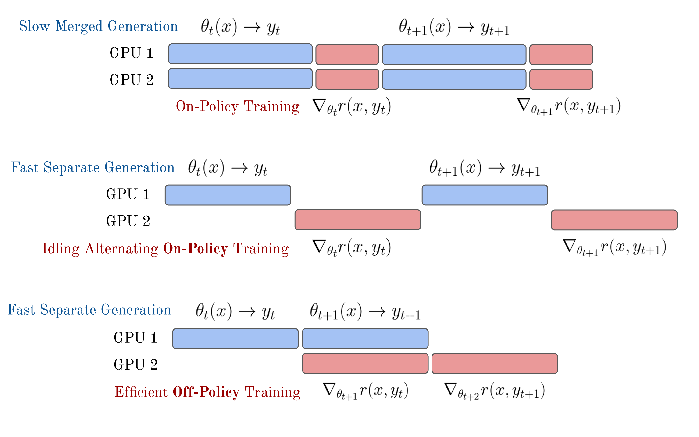

# Lec 4: RL Implementation and Practice

> Corresponding lecture: Lec 4 — RL Implementation & Practice · Chapter 6 Part 2 · Watch/PDF/Slides/Source at [rlhfbook.com/course](https://rlhfbook.com/course)

## From Math to Code

Lecture 3 built the mathematical foundation for policy-gradient methods: the policy-gradient theorem, REINFORCE, PPO, and GRPO. This lecture turns those equations into running code. The goal is not to derive new algorithms, but to understand how to implement, debug, and run reinforcement-learning (RL) training for large language models (LLMs).

The hardest bugs in RL training are rarely mistakes in the math. They are silent implementation errors: wrong token masking, stale log-probability caches, shape mismatches, or a reward scattered to the wrong position. Each of these can make training run without crashing while learning the wrong thing. This chapter walks through the core implementation patterns, the loss functions, the infrastructure choices, and the practical engineering details that separate a working RL run from a broken one.

A quick notation reminder: as in Chapter 6, we use $(s, a)$ when the RL framing is natural and $(x, y)$ when prompt-completion notation is clearer. The $(s, a)$ view reflects the token-level gradient computation; the $(x, y)$ view reflects the sequence-level reward. Both appear throughout the code.

## The Policy Gradient in Code

The policy-gradient objective is to maximize expected return:

$$
J(\\theta) = \\mathbb{E}\_{\\tau \\sim p\_\\theta}[R(\\tau)].
$$

Its gradient is

$$
\\nabla\_\\theta J(\\theta) = \\mathbb{E}\_{\\tau \\sim p\_\\theta}\\!\\left[\\sum\_{t=0}^{T} \\Psi\_t \\, \\nabla\_\\theta \\log \\pi\_\\theta(a\_t \\mid s\_t)\\right],
$$

where $\\Psi\_t$ is any quantity that scores how good the action was. In code, the gradient comes from summing log-probabilities and letting autodiff do the rest:

```python
seq_log_probs = (token_log_probs * completion_mask).sum(dim=-1)
loss = -(seq_log_probs * advantages).mean()
loss.backward()  # autodiff produces ∑ Ψ_t ∇ log π
```

Every loss in this lecture is a variation on this pattern: compute per-token log-probs, weight them by an advantage or return, mask out irrelevant positions, and aggregate to a scalar.

The family of losses we will implement looks like this:

$$
\\begin{aligned}
\\textbf{REINFORCE:}\\quad & -\\frac{1}{T}\\sum\_{t=1}^{T}\\log \\pi\_\\theta(a\_t\\mid s\_t)\\,\\big(G\_t - b(s\_t)\\big) \\\\[4pt]
\\textbf{RLOO:}\\quad & -\\frac{1}{K}\\sum\_{i=1}^{K}\\sum\_t \\log \\pi\_\\theta(a\_{i,t}\\mid s\_{i,t})\\left(R\_i-\\frac{1}{K-1}\\sum\_{j\\neq i}R\_j\\right) \\\\[4pt]
\\textbf{PPO:}\\quad & -\\frac{1}{T}\\sum\_{t=1}^{T}\\min\\!\\big(\\rho\_t A\_t,\\ \\mathrm{clip}(\\rho\_t,1-\\varepsilon,1+\\varepsilon)\\, A\_t\\big) \\\\[4pt]
\\textbf{GRPO:}\\quad & -\\frac{1}{G}\\sum\_{i=1}^{G}\\frac{1}{|a\_i|}\\sum\_{t=1}^{|a\_i|}\\min\\!\\big(\\rho\_{i,t} \\hat{A}\_i,\\ \\mathrm{clip}(\\rho\_{i,t},1-\\varepsilon,1+\\varepsilon)\\, \\hat{A}\_i\\big)
\\end{aligned}
$$

Here $\\rho\_t = \\frac{\\pi\_\\theta(a\_t \\mid s\_t)}{\\pi\_{\\theta\_\\text{old}}(a\_t \\mid s\_t)}$ is the importance-sampling ratio. PPO uses per-token advantages $A\_t$ from GAE; GRPO uses a sequence-level advantage $\\hat{A}\_i = \\frac{R\_i - \\mu}{\\sigma}$ computed over a group of completions.

### Computing Log-Probabilities

The fundamental building block is the per-token log-probability. A fully expanded implementation is:

```python
# Forward pass through the model
logits = model(input_ids).logits              # (B, L, vocab_size)

# Autoregressive shift: logit at position t predicts token at t+1
logits = logits[:, :-1, :]                    # (B, L-1, vocab_size)
labels = input_ids[:, 1:]                     # (B, L-1)
completion_mask = completion_mask[:, 1:]       # (B, L-1)

# Per-token log-probs
log_probs = logits.log_softmax(dim=-1)
token_log_probs = log_probs.gather(
    dim=-1, index=labels.unsqueeze(-1)
).squeeze(-1)                                 # (B, L-1)

# Per-sequence log-prob: sum over completion tokens
seq_log_probs = (token_log_probs * completion_mask).sum(dim=-1)
```

Everything stays in log-space to avoid numerical underflow from multiplying many small probabilities. In practice this is usually wrapped in a helper:

```python
def compute_log_probs(model, input_ids, attention_mask):
    logits = model(input_ids=input_ids,
                   attention_mask=attention_mask).logits
    logits = logits[:, :-1, :].to(torch.float32)
    log_probs = F.log_softmax(logits, dim=-1)
    targets = input_ids[:, 1:].unsqueeze(-1)
    return torch.gather(log_probs, dim=-1,
                        index=targets).squeeze(-1)
```

This returns log-probs for all positions; masking is applied later. At rollout time, call this for the old policy and the reference model and cache the results. During training, call it again for the current policy.

### REINFORCE in Code

The simplest policy-gradient loss uses a single baseline, usually the mean reward in the batch:

```python
# rewards: (B,) — one reward per sequence
# seq_log_probs: (B,) — sum of log-probs over completion tokens

baseline = rewards.mean()
advantages = rewards - baseline

# REINFORCE loss (negative because we minimize)
loss = -(advantages * seq_log_probs).mean()
```

Positive advantages increase the probability of the sampled completion; negative advantages decrease it. The `.mean()` here is one of many ways to reduce per-sequence losses to a scalar; the exact choice matters and is discussed in the loss-aggregation section below.

### RLOO in Code

REINFORCE Leave-One-Out (RLOO) generates $K$ completions per prompt and uses the average reward of the other $K-1$ completions as a baseline. This keeps the gradient estimator unbiased while reducing variance.

```python
# rlhf_reward: (B*K,) flat tensor of rewards
# Prompt-major layout: K sibling completions stay together
rlhf_reward = rlhf_reward.view(-1, rloo_k)  # (B, K)

# Leave-one-out baseline: avg of other K-1 rewards per prompt
baseline = (rlhf_reward.sum(dim=1, keepdim=True) - rlhf_reward) / (rloo_k - 1)

advantages = rlhf_reward - baseline        # (B, K)
advantages = advantages.reshape(-1)        # (B*K,)
```

The data loader must generate $K$ completions per prompt and keep them grouped. The rest of the training loop is standard policy gradient: multiply the advantages by the sequence log-probs and backpropagate.

## Proximal Policy Optimization (PPO)

PPO adds substantial complexity compared with REINFORCE and RLOO, but it also brings lower variance, token-level credit assignment, and the ability to reuse each rollout batch for multiple gradient steps. The cost is four models in memory, a fragile value-function initialization, and more hyperparameters.

The clipped surrogate objective, written as a loss, is

$$
L^{\\text{CLIP}}(\\theta) = -\\mathbb{E}\_t\\!\\left[\\min\\!\\Big(\\rho\_t A\_t,\\; \\text{clip}(\\rho\_t, 1-\\varepsilon, 1+\\varepsilon)\\, A\_t\\Big)\\right],
$$

with $\\rho\_t = \\frac{\\pi\_\\theta(a\_t \\mid s\_t)}{\\pi\_{\\theta\_\\text{old}}(a\_t \\mid s\_t)}$.

### From Scalar Reward to Per-Token Returns

A reward model gives one scalar $R(x, y)$ at the end of a completion. To feed it into GAE, we shape per-token rewards with a KL penalty:

$$
r\_t = \\begin{cases}
R(x, y) - \\beta \\, \\text{KL}\_t & \\text{if } t = T \\text{ (final token)} \\\\
-\\beta \\, \\text{KL}\_t & \\text{otherwise},
\\end{cases}
$$

where $\\text{KL}\_t = \\log \\pi\_\\theta(a\_t \\mid s\_t) - \\log \\pi\_\\text{ref}(a\_t \\mid s\_t)$. These per-token rewards are then consumed by GAE to produce per-token advantages.

### The PPO Training Loop

A full PPO iteration can be summarized as:

```text
for each batch:
  1. Sample prompts from dataset
  2. Generate completions with current policy π_θ
  3. Score with reward model → per-sequence rewards
  4. Compute ref model log-probs → per-token KL penalty
  5. Shape rewards: r_t = r_t - β * KL_t (per token)
  6. Compute returns via backward pass (GAE or MC)
  7. Compute advantages: A_t = returns_t - V(s_t)
  8. For k = 1 to K epochs on this batch:
     - Compute ratio = π_θ(a_t|s_t) / π_old(a_t|s_t)
     - Policy loss: clipped surrogate objective
     - Value loss: MSE on returns
     - total_loss = policy_loss + vf_coef * value_loss
     - Backward + optimizer step
  9. Sync π_old ← π_θ
```

At rollout time, the following tensors are computed once and frozen:

| Tensor | Shape | Used by |
|--------|-------|---------|
| Token IDs | `(B, L)` | All |
| Completion mask | `(B, L)` | All |
| Old log-probs $\\log \\pi\_{\\theta\_\\text{old}}$ | `(B, L)` | IS ratio |
| Old values $V\_{\\phi\_\\text{old}}$ | `(B, L)` | Critic clipping |
| Ref log-probs $\\log \\pi\_\\text{ref}$ | `(B, L)` | KL penalty |
| Rewards | `(B,)` or `(B, L)` | Advantage computation |

At each training step, only the new policy log-probs $\\log \\pi\_\\theta$ and the current value predictions $V\_\\phi$ are recomputed. The importance-sampling ratio uses one cached and one fresh quantity, which is what enables multiple epochs over the same rollout batch.

### Generalized Advantage Estimation (GAE)

GAE computes per-token advantages by propagating TD errors backward with exponential decay:

$$
\\hat{A}\_t^{\\text{GAE}} = \\sum\_{l=0}^{\\infty} (\\gamma \\lambda)^l \\delta\_{t+l}, \\qquad \\delta\_t = r\_t + \\gamma V(s\_{t+1}) - V(s\_t).
$$

In language-model RLHF, $\\gamma$ is usually 1.0 because the reward scores the entire completion rather than individual tokens. A common implementation is:

```python
# rewards: (B,) terminal only (KL shaping omitted), values_old: (B, L)
B, L = completion_mask.shape
advantages = torch.zeros_like(values_old)
next_v = torch.zeros(B, device=values_old.device)
gae = torch.zeros(B, device=values_old.device)

last_idx = completion_mask.long().cumsum(-1).argmax(-1, keepdim=True)
done_mask = (torch.arange(L, device=values_old.device).unsqueeze(0) >= last_idx).float()
rewards_t = torch.zeros_like(values_old).scatter_(-1, index=last_idx, src=rewards)

for t in reversed(range(L)):
    not_done = 1.0 - done_mask[:, t]
    delta = rewards_t[:, t] + gamma * not_done * next_v - values_old[:, t]
    gae = delta + gamma * lam * not_done * gae
    advantages[:, t] = gae
    next_v = values_old[:, t]

advantages = advantages * completion_mask
targets = (advantages + values_old).detach()
advantages = advantages.detach()
```

The `.detach()` on `targets` and `advantages` is critical: rollout-time values are treated as fixed targets, not as quantities to differentiate through.

### Policy Loss, Value Loss, and Combined Objective

The clipped policy loss in code is:

```python
# Compute probability ratio
ratio = torch.exp(new_per_token_logps - per_token_logps)  # (B, L)

# Clipped surrogate objective
eps = 0.2
pg_losses1 = -advantages * ratio
pg_losses2 = -advantages * torch.clamp(ratio, 1.0 - eps, 1.0 + eps)
pg_loss = torch.max(pg_losses1, pg_losses2)
```

`torch.max` selects the more pessimistic branch. Because we minimize a negative objective, this prevents over-committing to any single update.

The value function also has its own clipping:

```python
v_pred = value_net(completions)  # (B, L)
v_clip = torch.clamp(v_pred, old_values - eps, old_values + eps)
vf_unclipped = 0.5 * (v_pred - targets) ** 2
vf_clipped   = 0.5 * (v_clip - targets) ** 2
vf_loss = torch.max(vf_unclipped, vf_clipped)
```

The full per-token loss combines the two:

```python
per_token_loss = pg_loss + vf_coef * vf_loss  # (B, L)

loss = ((per_token_loss * completion_mask).sum(dim=1) /
         completion_mask.sum(dim=1)).mean()
```

### Multiple Epochs and Minibatches

PPO and GRPO optionally reuse each rollout batch for several gradient steps. Clipping activates whenever the current policy drifts from the rollout policy. Two mechanisms cause this:

- **Minibatching**: after the first minibatch is updated, the policy has already changed, so later minibatches in the same epoch see $\\rho\_t \\neq 1$. Clipping can activate even with $K=1$ epoch.
- **Multiple epochs**: looping over the full batch $K$ times lets the policy drift further. Typical $K$ is 2–4; beyond roughly 6 the policy is too far off-policy.

If $K=1$ and there is no minibatching, then $\\pi\_\\theta = \\pi\_{\\theta\_\\text{old}}$, the ratio is always 1, and clipping never activates. PPO then reduces to vanilla policy gradient with GAE.

### Advantage Whitening and Value Initialization

Advantages are usually normalized to zero mean and unit variance within the batch:

```python
valid_adv = advantages[completion_mask.bool()]
advantages = ((advantages - valid_adv.mean()) /
              (valid_adv.std() + 1e-8)) * completion_mask
```

This stabilizes gradient magnitudes across batches. Without whitening, a batch where all rewards are uniformly high or low can produce outsized gradients.

The value function $V\_\\phi$ must start with reasonable estimates. Common choices are:

- Initialize from the reward-model backbone (the InstructGPT convention, also used by Tülu 3 in Lambert et al. 2024). Value predictions start near actual rewards.
- Initialize from the supervised-fine-tuning (SFT) model with a randomly initialized value head. This is cheaper but can make early training unstable.
- Run a short value-function warmup on data with measured rewards before taking policy steps.

### PPO Hyperparameters and Batch Size

Illustrative ranges from common LLM RLHF setups are:

| Hyperparameter | Typical range | Notes |
|----------------|:-------------:|-------|
| Clip $\\varepsilon$ | 0.1–0.2 | Trust-region width |
| GAE $\\lambda$ | 0.95 | Bias-variance tradeoff |
| Value coefficient | 0.5–1.0 | Weight of critic loss |
| KL coefficient $\\beta$ | 0.01–0.1 | Strength of reference constraint |
| Epochs per batch $K$ | 2–6 | Off-policy budget |
| Learning rate | $1 \\times 10^{-6}$ to $5 \\times 10^{-6}$ | Much lower than SFT |
| Batch size | 256–1024 prompts | Larger = lower variance |

Batch size matters more in RL than in supervised learning because gradients come from Monte Carlo rollouts. McCandlish et al. 2018 showed that critical batch sizes in large RL runs can reach millions of transitions; Hilton et al. 2021 showed that PPO is not batch-size-invariant because clipping couples batch size to effective step size; Beukman et al. 2026 argued that PPO plateaus are often caused by noisy loss estimates that only resolve with more samples. In RLHF, increasing the batch size is one of the cheapest ways to stabilize training.

### PPO Debugging Checklist

During training, watch:

- **Clip fraction**: percentage of tokens clipped. 0% means clipping never activates; above 50% means the policy is changing too fast.
- **Advantage statistics**: mean near 0 (if whitened), standard deviation stable.
- **Value loss**: should decrease; if not, the value function is not learning.
- **KL divergence**: should increase gradually, not explode.

Common silent bugs include:

- Prompt tokens included in the policy loss.
- Reward scattered to the wrong position (for example, `[:, -1]` instead of the actual last generated token).
- Stale log-probs used as "current," causing ratios to stay near 1 and clipping to remain inactive.
- Zero-standard-deviation GRPO groups, where every completion gets the same reward and advantages become NaN.
- Value or policy loss computed outside the completion mask, training on padding.

For a 7B model in fp16, the four models in memory — policy, value function, reference policy, and reward model — consume roughly 56 GB of weights alone, before optimizer states, activations, or gradients. This is why PPO often requires model parallelism or offloading, and why some implementations share backbones.

## Group Relative Policy Optimization (GRPO) and Friends

GRPO, introduced in DeepSeekMath (Shao et al. 2024), removes the value function entirely. For each prompt, it samples $G$ completions and computes group-normalized advantages:

$$
\\hat{A}\_i = \\frac{R\_i - \\mu\_G}{\\sigma\_G}, \\qquad \\mu\_G = \\frac{1}{G}\\sum\_{j=1}^{G} R\_j, \\quad \\sigma\_G = \\sqrt{\\frac{1}{G}\\sum\_{j=1}^{G}(R\_j - \\mu\_G)^2}.
$$

The loss uses the same clipped surrogate as PPO, but with a sequence-level advantage broadcast to every token, plus an optional KL penalty:

$$
L^{\\text{GRPO}}(\\theta) = -\\frac{1}{G}\\sum\_{i=1}^{G}\\frac{1}{|a\_i|}\\sum\_{t=1}^{|a\_i|}\\min\\!\\Big(\\rho\_{i,t} \\hat{A}\_i,\\; \\text{clip}(\\rho\_{i,t}, 1-\\varepsilon, 1+\\varepsilon)\\, \\hat{A}\_i\\Big) + \\beta \\, \\text{KL}(\\pi\_\\theta \\| \\pi\_\\text{ref}).
$$

No value function, no GAE — advantages come entirely from comparing siblings within a group.

### GRPO in Code

```python
# Generate G completions per prompt, then compute group advantages
mean_r = rewards.view(-1, G).mean(dim=1)
std_r = rewards.view(-1, G).std(dim=1)
mean_r = mean_r.repeat_interleave(G)
std_r = std_r.repeat_interleave(G)
advantages = ((rewards - mean_r) / (std_r + 1e-4)).unsqueeze(1)

# Importance sampling ratio
ratio = torch.exp(new_logps - old_logps)   # (B*G, L)

# Clipped surrogate (same as PPO)
pg_losses1 = -advantages * ratio
pg_losses2 = -advantages * torch.clamp(ratio, 1 - eps, 1 + eps)
pg_loss = torch.max(pg_losses1, pg_losses2)

# KL penalty in loss (not in reward)
per_token_loss = pg_loss + beta * per_token_kl

loss = ((per_token_loss * mask).sum(dim=1) / mask.sum(dim=1)).mean()
```

### KL Penalty Placement

PPO folds the KL penalty into the reward before advantage estimation:

```python
rewards.scatter_(1, last_idx, rm_score)
rewards = rewards - beta * per_token_kl
advantages = gae(rewards, values, ...)
```

GRPO computes advantages from raw rewards and adds KL as a separate loss term:

```python
advantages = z_score(rewards)
loss = pg_loss + beta * per_token_kl
```

This avoids interaction between the KL penalty and advantage estimation.

### GRPO vs PPO

| Component | PPO | GRPO |
|-----------|:---:|:----:|
| Value network | Required | None |
| GAE computation | Required | None |
| Critic loss | Required | None |
| Value function init | Required | None |
| Advantage computation | Per-token (GAE) | Per-sequence (z-score) |
| KL handling | Fold into reward | Separate loss term |

GRPO is significantly less code and keeps roughly one fewer model copy in memory.

### RLOO vs GRPO Advantages

RLOO and GRPO share the same grouped-completion structure; they differ only in the baseline:

```python
# RLOO: leave-one-out mean
rewards = rewards.view(-1, K)         # (N, K)
baseline = (rewards.sum(dim=1, keepdim=True) - rewards) / (K - 1)
advantages = rewards - baseline
advantages = advantages.reshape(-1)
```

```python
# GRPO: group z-score normalization
rewards = rewards.view(-1, G)       # (N, G)
mean_r = rewards.mean(dim=1, keepdim=True)
std_r = rewards.std(dim=1, keepdim=True)
advantages = (rewards - mean_r) / (std_r + 1e-4)
advantages = advantages.reshape(-1)
```

GRPO adds standard-deviation normalization; RLOO uses the leave-one-out mean.

### GSPO and CISPO

Two recent variants address numerical instability in importance sampling.

**GSPO** (Group Sequence Policy Optimization; Zheng et al. 2025) collapses per-token ratios into one geometric-mean ratio per sequence:

$$
\\bar{\\rho}\_i = \\exp\\!\\Big(\\frac{1}{|a\_i|}\\sum\_t \\log \\rho\_{i,t}\\Big).
$$

```python
log_ratio = (new_logps - old_logps) * mask
rho = torch.exp(log_ratio.sum(dim=1) / mask.sum(dim=1))  # (B*G,)
rho_clipped = rho.clamp(1 - eps, 1 + eps)
loss = -torch.min(rho * advantages, rho_clipped * advantages).mean()
```

**CISPO** (Clipped Importance Sampling Policy Optimization; MiniMax Team 2025) detaches the clipped ratio so gradients flow only through $\\log \\pi\_\\theta$:

$$
\\text{sg}\\!\\big[\\text{clip}(\\rho, 1\\!-\\!\\varepsilon, 1\\!+\\!\\varepsilon)\\big] \\cdot \\hat{A} \\cdot \\log \\pi\_\\theta.
$$

```python
rho = torch.exp(new_logps - old_logps)
rho_clipped = torch.clamp(rho, 1 - eps, 1 + eps).detach()
loss = -(rho_clipped * advantages.unsqueeze(1) * new_logps * mask).sum() / mask.sum()
```

GSPO changes the granularity of the ratio; CISPO changes which part of the expression receives gradients.

## Loss Aggregation Strategies

Every algorithm above computes the same core gradient, $\\nabla \\log \\pi \\cdot A$. But how per-token losses are aggregated into a scalar changes training dynamics more than you might expect.

### Bandit-Style vs MDP-Style RLHF

**Bandit-style** methods assign one reward per completion and broadcast a sequence-level advantage across all tokens. REINFORCE, RLOO, and GRPO use this by default.

**MDP-style** methods treat each token as an action and compute per-token advantages or values. PPO with GAE uses this by default.

Most RLHF is mixed in practice: sequence-level rewards but token-level log-prob gradients. PPO-style RLHF usually starts from a sequence-level reward-model score and then derives token-level credit via KL shaping and GAE.

### Three Aggregation Strategies

Given per-token losses $\\ell\_{i,t}$, completion lengths $|a\_i|$, and batch size $B$, the three main strategies are:

**Per-sequence normalization** — each sequence contributes equally:

$$
L = \\frac{1}{B}\\sum\_{i=1}^{B} \\frac{1}{|a\_i|}\\sum\_{t=1}^{|a\_i|} \\ell\_{i,t}.
$$

```python
loss = ((per_token_loss * completion_mask).sum(dim=1) /
         completion_mask.sum(dim=1)).mean()
```

This is standard in GRPO and some PPO implementations. It makes per-token gradients inversely proportional to sequence length, which can bias the model away from long responses.

**Per-token normalization** — each token contributes equally across the whole batch:

$$
L = \\frac{\\sum\_{i=1}^{B} \\sum\_{t=1}^{|a\_i|} \\ell\_{i,t}}{\\sum\_{i=1}^{B} |a\_i|}.
$$

```python
loss = (per_token_loss * completion_mask).sum() / completion_mask.sum()
```

Used in DAPO (Yu et al. 2025). Longer sequences contribute proportionally more gradient, which can encourage verbose completions.

**Fixed-length normalization** — normalize by a constant $L\_\\text{max}$:

$$
L = \\frac{1}{B}\\sum\_{i=1}^{B} \\frac{1}{L\_\\text{max}}\\sum\_{t=1}^{|a\_i|} \\ell\_{i,t}.
$$

```python
loss = ((per_token_loss * completion_mask).sum(dim=1) /
         L_max).mean()
```

From Dr. GRPO (Liu et al. 2025). This equalizes per-token scale while still letting longer sequences contribute more total gradient because they contain more active tokens.

### A Concrete Example

```python
seq_1_losses = [1, 1, 1, 1, 10]           # 5 tokens, mean = 2.8
seq_2_losses = [1, 1, 1, 1, 1, 1, 1, 1, 1, 10]  # 10 tokens, mean = 1.9
```

| Strategy | Batch loss | Short seq gradient | Long seq gradient |
|----------|:----------:|:------------------:|:-----------------:|
| **Per-sequence** | $(2.8 + 1.9)/2 = 2.35$ | 0.20 per token | 0.10 per token |
| **Per-token** | $(14 + 19)/15 = 2.2$ | 0.067 per token | 0.067 per token |
| **Fixed-length** ($L=10$) | $(1.4 + 1.9)/2 = 1.65$ | 0.10 per token | 0.10 per token |

Per-sequence normalization gives short sequences larger per-token gradients. Per-token and fixed-length normalization equalize them. The right choice depends on whether you want to encourage or discourage long completions for your task.

## Training Infrastructure

### On-Policy vs Off-Policy

The theoretical ideal is fully on-policy: generate completions, update the policy, generate new completions from the updated policy, and repeat. Each batch is scored and used for a short update window, then discarded.

In practice, generation and training overlap on different GPU groups for better throughput. The model used for generation may be one to several gradient steps behind the training model. Slight staleness is usually fine, and most modern systems accept this small off-policy drift.

### Synchronous vs Asynchronous Training



Modern RL for LLMs splits compute into two groups:

- **Actors** (inference GPUs): generate completions with vLLM or a similar engine.
- **Learners** (training GPUs): compute policy-gradient updates.

A process-management library such as Ray coordinates data flow between them, and model weights are synced periodically from learner to actor.


Noukhovitch et al. 2024 studied the tradeoffs in asynchronous RLHF. The core tension is simple: perfect on-policy training leaves GPUs idle, while fully asynchronous training introduces more off-policy drift. In reasoning-style training, where a single answer may require tens of thousands of tokens, generation is such a strong bottleneck that overlapping it with training becomes essential.

### Open-Source Codebases

Several open-source implementations are useful starting points:

- **TRL** (von Werra et al. 2020): Hugging Face ecosystem, PPO/GRPO/DPO. Good starting point.
- **Open Instruct** (Ivison et al. 2024): Allen AI, multi-algorithm. Good for research and reproduction.
- **veRL**: widely used in the RLVR era.
- **OpenRLHF**: started for RLHF, also popular for RLVR.

## Practical Engineering

### Numerical Considerations

A handful of numerical details determine whether RL training is stable:

- **Log-space arithmetic**: always use `log_softmax` + `gather`, never `softmax` then `log`. Softmax squashes small probabilities to tiny floats, and `log` amplifies the precision loss.
- **Masking padding tokens**: `completion_mask` must be 1 only for completion tokens, excluding prompt tokens, post-EOS padding, and the EOS token itself (or include EOS consistently). Multiply losses by this mask before aggregation.
- **Stop-token handling**: EOS tokens need consistent treatment. Mishandling is a common silent error.
- **Sequence length handling**: variable-length completions need careful normalization.
- **Detaching baselines**: `advantages.detach()` prevents backpropagating through the advantage computation.
- **Division guards**: anywhere you divide by `mask.sum()` or sequence lengths, use `.clamp_min(1)` or `+ eps` to avoid NaN from empty completions.

### What to Monitor During Training

Illustrative thresholds, which vary by model size, task, and algorithm:

| W&B panel | Healthy | Unhealthy |
|-----------|---------|-----------|
| `reward/mean` | Steady upward trend | Spikes, oscillation, plateau |
| `kl/mean` | Gradual increase (0 → 2–5) | Explosion (>10) or flat at 0 |
| `loss/policy` | Decreasing | Diverging or NaN |
| `metrics/clip_frac` | 5–30% | 0% or >50% |
| `generation/length` | Stable or slight increase | Monotonic increase (length hack) |
| Policy entropy | Slow decrease | Crashes to 0 (mode collapse) |

Also monitor eval scores on held-out benchmarks and read sample outputs for coherence. Reward curves alone are not enough.

## A Forward Pointer: Regularization and Over-Optimization

When RL runs go wrong, it is often because the optimizer latches onto spurious signals rather than the intended reward. These topics are covered in later lectures on Chapters 14 and 15:

- KL penalties: forward vs reverse KL, math and code.
- Goodhart's Law: when the proxy objective diverges from true quality.
- Reward hacking: sycophancy, verbosity, over-refusal.
- Implicit regularization: "SFT Memorizes, RL Generalizes" and "RL's Razor."

## Key Takeaways

- The policy gradient reduces in code to computing per-token log-probs, weighting them by an advantage, masking to completion tokens, and aggregating to a scalar loss.
- REINFORCE and RLOO are simple bandit-style methods: one sequence-level advantage broadcast to all tokens. RLOO reduces variance with a leave-one-out per-prompt baseline.
- PPO adds a learned value function, GAE for per-token advantages, and a clipped surrogate objective that enables multiple gradient steps per rollout batch. It is powerful but memory-hungry and sensitive to value-function initialization.
- GRPO removes the value function and computes advantages from group-normalized rewards. It is simpler, uses less memory, and has become the default for many reasoning tasks.
- GSPO and CISPO are recent variants that address importance-sampling instability: GSPO aggregates ratios to the sequence level, while CISPO detaches the clipped ratio to keep gradients on all tokens.
- Loss aggregation — per-sequence, per-token, or fixed-length — changes the effective per-token gradient scale and can bias the model toward shorter or longer completions.
- Modern training is asynchronous: actors generate completions on inference GPUs while learners update the policy on training GPUs, accepting a small amount of off-policy staleness for much higher throughput.
- Stable RL training depends on careful masking, log-space arithmetic, detached baselines, division guards, and disciplined monitoring of rewards, KL, clip fraction, and generation length.
