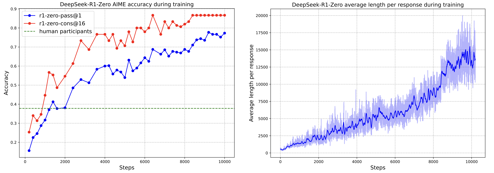
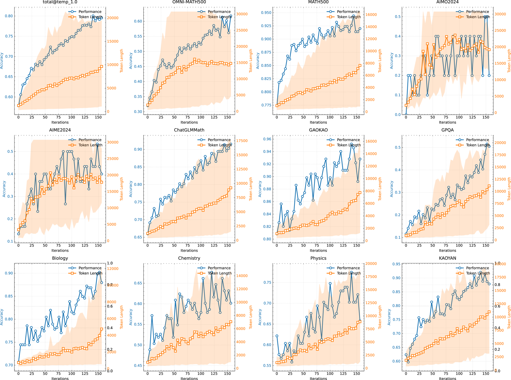
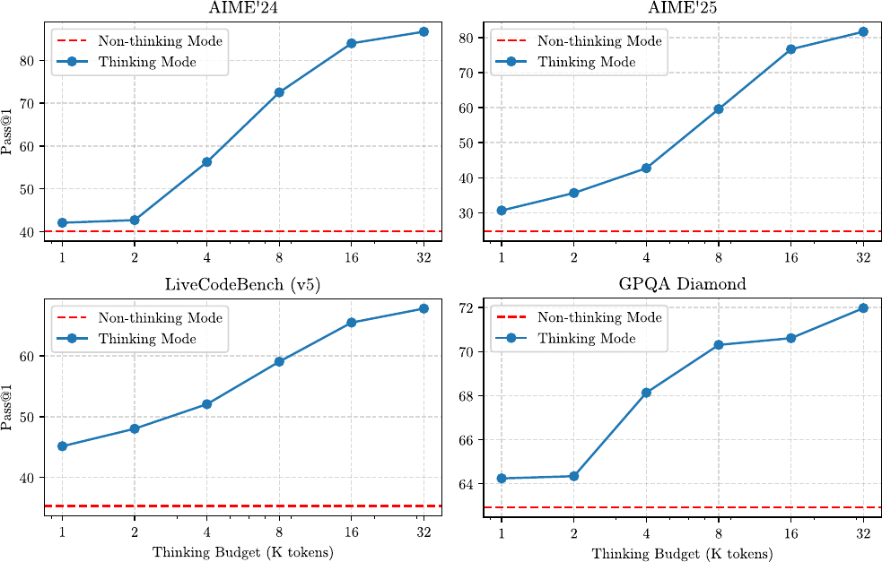
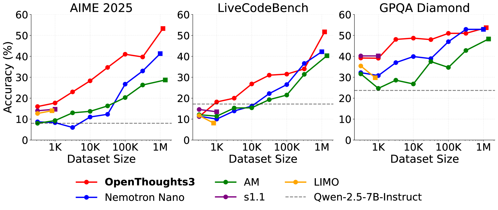
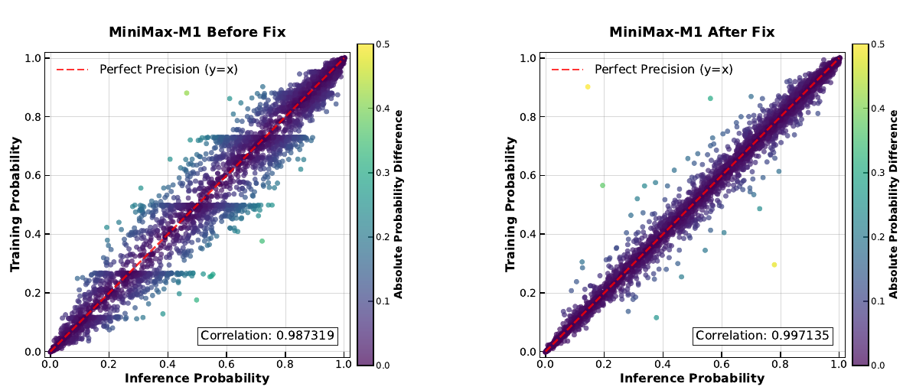
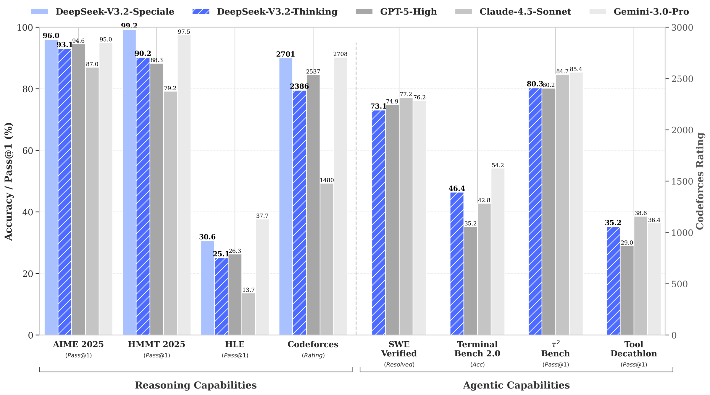

# Lec 5: The Rise of Reasoning Models

> Corresponding lecture: Lec 5 — The Rise of Reasoning Models · Chapter 7 · Watch/PDF/Slides/Source at [rlhfbook.com/course](https://rlhfbook.com/course)

Reasoning models and inference-time scaling produced one of the largest single jumps in language-model capability at the end of 2024 and through 2025. The idea is simple: allow the model to spend more computation at inference time, usually by emitting a long chain of thought before the final answer, and train it with reinforcement learning to make that extra computation useful. The training recipe is not fundamentally different from the RLHF pipeline covered in earlier lectures—PPO, GRPO, reward models, KL regularization, and rejection sampling all appear—but the reward source changes from learned human preferences to verifiable correctness signals. That change, called Reinforcement Learning with Verifiable Rewards (RLVR), turned post-training into a scaling law in its own right and kicked off an industry-wide race to build "thinking" models.

This chapter surveys that transition. We start with the distinction between RLHF and RLVR, then review the seminal models of the 2025 reasoning wave, the implementation tricks that made them work, and the open questions that will define the next phase.

## From RLHF to RLVR

At NeurIPS 2016, Yann LeCun introduced a now-famous metaphor: if intelligence is a cake, the bulk of the cake is unsupervised or self-supervised learning, the icing is supervised learning, and the cherry on top is reinforcement learning (LeCun, quoted in Synced 2019). With modern language models the analogy is almost complete. Self-supervised pretraining on internet-scale text is the cake. Supervised fine-tuning for instruction following is the icing. And the final RL stage—first RLHF, then RLVR—is the cherry. The only caveat is that, in the agentic systems now emerging, the RL cherry may consume far more compute than the metaphor suggests, even if the shape of the training loop stays the same.

RLHF and RLVR differ primarily in how the reward is obtained. In RLHF a learned reward model scores subjective qualities: helpfulness, clarity, style, and safety. In RLVR a verifier checks whether the answer is correct.

Consider the contrast. For an RLHF prompt such as

> Explain opportunity cost in economics.

scoring requires judging clarity, accuracy, completeness, and tone. There is no single correct completion. A reward model trained on human preferences is the natural tool.

For an RLVR prompt such as

> What is the sum of all prime numbers less than 20?

a simple rule decides success:

```
extracted_answer == 77 → Reward = 1
```

Or, for code:

> Write a Python function `fib(n)` returning the nth Fibonacci number.

```python
assert fib(10) == 55
```

If all tests pass, reward is 1; otherwise it is 0. The post-training algorithms are the same; what changes is the reward function and the set of intuitions that follow from it.

RLVR opened the door to reasoning models. Because correctness can be checked automatically, the model can be trained for thousands of gradient steps on the same pool of problems, revisiting questions again and again. Each revisit gives a fresh sample of reasoning traces, and the RL objective increases the probability of traces that end in correct answers. The clean RLHF/RLVR distinction is pedagogical—frontier systems now mix subjective rewards, rubrics, tool outputs, and verifiable scores—but the verifiable core is what made the 2025 reasoning explosion possible.

## The RLVR feedback loop

The RLVR loop is structurally identical to RLHF. A prompt is sampled, the policy generates a completion, a reward is computed, and the policy is updated. The only difference is that the reward model is replaced by a verification function.


For math problems the verifier often extracts the final answer from a `\boxed{}` expression or from a special `<answer>` token. For code the verifier executes unit tests. For instruction-following tasks it may check structured outputs against a specification. The reward is typically binary: correct or incorrect. Some systems use partial credit proportional to the number of tests passed, but the dominant recipe is a sparse 0/1 signal at the end of the completion.

Because the reward is sparse and terminal, advantage estimation is simple. GRPO, for example, samples $G$ completions for each prompt, computes the mean and standard deviation of their 0/1 rewards, and uses a z-scored advantage for each token in each completion. The group of rollouts provides its own baseline, so no learned value function is needed.

### Outcome rewards versus process rewards

The dominant RLVR signal is an **outcome reward**: a single 0/1 score at the end of the completion. Outcome rewards are cheap to compute and hard to game at the level of individual problems, but they give no credit for partial progress and can make long trajectories feel like a random walk.

An alternative is a **process reward model (PRM)**, which scores each step of a reasoning trace. The idea was popularized by "Let's verify step by step" (Lightman et al. 2024): instead of judging only the final answer, a model is trained to label whether each intermediate step is correct. PRMs can improve credit assignment and make training more sample-efficient, but they are expensive to build because they require step-level labels, and they can themselves be gamed if the policy learns to produce steps that look good to the PRM rather than steps that lead to the right answer. As of 2025, outcome-reward RLVR remained the workhorse of open reasoning recipes, while PRMs were used more often at test time for reranking or as research probes.

## RL training versus inference-time scaling

Two kinds of scaling drive reasoning models.

**Train-time scaling** means spending more compute during RL training. More gradient steps, more rollouts, and more carefully curated problems all improve the policy. OpenAI's o1 demonstrated this scaling law: as RL training compute grows, performance on hard math and coding benchmarks improves (OpenAI 2024).


**Test-time scaling** means spending more compute during generation. The model produces a longer reasoning chain, explores multiple strategies, or samples many answers and aggregates them. OpenAI's o1 also showed that, for a fixed trained policy, allowing more thinking tokens at inference time improves accuracy (OpenAI 2024).


The two are deeply coupled. RL training teaches the model how to use a long reasoning budget; the long reasoning budget gives RL a richer behavior space to reinforce. This is different from earlier length biases in RLHF, where human preference training sometimes increased response length for marginal gains (Singhal et al. 2023). In reasoning models, longer thinking is correlated with better answers because the model has learned to allocate computation to hard subproblems.

## What thinking tokens look like

A standard model answers directly. Asked

> What is the sum of all prime numbers less than 20?

it might respond:

> The primes less than 20 are 2, 3, 5, 7, 11, 13, 17, and 19. Their sum is 77.

A reasoning model first emits a `<think>` block:

> `<think>` I need to find all primes less than 20. Starting from 2: 2 is prime. 3 is prime. 4 = 2×2, not prime. 5 is prime... Let me add them up: 2+3=5, 5+5=10, 10+7=17, 17+11=28, 28+13=41, 41+17=58, 58+19=77. `</think>`
>
> The answer is $\\boxed{77}$.

For easy problems this looks wasteful. For hard competition-math problems or multi-step coding tasks, the thinking stage can run to thousands of tokens. The `<think>` tokens are not shown to the user in most products, but they are part of the model's generation and consume context length, inference compute, and training memory.

## Key evaluation metrics and algorithms

Two metrics dominate reasoning evaluation.

**pass@1** is the accuracy on a single sample per problem. It measures whether the model gets the answer right on the first try.

**pass@K** generates $K$ independent completions and reports whether any is correct. It measures coverage or the upper bound available from sampling. If $n$ attempts contain $c$ correct answers, the unbiased estimator is

$$
\\widehat{\\mathrm{pass@}k}=1-\\frac{\\binom{n-c}{k}}{\\binom{n}{k}}.
$$

Two algorithmic terms appear frequently in the 2025 reasoning literature.

**DAPO** (Dynamic Advantage Policy Optimization), introduced by Yu et al. 2025, is a relaxed-clipping variant of GRPO. It widens the upper clip bound so that promising exploratory updates are not cut off.

**CISPO** (Clipped Importance Sampling Policy Optimization), introduced by MiniMax in MiniMax-M1 (MiniMax 2025), clips importance-sampling weights rather than per-token policy ratios. It uses a stop-gradient on the clipped weight so every token still receives a signal, but the magnitude of the update is bounded.

## The reasoning model Cambrian explosion

The key ideas behind RLVR were explored before o1 and R1 made them mainstream. STaR (Zelikman et al. 2022) and Quiet-STaR (Zelikman et al. 2024) used ground-truth rewards to bootstrap chain-of-thought reasoning: sample many rationales, keep the ones that lead to correct answers, and fine-tune on them. TRICE (Hoffman et al. 2023) optimized reasoning traces with a Markov-chain Monte Carlo inspired expectation-maximization procedure. VinePPO (Kazemnejad et al. 2024) used PPO with binary math rewards on GSM8K and MATH, relying on many rollouts and Monte Carlo credit assignment. Tülu 3 (Lambert et al. 2024) showed that PPO for math correctness could be applied without destroying broad capabilities.

These works established the pieces. The 2025 models scaled the pieces up and simplified the recipe.

### Why does RL work now?

Three factors converged.

**Stability is more tractable.** RL is still brittle—entropy collapse, loss spikes, and long-horizon credit assignment remain first-class research problems—but tooling and recipes matured enough for widespread adoption. Frameworks such as TRL (von Werra et al. 2020), Open Instruct (Lambert et al. 2024), veRL (Sheng et al. 2025), and OpenRLHF (Hu et al. 2024) lowered the barrier to entry.

**Base models are good enough.** Multiple sources suggest that RL reasoning training only became viable with leading models released from roughly 2024 onward. A capability floor was needed before the model could benefit from thousands of gradient steps on hard problems.

**Verifiable domains give clean signal.** Math and code provide unambiguous rewards. The policy either passes the unit test or it does not. This avoids many of the reward-hacking problems that plague RLHF, where the learned reward model can be gamed. That said, verifiable rewards are not immune to manipulation. Recent work such as "LLMs Gaming Verifiers" (Helff et al. 2026) showed that RLVR can still lead to reward hacking when the verification function has exploitable structure, for example by producing answers that match the verifier's expected format without being mathematically correct. The arms race between verification and exploitation continues.

### DeepSeek R1 (January 20, 2025): the catalyst

DeepSeek R1 (Guo et al. 2025) was a surprisingly fast open replication of OpenAI's o1. Its importance comes from three things.

**R1-Zero** showed that pure RL on a base model, with no supervised fine-tuning warm-start, could induce chain-of-thought reasoning at scale. The training reward curve shows reasoning behaviors emerging spontaneously as RL continues.



**The full R1 recipe** is cold-start SFT, large-scale RL, and distillation of smaller models. The cold start stabilizes the early training distribution; the large-scale RL improves reasoning; the distillation transfers the behavior to smaller, faster models.

**The open release** made the recipe legible to the rest of the industry. Although R1's training data was not released, the technical report gave enough detail that open replications followed within weeks.

### Kimi 1.5 (January 20, 2025): scaling the curriculum

Kimi 1.5 landed the same week as R1 and emphasized RL scale plus curriculum (Kimi Team 2025). The report described PPO/GRPO-style RL on Chinese and English reasoning data, difficulty scheduling and online filtering to keep gradients useful, and progressive length extension to combat overthinking while enabling long chain-of-thought. Kimi 1.5 was not released as open weights, but its training-dynamics plots were widely cited as evidence that accuracy and response length grow together during RL.



### Open-Reasoner-Zero (February 18, 2025): the minimalist replication

Open-Reasoner-Zero (Hu et al. 2025) was the first public dataset and code release for an R1-style base-model RL run. It used vanilla PPO with GAE ($\\lambda=1$, $\\gamma=1$), simple rule-based rewards, and no KL penalty. An expansion in March added easier scripts and 129k curated problems. The work was important because it proved that the R1-Zero result could be reproduced without proprietary infrastructure.


### Qwen 3 (April 29, 2025): hybrid reasoners

Qwen 3 (Yang et al. 2025) became a new open-weight standard. Its defining feature is toggleable thinking: `/think` and `/no_think` modes let users switch reasoning on and off. Training such hybrid models turned out to be difficult—most labs reported it as a headache—but the release set expectations for future open models. Qwen 3 also introduced thinking-budget length controls and, for the smaller variants, strong-to-weak distillation using off-policy outputs followed by on-policy teacher-logit matching. Llama-Nemotron (Bercovich et al. 2025) is another toggleable open-weights reasoner with released post-training data and codebases, though it followed a different recipe.



### MiMo (April 30, 2025): end-to-end reasoning pipeline

Xiaomi's MiMo (Xia et al. 2025) reported the entire pipeline from pretraining through post-training. The reasoning-oriented tweaks began in pretraining: three-stage data mixing over 25T tokens and multi-token prediction (MTP) during pretraining. Post-training used multi-domain RL to prevent over-optimization on a single task type. MiMo was also notable for releasing clear intermediate checkpoints within post-training, letting outsiders study how the model evolved.


### OpenThoughts 3 (June 5, 2025): SFT data recipes still matter

OpenThoughts 3 (Guha et al. 2025) showed that open reasoning data and careful distillation still matter. It released 1.2M public examples across math, code, and science, distilled from QwQ-32B traces, and documented over 1,000 controlled data-pipeline experiments. OpenThinker3-7B reached strong reasoning performance with supervised fine-tuning alone. The work underlined that the community needs more investment in high-quality, open reasoning traces and in understanding what makes a good teacher trace.



### MiniMax-M1 (June 16, 2025): a fun RL paper

MiniMax-M1 (MiniMax 2025) contributed two lasting ideas. First, CISPO clipped importance-sampling weights instead of dropping high-update tokens, an algorithmic choice that has persisted in later work. Second, the paper introduced the now-famous FP32 LM-head inference-training mismatch plot: running the language-modeling head in low precision during training makes per-token probabilities diverge from those computed during inference, which destabilizes RL. Upcasting just the LM head to FP32 realigns the two distributions.



### GLM-4.5 (July 28, 2025): reasoning broadens into agentic work

GLM-4.5 (GLM-4.5 Team 2025) was one of the early reports to foreground agentic behaviors. It is a 355B-parameter mixture-of-experts model with 32B active parameters, supports thinking and direct-response modes, and was post-trained with expert-model iteration plus RL for agent, reasoning, and general chat skills.


### Olmo 3 Think (November 20, 2025): the fully open reasoning model

Olmo 3 Think (Team Olmo 2025) represents the most comprehensive open documentation of a reasoning model lifecycle. The release includes stages, checkpoints, data, infrastructure details, and hyperparameters. The accompanying report also contains interesting DPO findings and ablations. For researchers who want to study how a reasoning model is built rather than just use the final artifact, Olmo 3 is the current reference.


### DeepSeek V3.2 (December 1, 2025): reasoning becomes agentic

DeepSeek V3.2 (DeepSeek-AI 2025) pushed the R1 recipe into tool-use and agent environments. It is an open-weight MoE successor to V3.2-Exp, integrates thinking directly into tool use rather than treating reasoning as a separate mode, and includes a Speciale variant targeting maximum reasoning performance.



### Nemotron 3 Nano (December 15, 2025): efficient agentic reasoning

Nemotron 3 Nano (NVIDIA 2025) is another very open release, with 31.6B total parameters and roughly 3.2B active per forward pass. It uses a hybrid Mamba-Transformer MoE architecture and was post-trained with SFT, multi-environment RLVR, and RLHF. The release fed into stronger American open-weight models in 2026.


### MiMo-V2-Flash (December 16, 2025): distilling many teachers into one

MiMo-V2-Flash (LLM-Core Xiaomi 2025) introduced Multi-Teacher On-Policy Distillation (MOPD). The recipe trains a specialist teacher per domain—math, code, search, and reasoning—and then distills them into a single student. The student learns from dense, token-level rewards rather than sequence-level outcome rewards, which is more sample-efficient and lets the student match its strongest teacher in every domain. The underlying model is a 309B/15B MoE built for fast rollouts, but the post-training recipe is the main story.


### Recent open models

By early 2026 the frontier had shifted from pure reasoning models to long-horizon, tool-using agent substrates. American releases included NVIDIA Nemotron 3 Super (March 2026), a 120B/12B MoE with LatentMoE, MTP, and native NVFP4 pretraining, released with checkpoints, training data, and recipes; and Arcee Trinity-Large-Thinking (April 2026), a frontier reasoning model tuned for long-horizon multi-turn tool use with Apache 2.0 weights.

Chinese releases moved just as quickly. Kimi K2.5 (January 2026) and K2.6 (April 2026) emphasized native multimodality and agent swarms, then stronger long-horizon coding. GLM-5 (February 2026) and GLM-5.1 (April 2026) focused on agentic engineering and longer autonomous runs. DeepSeek V4 Preview (April 2026) offered open Pro and Flash models with dual reasoning modes, efficient architecture innovations, and 1M-token context.

The landscape tells us several things. First, the basics of RLVR were replicated in open-source codebases and data within months. Second, the shift to agentic models followed very quickly from math and code reasoning. Third, substantial model-layer innovation went into making long-context inference more efficient, especially from Chinese labs. Fourth, lasting fundamentals—FP32 LM heads, CISPO-style losses, batch-level advantage normalization—emerged quickly but took meaningful tinkering to converge.

## Common implementation patterns

The 2025 reasoning reports share a surprisingly consistent set of recipe decisions. The following list is a snapshot of documented practice, not a claim about the optimal recipe.

### Offline difficulty filtering

A model can only learn from problems where its current policy sometimes succeeds and sometimes fails. If the policy solves a problem 0% or 100% of the time, the gradient between different completions is zero. Many projects therefore pre-sample $N$ completions per training prompt—often $N=16$—and keep only those prompts with a 20-80% pass rate. This was used by Seed-Thinking 1.5, Open-Reasoner-Zero, Phi-4 Reasoning, INTELLECT-2, MiMo, Skywork OR-1, and Olmo 3.

### Online filtering and curriculum

Even after filtering, not every problem is useful at every stage of training. Online filtering skips prompts that have become too easy or too hard, and curriculum schedulers save harder problems for later. This was used by Kimi 1.5, Magistral, Llama-Nemotron, INTELLECT-2, and MiMo.

### Zero-gradient filtering and active sampling

If all $G$ completions for a prompt pass or all fail, the group advantage is zero and the prompt contributes nothing to the gradient. Olmo 3 drops such groups and refills the batch with fresh prompts, which makes the loss curve cleaner and training more stable.

### KL penalty: dropped, now creeping back

Single-turn math RLVR often sets the KL coefficient $\\beta=0$, because verifiable rewards resist over-optimization. This was done by Magistral, Open-Reasoner-Zero, and Skywork OR-1. But long-horizon, off-policy agentic training is reviving a KL or reference term for stability, as in Cursor Composer 2.

### Relaxed and asymmetric clipping

Standard PPO/GRPO clips the importance-sampling ratio symmetrically around 1. Reasoning models often relax the upper bound so that promising exploratory updates are preserved. DAPO (Yu et al. 2025) is the canonical example; Magistral, INTELLECT-2, and others adopted similar ideas.

### CISPO

MiniMax-M1 (MiniMax 2025) introduced CISPO, and ScaleRL (Khatri et al. 2025) selected it as the best loss in their scaling study. Recall from Lecture 3 that importance sampling and clipping are the core tools for taking multiple gradient steps on a batch of rollouts. CISPO applies clipping to the weights rather than the objective, bounding update magnitudes without zeroing out exploratory tokens.

### Normalization choices

How advantages and losses are averaged quietly changes the objective. Magistral and MiMo normalize advantages across the whole batch rather than per prompt group, so a few very easy or very hard prompts do not dominate. Dr. GRPO (Liu et al. 2025) argued for averaging the loss over total tokens rather than per sequence, to remove a length bias. Lecture 4 covered the per-token versus per-sequence loss-aggregation tradeoff in detail.

### Format rewards

To make reasoning traces predictable, many models add small rewards for valid `<think>` blocks and extractable final answers. These rewards are about usability, not correctness. DeepSeek R1, Open-Reasoner-Zero, Magistral, and Skywork OR-1 all used format rewards.

### Language consistency rewards

Multilingual reasoning models sometimes switch languages mid-trace, which hurts readability. DeepSeek R1 and Magistral added language consistency rewards to penalize switching inside a reasoning trace.

### Length control

Long reasoning chains are useful, but unbounded length wastes compute and can indicate overthinking. Kimi 1.5 progressively extended the maximum training length, forcing the model to reason effectively within a shorter budget before graduating to longer traces. INTELLECT-2 ran a small length penalty throughout. Other projects use overlong filtering for throughput.

### Inference is the bottleneck

Long, variable completions mean that learner GPUs sit idle while rollout workers generate. Olmo 3 reported learner GPUs idle roughly 75% of the time, with 5-14× more inference compute than training compute. This imbalance is why asynchronous and off-policy training are becoming standard.

### Off-policy and async updates

Actors generate completions continuously while the learner consumes slightly stale rollouts. The rollouts are a few steps behind the current policy, but throughput jumps because compute is better utilized. Seed-Thinking 1.5 and INTELLECT-2 used this pattern; Olmo 3 documented it in detail.


### Test-time scaling

Parallel test-time compute can substantially improve accuracy. The simplest form is majority voting across $K$ independent samples, used by DeepSeek R1 and Phi-4 Reasoning. A more advanced form uses a selector model to pick the best answer, as in DeepSeek-GRM (Liu et al. 2025). The gap between pass@K and pass@1 measures the headroom available from better aggregation.

Test-time scaling is not limited to RL-trained models. The `s1` work (Muennighoff et al. 2025) showed that a small model can be fine-tuned on curated reasoning traces and then prompted with a "wait" token to control how long it thinks, obtaining strong performance without large-scale RL. The general lesson is that more inference compute helps only when the model has learned to use it; the training recipe and the inference recipe are two sides of the same coin.

### Text-only RL boosts multimodal performance

A surprising finding: training a multimodal model and then performing text-only reasoning RL can improve its vision-task performance. MiMo-VL and Magistral both reported this effect.

### Midtraining sets the RL ceiling

The composition of pretraining data bounds what RL can achieve. MiMo showed that increasing the math and code share in pretraining raises the ceiling reached by post-training RL. Pretraining is not dead; it determines the substrate on which RL operates.

## Open questions

Several questions remain unresolved.

- Is RL training **discovering** new capabilities, or **eliciting** capabilities already latent in pretraining?
- How far can reasoning training go without better pretraining data?
- Will agentic RL—tool use plus reasoning—require fundamentally different recipes?
- Can we systematically study the scaling properties of RL for reasoning? Early work such as ScaleRL (Khatri et al. 2025) is a start.
- What will the balance of compute between pretraining and RL look like in 1, 2, 5, and 10 years?

## RL training libraries

A healthy ecosystem of open-source training libraries supports this research.

- **slime** — SGLang-native post-training framework for RL scaling; used for the GLM model line.
- **SkyRL** — Modular full-stack RL library with async and multi-turn agent workflows.
- **veRL** — Flexible, production-oriented RL training library from the HybridFlow work (Sheng et al. 2025).
- **OpenRLHF** — Ray-based RLHF and RLVR training framework (Hu et al. 2024).
- **TRL** — Hugging Face post-training library with accessible trainer APIs (von Werra et al. 2020).
- **Open Instruct** — Ai2's open post-training recipes and research code (Lambert et al. 2024).

## Key Takeaways

- Reasoning models are trained with the same policy-gradient algorithms as RLHF, but the reward comes from a verification function rather than a learned reward model. This paradigm is called Reinforcement Learning with Verifiable Rewards (RLVR).
- RLVR works because math and code provide unambiguous correctness signals, allowing the model to train for thousands of steps on the same problems and learn to generate useful chain-of-thought reasoning.
- Two scaling laws drive the area: train-time scaling through more RL compute, and test-time scaling through longer reasoning chains at inference.
- The 2025 reasoning wave was catalyzed by DeepSeek R1 and included Kimi 1.5, Open-Reasoner-Zero, Qwen 3, MiMo, OpenThoughts 3, MiniMax-M1, GLM-4.5, Olmo 3 Think, DeepSeek V3.2, Nemotron 3 Nano, and MiMo-V2-Flash. By 2026 the frontier had shifted toward long-horizon, tool-using agent substrates.
- Common recipe decisions include offline and online difficulty filtering, dropping or reintroducing the KL penalty, relaxed clipping, CISPO, batch-level normalization, format and language-consistency rewards, length control, and asynchronous off-policy training.
- Open questions include whether RL discovers or merely elicits reasoning, how far RL can go without better pretraining data, what agentic RL recipes will look like, and how the pretraining-RL compute balance will evolve.
