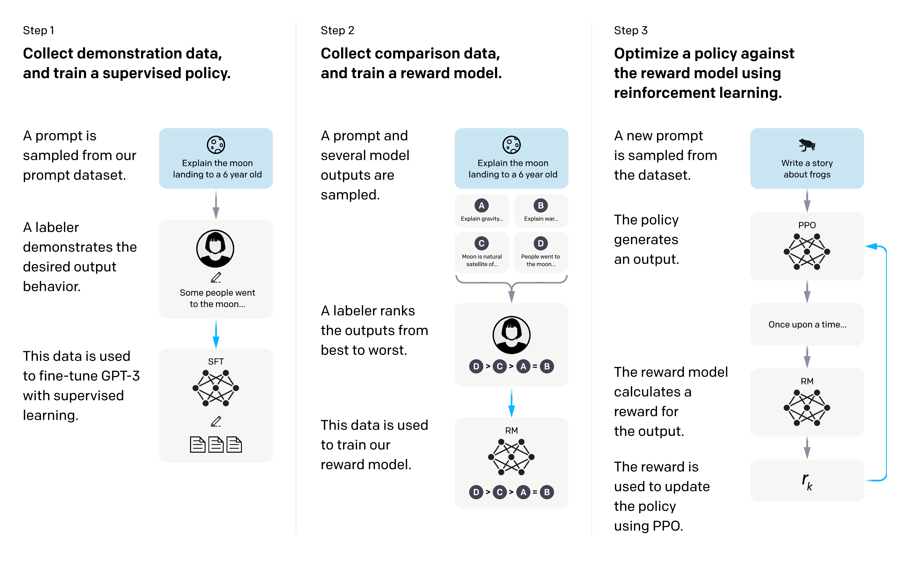
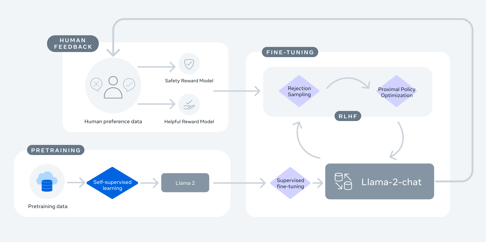
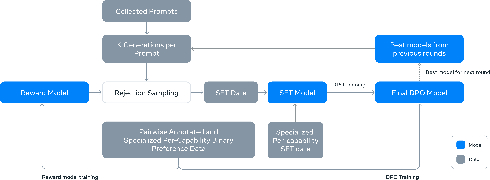
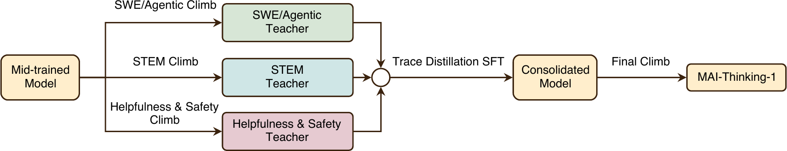

> Corresponding lecture: Conversation 1 — Frontier post-training recipes in 2026 (w/ Finbarr Timbers) · Watch/PDF/Slides/Source at [rlhfbook.com/course](https://rlhfbook.com/course)

# Conversation 1: Frontier Post-Training Recipes in 2026

This chapter distills a conversation with Finbarr Timbers about how frontier labs built language models in 2026. The central claim is simple but far-reaching: the *shape* of a post-training recipe changed more in the year leading up to 2026 than in the previous three years combined. We trace that change from the canonical three-step RLHF recipe through the rise of reasoning RL, and we focus on the new consolidation pattern that emerged at the frontier—multi-teacher on-policy distillation (MOPD).

The conversation is organized around recipes rather than individual algorithms. A recipe is the full sequence of data, optimizers, and models used to turn a base model into a product. Understanding recipes matters because the same algorithmic building blocks—SFT, DPO, PPO, GRPO, rejection sampling—produce very different models depending on order, scale, and how specialist capabilities are merged.

## Four Phases of Post-Training Recipes

A useful shorthand for the last five years is four recipe eras:

- **2022–2023: the canonical three-step recipe.** InstructGPT (Ouyang et al. 2022) established SFT → reward model → PPO as the standard pipeline. ChatGPT made this recipe famous, and for a while most open reproductions treated it as the target.
- **2024: complex multi-stage recipes with simpler optimizers.** Llama 3 (Dubey et al. 2024) and Tülu 3 (Lambert et al. 2024) showed that many rounds of rejection sampling, SFT, and direct preference optimization could match or beat a single online RL stage. Closed labs were running many more RLHF stages in parallel.
- **2025: reasoning RL becomes the centerpiece.** DeepSeek R1 (Guo et al. 2025) demonstrated that large-scale RL with verifiable rewards (RLVR) could be the primary driver of capability, with SFT used mainly to distill and refine RL-discovered behaviors.
- **2026: fragmentation and consolidation.** The leading open recipes began training many domain-specialist models and merging them back into one final model. The consolidation step is MOPD.

This progression is not a smooth replacement of one recipe by another. Each era added tools to the toolkit. SFT and rejection sampling never went away; they were repositioned inside longer pipelines. What changed was which stage consumed the most compute and which stage was treated as the source of truth for the final model.

## Canonical Recipes Before MOPD

### InstructGPT: SFT, Reward Model, PPO

The InstructGPT recipe (Ouyang et al. 2022) is the template that most later work either follows or reacts against. It has three stages:

1. **Supervised fine-tuning** on human demonstrations to teach the question-answer format.
2. **Reward-model training** on pairwise human comparisons to score completions.
3. **PPO** against the reward model, with a KL penalty to keep the policy near the SFT checkpoint.

The objective at stage three is the familiar KL-regularized reward maximization:

$$J(\\pi) = \\mathbb{E}\_{x \\sim \\mathcal{D},\\, y \\sim \\pi(\\cdot \\mid x)}\\big[r\_\\phi(x, y)\\big] - \\beta \\mathcal{D}\_{\\mathrm{KL}}\\big(\\pi(\\cdot \\mid x) \\,\\|\\, \\pi\_{\\mathrm{ref}}(\\cdot \\mid x)\\big).$$

This formulation appears, in various disguises, throughout post-training. DPO rederives it as a direct preference loss; RLVR replaces the reward model with an exact verifier; MOPD replaces the reward model with a teacher distribution.

### Llama 2: Iterative RLHF with Specialist Reward Models

Llama 2 (Touvron et al. 2023) moved the field toward multi-stage, iterative RLHF. Each round combined rejection sampling with PPO, and the project trained two reward models—one for helpfulness and one for safety—rather than one.

The helpfulness/safety split is an early example of a broader design principle: when one optimization target has to balance conflicting goals, it can be cleaner to train separate models and combine them later.

### Llama 3: Reward Model as a Filter, DPO as the Optimizer

Llama 3 (Dubey et al. 2024) is the clearest documentation of a recipe that keeps the reward model but does not use it inside online RL. Each round sampled $K$ completions per prompt, filtered them with the reward model, and then ran rejection-sampling SFT followed by DPO. The recipe iterated over six rounds, with the best checkpoint from each round seeding the next.

The lesson of Llama 3 is that the *same* three-step ingredients can be rearranged. The reward model became a data-quality filter rather than a live optimization target; DPO, a simpler offline algorithm, became the final optimizer.

### Tülu 3: SFT → DPO → RLVR

Tülu 3 (Lambert et al. 2024) formalized a simpler three-stage recipe for open models: curated prompts → SFT → DPO → RLVR. The acronym RLVR—reinforcement learning with verifiable rewards—was introduced in this paper. The RLVR stage is small in prompt count but large in compute per prompt, because each problem is sampled and verified many times.

Tülu 3 also showed that RL can be applied surgically: training only on math prompts still improved or preserved broad capabilities. This is an early hint that domain-specific RL stages could be decoupled from general capability training.

### Olmo 3: A Reasoning Update to the Tülu Recipe

Olmo 3 (Team Olmo et al. 2025) kept the Tülu 3 backbone but added explicit reasoning branches. The pipeline split after midtraining into think, instruct, and RL-Zero tracks, each running its own SFT → DPO → RLVR sequence before being combined.

The branching structure is another step toward specialization: different capabilities are trained in separate streams and then merged.

### DeepSeek R1: RL as the Centerpiece

DeepSeek R1 (Guo et al. 2025) is the landmark recipe for reasoning models. It has four stages:

1. **R1-Zero:** pure GRPO RL on the base model, with no SFT, used to *seed* reasoning behaviors rather than as a product.
2. **Cold-start SFT** on heavily filtered reasoning traces from R1-Zero.
3. **Reasoning RL** until convergence.
4. **Rejection-sampling SFT** followed by a final mixed RL stage that balances verifiable reasoning rewards with general preference rewards.

The inversion here is important. In InstructGPT, RL is the final polish on top of SFT. In R1, RL discovers the core reasoning behavior and SFT is used to distill, stabilize, and generalize that behavior.

### DeepSeek's Own Trajectory After V3

DeepSeek moved quickly from V3 to R1 to a sequence of specialist variants:

- **V3** (Dec. 2024): SFT + GRPO RL.
- **R1** (Jan. 2025): multi-stage RL; reasoning emerges.
- **V3.1** (Aug. 2025): hybrid think / non-think in one model.
- **V3.2** (Dec. 2025): six specialists trained via RL, then distilled via SFT into one mixed GRPO stage.
- **V4** (Apr. 2026): ten-plus domain experts consolidated via MOPD.

The V3.2 design is already a specialist-then-merge recipe; V4 replaces the SFT merge with MOPD.

## MOPD: The Consolidation Pattern of 2026

**Multi-teacher on-policy distillation (MOPD)** is the pattern that appeared across the 2026 frontier. It has three stages:

1. Train $N$ domain-specialist teachers. Each teacher is produced by a familiar recipe: SFT followed by RL on a single domain such as math, code, reasoning, or agentic tasks.
2. Train one general student by sampling *its own* trajectories.
3. On each rollout, minimize the reverse KL from the student's token distribution to the relevant teacher's token distribution.

The key phrase is "on-policy." The student is not trained on static teacher outputs; it generates completions from its own policy, and the teachers provide feedback only on the states the student actually visits. This closes the exposure-bias gap between training and inference (Kim & Rush 2016; Agarwal et al. 2024; Ross et al. 2011).

### The MOPD Objective

Let $s$ be a prompt, $a = (a\_1, \\ldots, a\_L)$ a completion sampled from the current student $\\pi\_\\theta$, and $s\_t = (s, a\_{<t})$ the token-level state at step $t$. Let $\\pi\_{T\_k}$ be teacher $k$ and $w\_k(s)$ its prompt-dependent mixture weight, with $\\sum\_k w\_k(s) = 1$. The MOPD loss is:

$$\\mathcal{L}\_{\\mathrm{MOPD}}(\\theta) = \\mathbb{E}\_{s,\\, a \\sim \\pi\_\\theta(\\cdot \\mid s)} \\sum\_t \\sum\_k w\_k(s) \\, \\mathcal{D}\_{\\mathrm{KL}}\\big(\\pi\_\\theta(\\cdot \\mid s\_t) \\,\\|\\, \\pi\_{T\_k}(\\cdot \\mid s\_t)\\big).$$

This is a reverse-KL objective: the expectation is under the student policy, and the student distribution is on the left side of the KL. Reverse KL tends to concentrate student mass on high-probability teacher tokens rather than spreading it to cover the whole teacher distribution. In practice this often yields sharper, higher-quality generations than the forward-KL (cross-entropy) used in offline distillation.

A closely related implementation treats the per-token log-probability gap as an advantage inside an RL algorithm (Lu 2025). For a sampled token $a\_t$ at state $s\_t$:

$$A\_t^{\\mathrm{OPD}} = \\log \\pi\_T(a\_t \\mid s\_t) - \\log \\pi\_\\theta(a\_t \\mid s\_t).$$

Tokens the teacher rates higher than the student receive positive advantage; tokens the student rates higher receive negative advantage. The teacher thus acts as dense, token-level feedback.

### From Offline KD to On-Policy Distillation

Traditional knowledge distillation (Hinton et al. 2015) trains a student to match a teacher's soft output distribution. Applied to language models, this became sequence-level distillation (Kim & Rush 2016): the teacher generates a high-probability sequence offline, and the student is trained to reproduce it with cross-entropy.

Offline distillation has a well-known limitation: the student is trained on teacher trajectories $u \\sim \\pi\_T$, but at inference it rolls out under its own policy $\\pi\_\\theta$. The prefixes it visits at test time differ from those it saw during training, and errors can compound. This is the same exposure-bias problem analyzed in imitation learning (Ross et al. 2011). On-policy distillation fixes the mismatch by sampling from the student and supervising at the visited states.

MOPD extends on-policy distillation to multiple teachers. The specialist teachers can be far stronger in their domains than any single monolithic model, and the student learns from each teacher only on prompts where that teacher is relevant.

## Why MOPD Emerged in 2026

Three forces pushed the field toward MOPD.

**RL became expensive and conflict-prone.** Running a single RL stage that mixes math, code, reasoning, and agentic tasks eventually trades capabilities off against one another. A reward or verifier that is good for code can hurt chat style; a reasoning objective can increase verbosity on simple questions. Separating domains lets each RL run optimize one thing well.

**Specialists are cheap to make and organizationally scalable.** SFT-then-RL on a single domain is well understood, easy to parallelize, and easy to debug. As post-training becomes the largest part of model development, splitting it into independent specialist teams is a major operational win.

**On-policy distillation matured.** The RLVR renaissance produced a generation of infrastructure, algorithms, and intuition for training models from their own rollouts. MOPD applies that machinery to merging teachers rather than to optimizing a reward model.

The result is a shift from *depth* to *breadth* in recipe complexity. Earlier recipes had many iterative rounds of the same monolithic model. MOPD recipes have fewer iterations but more distinct expert models that must be merged.

## The 2026 Frontier in Practice

### MiMo Flash v2: Where MOPD Started

Xiaomi's MiMo-V2-Flash (LLM-Core Xiaomi 2025) was the first technical report to articulate MOPD cleanly as the final consolidation step. The recipe is:

- Stage 1: general SFT.
- Stage 2: train roughly six domain-specialist teachers with standard post-training recipes.
- Stage 3: MOPD into a single student.

The novelty is replacing a single monolithic RL stage with distill-from-specialists. MiMo Flash v2 also demonstrated that MOPD could be used to push the frontier in specialized domains without sacrificing general capability.

### Nemotron 3 Ultra: Two Rounds, Many Teachers

NVIDIA's Nemotron 3 Ultra (NVIDIA 2026) ran MOPD over *two iterations*, with more than ten teachers spanning reasoning, code, math, and agentic tasks. The first MOPD pass produces a stronger student; that student is then used to refresh or train new teachers, and a second MOPD pass consolidates again.

The multi-round structure matters because the student produced by the first pass is already better than the starting base. Using it to generate on-policy data for a second pass lets the teachers supervise a more capable policy, potentially extracting additional gains.

### MAI-Thinking-1: A Non-MOPD Counterexample

MAI-Thinking-1 (Microsoft 2026) is closer to DeepSeek R1 than to V4. Its recipe runs three specialist RL "climbs" on a mid-trained base, then consolidates the climbs with trace-distillation SFT, then runs a final RL climb. It does not use on-policy MOPD.

This is a useful reminder that MOPD is not universal. Labs are still exploring the design space of specialist-then-merge recipes, and the best merge mechanism—on-policy distillation, trace-distillation SFT, or something else—depends on the target capability mix.

### Kimi K2.5: Agentic and Multimodal RL

Kimi K2.5 (Kimi Team 2025) followed a different path: text-only SFT followed by joint text–vision RL across coding, vision, reasoning, and agentic tasks. The report does not mention MOPD.

K2.5 is evidence that the 2026 frontier is not converged. Some labs bet on domain specialists plus MOPD; others bet on large-scale multimodal RL and agentic training harnesses.

### GLM-5: Staged RL by Capability

GLM-5 (GLM-5 Team 2026) uses MOPD but only after a more complex three-stage RL process: SFT, then reasoning RL, then agentic RL, then general RL, with cross-stage distillation.

GLM-5 illustrates that MOPD can be combined with sequential RL. The model is pushed through capability-specific RL stages first, and MOPD appears as a late consolidation or distillation step.

## Data, Synthetic Data, and the Distillation View

MOPD sits at the intersection of two larger trends: the growing role of synthetic data and the resurgence of teacher-student distillation.

Modern frontier pipelines are dominated by synthetic data. Instruction-tuning completions are distilled from stronger models; preference pairs are generated by LLM-as-a-judge systems; reasoning traces are filtered and polished from RL rollouts. The fear that synthetic data inevitably causes model collapse (Shumailov et al. 2024) has been tempered by evidence that mixing real data, using diverse teachers, and aggressive filtering can avoid the collapse regime (Gerstgrasser et al. 2024; Feng et al. 2024).

MOPD is a form of *distillation*, but it is not the offline sequence distillation of earlier eras. Offline distillation generates teacher outputs once and trains the student to match them with cross-entropy. MOPD instead samples student trajectories and matches the student's distribution to the teacher's distribution at the visited states with reverse KL. This is the same conceptual move—from offline to on-policy—that has driven much of post-training since RLVR.

The teachers in MOPD are themselves often trained with synthetic data. A math specialist might be trained on filtered OpenThoughts traces (Guha et al. 2025); a coding specialist might use compiler-verified samples; an agentic specialist might use tool-use trajectories from another model. MOPD therefore consolidates multiple synthetic-data recipes into one final model.

There is also a connection to AI feedback. Constitutional AI (Bai et al. 2022) and RLAIF (Lee et al. 2023) showed that language models can substitute for human annotators in preference labeling. Hybrid routing between human and AI feedback (Miranda et al. 2025) suggests that the optimal data mix depends on the domain. MOPD inherits this logic at the model level: different domains get different teachers, and the final model is a weighted mixture of their expertise.

## Evaluation, Scaling, and What to Watch

The conversation emphasizes that recipes are not merely academic choices; they are scaling and evaluation choices.

**Scaling.** Post-training compute has become a major scaling dimension alongside pretraining and inference. MOPD scales breadth: more teachers, more domains, more parallel specialist RL runs. DeepSeek R1 and its successors scale depth: longer reasoning RL runs on harder problems. Both directions consume large amounts of compute, and the best recipes combine them.

**Evaluation.** As recipes grow more complex, evaluation grows harder. A single aggregate score hides trade-offs between reasoning, coding, chat, safety, and tool use. The right evaluation is a suite that covers all domains the recipe touches, with held-out prompts that are hard enough to distinguish real capability from memorization. Verifiable tasks make evaluation easier; open-ended chat and agentic tasks make it harder. LLM-as-a-judge is now standard, but judge bias remains a concern.

**What to watch.** Three design decisions appear to matter most in current recipes:

1. **When to specialize.** Some capabilities are easiest to add with domain-specific RL; others are easiest with broad SFT or general RL. The decision affects whether MOPD is needed at all.
2. **How to merge.** On-policy reverse KL is one merge mechanism; trace-distillation SFT is another. The choice changes how much the final model retains of each teacher's style and how robust it is to out-of-distribution prompts.
3. **How many teachers.** Nemotron 3 Ultra and DeepSeek V4 use more than ten; MiMo Flash v2 used roughly six. The right number depends on the granularity of domain boundaries and the cost of training each teacher.

## Key Takeaways

- Post-training recipes evolved from the canonical three-step InstructGPT pipeline (SFT → reward model → PPO) through complex multi-stage recipes in 2024, reasoning-RL-centric recipes in 2025, and specialist-then-merge recipes in 2026.
- **Multi-teacher on-policy distillation (MOPD)** has become the defining consolidation pattern of 2026: train domain-specialist teachers, sample rollouts from a single student, and minimize reverse KL to the relevant teacher's token distribution.
- MOPD is driven by three forces: monolithic RL becomes expensive and conflict-prone across domains; specialists are parallelizable and organizationally scalable; and on-policy distillation matured during the RLVR renaissance.
- The MOPD objective is a reverse-KL loss over student-sampled trajectories with per-prompt teacher weights: $\\mathcal{L}\_{\\mathrm{MOPD}} = \\mathbb{E}\_{s, a \\sim \\pi\_\\theta} \\sum\_t \\sum\_k w\_k(s) \\mathcal{D}\_{\\mathrm{KL}}(\\pi\_\\theta(\\cdot \\mid s\_t) \\,\\|\\, \\pi\_{T\_k}(\\cdot \\mid s\_t))$.
- Leading 2026 recipes differ in how they use MOPD: MiMo Flash v2 introduced it; Nemotron 3 Ultra iterated it twice with more than ten teachers; MAI-Thinking-1 used trace-distillation SFT instead; Kimi K2.5 pursued large-scale multimodal RL; and GLM-5 combined sequential RL stages with MOPD.
- MOPD is a form of on-policy distillation, distinct from offline sequence distillation. It closes the exposure-bias gap by supervising the student on its own rollouts.
- Synthetic data and distillation are inseparable from modern recipes: teachers are often trained on synthetic traces, and MOPD consolidates multiple synthetic-data pipelines into one model.
- Recipe choice is ultimately a scaling and evaluation choice: it determines where compute goes, how capabilities are traded off, and how the final model is validated.
