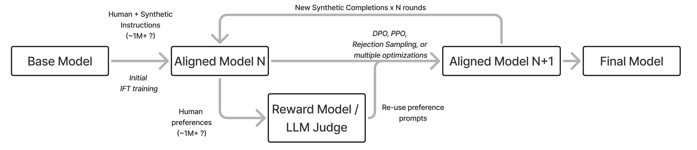

> Corresponding lecture: Lec 7 — Synthetic Data and Modern Post-Training Methods · Chapter 12 · Watch/PDF/Slides/Source at [rlhfbook.com/course](https://rlhfbook.com/course)

# Lec 7: Synthetic Data and Modern Post-Training Methods

When RLHF was first used to train large language models, human data was the only plausible source of high-quality responses and reliable feedback. Humans wrote the demonstrations, humans chose the preferred completion, and humans supplied the scores. As models improved, that assumption collapsed quickly. Today, synthetic data—training data generated in whole or in part by another AI model—permeates nearly every stage of post-training. It is used to write prompts, generate completions, label preferences, filter bad examples, and verify answers for reinforcement learning. In many settings it is cheaper, faster, and more scalable than human collection, and in some settings it is simply better.

This chapter surveys how synthetic data replaced or expanded the post-training pipeline, then derives on-policy distillation as the technical core of modern teacher-student training. We cover Constitutional AI, AI feedback, rubric-based rewards, multi-teacher distillation, and self-distillation. By the end, you should be able to:

- explain why synthetic data became dominant and where human data still matters;
- distinguish the technical and colloquial meanings of "distillation";
- derive sequence-level distillation from cross-entropy and connect it to SFT;
- state the on-policy distillation objective, explain reverse KL, and write the per-token advantage;
- describe Constitutional AI and how it generates both SFT and preference data;
- design a simple rubric for RL training on a task without a verifiable answer.

## What Synthetic Data Is and Where It Sits

**Synthetic data** is any training data used for an AI model that is generated, in some part, by another AI model. The definition is intentionally broad: a stronger model can generate new prompts from seed examples (Wang et al. 2023), modify or expand existing prompts, write completions for SFT (NuminaMath 7B TIR 2024), label pairwise preferences for RLHF (Cui et al. 2023), filter low-quality outputs (Li et al. 2024), or verify answers as rewards for RL. The same model family is often reused for many of these roles inside a single pipeline.



The post-training pipeline is still the same five-step skeleton we have seen before—collect prompts, generate completions, collect preferences, score rewards, and clean everything—but synthetic data now flows through every box. This is why the term "post-training" has partly eclipsed "RLHF" in modern discussions: the data loop has become richer than a single human-preference stage.

### Why synthetic data took over

Three forces drove the shift.

**Cost and iteration speed.** A piece of human preference data costs roughly \$1–\$10 per prompt; AI feedback from a frontier model costs less than \$0.01 per prompt. Human labor cost is roughly flat, while model price-per-performance keeps falling. Synthetic data therefore opened RLHF experimentation to groups that were previously priced out.

**A capability threshold.** Synthetic data only became reliable once GPT-4-class models appeared (OpenAI 2023). Llama 2 and GPT-3.5-Turbo were not consistent enough to generate or supervise high-quality training data. In the GPT-3.5 to GPT-4 transition, LLM-as-a-judge ability emerged: frontier models became robust enough to score, compare, and critique outputs in ways that correlate with human judgments.

**The center of gravity shifted.** Leading models now need synthetic data to reach the frontier. Distillation—the general process of transferring capability from a stronger model to a student—has become the default method for scaling post-training, especially in reasoning and agentic settings.

### The balance between human and synthetic data

Synthetic data has not replaced human data uniformly.

- **Instruction data (SFT).** Synthetic has largely won. A strong model's completions are now higher quality, at scale, than most human writers for standard instruction-following tasks.
- **Preference data (RLHF).** The picture is mixed. Academic work shows synthetic preferences can match human labels, yet frontier labs still treat human preference data as a competitive moat.
- **Evaluation.** LLM-as-a-judge scales scoring cheaply, but the underlying benchmarks and ground-truth labels still require human creation and calibration.

The pattern is that synthetic data dominates wherever models already exceed human reliability, while humans remain essential at the capability frontier, for establishing ground truth, and for seeding new directions.

### Model collapse: an outdated worry

A common criticism of synthetic data is **model collapse**: the idea that repeatedly training on a model's own generations progressively narrows the effective training distribution (Shumailov et al. 2024). As diversity drops, rare facts and styles are underrepresented, and small mistakes compound across iterations, so generalization degrades.


Collapse is a real phenomenon, but it is mostly a failure of *unfiltered, single-model, self-training loops*. In practice it is avoided by mixing in real or human data, using diverse teachers, deduplication, and strong quality filters. Evidence suggests synthetic data can—and should—be used at scale without the catastrophic regressions implied by the strongest collapse stories (Gerstgrasser et al. 2024; Feng et al. 2024).

### Canonical synthetic datasets and their scale

A few datasets mark the eras of synthetic post-training:

| Dataset | Prompts | Tokens (approx.) |
| :--- | :---: | :---: |
| **Stanford Alpaca** (Taori et al. 2023) | 52K | ~10M |
| **Tülu 3** (Lambert et al. 2024) | ~1M | ~500M |
| **OpenThoughts 3** (Guha et al. 2025) | 1.2M | ~10B |

**UltraFeedback** (Cui et al. 2023) was the first prominent synthetic preference dataset and helped kickstart the DPO revolution. **Stanford Alpaca** was one of the first chat-style SFT datasets. **Tülu 3** is a broad, skill-focused pre-RL SFT set. **OpenThoughts 3** is a large synthetic reasoning set used to train thinking models. The growth is enormous: Alpaca is two orders of magnitude smaller in tokens than OpenThoughts 3, reflecting both more prompts and far longer completions.

## Distillation with Synthetic Data

The word "distillation" is used in two ways.

**Technical knowledge distillation** (Hinton et al. 2015) trains a smaller *student* to match a stronger *teacher's* full output distribution—*soft* labels over every class or token, not one-hot targets. The loss is a KL divergence between the teacher and student distributions.


**Colloquial distillation** simply means "train a weaker model on the outputs of a stronger model." This is what people mean when they say a model "distills from GPT/Claude." The two meanings overlap, but the colloquial one is far more common in modern post-training.


In practice, distillation plays two roles. First, it is a *data engine* across the whole pipeline: completions for SFT, preference pairs, critiques, and verification signals. Second, it is a *skill-transfer* tool: a lab trains a large internal model (Claude Opus, Gemini Ultra, an internal reasoning checkpoint) and distills specific capabilities such as math, code, or alignment into smaller released models. Open models often distill from closed APIs into openly available weights (Tunstall et al. 2024), and limited high-quality data from strong models can drive alignment even with very few examples (Zhou et al. 2023; Muennighoff et al. 2025).

Reasoning models complicated the simple API-distillation story. To distill reasoning you want the *reasoning traces*, and closed APIs stopped returning them. Distillation therefore shifted toward open models, where the weights expose the full trace, or toward more aggressive attempts to recover hidden traces.

## From Offline to On-Policy Distillation

The technical literature on distillation has resurged as post-training moves toward reasoning and agentic models. Leading models trained with new forms of knowledge distillation include Qwen3 (Yang et al. 2025), MiMo-V2-Flash, DeepSeek-V4-Pro, and GLM-5 (GLM-5 Team 2026). This section derives the modern on-policy form from the classic Hinton setup.

### Notation

Let:

- $s$ be the source prompt;
- $u = (u\_1, \\ldots, u\_J)$ be a complete output sequence sampled from the *teacher*;
- $\\mathcal{V}$ be the output vocabulary;
- $q$ be the teacher's next-token distribution;
- $p$ be the student's next-token distribution.

We deliberately use $u$ for teacher trajectories and reserve $a$ for student-sampled completions. That $u$-versus-$a$ split is the whole point of "on-policy."

### Word-level (per-token) distillation

The classic Hinton soft-label idea applied at every token position is (Kim & Rush 2016):

$$
\\mathcal{L}\_{\\mathrm{WORD\\text{-}KD}}
= -\\sum\_{j=1}^{J}\\sum\_{k=1}^{|\\mathcal{V}|}
q(u\_j = k \\mid s, u\_{<j})\\,\\log p(u\_j = k \\mid s, u\_{<j}).
$$

At each position the student matches the teacher's full next-token distribution over the entire vocabulary. The inner sum runs over every possible token, but the loss is still cheap: it costs $O(J\\,|\\mathcal{V}|)$, the same as ordinary cross-entropy, because the teacher probabilities are already computed. Matching over *whole sequences* is the hard part.

### Sequence-level distillation

Sequence-level distillation approximates the teacher's distribution over whole sequences $\\mathcal{U}$ by a point mass on a single high-probability teacher output $\\hat{u}$, usually obtained by beam search:

$$
\\begin{aligned}
\\mathcal{L}\_{\\mathrm{SEQ\\text{-}KD}}(s)
&= -\\sum\_{u \\in \\mathcal{U}} q(u \\mid s)\\log p(u \\mid s) && \\text{intractable}\\\\
&\\approx -\\log p(\\hat{u} \\mid s) && \\text{teacher } \\approx \\text{ point mass}\\\\
&= -\\sum\_{j=1}^{|\\hat{u}|}\\log p(\\hat{u}\_j \\mid s, \\hat{u}\_{<j}) && \\text{autoregressive factorization}.
\\end{aligned}
$$

SEQ-KD is the step toward modern methods: the teacher generates fresh data, and the student trains on it with standard supervised learning. We call this *offline* distillation because the teacher outputs are generated ahead of time. Early successful offline-distilled models included the classifier-style DistilBERT (Sanh et al. 2019) and TinyBERT (Jiao et al. 2020), which built momentum around the idea even though they were not autoregressive sequence distillers.

### Cross-entropy is forward KL

Recall the cross-entropy of a teacher $q$ and student $p$:

$$
H(q,p) = -\\sum\_z q(z)\\log p(z).
$$

Add and subtract $\\sum\_z q(z)\\log q(z)$:

$$
\\begin{aligned}
H(q,p)
&= -\\sum\_z q(z)\\log q(z) + \\sum\_z q(z)\\log q(z) - \\sum\_z q(z)\\log p(z)\\\\
&= H(q) + \\sum\_z q(z)\\log\\frac{q(z)}{p(z)}\\\\
&= H(q) + D\_{\\mathrm{KL}}(q\\,\\|\\,p).
\\end{aligned}
$$

Because $H(q)$ does not depend on the student, minimizing cross-entropy is equivalent to minimizing the forward KL:

$$
\\min\_p H(q,p) \\;\\equiv\\; \\min\_p D\_{\\mathrm{KL}}(q\\,\\|\\,p).
$$

This is the KL direction of offline KD and SFT on teacher-generated text: wherever the teacher places mass, the student must also place mass.

### Exposure bias in offline distillation

Offline KD samples teacher trajectories $u \\sim \\pi\_T$ and minimizes per-token forward KL:

$$
\\mathcal{L}\_{\\mathrm{KD}}(\\theta)
= \\mathbb{E}\_{s \\sim \\mathcal{D},\\, u \\sim \\pi\_T(\\cdot \\mid s)}
\\sum\_t D\_{\\mathrm{KL}}\\!\\left(\\pi\_T(\\cdot \\mid s, u\_{<t}) \\,\\|\\, \\pi\_\\theta(\\cdot \\mid s, u\_{<t})\\right).
$$

At test time, however, the student rolls out under its own policy:

$$
\\mathcal{L}\_{\\mathrm{eval}}(\\theta)
= \\mathbb{E}\_{s \\sim \\mathcal{D}\_{\\mathrm{test}},\\, a \\sim \\pi\_\\theta(\\cdot \\mid s)}\\ \\ell\_{\\mathrm{task}}(s, a).
$$

Because $\\pi\_T \\neq \\pi\_\\theta$, training prefixes and test prefixes come from different state distributions. This train-test mismatch is **exposure bias** (Arora et al. 2022; Song & Zheng 2026). A single suboptimal token can nudge the student slightly out-of-distribution; the model, never having seen that prefix in training, is more likely to err again.

### The DAgger analogy

On-policy distillation connects to imitation learning. DAgger trains an agent on its own rollouts, with an oracle (teacher) labeling the action it *should* have taken (Ross et al. 2011). Suppose the student matches the teacher within per-step error $\\epsilon$ on teacher-induced states:

$$
\\mathbb{E}\_{s\_t \\sim d\_{\\pi\_T}}\\!\\left[\\mathbb{I}\\!\\left(\\pi\_\\theta(s\_t) \\neq \\pi\_T(s\_t)\\right)\\right] \\leq \\epsilon.
$$

The supervised imitation-learning analysis shows that the expected loss along a length-$L$ student trajectory can scale quadratically:

$$
\\mathbb{E}\_{a \\sim \\pi\_\\theta(\\cdot \\mid s)}\\!\\left[\\sum\_{t=1}^{L} \\ell\\!\\left(s, a\_{<t}\\right)\\right] \\leq O(\\epsilon L^2).
$$

For LLMs this is an analogy rather than a theorem: token losses are distributional (KL), not 0-1 action disagreement. But the intuition carries. Modern completions routinely span thousands of tokens, so compounding errors are a real failure mode.

### The on-policy distillation objective

The core shift to on-policy distillation is to sample from the *student* and supervise it with the teacher at its own visited states. Let $a = (a\_1, \\ldots, a\_L)$ be sampled from the student $\\pi\_\\theta(\\cdot \\mid s)$ and let $s\_t = (s, a\_{<t})$. The teacher $\\pi\_T$ is fixed. The objective is:

$$
\\boxed{
\\mathcal{L}\_{\\mathrm{OPD}}(\\theta)
= \\mathbb{E}\_{s,\\, a \\sim \\pi\_\\theta(\\cdot \\mid s)}
\\sum\_t D\_{\\mathrm{KL}}\\!\\left(\\pi\_\\theta(\\cdot \\mid s\_t) \\,\\|\\, \\pi\_T(\\cdot \\mid s\_t)\\right)
}
$$

This is now in the sampling framework of policy gradients: alternate generate-and-update. Sampling from the student also flips the KL direction from forward to reverse.

### Forward versus reverse KL

The expectation is over the distribution on the *left* of the KL. Offline KD / SFT uses the teacher:

$$
D\_{\\mathrm{KL}}(\\pi\_T \\,\\|\\, \\pi\_\\theta)
= \\mathbb{E}\_{z \\sim \\pi\_T}\\!\\left[\\log\\frac{\\pi\_T(z)}{\\pi\_\\theta(z)}\\right].
$$

This is **mass-covering**: wherever the teacher has mass and the student goes to zero, the loss explodes, so the student must cover everything the teacher might say.

On-policy distillation uses the student:

$$
D\_{\\mathrm{KL}}(\\pi\_\\theta \\,\\|\\, \\pi\_T)
= \\mathbb{E}\_{z \\sim \\pi\_\\theta}\\!\\left[\\log\\frac{\\pi\_\\theta(z)}{\\pi\_T(z)}\\right].
$$

This is **mode-seeking**: the student is penalized only where *it* puts probability that the teacher dislikes, so it collapses onto the teacher's modes. Why reverse KL is often preferable is discussed further in Lecture 10 and Chapter 15.

### KD as an RL advantage

Recent implementations take the per-token reverse-KL distance directly as a reward (Lu 2025). The reverse KL at state $s\_t$ is an expectation over student-sampled tokens:

$$
D\_{\\mathrm{KL}}\\!\\left(\\pi\_\\theta(\\cdot \\mid s\_t) \\,\\|\\, \\pi\_T(\\cdot \\mid s\_t)\\right)
= \\mathbb{E}\_{a\_t \\sim \\pi\_\\theta(\\cdot \\mid s\_t)}\\!\\left[\\log \\pi\_\\theta(a\_t \\mid s\_t) - \\log \\pi\_T(a\_t \\mid s\_t)\\right].
$$

In practice we never sum over the vocabulary. A single sampled token gives an unbiased estimate $\\hat{D}\_{\\mathrm{KL}}$ of that KL (Schulman 2020), and the per-token advantage is its negative:

$$
A\_t^{\\mathrm{OPD}}
= -\\hat{D}\_{\\mathrm{KL}}
= \\log \\pi\_T(a\_t \\mid s\_t) - \\log \\pi\_\\theta(a\_t \\mid s\_t).
$$

Tokens more likely for the teacher receive positive advantage; tokens less likely receive negative advantage. The sign makes it look like a forward-KL term, but what makes it *reverse* KL is sampling $a\_t \\sim \\pi\_\\theta$. This teacher log-prob gap is dense, token-level feedback, potentially richer than a sparse verifiable reward or a single reward-model score. It layers naturally into modern RL machinery, for example alongside GRPO's group-level normalization.

### Multi-teacher on-policy distillation

A student can be supervised by several teachers—domain specialists for math or code, or earlier checkpoints—each with a prompt-dependent mixture weight $w\_k(s)$ satisfying $\\sum\_k w\_k(s)=1$ (MiMo-V2-Flash 2025):

$$
\\mathcal{L}\_{\\mathrm{MOPD}}(\\theta)
= \\mathbb{E}\_{s,\\, a \\sim \\pi\_\\theta(\\cdot \\mid s)}
\\sum\_t \\sum\_k w\_k(s)\\, D\_{\\mathrm{KL}}\\!\\left(\\pi\_\\theta(\\cdot \\mid s\_t) \\,\\|\\, \\pi\_{T\_k}(\\cdot \\mid s\_t)\\right).
$$

At scale this lets a growing organization divide labor: many groups train expert teachers that later distill into one final student, as reported for DeepSeek-V4-Pro and MiMo-V2-Flash.

### Self-distillation and privileged information

At the absolute frontier there may be no stronger model to distill from. **On-Policy Self-Distillation (OPSD)** sidesteps this by making the teacher the *same model conditioned on privileged information*—a hint the student will not see at inference (Zhao et al. 2026). The self-distillation gradients teach the model that the tokens after the hint were a mistake, absorbing the lesson with an OPD-style loss.

Cursor's Composer 2.5, fine-tuned from Kimi K2.5, trained this way (Cursor Team 2026). A judge reviews RL trajectories against a list of common bugs. When it finds a bug, it inserts a hint into the sequence—privileged information the model would not see at test time—and the model takes a KD loss toward its own hinted continuation, learning to reach it unaided. How best to structure these hints is an active area, often called *privileged information* distillation (Penaloza et al. 2026).


One caveat: per-token KD needs the student and teacher to share a tokenizer. That is unusual among post-training methods and partly explains why OPD thrives inside a lab's own model family.

## AI Feedback

Soon after RLHF took off, **RL from AI Feedback (RLAIF)** emerged: using AIs to approximate the human-data step, starting with pairwise preferences (Lee et al. 2023; Sharma et al. 2024; Castricato et al. 2024). After early debates about whether it could match human data, it became the default for many academic and industrial pipelines.

### Cost and trade-offs

Cost was the obvious advantage. A single human preference prompt can cost \$1–\$10 or more; AI feedback from a model like GPT-4o costs less than \$0.01. This opened RLHF experimentation to a much wider population.

The performance trade-off is often described as a bias-variance story:

- **Human data** are *high-noise, low-bias*. Collection and filtering are hard, but a well-wrangled human signal is reliable.
- **Synthetic preference data** are *low-noise, high-bias*. They are easier to start with, but can carry systematic second-order effects that are baked into the data.

Early work claimed AI feedback could fully replace human data, especially on chat tasks (Lee et al. 2023; Cui et al. 2023; Yuan et al. 2024). Later work is more nuanced: on broader evaluations, including reasoning, the best mix routes hard data points to humans while sending most to AI (Miranda et al. 2025; Xu et al. 2025). No study has mapped the optimal human/AI balance across all domains, and frontier labs still treat human preference data as a substantial moat.

### Specialized judge models

If AI feedback is central, should you train a specialized judge model? The evidence is mixed. LLMs can be inconsistent evaluators (Wang et al. 2023) and show **self-preference bias**, favoring their own generations over those of other models (Panickssery et al. 2024). Dedicated judge models such as Prometheus 2 (Kim et al. 2024) exist but are not widely adopted in documented post-training recipes. The equilibrium today is that frontier models are already trained extensively for judging, so a separate judge is rarely needed unless your task involves private data not on the public internet.

## Constitutional AI

**Constitutional AI (CAI)** is the earliest documented, large-scale use of synthetic data for RLHF training (Bai et al. 2022). It is also the paper that coined the term RLAIF, which caused some confusion. The relationship is simple: CAI is the example that kickstarted the broader field of RLAIF; CAI $\\subset$ RLAIF.


A **constitution** $\\mathcal{C}$ is a human-written set of principles, such as "Is the answer encouraging violence?" or "Is the answer truthful?" CAI generates synthetic data in two stages.

### Stage 1: critique and revise

The model repeatedly samples a principle $c\_i \\in \\mathcal{C}$ and revises its latest output $y^i$ to the prompt $x$ to align with $c\_i$:

$$
\\{c\_0, c\_1, \\ldots, c\_{n-1}\\}\\;\\longrightarrow\\;\\{y^0, y^1, \\ldots, y^n\\}
\\qquad\\Longrightarrow\\qquad
\\text{SFT point } (x, y^n).
$$

The model is then fine-tuned on the refined dataset. These critique-and-revise methods are now used broadly for data filtering and synthetic-data generation beyond CAI itself.

### Stage 2: AI preference labels

Preferences are constructed by giving a feedback model a prompt $x$, a subset of principles $\\{c\_0, \\ldots, c\_n\\}$, and two labeled completions $y\_0, y\_1$. The model selects which answer is higher quality and more aligned with the principle. Standard RLHF then proceeds with synthetic preferences—hence RLAIF.

Early implementations prompted the model with "The answer is: " and read which token (A or B) had higher probability. Modern versions use a **generative reward model** that explains its reasoning before selecting (Mahan et al. 2024), a style closely related to principle-guided reward models (Sun et al. 2024).

### Related directions

OpenAI's **Model Spec** (OpenAI 2024) states intended behavior and is explored with methods that reference the document directly, a close peer to CAI. OpenAI also trained reasoning models with **Deliberative Alignment** (Guan et al. 2024), where the model reasons about safety policies before answering. Anthropic continues to update Claude's constitution, and the open community has replicated CAI on open datasets (Lambert et al. 2024).

## Rubrics: Prompt-Specific AI Feedback

AI feedback's role in training expanded in late 2024 and 2025 as the field looked for ways to scale reinforcement learning beyond domains with verifiable rewards. The idea of **rubrics** emerged: write nearly-verifiable criteria for a prompt, generate multiple answers, and RL-update toward the best ones. Rubrics now provide gains in scientific reasoning and factuality (Gunjal et al. 2025; Viswanathan et al. 2025; Rezaei et al. 2025; Liu et al. 2025).

### A rubric example

For a prompt with no single right answer, a rubric scores against tagged criteria (Liu et al. 2025):

```text
Prompt: As a museum curator, suggest five obscure artifacts for a
"Mysteries of the Ancient World" exhibit ...

Rubric:
1. Includes exactly five distinct artifacts.            [Hard Rule]
2. Each from a different culture and time period.       [Hard Rule]
3. Brief description of each artifact's significance.   [Hard Rule]
6. Communicates clearly and is well-organized.          [Principle]
8. Uses engaging language that stimulates curiosity.    [Principle]
```

`[Hard Rule]` items are atomic, must-pass checklist items; `[Principle]` items are softer quality criteria. Subcomponents of the rubric contribute to the final score, often with explicit weights.

### Per-prompt generation

Rubrics are usually generated per prompt to ensure quality and robustness to over-optimization. A domain-level base rubric is refined by a supervising language model for each specific prompt (Gunjal et al. 2025). A truncated meta-prompt for a science task might ask for 7–20 rubric items, each with a title, description, and weight, classified as Essential, Important, Optional, or Pitfall. Weights are positive for the first three and negative for pitfalls.

### Where rubrics are going

Rubric-based RL is a frontier of AI-feedback-driven training, expanding into advanced instruction following (He et al. 2025), deep research agents (Shao et al. 2025), evaluation of research agents (Sharma et al. 2025), and long-form generation with structured checklists (Ruan et al. 2025).

## Key Takeaways

- Synthetic data is any training data generated in part by another AI model. It now feeds prompts, completions, preferences, rewards, and filtering in modern post-training.
- Synthetic data dominates where models exceed human reliability (SFT, evaluation scoring), while human data remains important at the frontier, for ground truth, and for preference signals that labs treat as a moat.
- Model collapse is a real risk of unfiltered self-training, but is mitigated by mixing real data, using diverse teachers, deduplication, and quality filters.
- "Distillation" has a technical meaning (teacher-student KL matching) and a colloquial meaning (training on a stronger model's outputs).
- Sequence-level distillation approximates the teacher's sequence distribution by a point mass, reducing to SFT on teacher-generated text; minimizing cross-entropy is minimizing the forward KL $D\_{\\mathrm{KL}}(\\pi\_T \\|\\, \\pi\_\\theta)$.
- Offline KD suffers from exposure bias: the student trains on teacher prefixes but acts under its own distribution at test time.
- On-policy distillation samples from the student and minimizes the reverse KL $D\_{\\mathrm{KL}}(\\pi\_\\theta \\|\\, \\pi\_T)$; it can be implemented as a per-token RL advantage $A\_t^{\\mathrm{OPD}} = \\log \\pi\_T(a\_t \\mid s\_t) - \\log \\pi\_\\theta(a\_t \\mid s\_t)$.
- Multi-teacher on-policy distillation mixes specialist teachers; self-distillation uses privileged hints when no stronger teacher exists.
- RLAIF replaces or augments human preference labels with AI labels; Constitutional AI is the earliest large-scale example, using a constitution to generate SFT revisions and preference data.
- Rubrics extend AI feedback to tasks without verifiable answers by decomposing quality into weighted, prompt-specific criteria.

## References

- Agarwal, R., Vieillard, N., Zhou, Y., Stanczyk, P., Ramos Garea, S., Geist, M., & Bachem, O. (2024). On-policy distillation of language models: Learning from self-generated mistakes. *The Twelfth International Conference on Learning Representations*.
- Arora, K., El Asri, L., Bahuleyan, H., & Cheung, J. C. K. (2022). Why exposure bias matters: An imitation learning perspective of error accumulation in language generation. *Findings of the Association for Computational Linguistics: ACL 2022*, 700–710.
- Bai, Y., Kadavath, S., Kundu, S., Askell, A., Kernion, J., Jones, A., Chen, A., Goldie, A., Mirhoseini, A., McKinnon, C., & others. (2022). Constitutional AI: Harmlessness from AI feedback. *arXiv preprint arXiv:2212.08073*.
- Beeching, E., Huang, S. C., Jiang, A., Li, J., Lipkin, B., Qina, Z., Rasul, K., Shen, Z., Soletskyi, R., & Tunstall, L. (2024). NuminaMath 7B TIR. *Hugging Face repository*.
- Castricato, L., Lile, N., Anand, S., Schoelkopf, H., Verma, S., & Biderman, S. (2024). Suppressing Pink Elephants with Direct Principle Feedback. *arXiv preprint arXiv:2402.07896*.
- Cui, G., Yuan, L., Ding, N., Yao, G., Zhu, W., Ni, Y., Xie, G., Liu, Z., & Sun, M. (2023). UltraFeedback: Boosting language models with high-quality feedback.
- Cursor Team. (2026). Introducing Composer 2.5. *Cursor Blog*.
- Feng, Y., Dohmatob, E., Yang, P., Charton, F., & Kempe, J. (2024). Beyond model collapse: Scaling up with synthesized data requires reinforcement. *ICML 2024 Workshop on Theoretical Foundations of Foundation Models*.
- Gerstgrasser, M., Schaeffer, R., Dey, A., Rafailov, R., Sleight, H., Hughes, J., Korbak, T., Agrawal, R., Pai, D., Gromov, A., & others. (2024). Is model collapse inevitable? Breaking the curse of recursion by accumulating real and synthetic data. *arXiv preprint arXiv:2404.01413*.
- GLM-5 Team, Zeng, A., Lv, X., Hou, Z., Du, Z., Zheng, Q., & others. (2026). GLM-5: From Vibe Coding to Agentic Engineering. *arXiv preprint arXiv:2602.15763*.
- Gu, Y., Dong, L., Wei, F., & Huang, M. (2024). MiniLLM: Knowledge distillation of large language models. *The Twelfth International Conference on Learning Representations*.
- Guan, M. Y., Joglekar, M., Wallace, E., Jain, S., Barak, B., Heylar, A., Dias, R., Vallone, A., Ren, H., Wei, J., & others. (2024). Deliberative alignment: Reasoning enables safer language models. *arXiv preprint arXiv:2412.16339*.
- Guha, E., Marten, R., Keh, S., & others. (2025). OpenThoughts: Data recipes for reasoning models. *arXiv preprint arXiv:2506.04178*.
- Gunjal, A., Wang, A., Lau, E., Nath, V., He, Y., Liu, B., & Hendryx, S. (2025). Rubrics as Rewards: Reinforcement Learning Beyond Verifiable Domains. *arXiv preprint arXiv:2507.17746*.
- He, Y., Li, W., Zhang, H., Li, S., Mandyam, K., Khosla, S., Xiong, Y., Wang, N., Peng, X., Li, B., & others. (2025). AdvancedIF: Rubric-based benchmarking and reinforcement learning for advancing LLM instruction following. *arXiv preprint arXiv:2511.10507*.
- Hinton, G., Vinyals, O., & Dean, J. (2015). Distilling the knowledge in a neural network. *arXiv preprint arXiv:1503.02531*.
- Jiao, X., Yin, Y., Shang, L., Jiang, X., Chen, X., Li, L., Wang, F., & Liu, Q. (2020). TinyBERT: Distilling BERT for natural language understanding. *arXiv preprint arXiv:1909.10351*.
- Kim, S., Suk, J., Longpre, S., Lin, B. Y., Shin, J., Welleck, S., Neubig, G., Lee, M., Lee, K., & Seo, M. (2024). Prometheus 2: An open source language model specialized in evaluating other language models. *Conference on Empirical Methods in Natural Language Processing (EMNLP)*.
- Kim, Y., & Rush, A. M. (2016). Sequence-level knowledge distillation. *Proceedings of the 2016 Conference on Empirical Methods in Natural Language Processing*, 1317–1327.
- Lambert, N., Morrison, J., Pyatkin, V., Huang, S., Ivison, H., Brahman, F., Miranda, L. J. V., Liu, A., Dziri, N., Lyu, S., & others. (2024). Tülu 3: Pushing frontiers in open language model post-training. *arXiv preprint arXiv:2411.15124*.
- Lambert, N., Schoelkopf, H., Gokaslan, A., Soldaini, L., Pyatkin, V., & Castricato, L. (2024). Self-directed synthetic dialogues and revisions technical report. *arXiv preprint arXiv:2407.18421*.
- Lee, H., Phatale, S., Mansoor, H., Lu, K. R., Mesnard, T., Ferret, J., Bishop, C., Hall, E., Carbune, V., & Rastogi, A. (2023). RLAIF: Scaling reinforcement learning from human feedback with AI feedback.
- Li, M., Zhang, Y., He, S., Li, Z., Zhao, H., Wang, J., Cheng, N., & Zhou, T. (2024). Superfiltering: Weak-to-strong data filtering for fast instruction-tuning. *Annual Meeting of the Association for Computational Linguistics (ACL)*.
- Liu, T., Xu, R., Yu, T., Hong, I., Yang, C., Zhao, T., Wang, H., & others. (2025). OpenRubrics: Towards scalable synthetic rubric generation for reward modeling and LLM alignment. *arXiv preprint arXiv:2510.07743*.
- LLM-Core Xiaomi. (2025). MiMo-V2-Flash Technical Report.
- Lu, K. (2025). On-Policy Distillation. *Thinking Machines Lab: Connectionism*.
- Mahan, D., Phung, D. V., Rafailov, R., Blagden, C., Lile, N., Castricato, L., Franken, J.-P., Finn, C., & Albalak, A. (2024). Generative reward models.
- Miranda, L. J. V., Wang, Y., Elazar, Y., Kumar, S., Pyatkin, V., Brahman, F., Smith, N. A., Hajishirzi, H., & Dasigi, P. (2025). Hybrid preferences: Learning to route instances for human vs. AI feedback. *Proceedings of the 63rd Annual Meeting of the Association for Computational Linguistics (Volume 1: Long Papers)*, 7162–7200.
- Muennighoff, N., Yang, Z., Shi, W., Li, X. L., Fei-Fei, L., Hajishirzi, H., Zettlemoyer, L., Liang, P., Candès, E., & Hashimoto, T. (2025). s1: Simple test-time scaling. *arXiv preprint arXiv:2501.19393*.
- OpenAI. (2023). GPT-4 technical report. *arXiv preprint arXiv:2303.08774*.
- OpenAI. (2024). Introducing the Model Spec.
- Panickssery, A., Bowman, S., & Feng, S. (2024). LLM evaluators recognize and favor their own generations. *Advances in Neural Information Processing Systems*.
- Penaloza, E., Vattikonda, D., Gontier, N., Lacoste, A., Charlin, L., & Caccia, M. (2026). Privileged Information Distillation for Language Models. *arXiv preprint arXiv:2602.04942*.
- Rezaei, M. H., Vacareanu, R., Wang, Z., Wang, C., Liu, B., He, Y., & Akyürek, A. F. (2025). Online Rubrics Elicitation from Pairwise Comparisons. *arXiv preprint arXiv:2510.07284*.
- Ross, S., Gordon, G., & Bagnell, D. (2011). A reduction of imitation learning and structured prediction to no-regret online learning. *Proceedings of the Fourteenth International Conference on Artificial Intelligence and Statistics*, 627–635.
- Ruan, J., Nair, I., Cao, S., Liu, A., Munir, S., Pollens-Dempsey, M., Chiang, T., Kates, L., David, N., Chen, S., & others. (2025). ExpertLongBench: Benchmarking language models on expert-level long-form generation tasks with structured checklists. *arXiv preprint arXiv:2506.01241*.
- Sanh, V., Debut, L., Chaumond, J., & Wolf, T. (2019). DistilBERT, a distilled version of BERT: Smaller, faster, cheaper and lighter. *arXiv preprint arXiv:1910.01108*.
- Sharma, A., Keh, S., Mitchell, E., Finn, C., Arora, K., & Kollar, T. (2024). A critical evaluation of AI feedback for aligning large language models. *Advances in Neural Information Processing Systems (NeurIPS)*.
- Sharma, M., Zhang, C. B. C., Bandi, C., Wang, C., Aich, A., Nghiem, H., Rabbani, T., Htet, Y., Jang, B., Basu, S., & others. (2025). ResearchRubrics: A benchmark of prompts and rubrics for evaluating deep research agents. *arXiv preprint arXiv:2511.07685*.
- Shao, R., Asai, A., Shen, S. Z., Ivison, H., Kishore, V., Zhuo, J., Zhao, X., Park, M., Finlayson, S. G., Sontag, D., & others. (2025). DR Tulu: Reinforcement learning with evolving rubrics for deep research. *arXiv preprint arXiv:2511.19399*.
- Shumailov, I., Shumaylov, Z., Zhao, Y., Papernot, N., Anderson, R., & Gal, Y. (2024). AI models collapse when trained on recursively generated data. *Nature*, 631(8022), 755–759.
- Song, M., & Zheng, M. (2026). A survey of on-policy distillation for large language models. *arXiv preprint arXiv:2604.00626*.
- Sun, Z., Shen, Y., Zhang, H., Zhou, Q., Chen, Z., Cox, D., Yang, Y., & Gan, C. (2024). SALMON: Self-alignment with principle-following reward models. *The Twelfth International Conference on Learning Representations*.
- Taori, R., Gulrajani, I., Zhang, T., Dubois, Y., Li, X., Guestrin, C., Liang, P., & Hashimoto, T. B. (2023). Stanford Alpaca: An instruction-following LLaMA model. *GitHub repository*.
- Tunstall, L., Beeching, E., Lambert, N., Rajani, N., Rasul, K., Belkada, Y., Huang, S., Von Werra, L., Fourrier, C., Habib, N., & others. (2024). Zephyr: Direct distillation of LM alignment. *First Conference on Language Modeling*.
- Viswanathan, V., Sun, Y., Ma, S., Kong, X., Cao, M., Neubig, G., & Wu, T. (2025). Checklists are better than reward models for aligning language models. *arXiv preprint arXiv:2507.18624*.
- Wang, P., Li, L., Chen, L., Cai, Z., Zhu, D., Lin, B., Cao, Y., Liu, Q., Liu, T., Sui, Z., & others. (2023). Large language models are not fair evaluators. *Annual Meeting of the Association for Computational Linguistics (ACL)*.
- Wang, Y., Kordi, Y., Mishra, S., Liu, A., Smith, N. A., Khashabi, D., & Hajishirzi, H. (2023). Self-instruct: Aligning language models with self-generated instructions. *Annual Meeting of the Association for Computational Linguistics (ACL)*.
- Xu, Y., Chakraborty, T., Kıcıman, E., Aryal, B., Rodrigues, E., Sharma, S., Estevao, R., de Luis Balaguer, M. A., Wolk, J., Padilha, R., & others. (2025). RLTHF: Targeted human feedback for LLM alignment. *International Conference on Machine Learning (ICML)*.
- Yang, A., Li, A., Yang, B., Zhang, B., Hui, B., Zheng, B., Yu, B., Gao, C., Huang, C., Lv, C., & others. (2025). Qwen3 technical report. *arXiv preprint arXiv:2505.09388*.
- Yuan, W., Pang, R. Y., Cho, K., Li, X., Sukhbaatar, S., Xu, J., & Weston, J. (2024). Self-Rewarding Language Models. *International Conference on Machine Learning (ICML)*.
- Zhao, S., Xie, Z., Liu, M., Huang, J., Pang, G., Chen, F., & Grover, A. (2026). Self-Distilled Reasoner: On-policy self-distillation for large language models. *arXiv preprint arXiv:2601.18734*.
- Zhou, C., Liu, P., Xu, P., Iyer, S., Sun, J., Mao, Y., Ma, X., Efrat, A., Yu, P., Yu, L., & others. (2023). LIMA: Less is more for alignment. *Advances in Neural Information Processing Systems*, 36, 55006–55021.
