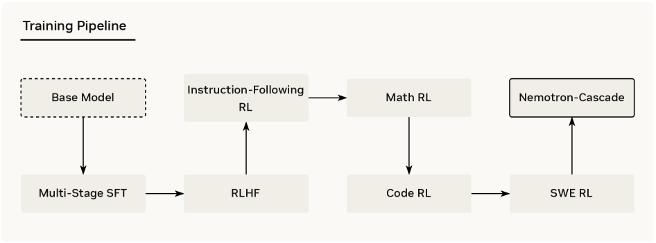
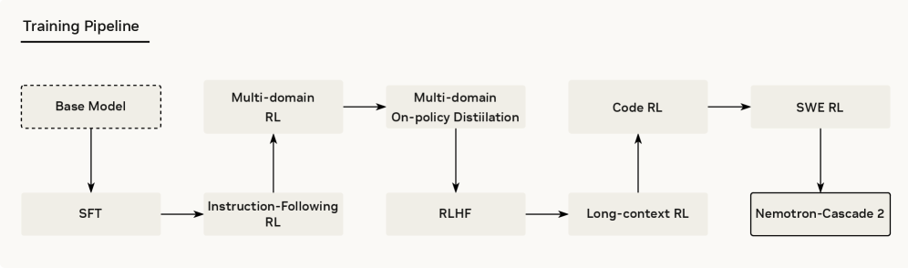

> Corresponding lecture: Q&A 3 — Reader questions, lec. 8–11 · Watch/PDF/Slides/Source at [rlhfbook.com/course](https://rlhfbook.com/course)

# Q&A 3: Post-Training Recipe Evolution and Advice

This chapter collects questions from GitHub, Discord, and YouTube comments through Lecture 11.

## Q1: “Should capabilities be trained separately, then merged?”

A viewer asks:

> If each capability is sort of its own “mode,” would it make sense to post-train stage by stage — coding → math → agentic tool use → etc. — learning one mode at a time? My guess is this intuition is wrong somewhere, since it seems like people don’t really do this and still put a lot of care into the data mixture.

**Answer:** Industry post-training has a shocking number of stages and sequencing. It is usually not just per-capability in a line, but rather with forking & merging, with some sequence too. The emerging version trains **specialist teachers in parallel**, then consolidates them into one student with multi-teacher on-policy distillation (MOPD). See Conversation 1 (w/ Finbarr Timbers).

### Cascade RL: a sequential recipe

A fun paper! Integrated a bit into Nemotron, but not accepted as state-of-the-art.

### Cascade RL 2: sequential recipe + on-policy distillation

## Q2: “Why does RLVR often omit the KL penalty?”

A follow-up from the Lecture 10 comments:

> It seems like for RLVR the default is to drop the KL term entirely. My understanding is that this is because in RLVR the reward is verifiable ground truth, so we don’t run into the over-optimization problem you get in RLHF, where a learned reward model is only a proxy. Is that the right way to think about it?

**Answer:** Overall yes. We even found during Tülu 3 that in RLVR the models are very good at selectively updating behaviors — e.g. learning math without out-of-distribution degradation.

### Some more β choices

**Dropped it:**

- Open-Reasoner-Zero, Magistral, and Skywork OR-1 ran RLVR at $\\beta = 0$.
- DAPO removed it explicitly so long reasoning chains can explore.
- GLM-5 (2026): “we remove the KL regularization term to accelerate RL improvement.”

**Kept (a version of) it:**

- DeepSeek-R1’s GRPO objective ships with a $\\beta\\, D\_{\\mathrm{KL}}$ term to the reference model.
- Kimi K3’s report never mentions KL in its RL objective — the frontier default is quiet omission.

## Q3: “How does the ~1M SFT prompt budget scale with model size?”

From the Lecture 2 comments:

> You mention some pocket rules for prompt budgets, e.g. ~1M prompts for SFT. In your experience, how does this number scale with the size of the model being post-trained?

**Answer:** Mostly, bigger models tend to need less data (e.g. Tülu 3 405B). They are more sample-efficient at RL (in terms of steps, not total GPU hours) and need less SFT data (or much of SFT data doesn’t help them). Read this as bigger models need fewer tokens per capability, which fits scaling laws. This has confounders today, as mid-training and SFT are almost indistinguishable in some ways; they both seed reasoning behaviors.

## Q4: “RL is basically just SFT with a regularization term?”

A great question from the Lecture 3 comments:

> The conventional belief is that RL is good for hardcore reasoning tasks whereas SFT is good for getting structure and formatting. But there are always new papers popping up saying RL is basically just SFT with some regularized term, and if you do their regularized version of SFT, you can get the same result. How believable/generalizable is this?

**Answer:** On the premise: it is less “SFT for formatting, RL for reasoning” and more that **SFT is the foundation** (and very compute-efficient these days), then **RL is how the model learns a lot more from there** — on harder problems, and adapting to the harnesses it will be used in at deployment. Both are impossible to get around right now. Still, **great models can be made with mostly SFT** as the field moves so fast. Any good data work will get you far.

### The similarities in all the loss functions are very real

Yes — the two updates share their core term, and on curated targets SFT is the “all-positive” special case (the same can be shown for DPO). That shared algebra drives iw-SFT, DFT, and the unified-view papers. A huge difference: **negative gradients**. RL pushes below-baseline samples *down* — it learns from its own mistakes, which SFT structurally cannot do, plus the power of on-policy learning to regularize and nudge a model.

## Q5: “When should in-house traces be trained into the weights vs. handled with ICL?”

From the Lecture 7 comments:

> When should in-house traces be learned into the weights rather than handled with in-context learning?

**Answer:** Mostly it comes down to cost, how much inference you’re doing, and what the improvements are worth monetarily. Build evaluations to see where you’re at, but assume any meaningful training effort is at least millions or tens of millions.

## Q6: “Can continued pretraining on a distillation-only dataset make a model worse?”

From the Lecture 7 comments.

**Answer:** Distillation data as a category doesn’t make it good or bad. It depends on the teacher model, the student model, the filtering, the generation procedure, etc. People have made both failed models and SOTA models with continued pretraining on synthetic data.

## Key Takeaways

- Post-training recipes use forking, merging, and sequencing; MOPD is the emerging way to combine specialists.
- RLVR often drops the KL penalty because verifiable rewards are less prone to over-optimization, but some frontier recipes keep a version of it.
- Bigger models generally need less SFT data per capability.
- SFT and RL share algebra, but RL adds negative gradients and on-policy regularization.
- Deciding between in-context learning and weight updates is a cost/benefit question.
- Synthetic/distillation data quality depends on teacher, student, filtering, and generation — not the label “distillation.”
