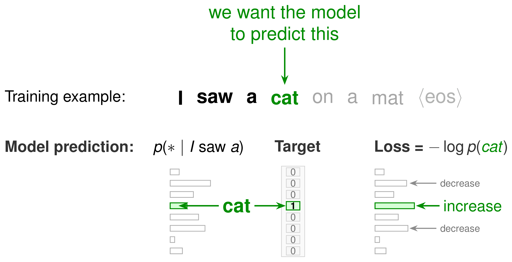

> 对应课程：第 0 讲 —— LLM 后训练的机器学习基础 · 视频/PDF/幻灯片/源码见 [rlhfbook.com/course](https://rlhfbook.com/course)

# 第 0 讲：LLM 后训练的机器学习基础

本章是一份简短的可选复习材料。我们不假设读者已有强化学习背景，但希望你熟悉基础机器学习概念——损失、梯度与概率——并能读懂 PyTorch 张量形状。本章目标是复习后续课程每天都会用到的几个核心概念：自回归语言模型、交叉熵训练目标、基于梯度的微调、KL 散度、sigmoid 偏好模型，以及把这些概念串成后训练（post-training）的强化学习框架。

读完本章后，你应该能够：

- 读懂语言模型的自回归因式分解，并将其与 `log_softmax` 和交叉熵联系起来；
- 从一个训练样本的词元 ID 出发，追溯经过 logits、对数概率、掩码到损失的完整路径；
- 解释为什么 KL 散度几乎出现在所有对齐方法中；
- 把偏好概率理解为分数差经过 sigmoid 后的输出；
- 将文本生成建模为马尔可夫决策过程，并说出后训练优化的强化学习目标。

## 语言模型

### 什么是语言模型

语言模型以**自回归**方式学习一个**词元**序列的联合概率——每个预测只依赖于它前面的词元。给定序列 $x=(x\_1,\\ldots,x\_T)$，模型用链式法则对序列概率进行因式分解：

$$P\_\\theta(x)=\\prod\_{t=1}^{T} P\_\\theta(x\_t \\mid x\_1,\\ldots,x\_{t-1}).$$

现代对话模型（如 ChatGPT、Claude、Gemini）都是基于**自注意力**的**仅解码器 Transformer**。在仅解码器模型中，每个位置只能关注自己和更早的位置，这保证了自回归结构。



同一个 Transformer 主干可以接不同的“头”完成不同任务。本课程中第一个遇到的新头是**奖励模型头**（reward-model head，见第 5 章）：同样的主干，新的头，新的目标。

### 语言模型头（LM head）

Transformer 主干为每个输入词元输出一个隐藏状态向量。**语言模型头（LM head）**是从隐藏维度到词表维度的最终线性投影。一次前向传播包括：

- 隐藏状态 $\\xrightarrow{\\text{LM head}}$ **对数几率（logits）**（词表中每个词元对应一个实值分数）；
- 对 logits 做 **softmax** $\\rightarrow$ 下一个词元的概率分布；
- 从该分布中采样或取 argmax $\\rightarrow$ 生成下一个词元。

### Softmax 与对数概率

在生成第 $t$ 步时，logits 为 $z^{(t)} \\in \\mathbb{R}^{|\\mathcal{V}|}$。softmax 将其转换为下一个词元的分布：

$$P\_\\theta(x\_t \\mid x\_{<t}) = \\mathrm{softmax}(z^{(t)})\_{x\_t}
= \\frac{e^{z^{(t)}\_{x\_t}}}{\\sum\_{j\\in\\mathcal{V}} e^{z^{(t)}\_j}}.$$

整个序列是这些单步项的乘积；取对数后乘积变为求和：

$$\\log P\_\\theta(x)
= \\log \\prod\_{t=1}^{T} P\_\\theta(x\_t \\mid x\_{<t})
= \\sum\_{t=1}^{T} \\log P\_\\theta(x\_t \\mid x\_{<t}).$$

求和中的每一项都是在真实下一个词元位置读取的 `log_softmax`。它正好是该位置的负交叉熵损失。我们使用对数概率有两个原因：**数值稳定性**（多个小概率相乘会下溢）以及求和比求积更容易求导。

### 一个 LM 训练样本的完整结构

课程中会反复提到“移动 logits”“收集目标对数概率”“掩码”。下面是一个样本的完整张量形状故事：

```text
input_ids  ∈ ℕ^{B × L}          # 模型输入：词元 ID，批量 B，长度 L
   → model(input_ids).logits ∈ ℝ^{B × L × V}     # 每个位置一个向量，V = 词表大小
   → log_softmax + gather    ∈ ℝ^{B × (L-1)}     # 每个观测词元的对数概率
   → (× completion_mask).sum ∈ ℝ^{B}             # 每条序列一个补全对数概率
```

下面是同样路径的 PyTorch 逐行实现：

```python
logits = model(input_ids).logits            # (B, L, V)：每个位置、每个词元都有一个分数
logits = logits[:, :-1, :]                  # 丢掉最后一个位置——它没有下一个词元可打分
labels = input_ids[:, 1:]                   # 每个位置的目标就是真实的下一个词元（右移）
completion_mask = completion_mask[:, 1:]    # 掩码同样右移，与 labels 对齐（1 表示补全词元）
log_probs = logits.log_softmax(dim=-1)      # 把 logits 归一化为对数概率 -> (B, L-1, V)
token_log_probs = log_probs.gather(-1, labels.unsqueeze(-1)).squeeze(-1)  # 读取每个真实下一个词元的对数概率 -> (B, L-1)
seq_log_probs = (token_log_probs * completion_mask).sum(dim=-1)           # 提示/填充位置置零，再按序列求和 -> (B,)
```

从上到下阅读这段代码：模型为每个位置生成 logits；我们丢弃最后一个 logit，因为它没有观测到的下一个词元；将词元 ID 和掩码右移一位，使位置 $t$ 监督词元 $t+1$ 的预测；`log_softmax` 把 logits 变成归一化概率；`gather` 选出真实词元的对数概率；掩码保证只对补全词元求和。

这种“单步右移”让自回归步骤变得具体：位置 $t$ 的 logits 预测词元 $t+1$。将每个词元的对数概率求和并调用 `loss.backward()`，这个和就会被自动微分变成对应每个词元梯度的和。

### 后训练代码中常见的三种掩码

掩码是 LLM 代码里“静默 bug”的高发区。三种不同的掩码做三件不同的事：

- **因果掩码（causal mask）**（内置于解码器注意力）：位置 $t$ 不能关注 $>t$ 的位置。它让模型成为自回归模型；普通训练代码不会碰它。
- **注意力 / 填充掩码**：告诉注意力忽略填充词元，因为变长序列被拼成一批。形状 `(B, L)`。
- **补全 / 损失掩码**：只在补全词元上取值为 `1`；损失会先乘上它再求和。**提示词元只起条件作用，不产生损失。**

如果补全掩码写错，你可能会在提示上训练（浪费无法改变的词元上的梯度），或者在填充上训练（在噪声上训练）。

### 解码简评

生成过程是在同一策略 $\\pi\_\\theta$ 下采样或搜索；权重不变，只有选择每个词元的方式变化：

- **贪心解码（greedy）**：每步取 $\\arg\\max\_v P\_\\theta(v \\mid x\_{<t})$。确定性强，但目光短浅：局部最优词元可能毁掉整个序列。
- **束搜索（beam search）**：保留按累计对数概率排序的前 $b$ 条部分序列，扩展并剪枝。对低熵任务（如翻译）很好，对开放式文本往往乏味。
- **温度采样**：$y\_t \\sim \\mathrm{softmax}(z\_t / T)$。$T$ 越高越多样，$T$ 越低越接近贪心。
- **截断采样**：只从 top-$k$ 个词元中采样，或从累计概率质量至少为 $p$ 的最小集合中采样（top-$p$ / nucleus 采样）。
- **前瞻搜索**（MCTS 及类似方法）：在真正选定某个词元前，先对模拟的未来续写打分（通常用价值模型或奖励模型）。

关键区分在于 **分布** $\\pi\_\\theta$ 与 **采样它的过程** 是不同的。

温度有一个清晰的信息论解释：它重新缩放 logits，从而改变输出分布的熵。当 $T\\to 0$ 时分布坍缩为贪心的 argmax；当 $T\\to\\infty$ 时分布趋近于词表上的均匀分布。

## 训练语言模型：交叉熵

在每个位置，交叉熵将模型预测分布与真实下一个词元标签 $q\_t$ 比较。由于标签在实际词元 $x\_t$ 处是 one-hot 的，对词表求和会坍缩成单一项：

$$H(q\_t,\\,P\_\\theta)
= -\\sum\_{v\\in\\mathcal{V}} q\_t(v)\\,\\log P\_\\theta(v \\mid x\_{<t})
= -\\log P\_\\theta(x\_t \\mid x\_{<t}).$$

对位置求和并对数据集取平均，得到标准语言建模损失，也称**负对数似然（NLL）**：

$$\\mathcal{L}\_{\\text{LM}}(\\theta)
= -\\,\\mathbb{E}\_{x\\sim\\mathcal{D}}\\left[\\sum\_{t=1}^{T} \\log P\_\\theta(x\_t \\mid x\_{<t})\\right].$$

“预测下一个词元”就是监督学习；标签就是序列中的下一个词元。

### 交叉熵即最大似然

因为数据的经验分布把所有质量都放在观测到的词元上，所以在整个数据集上最小化平均交叉熵，等价于在模型下最大化数据的对数似然。这就是为什么 LM 目标也被称为**最大似然估计**，以及“预测下一个词元”成为经典预训练任务的原因。

## 优化与微调

### 梯度下降与训练循环

深度学习训练反复执行同一步骤：

$$\\theta \\leftarrow \\theta - \\eta \\,\\nabla\_\\theta \\mathcal{L}(\\theta),$$

其中 $\\theta$ 是模型参数，$\\eta$ 是学习率，$\\nabla\_\\theta\\mathcal{L}$ 是损失梯度。实践中，语言模型训练通常使用 **AdamW** 等自适应优化器，而不是普通 SGD。训练以优化器**步数**或**词元数**计量；对有限微调数据集，**轮数（epochs）**是有用的单位。学习率调度方案本身与学习率一样重要。

基本的反向传播循环在预训练、中期训练与微调中是相同的。不同的是掩码、采样、批处理、数据构造和系统，而不是优化器。

### 预训练 → 中期训练 → 监督微调

预训练结束处的边界很模糊，对后训练却非常重要：

- **预训练**：在大量原始网页和代码数据上做下一个词元交叉熵；**每个**词元都参与损失。
- **中期训练（mid-training）**：预训练末尾的退火 / 高质量数据阶段，发生在任何指令数据之前。这里质量会提升。它可以被视为后训练的一部分，但通常单独讨论。
- **监督微调（SFT）**：仍然是交叉熵，但现在数据是**指令–回复**对，并使用**补全掩码**。只有回复词元参与损失；提示只起条件作用。模型学会*回应*，而不只是续写文本。

因此，预训练结束的确切点是一个设计选择。有些团队把退火阶段视为预训练的最后一部分；有些则把它视为后训练的第一部分。对 RLHF 来说，重要的是起始检查点已经具备高质量的通用知识和流畅的下一个词元行为，这样后训练阶段才能专注于激发有用的回复。

现代后训练流水线从一个**经过中期训练**的检查点开始，因此本课程的故事实际上从这里开始。

## 概率论基础

### KL 散度（与熵）

**KL 散度（Kullback–Leibler divergence）**衡量两个分布之间的差异：

$$\\mathcal{D}\_{\\text{KL}}(p\\,\\|\\,q)=\\sum\_i p\_i \\log\\frac{p\_i}{q\_i}.$$

记住三条性质：

- **非对称**：$\\mathcal{D}\_{\\text{KL}}(p\\|q)\\neq\\mathcal{D}\_{\\text{KL}}(q\\|p)$，方向很重要。
- **非负**，且仅在 $p=q$ 时为零。
- **对齐的核心对象**：RLHF 中的 KL 惩罚项（第 3–4 讲）让策略贴近它的 SFT 起点；DPO 损失（第 6 讲）则从一个**带 KL 正则的奖励最大化**目标推导而来。

相关概念：**熵** $H(p)=-\\sum\_i p\_i \\log p\_i$ 表示一个分布的不确定性——均匀分布熵高、尖峰分布熵低。它出现在各种定义、推导和理解系统行为的讨论中。

### 交叉熵、熵与 KL 散度的统一关系

三个量构成一个信息论整体（用 $\\ln$ 时单位为 nats，用 $\\log\_2$ 时单位为 bits）：

- **熵**：$H(p)=-\\sum\_i p\_i\\log p\_i$ —— 从 $p$ 中采样样本的平均“惊讶度”；编码它们的不可压缩代价。
- **交叉熵**：$H(p,q)=-\\sum\_i p\_i\\log q\_i$ —— 用为*错误*分布 $q$ 设计的编码去编码 $p$ 的样本所需的代价。
- **KL 散度**：$\\mathcal{D}\_{\\text{KL}}(p\\|q)=\\sum\_i p\_i\\log\\frac{p\_i}{q\_i}$ —— 用 $q$ 代替 $p$ 所多付出的*额外*代价。

它们满足：

$$H(p,q)=H(p)+\\mathcal{D}\_{\\text{KL}}(p\\|q).$$

因此最小化交叉熵就是在最小化到真实分布的 KL：$H(p)$ 由数据固定。在语言模型训练中标签 $p$ 是 one-hot，所以 $H(p)=0$，于是**交叉熵 = KL 散度 = 负对数似然**。而在 RLHF 中，KL 项是*故意加上去*的，用来让策略贴近参考模型。

### 序列上 KL 散度的估计

对完整序列，KL 背后的精确求和通常不可行，但 KL 是一个**期望**，因此可以用蒙特卡洛方法估计：对从策略中采样的样本取对数比的平均。

$$\\mathcal{D}\_{\\text{KL}}(\\pi\_\\theta\\,\\|\\,\\pi\_{\\text{ref}})
= \\mathbb{E}\_{x\\sim\\pi\_\\theta}\\!\\left[\\log\\frac{\\pi\_\\theta(x)}{\\pi\_{\\text{ref}}(x)}\\right]
\\approx \\frac{1}{N}\\sum\_{i=1}^{N}\\log\\frac{\\pi\_\\theta(x\_i)}{\\pi\_{\\text{ref}}(x\_i)}.$$

- 被积函数就是每次 rollout 上已经生成的**对数概率比**。
- 朴素的单样本平均 $\\hat k\_1=\\log\\frac{\\pi\_\\theta}{\\pi\_{\\text{ref}}}$ 无偏但方差大，在有限样本下可能为负。
- RLHF 实现常使用低方差且恒为非负的 **$k\_3$ 估计量** $\\hat k\_3 = r - 1 - \\log r$，其中 $r=\\frac{\\pi\_{\\text{ref}}}{\\pi\_\\theta}$（Schulman 2020）。

这是信息论的实践面貌：从样本中近似目标分布，用方差换取原本不可行的求和。

### Sigmoid 与成对似然

“回复 $y\_w$ 比 $y\_l$ 更好”这样的偏好是一个**二分类**结果，因此分数差要经过 **sigmoid** 压缩成概率：

$$\\sigma(z)=\\frac{1}{1+e^{-z}},\\qquad
P(y\_w\\succ y\_l\\mid x)=\\sigma\\!\\left(r(x,y\_w)-r(x,y\_l)\\right).$$

要认识到三点：

- sigmoid 把**分数差**转换成二分类概率。
- 只有**相对**奖励差才重要——给两个奖励同时加上常数不会改变结果。
- $-\\log\\sigma(\\cdot)$ 就是**二分类负对数似然**。

第 2 讲会完整推导这个 Bradley–Terry 模型来训练奖励模型；第 6 讲会在 DPO 中复用完全相同的 $\\sigma(\\Delta r)$ 形式。

## 强化学习框架

### 标准 RL 目标

强化学习研究智能体在**马尔可夫决策过程（Markov decision process, MDP）** $(\\mathcal{S},\\mathcal{A},P,r,\\gamma)$ 中的行为。在标准设定中，智能体按策略 $\\pi(a\_t\\mid s\_t)$ 采样动作 $a\_t$，环境按转移动力学 $p(s\_{t+1}\\mid s\_t,a\_t)$ 演化，并给出奖励 $r(s\_t,a\_t)$。策略与动力学共同诱导出轨迹 $\\tau=(s\_0,a\_0,s\_1,\\ldots)$ 的分布：

$$p\_\\pi(\\tau)=\\rho\_0(s\_0)\\prod\_{t=0}^{T-1}\\pi(a\_t\\mid s\_t)\\,p(s\_{t+1}\\mid s\_t,a\_t).$$

在有限时间范围 $T$ 内，智能体目标是最大化折扣期望回报：

$$\\max\_\\pi \\; \\mathbb{E}\_{\\tau\\sim p\_\\pi}\\left[\\sum\_{t=0}^{T-1}\\gamma^t r(s\_t,a\_t)\\right],$$

其中 $\\gamma\\in[0,1]$ 权衡近期与未来奖励。策略的期望回报常记为 $J(\\pi)$。

对于持续性任务，通常让 $T\\to\\infty$ 并依赖折扣因子 $\\gamma<1$ 来保持目标有定义。而文本生成通常被视为单回合的 episodic 问题，因此在 RLHF 中常见 $\\gamma=1$。

### 简单例子：恒温器

在把 RL 映射到语言之前，先用一个恒温器让 RL 循环具体化。假设恒温器要把房间保持在 $70^\\circ$F：

- **状态 $s\_t$**：当前室温，例如 $65^\\circ$F。
- **动作 $a\_t$**：打开或关闭加热器。
- **奖励 $r$**：当温度在目标 $\\pm 2^\\circ$ 内时为 $+1$，否则为 $0$。
- **转移**：加热器打开时房间升温，关闭时降温。
- **策略 $\\pi$**：根据当前温度决定是否打开加热器，例如

$$\\pi(a\_t=\\text{on}\\mid s\_t)=\\begin{cases}1 & \\text{if } s\_t<70^\\circ\\text{F}\\\\0 & \\text{otherwise.}\\end{cases}$$

初始时策略几乎是随机的，但通过试错它会发现：房间冷时开加热器、热时关加热器能获得更多奖励。这就是 RL 循环的核心：观察、行动、收到奖励、更新策略以在未来获得更多奖励。

### 经典控制例子：CartPole

为了用一个带连续动力学的更丰富例子来巩固直觉，可以考虑经典的 *CartPole*（倒立摆）控制任务。它出现在许多 RL 教材、课程甚至研究论文中。与只有单一状态变量和二值动作的恒温器不同，CartPole 包含四个连续状态变量和基于物理的转移，是 RL 算法的标准基准。

- **状态（$s\_t$）**：小车位置/速度以及杆角度/角速度：

  $$s\_t = (x\_t,\\,\\dot{x}\_t,\\,\\theta\_t,\\,\\dot{\\theta}\_t).$$

- **动作（$a\_t$）**：对小车施加向左或向右的水平力，例如 $a\_t \\in \\{-F, +F\\}$。

- **奖励（$r$）**：简单奖励为每步 $r\_t = 1$，只要杆保持平衡且小车留在轨道上（例如 $|x\_t| \\le 2.4$ 且 $|\\theta\_t| \\le 12^\\circ$）；一旦超出任一界限，回合结束。

- **动力学 / 转移（$p(s\_{t+1}\\mid s\_t,a\_t)$）**：在许多环境中，动力学是确定性的（因此 $p$ 是一个点质量），可写成通过步长 $\\Delta t$ 的欧拉积分得到的 $s\_{t+1} = f(s\_t,a\_t)$。一个常用的简化 CartPole 更新使用小车质量 $m\_c$、杆质量 $m\_p$、杆半长 $l$ 和重力加速度 $g$（其中 $\\alpha$ 是一个具有加速度单位的、按质量归一化的中间量）：

  $$\\alpha = \\frac{a\_t + m\_p l\\,\\dot{\\theta}\_t^2\\sin\\theta\_t}{m\_c + m\_p}$$

  $$\\ddot{\\theta}\_t = \\frac{g\\sin\\theta\_t - \\cos\\theta\_t\\,\\alpha}{l\\left(\\tfrac{4}{3} - \\frac{m\_p\\cos^2\\theta\_t}{m\_c + m\_p}\\right)}$$

  $$\\ddot{x}\_t = \\alpha - \\frac{m\_p l\\,\\ddot{\\theta}\_t\\cos\\theta\_t}{m\_c + m\_p}$$

  $$x\_{t+1}=x\_t+\\Delta t\\,\\dot{x}\_t,\\quad \\dot{x}\_{t+1}=\\dot{x}\_t+\\Delta t\\,\\ddot{x}\_t,$$
  $$\\theta\_{t+1}=\\theta\_t+\\Delta t\\,\\dot{\\theta}\_t,\\quad \\dot{\\theta}\_{t+1}=\\dot{\\theta}\_t+\\Delta t\\,\\ddot{\\theta}\_t.$$

这是上述一般设定的具体实例：策略选择 $a\_t$，转移函数推进状态，奖励在回合中累计。

### 语言模型作为 MDP

对文本生成，标准 MDP 各部分映射如下：

| MDP 概念 | 语言模型 |
|---|---|
| 状态 $s\_t$ | 提示 + 已生成词元：$(x, y\_{<t})$ |
| 动作 $a\_t$ | 下一个词元 $y\_t$ |
| 转移 $P$ | 确定性：把词元追加到序列 |
| 策略 $\\pi\_\\theta(a\_t\\mid s\_t)$ | 语言模型的下一个词元分布 |
| 奖励 $r$ | 通常是**终止奖励**：奖励模型分数或验证器输出 |
| 折扣 $\\gamma$ | 通常为 $1.0$（无折扣） |

策略就是语言模型，对词元进行因式分解：

$$\\pi\_\\theta(y\\mid x)=\\prod\_t \\pi\_\\theta(y\_t\\mid x,y\_{<t}).$$

因为转移是确定性的——追加一个词元总是产生相同的下一个状态——语言模型的轨迹分布就简化为策略选择的乘积，没有环境动力学项。这正是语言模型一节中的自回归因式分解。区别在于目标：不是最大化固定文本的似然，而是最大化赋给整个补全的标量奖励。

### RL 的目标，以及为什么用于语言模型

RL 的目标是选择策略参数 $\\theta$，以最大化策略自身下的期望奖励：

$$J(\\theta)=\\mathbb{E}\_{y\\sim\\pi\_\\theta}[R(x,y)].$$

对语言模型而言，人类偏好或验证器是在回复末尾给出的单一标量。这个信号是：

- **稀疏的**：整条回复只有一个标签，而非每个词元都有标签。
- **延迟的**：一个词元的质量取决于整个补全。
- **离散词元不可微**：普通梯度无法穿过被采样的离散词元反向传播。

因此不存在“偏好”的交叉熵目标。策略梯度仍然直接优化期望评估分数。标准做法先把信号*学习*成一个奖励模型，再*优化*它——并且通常会加上 KL 惩罚，让策略贴近起点：

$$\\max\_\\pi \\; \\mathbb{E}\_{y\\sim\\pi\_\\theta}[r\_\\theta(x,y)] - \\beta\\,\\mathcal{D}\_{\\text{KL}}(\\pi\_\\theta(\\cdot\\mid x)\\,\\|\\,\\pi\_{\\text{ref}}(\\cdot\\mid x)).$$

超参数 $\\beta$ 控制 KL 预算的强度：$\\beta$ 越大，策略越贴近参考模型；$\\beta$ 越小，优化器越自由地追逐奖励。我们将在第 10 讲回到这一权衡。

这就是 RLHF 的全部动机。

## 从这些基础到后训练

本章所讲的一切都是基础机制——概率、损失、梯度与采样。**后训练（post-training）**指的是把这些机制指向预训练模型，并使用比原始“下一个词元预测”更丰富的反馈：

- **示范**（“生成这个回复”）→ 监督微调（SFT）；
- **偏好**（“让这个回复比那个更可能出现”）→ 奖励模型或偏好优化（如 DPO）；
- **奖励**（“采样高分的回复”）→ 强化学习（PPO、GRPO、RLVR）；
- **约束**（“不要离起点太远”）→ 正则化，尤其是 KL 惩罚。

数据与目标不同，但根本目标相同：

> **把模型对回复的分布转向我们想要的行为。**

课程的其余部分就是讨论如何可靠地做到这一点。

| 信号 | 目标 | 典型数据 | 改变什么 |
|---|---|---|---|
| 示范 | 交叉熵（SFT） | 提示–回复对 | 形式与基本指令遵循 |
| 成对偏好 | 奖励模型训练或 DPO | $y\_w \\succ y\_l$ 比较 | 风格与微妙的人类偏好 |
| 标量奖励 | RL（PPO、GRPO、RLVR） | 采样轨迹 + 奖励 | 针对性行为与推理 |
| KL 惩罚 | 加入上述目标 | 参考策略 | 正则化，防止漂移 |

### 经典的三阶段配方

最早被广泛记录的 RLHF 配方由 InstructGPT（Ouyang et al. 2022）建立，它将上述组件转化为一条具体流水线。从一个在大量网页文本上预训练过的基座模型出发，依次执行三个阶段：

1. **在约 10K 条样本上进行指令微调**：模型看到“提示–回复”形式的问答对，从而学习回答的*形式*。
2. **在约 10 万对偏好数据上训练奖励模型**：将指令微调后的模型复制一份，拟合人类偏好比较，输出一个标量奖励信号。
3. **在约 10 万个提示上进行 RLHF 优化**：指令微调后的模型生成补全，奖励模型打分，策略梯度算法朝着更高奖励更新生成模型，同时 KL 惩罚项让它贴近初始点。

这个配方是现代后训练的基础。当代配方还会加入预训练末段退火、更大的偏好数据集、直接对齐方法（如 DPO）以及可验证奖励强化学习（RLVR），但交叉熵、KL 散度、sigmoid 偏好和策略梯度这些基本组件始终贯穿其中。

### 后训练改变了什么

后训练不会从头重写模型；它只是重新加权补全上的分布。如果你问基座模型“The president of the United States in 2006 was”，它会续写句子并滑向无关的网页文本，例如：

> George W. Bush, the governor of Florida in 2006 was Jeb Bush, and John McCain was an Arizona senator in 2006 — who later lost to Obama. September 1 — U.S. President Bush signs an executive order ...

而经过后训练的模型会直接回答问题：

> George W. Bush was the president of the United States in 2006. He served two terms in office, from January 20, 2001, to January 20, 2009.

这种差异——把“下一个词元续写”转化为有针对性的有用行为——正是本章这些基础概念能够实现的效果。

## 如果某些内容感觉生疏

- **强化学习**：Sutton & Barto，《Reinforcement Learning: An Introduction》；David Silver 的 UCL 课程；UC Berkeley CS285。
- **从零开始理解语言模型**：Sebastian Raschka，《Build a Large Language Model (From Scratch)》。
- **本书附录**：《Reinforcement Learning from Human Feedback》附录 A 涵盖了全书使用的语言模型概述、KL 散度与 RL 术语。

去钻兔子洞、跳读、追你感兴趣的内容——这门课就是为这种学习方式设计的。

## 要点小结

- 语言模型把 $P\_\\theta(x)$ 因式分解为下一个词元概率的乘积；取对数后变成 `log_softmax` 项之和，即负交叉熵损失。
- 训练是单步右移：位置 $t$ 的 logits 预测词元 $t+1$；提示词元被掩码掉，只有补全词元参与损失。
- KL 散度、熵与交叉熵满足 $H(p,q)=H(p)+\\mathcal{D}\_{\\text{KL}}(p\\|q)$。在 LM 训练中，one-hot 标签使交叉熵等于负对数似然；在 RLHF 中，KL 项被故意加入作为正则项。
- 成对偏好建模为 $\\sigma(\\Delta r)$；只有相对奖励差才重要，$-\\log\\sigma(\\Delta r)$ 是二分类负对数似然。
- 文本生成可视为 MDP：语言模型是策略，词元是动作，奖励通常是终止且稀疏的；这就是为什么目标不是固定序列时需要策略梯度。
- 后训练复用预训练的优化器与采样机制，但改变数据与目标，以引导模型产生有用行为。

## 参考文献

- Vaswani, A., Shazeer, N., Parmar, N., Uszkoreit, J., Jones, L., Gomez, A. N., Kaiser, Ł., & Polosukhin, I. (2017). Attention Is All You Need. *Advances in Neural Information Processing Systems 30 (NeurIPS 2017)*.
- Schulman, J. (2020). Approximating KL Divergence. *Blog post*. <http://joschu.net/blog/kl-approx.html>
- Ouyang, L., Wu, J., Jiang, X., Almeida, D., Wainwright, C., Mishkin, P., Zhang, C., Agarwal, S., Slama, K., Ray, A., ... (2022). Training language models to follow instructions with human feedback. *Advances in Neural Information Processing Systems*, 35, 27730–27744.
