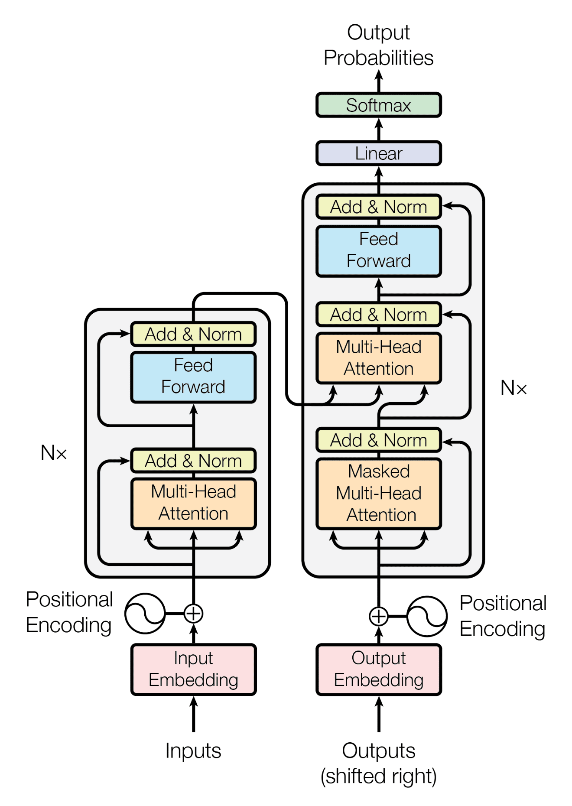
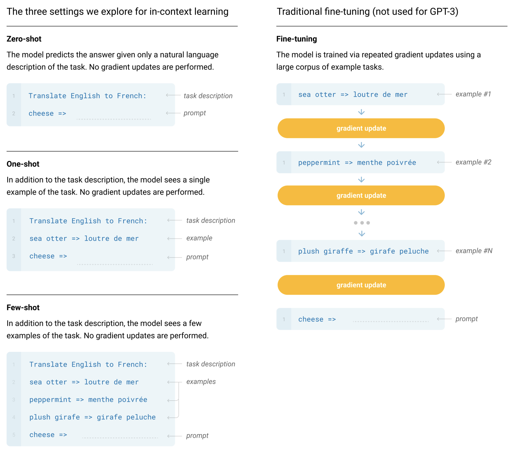
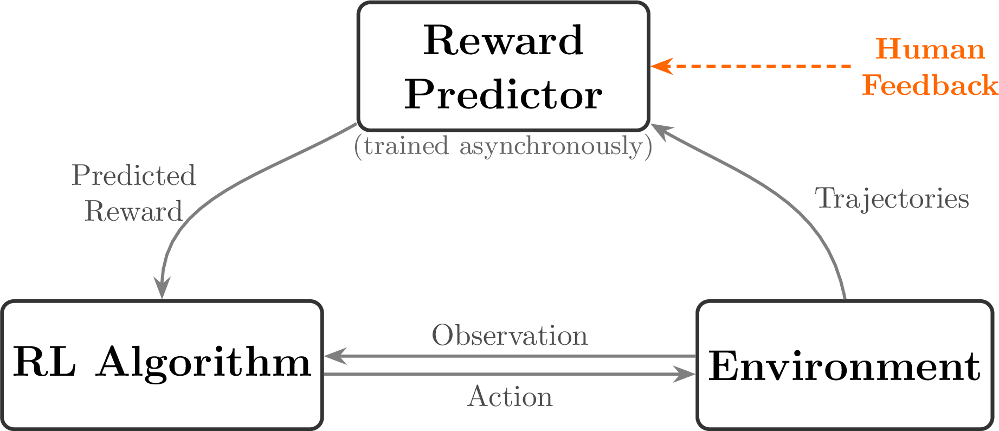
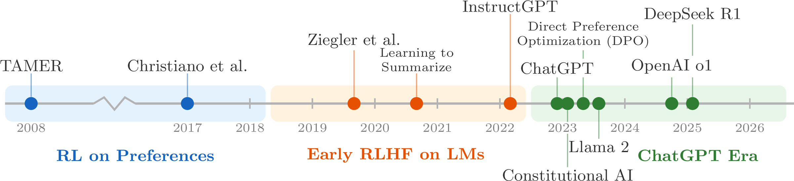

> 对应讲座：第 1 讲——概述 · 第 1–3 章 · 观看视频/下载 PDF/幻灯片/源码请访问 [rlhfbook.com/course](https://rlhfbook.com/course)

# 第 1 讲：概述——RLHF 与后训练基础

基于人类反馈的强化学习（RLHF）是一套将大规模语言模型从自动补全引擎转变为实用助手的技术。它隶属于模型开发中一个更宽泛的阶段，即*后训练*：在基座模型完成大规模自回归预训练之后所施加的全部训练步骤。本章将勾勒这一领域的全貌。我们首先说明什么是语言模型，梳理使现代后训练成为可能的短暂而密集的历史；接着引入支撑 RLHF 的强化学习形式化框架；随后走过经典的三步 InstructGPT 配方；最后落脚于 2026 年前后后训练的两大主流方向：直接偏好优化与可验证奖励强化学习（RLVR）。

## 语言模型与 Transformer 革命

语言模型的核心是给文本分配概率。它将文本看作一串*词元*（token）序列——词元可以是完整单词、子词或字符——并在给定前文的情况下预测下一个词元。重复这一预测过程，即可逐词生成一段*补全*（completion），这被称为*自回归*生成。

现代语言模型拥有数十亿到数万亿参数，大多是 Transformer 架构的后代。Transformer 将*自注意力*机制与全连接前馈层结合使用（Vaswani et al. 2017）。如今的模型处理的也远不止文本：Gemini、ChatGPT 及其同类产品都能处理图像、音频和视频。

现代时间线很短，但变革剧烈：

- **2017 年：** Transformer 诞生（Vaswani et al. 2017）。
- **2018 年：** GPT-1（Radford et al. 2018）、ELMo（Peters et al. 2018）和 BERT（Devlin et al. 2018）表明，大规模无监督或自监督语言模型能强有力地迁移到下游任务。
- **2019 年：** GPT-2（Radford et al. 2019）证明扩大模型规模和数据量可带来广泛的新兴能力；同年，缩放定律（Kaplan et al. 2020）为领域建立了算力、数据、参数与损失之间的可预测关系。
- **2020 年：** GPT-3（Brown et al. 2020）以其上下文学习与少样本提示能力令研究者惊讶：模型仅通过嵌入提示中的几个示例就能完成新任务。
- **2021 年：** "Stochastic Parrots" 论文（Bender et al. 2021）凝练了对超大规模语言模型风险的早期关切。
- **2022 年：** ChatGPT（OpenAI 2022）使经 RLHF 调优的对话式 AI 成为主流产品。
- **2023 年：** GPT-4（OpenAI 2023）确立了前沿多模态模型的地位。
- **2024 年：** OpenAI 的 o1 系列（OpenAI 2024）普及了在推理阶段投入更多算力的推理模型。
- **2025 年：** o3、Claude Code（Anthropic 2025）以及 OpenAI 的 Agent 工具（OpenAI 2025）推动模型向长程工具使用与编程 Agent 演进。

## 预训练：下一词元预测

预训练是第一个、也是规模最大的训练阶段。模型在来自网页、书籍、代码和文档的数万亿词元上进行训练。前沿模型通常训练 5–50+ 万亿词元；一万亿文本词元大约相当于 3–5 TB 数据。实验室收集并过滤的数据量通常是实际入模数据的 10–20 倍，因此总数据漏斗可达 PB 量级。目标很简单：预测序列中的下一个词元。其结果是模型获得了广泛的世界知识、语言流畅性与灵活能力。

预训练结束后的基座模型，本质上是一个非常强大的自动补全引擎。若问它"2006 年美国总统是"，像 Llama 3.1 405B Base 这样的基座模型会接着写：

> George W. Bush, the governor of Florida in 2006 was Jeb Bush, and John McCain was an Arizona senator in 2006...

它补完了句子，然后滑向相关的网页式文本。后训练正是把这种延续行为转变为直接、对话式回答的过程。

## 后训练：从自动补全到助手

后训练是预训练之后为使模型适用于聊天或助手界面而施加的全部阶段的统称。不同阶段改变的东西各不相同：

- **预训练**构建世界知识、语言流畅性与广泛能力。
- **指令微调 / 监督微调（SFT）**教会模型以问答格式作答，并常教会它复现特定的词元序列。
- **偏好微调 / RLHF**使用对比损失整体地修改补全，使模型更丰富、更灵活，也更符合人类偏好。
- **可验证奖励强化学习（RLVR）**增强模型在答案可被精确检验的问题上的表现，例如数学或代码测试；这可以转化为更复杂、更具 Agent 性质的行为。

基于 RL 的后训练比单纯的 SFT 提供了更丰富、*响应级别*的对比反馈，但 SFT 仍是取得最佳性能的基础。

经过后训练，同样的提示会得到聚焦的助手式回答。后训练模型 Tülu 3 405B 会回答：

> George W. Bush was the president of the United States in 2006. He served two terms in office, from January 20, 2001, to January 20, 2009.

ChatGPT 展示了 RLHF 在产品层面的威力。模型的回复迅速在三个维度上提升：*格式*更好（直接、对话式）、*风格*更好（有帮助、简洁、使用 Markdown），以及整体*产品*体验更好，成为人们日常可用的工具。

## 强化学习基础

理解 RLHF 之前，有必要从经典强化学习（RL）说起。RL 问题通常被写成一个**马尔可夫决策过程（MDP）**：

$$(\\mathcal{S}, \\mathcal{A}, P, r, \\gamma)$$

其中 $\\mathcal{S}$ 是状态空间，$\\mathcal{A}$ 是动作空间，$P(s\_{t+1} \\mid s\_t, a\_t)$ 是转移动力学，$r(s\_t, a\_t)$ 是奖励函数，$\\gamma$ 是折扣因子。智能体的目标是在一条轨迹上最大化累积回报：

$$J(\\pi) = \\mathbb{E}\_{\\tau \\sim \\pi}\\left[\\sum\_{t=0}^{T} \\gamma^t r(s\_t, a\_t)\\right].$$

用通俗语言解释：

- **状态**：智能体所处的当前情境。
- **动作**：智能体下一步采取的行为。
- **奖励**：衡量该动作好坏的信号。
- **策略** $\\pi$：选择动作的策略。
- **轨迹** $\\tau$：状态、动作与奖励的序列，$\\tau = (s\_0, a\_0, r\_0, s\_1, a\_1, r\_1, \\ldots)$。
- **轨迹概率**：$P(\\tau \\mid \\pi) = p(s\_0) \\prod\_{t=0}^{T} \\pi(a\_t \\mid s\_t)  p(s\_{t+1} \\mid s\_t, a\_t)$。

**恒温器。** 一个简单的 RL 例子是恒温器学习何时开关暖气。状态是当前室温；动作是开或关；奖励是房间温度接近目标时为正；策略是决定如何动作的规则。一种可能的策略是：

$$\\pi(a\_t = \\text{on} \\mid s\_t) = \\begin{cases} 1 & \\text{if } s\_t < 70^\\circ\\text{F} \\0 & \\text{otherwise} \\end{cases}.$$

**CartPole。** 一个标准基准是 CartPole。状态是四维的：

$$s\_t = (x\_t, \\dot{x}\_t, \\theta\_t, \\dot{\\theta}\_t),$$

其中 $x\_t$ 是小车位置，$\\dot{x}\_t$ 是小车速度，$\\theta\_t$ 是杆的角度，$\\dot{\\theta}\_t$ 是角速度。动作是向左或向右推小车：

$$a\_t \\in \\{\\text{left}, \\text{right}\\}.$$

奖励是杆保持直立的每一步得 +1，若杆倾斜过度或小车出轨则回合结束：

$$r(s\_t, a\_t) = \\begin{cases} 1 & \\text{if } |\\theta\_t| < 12° \\text{ and } |x\_t| < 2.4 \\0 & \\text{otherwise}. \\end{cases}$$

其动力学涉及小车质量 $m\_c$、杆质量 $m\_p$、杆长 $l$、重力 $g$ 与作用力 $F$：

$$\\begin{aligned}
\\ddot{x}\_t &= \\frac{F + m\_p l (\\dot{\\theta}\_t^2 \\sin\\theta\_t - \\ddot{\\theta}\_t \\cos\\theta\_t)}{m\_c + m\_p}, \\\\[6pt]
\\ddot{\\theta}\_t &= \\frac{g \\sin\\theta\_t - \\cos\\theta\_t \\cdot \\ddot{x}\_t}{l}.
\\end{aligned}$$

因此，经典 RL 是一个**多步控制问题**：每个动作都会改变下一状态，奖励在整条轨迹上累积。

## 为什么需要 RLHF？

在经典 RL 中，奖励函数是已知的——CartPole 每步给 +1。但在许多真实任务中，奖励**很难写下来**。判断哪首诗更好容易，写出一首杰作却很难；识别一个有用的回答容易，把"有用"写成公式却很难；而且预训练下最可能的补全未必是最有用的补全。RLHF 让我们能够优化那些我们可以*评估*、却难以*显式指定*奖励的行为。

这一思想早于语言模型。**TAMER**（Knox & Stone 2008）让人类为智能体动作打分以学习奖励模型。Christiano et al. (2017) 将 RLHF 应用于 Atari 游戏中的轨迹偏好。Ziegler et al. (2019) 首次在语言模型上做了 RLHF。Christiano et al. (2017) 的示意图——用比较训练奖励模型，再用 RL 智能体优化该奖励模型——至今仍是现代 RLHF 的核心循环。

通向现代 RLHF 的路径包含若干里程碑（Ziegler et al. 2019；Ouyang et al. 2022；Bai et al. 2022；Rafailov et al. 2024；Dubey et al. 2024；Lambert et al. 2024；Guo et al. 2025）：

语言模型上的其他重要早期工作包括：

- **Stiennon et al. (2020)** —— 从人类反馈中学习总结，将 Ziegler et al. 的方法扩展到长文本总结，并使用 PPO。
- **WebGPT（Nakano et al. 2021）** —— 训练模型浏览网页并借助 RLHF 回答问题，同时给出引用。
- **Anthropic HH（Bai et al. 2022）** —— 用 RLHF 训练有帮助且无害的助手，并引入了广泛使用的 HH 数据集。
- **GopherCite（Menick et al. 2022）** —— 教语言模型用经过验证的引用来支撑答案。
- **Sparrow（Glaese et al. 2022）** —— 通过针对性的人类判断改进对话智能体，并在 RLHF 中加入基于规则的约束。
- **InstructGPT（Ouyang et al. 2022）** —— ChatGPT 背后的经典三步 RLHF 配方。

## RLHF 的比较数据长什么样

RLHF 训练的是*偏好对*。人类或 AI 标注者看到同一提示下的两个回复，选出更好的一个。例如对提示 "Explain why the sky is blue in one sentence"，回复 A 可能是：

> The sky is blue due to Rayleigh scattering, where shorter blue wavelengths of sunlight are scattered more by atmospheric molecules than longer wavelengths.

回复 B 可能是：

> The sky appears blue because of the way light interacts with the atmosphere and stuff, it's basically just physics.

偏好对 $(y\_w, y\_l)$，其中 $y\_w$ 为优胜回复、$y\_l$ 为落败回复，就成为训练数据。

## 经典 RL 与 RLHF 的对比

经典 RL 与 RLHF 在几个维度上不同：

| | 经典 RL | RLHF |
|---|---|---|
| **环境** | 智能体在状态 $s\_t$ 中执行动作 $a\_t$ | 提示 $x$ 从数据集中采样；无环境 |
| **奖励** | 已知逐步奖励 $r(s\_t, a\_t)$ | 从人类偏好中学习；响应级别 |
| **优化目标** | 轨迹上的累积回报 | 期望奖励减去与参考模型的 KL 距离 |
| **正则化** | 折扣 $\\gamma$ | KL 惩罚系数 $\\beta$ |

经典目标为：

$$J(\\pi) = \\mathbb{E}\_{\\tau \\sim \\pi}\\left[\\sum\_{t=0}^{T} \\gamma^t r(s\_t, a\_t)\\right].$$

RLHF 目标为：

$$J(\\pi) = \\mathbb{E}\\left[ r\_\\phi(x, y) \\right] - \\beta  D\_{\\text{KL}}\\left(\\pi \\mid \\pi\_{\\text{ref}}\\right).$$

## InstructGPT 三步配方

由 InstructGPT（Ouyang et al. 2022）确立的经典 RLHF 配方包含三步。

### 第一步：指令微调（SFT）

从预训练语言模型出发，用期望助手行为的演示数据，以标准监督学习训练提示-回复对。SFT 损失是目标回复词元的负对数似然：

$$\\mathcal{L}\_{\\mathrm{SFT}}(\\theta) = - \\sum\_{(x, y^\\star)} \\sum\_{t=1}^{|y^\\star|} \\log \\pi\_\\theta \\left(y^\\star\_t \\mid x, y^\\star\_{<t}\\right).$$

此步之后，模型能够以期望格式回答问题。SFT 易于应用，可快速将基座模型适配到多个领域。

### 第二步：奖励模型训练

收集同一提示下两个模型输出的比较。（RLHF 之名源于收集*人类*反馈，但如今大量反馈由 AI 生成。）训练奖励模型 $r\_\\phi(x, y)$，使更受欢迎的回复得分更高。

概率模型认为，当某回复获得更高奖励分时，它应当获胜：

$$P(y\_w \\succ y\_l \\mid x) = \\sigma\\left(r\_\\phi(x, y\_w) - r\_\\phi(x, y\_l)\\right).$$

训练最小化优胜回复击败落败回复的负对数似然：

$$\\mathcal{L}\_{\\mathrm{RM}}(\\phi) = - \\log \\sigma\\left(r\_\\phi(x, y\_w) - r\_\\phi(x, y\_l)\\right).$$

其中 $x$ 是提示，$y\_w$ 是优胜回复，$y\_l$ 是落败回复，$r\_\\phi(x, y)$ 是训练后的奖励模型。因此 RLHF 中使用的奖励，实质上是模型预测给定文本在一对补全中成为"被选"补全的概率。

### 第三步：针对奖励模型做 RL

这一步是 RLHF 得名的原因。从数据集中采样提示 $x\_i$，由被训练模型生成补全 $y\_i \\sim \\pi\_\\theta(\\cdot \\mid x\_i)$，用奖励模型 $r\_\\phi(x\_i, y\_i)$ 打分，加入 KL 惩罚使策略贴近 SFT/参考模型 $\\pi\_{\\mathrm{ref}}$，再用策略梯度算法更新策略——InstructGPT 与 ChatGPT 使用的是近端策略优化（PPO）。目标函数为：

$$J(\\pi) = \\mathbb{E}\\left[r\_\\phi(x, y)\\right] - \\beta D\_{\\mathrm{KL}}\\left(\\pi \\mid \\pi\_{\\mathrm{ref}}\\right).$$

拆开来看，目标函数是：

$$\\max\_{\\pi}  \\mathbb{E}\_{x \\sim D, y \\sim \\pi(\\cdot \\mid x)} \\underbrace{r\_\\phi(x, y)}\_{\\text{最大化奖励}} - \\underbrace{\\beta D\_{\\mathrm{KL}}\\left(\\pi(\\cdot \\mid x)\\mid\\pi\_{\\mathrm{ref}}(\\cdot \\mid x)\\right)}\_{\\text{但别让模型变化太大}}.$$

参考模型 $\\pi\_{\\mathrm{ref}}$ 将策略锚定在 SFT 模型上。KL 散度衡量新策略在提示 $x$ 上偏离该参考的程度，$\\beta$ 控制改进行为与保持接近已有知识之间的权衡。

## 直接偏好优化

上述 RLHF 目标可以更直接地优化。**直接偏好优化（DPO）**（Rafailov et al. 2024）推导出朝向最优策略 $\\pi^\*$ 的梯度，并通过训练隐式奖励模型消除了对单独奖励模型的需求。DPO 直接在提示 $x$ 的偏好对 $(y\_w, y\_l)$ 上训练：

$$\\mathcal{L}\_{\\mathrm{DPO}}(\\theta) = - \\log \\sigma \\left( \\beta \\log \\frac{\\pi\_\\theta(y\_w \\mid x)}{\\pi\_{\\mathrm{ref}}(y\_w \\mid x)} - \\beta \\log \\frac{\\pi\_\\theta(y\_l \\mid x)}{\\pi\_{\\mathrm{ref}}(y\_l \\mid x)} \\right).$$

DPO 大受欢迎，因为它实现简单得多、运行成本低得多，且能达到完整在线 RL 最终性能的约 80% 或更高。它已被用于构建 Zephyr-Beta、Tülu 2/3 和 OLMo 2/3 等模型。

## 拒绝采样与偏好微调全景

**拒绝采样**是最简单的偏好优化方法。生成多个补全、打分，然后在最优补全上做微调：

1. **生成**：从当前模型对每个提示采样 $N$ 个补全。
2. **打分**：将每个补全送入奖励模型 $r\_\\phi(x, y)$。
3. **选择**：保留得分最高的补全（们）。
4. **微调**：在筛选后的集合上应用标准 SFT 损失。

$$\\mathcal{L}\_{\\mathrm{RS}} = \\mathcal{L}\_{\\mathrm{SFT}}\\left(\\theta; \\{(x\_i, y\_i^{\\star})\\}\\right) \\quad \\text{其中 } y\_i^{\\star} = y\_{i, \\arg\\max\_{j} r\_\\phi(x\_i, y\_{i,j})}.$$

拒绝采样简单、稳定且应用广泛：Llama 2（Touvron et al. 2023）和 DeepSeek R1（Guo et al. 2025）都包含拒绝采样阶段。

三种主要偏好微调方法对比如下：

| | 拒绝采样 | 在线 RL（PPO） | DPO |
|---|---|---|---|
| **机制** | 筛选后 SFT | 生成、打分、更新策略 | 直接在偏好上求梯度 |
| **奖励模型** | 需要 | 需要 | 隐式（无需单独 RM） |
| **同策略数据** | 是（从当前模型生成） | 是（每步生成） | 否（固定偏好数据集） |
| **复杂度** | 低 | 高 | 低 |

三者优化的是同一个底层目标，区别仅在于如何将策略移向更高奖励的补全。在线 RL 与 DPO 孰优孰劣仍有争论，证据也不一致。

## 过度优化与古德哈特定律

奖励模型是**代理奖励**，而非真实目标。即便训练良好的奖励模型，也仅与真实用户满意度相关。这就导致了**古德哈特定律**："当一项指标成为目标时，它就不再是一项好指标。"

在实践中，过度优化表现为：

- **奖励黑客**：奖励模型分数持续上升，但实际质量下降。
- **冗长偏见**：更长的回复得分更高，模型变得啰嗦。
- **谄媚**：模型只说用户想听的，而非准确内容。
- **过度拒绝**：模型拒绝合法查询（例如 "how to kill a linux process"）。

带有系数 $\\beta$ 的 KL 惩罚是主要防御手段：它限制策略偏离参考模型的程度。但过度优化仍是所有基于偏好训练中的**根本张力**（Gao et al. 2023）。

## 从 RLHF 到后训练

训练配方快速演进。粗略对比如下：

| | InstructGPT（2022） | Tülu 3（2024） | DeepSeek R1（2025） |
|---|---|---|---|
| **指令数据** | ~10K | ~1M | 100K+ |
| **偏好数据** | ~100K | ~1M | 同策略 |
| **RL 阶段** | ~100K 提示 | ~10K（RLVR） | 不适用 |

总体趋势是在所有阶段投入更多算力，同时把更多重心放在 RLVR 上。

早期 RLHF 有清晰、简单的流程。InstructGPT 确立了经典三步配方——SFT、奖励模型、针对奖励模型做 RL——并成为现代后训练的思想模板。但最初被称为"RLHF"的配方已演变为获得最终最优模型的一系列复杂步骤。Nemotron 4 340B、Llama 3.1 等现代系统保留了使用多种优化器这一核心思想，但增加了更多阶段、更多数据、更多过滤。

自 ChatGPT 以来，领域大致经历了四个阶段：

1. **2023 年：** 简单 SFT 以获得更好的聊天机器人并复现 RLHF 基础（Alpaca、Vicuna 等）。
2. **2024 年：** DPO 在开放模型中占主导，训练阶段扩展（Zephyr-Beta、Tülu 2 等）。
3. **2025 年：** RLVR 与复杂配方（Tülu 3、OLMo 3、Nemotron 3、R1 等）。
4. **2026 年：** Agent 化训练、多轮 RL 等。

### 激发理论与浅层对齐假设

RLHF 曾一度被认为对最终语言模型贡献甚微。论文 *LIMA: Less Is More for Alignment*（Zhou et al. 2023）捕捉到了这种直觉：

> A model's knowledge and capabilities are learnt almost entirely during pretraining, while alignment teaches it which subdistribution of formats should be used when interacting with users.

这让一些人把后训练描述为"只是风格迁移"。浅层对齐假设（SAH）认为，大部分知识在预训练阶段已习得，后训练不过是将其表面化（Vergara-Browne et al. 2026）。

实际情况更有趣。一个具体例子来自 Ai2 的开放混合专家模型 OLMoE。同一基座模型系列仅更新后训练后，平均评测分数从 2024 年 9 月的 38.44 提升到 2025 年 1 月的 45.62（Muennighoff et al. 2024；Ai2 2025）。基座模型决定*上限*，后训练的任务是*达到*上限。简单的后训练往往远未榨取模型的全部性能。

这种观点可称为后训练的**激发理论**：后训练是一门工艺，目的是把基座模型中已经存在的最有用知识挖掘出来。预训练打造底盘，后训练则是从底盘中榨取最大性能的精湛工艺。

## 可验证奖励强化学习（RLVR）

RLVR 将同样的 RL 算法应用于答案可被直接检验的 LLM 任务，无需训练奖励模型。数学题可比较最终答案来检验；代码可运行测试来检验。由于奖励是精确的，**不存在代理目标**。RLVR 使得在推理任务上大规模扩展 RL 算力成为可能，并解锁了**推理时缩放**：每个问题在生成阶段投入更多算力，性能大致随算力对数线性增长。

RLVR 由 Tülu 3（Lambert et al. 2024）命名，并由 DeepSeek R1（Guo et al. 2025）普及。

经典 RL、RLHF 与 RLVR 的对比如下：

| | 经典 RL | RLHF | RLVR |
|---|---|---|---|
| **奖励** | 环境 | 学习得到（代理） | 可验证（精确） |
| **状态转移** | 有 | 无 | 无 |
| **奖励粒度** | 逐步 | 响应级别 | 响应级别 |
| **主要挑战** | 探索-利用权衡 | 过度优化 | 任务泛化 |
| **示例** | CartPole | 聊天风格调优 | 数学推理 |

## 后训练的 RL 缩放时代

RLVR 开辟了新的缩放维度。OpenAI 的 o1-preview 发布包含一张标志性图表，显示推理时算力——每个问题生成的词元数——与下游性能呈对数线性关系（OpenAI 2024）。这可以通过一条长思维链、多个并行 Agent，或两者混合来实现。改进推理时缩放会改变曲线的斜率和截距。

o1 发布中常被忽视的一点是，**用 RL 进行训练时缩放**同样能带来对数线性的性能回报。这为语言模型创造了双面缩放图景：预训练与后训练都能缩放，而推理是第三个缩放维度（无需更新权重）。

近期工作强化了这一趋势。Cursor Composer 1.5 报告了 RL 缩放曲线（Cursor Team 2026）。DeepSeek R1-Zero 表明，仅通过 RL 在推理任务上训练就能产生强的新兴行为（Guo et al. 2025）。OLMo 3.1 是少数完全开放的大规模 RL 运行之一，它用一个通用 32B 推理模型在约 **224 块 GPU 上训练了 28 天**；性能提升在整个运行过程中保持一致，甚至在运行结束时仍在上升（Team Olmo et al. 2025）。

这把我们带向何处：后训练与 RLHF 的变化速度或许比以往任何时候都快。语言模型正变得"原生工具化"——它们不再只是权重，而是关于工具、 Harness（告诉模型如何使用这些工具）和执行环境。人类偏好并未消失，但其演进速度较慢，且已不再是行业关注的最中心。随着编程 Agent 的兴起，构建语言模型和开展研究的方式正在迅速改变。

## 要点小结

- 语言模型给文本分配概率并自回归生成；在数万亿词元上预训练可获得广泛知识与流畅性，但得到的基座模型本质上仍是自动补全引擎。
- 后训练通过指令微调、偏好微调 / RLHF，以及日益重要的 RLVR，将基座模型转化为助手。
- 经典 RL 被形式化为 MDP，优化多步轨迹上的折扣累积回报；RLHF 则用学习到的奖励模型替代环境奖励，并在 KL 惩罚下操作响应级别奖励。
- 经典的 InstructGPT 配方分三步：监督微调、在偏好对上训练奖励模型、用 RL（通常为 PPO）针对奖励模型优化策略。
- DPO 直接从偏好对优化与 RLHF 相同的目标，无需单独奖励模型，更简单、更便宜；拒绝采样是另一种简单替代方案。
- 奖励模型是代理目标，因此过度优化是根本张力；KL 惩罚是主要防御手段。
- 后训练可被理解为*激发*：基座模型蕴含潜在能力，后训练的工艺在于挖掘并放大最有用的行为。
- RLVR 在推理领域使用精确可验证的奖励，既解锁了推理时缩放，也开启了 RL 训练时缩放，标志着后训练进入新的缩放时代。
