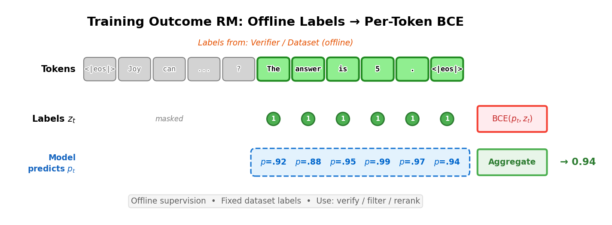

> 对应课程：Lec 2 —— 指令微调、奖励模型与拒绝采样 · 第 4、5、9 章 · 视频/PDF/幻灯片/源码见 [rlhfbook.com/course](https://rlhfbook.com/course)

# Lec 2：指令微调、奖励模型与拒绝采样

本章介绍三个工具，它们共同构成了一条从预训练语言模型到带有奖励模型的偏好调优模型的最简单完整路径：指令微调（IFT）、奖励建模与拒绝采样。它们不如完整的在线强化学习那样耀眼，却是后续方法赖以建立的基础。指令微调让模型学会对话格式，奖励模型从对比中学习质量评分，而拒绝采样则利用这些评分筛选出更优训练数据。三者组合在一起是一条强有力的基线，也是后续策略梯度与直接对齐方法的自然过渡。

详细理解这三个阶段非常重要，因为几乎所有现代后训练流程都会以某种形式使用它们。前沿模型可能会加入在线强化学习、推理数据或性格训练，但几乎总是从指令微调开始，训练或复用奖励模型，并在某个阶段通过拒绝采样进行过滤或蒸馏。此处的设计选择——聊天模板、数据配比、奖励模型架构与筛选策略——将直接决定最终系统的行为。

## 指令微调

指令微调（instruction fine-tuning），也称监督微调（SFT），是后训练的第一阶段。预训练模型继续以预测文本为目标进行训练，但此时的文本被组织成“指令—回复”对。最终模型能够以对话形式遵循指令，而不是简单地续写提示。例如，当问到“法国的首都是哪里？”时，经过指令微调的模型会回答“法国的首都是巴黎”，而基础模型可能会继续列出类似的问题。

指令微调源于两条研究路线的汇合。第一条路线是自然语言处理向统一“文本到文本”框架的转变，即把所有任务都表述为文本输入/文本输出。T5（Raffel et al. 2020）表明这种框架可以跨多种任务通用，而 FLAN（Wei et al. 2022）、T0（Sanh et al. 2022）和 Natural Instructions（Mishra et al. 2022）等集合则证明，在明确的指令上训练能显著提升零样本泛化。第二条路线是模型规模扩大后，单个预训练模型已能跨任务泛化，但只有在明确用指令—回复示例微调后，泛化才足够可靠。ChatGPT 发布后，Alpaca（Taori et al. 2023）、OpenAssistant（Köpf et al. 2023）和 Tulu（Wang et al. 2023；Lambert et al. 2024）等开源配方使指令微调成为可复现的社区级实践。


### 聊天模板

指令微调数据不是原始文本，而是以角色结构化的对话。标准角色包括：

- **System（系统）**：提供背景指令，例如角色设定、日期或约束。
- **User（用户）**：人类发送的消息。
- **Assistant（助手）**：模型生成的回复。

一种 ChatML 风格的模板会把消息列表渲染成模型看到的单一词元序列：

```text
<|im_start|>system
你是一个友好的聊天机器人，总是用海盗的风格回答<|im_end|>
<|im_start|>user
一个人一顿饭能吃多少架直升机？<|im_end|>
<|im_start|>assistant
```

模型随后继续生成，直到产生结束序列的词元。这种序列化通常以 Jinja 片段形式存储在分词器配置中，通过 `tokenizer.apply_chat_template(messages)` 调用。不同模型家族使用不同的特殊词元，但结构相同。Zephyr（Tunstall et al. 2024）使用 `<|system|>`、`<|user|>`、`<|assistant|>` 并以 `</s>` 分隔。Tulu（Lambert et al. 2024）使用 `<|user|>` 和 `<|assistant|>` 标签，并以 `<|endoftext|>` 结束。

多轮对话通过交替用户和助手轮次来扩展。整个对话历史被打包成一个词元序列，因此模型在生成下一轮回复时能看到之前的全部内容。

更新的格式如 OpenAI 的 Harmony 超越了 Jinja。Harmony 使用基于 Rust 的渲染器，将输出分成 `analysis`、`commentary`、`final` 等通道。这种设计避免了 Jinja 在处理工具调用和推理痕迹时容易出现的转义与边界问题。

### 模型实际学习什么

指令微调使用与预训练相同的交叉熵目标，但只对助手词元计算损失。系统和用户词元被屏蔽，因此模型学习的是“如何回答”，而不是“如何提问”。对于多轮对话，常见有两种屏蔽策略：

1. **只保留最后一轮**：只对最后一轮助手回复计算损失，之前的所有上下文都被屏蔽。
2. **保留所有助手轮次**：屏蔽用户和系统词元，但每一轮助手回复都参与损失计算。

### 最佳实践与数据规模

数据质量比单纯数量更重要。由于提示部分被屏蔽，模型主要从回复中学习，因此高质量的回复至关重要。在偏聊天对齐的领域，小型而聚焦的数据集就能取得强劲表现：ChatGPT 刚发布后的早期工作仅使用 10K 级人工样本就达到了先进水平（Ouyang et al. 2022；Rajani et al. 2023；Zhou et al. 2023）。而当前最佳实践则倾向于大规模合成数据集（Lambert et al. 2024），并配合积极的质量过滤。

Tulu 3（Lambert et al. 2024）给出的提示规模可作为参考：监督微调约 100 万条提示，偏好微调约 100 万条，强化微调约 1–10 万条。这些数字差异很大，但核心信息是：提示是每个后训练阶段的原材料。

指令数据的词元总量也在迅速增长。Tulu 3 构建了约 3 亿词元的先进 SFT 数据集，而面向推理的 Olmo 3 SFT 数据集达到约 200 亿词元（Olmo et al. 2025）。其他工作更是将规模进一步推高。规模、质量与后续强化学习之间的相互作用仍是开放问题；实践上的关键是：无论数据集是 1 万还是 200 亿词元，高质量的回复始终是性能的主导因素。

训练细节与预训练不同：

- **批量大小**小得多（例如 256 条提示，而预训练可能是 1024–2048 个序列）。
- **学习率**通常低 1–2 个数量级（例如 $1 \\times 10^{-5}$ 对比 $3 \\times 10^{-4}$），以防止在更窄的数据分布上过拟合。
- **损失函数**仍是交叉熵，但只计算未屏蔽的助手词元。

合成数据已成为构建 SFT 数据集的主要方式（Wang et al. 2023）。常见做法是：先用少量高质量人工提示，用强语言模型改写或扩充，再用另一个强模型生成回复。这很容易把训练数据扩大 10 倍。强模型对大多数指令都能生成不错的回复，因此扩展回复侧相对容易；更难的是提示质量和领域覆盖——如果只用合成通用知识问题训练，模型仍可能在医疗、法律等专业任务上失败。因此大多数配方都会把合成数据与少量专家整理的人工数据混合。

SFT 的设计过程是两条轨道的循环。**数据配比**是把现有数据集与当前混合方案组合，观察性能，通常目标是“删去数据同时保持性能”。**数据策展**则是找出模型落后的评测维度，为这些技能构造针对性数据。两条轨道迭代进行：混合、评测、策展、再混合。

## 奖励模型

在 RLHF 中，奖励模型扮演环境的角色：它返回一个标量信号，告诉策略模型某条回复表现如何。与经典强化学习的不同之处在于，奖励函数不是固定的，而是从人类或人工智能偏好中学习得到的。因此，奖励模型把复杂、主观的价值判断压缩成一个单一标量。由于这个分数会成为优化目标，它也是一种代理奖励：模型会优化奖励模型实际衡量的东西，而这可能与真实人类偏好并不完全一致。这种代理奖励视角在后续讨论过度优化时尤为重要。


### 经典 RL 与 RLHF 的对比

经典强化学习问题通常被写成马尔可夫决策过程（MDP）$(\\mathcal{S}, \\mathcal{A}, P, r, \\gamma)$，其中 $\\mathcal{S}$ 是状态空间，$\\mathcal{A}$ 是动作空间，$P(s\_{t+1} \\mid s\_t, a\_t)$ 是转移动态，$r(s\_t, a\_t)$ 是每步奖励，$\\gamma$ 是折扣因子。目标是最大化累积回报：

$$
J(\\pi) = \\mathbb{E}\_{\\tau \\sim \\pi}\\!\\left[\\sum\_{t=0}^{T} \\gamma^t r(s\_t, a\_t)\\right].
$$

在 RLHF 中没有外部环境。从数据集中采样提示 $x$，生成补全 $y$，再由奖励模型打分。奖励是回复级别的而非每步词元级别，优化通常还会加上 KL 正则项，使策略接近参考模型：

$$
J(\\pi) = \\mathbb{E}\\left[ r\_\\theta(x, y) \\right] - \\beta \\, D\_{\\text{KL}}\\!\\left(\\pi \\| \\pi\_{\\text{ref}}\\right).
$$


### 偏好数据

奖励模型在偏好对上训练。人类或人工智能评审员看到同一提示的两个回复，并选出更好的一个。例如，对于提示“用一句话解释天空为什么是蓝色的”，回复 A 给出精确的瑞利散射解释，而回复 B 含糊其辞。三元组 $(x, y\_c, y\_r)$ 成为训练数据，其中 $y\_c$ 是被选中的补全，$y\_r$ 是被拒绝的补全。

### Bradley-Terry 模型

标准奖励模型假设偏好遵循 Bradley-Terry 成对比较模型（Bradley and Terry 1952）。对于两个项目 $i$ 和 $j$，评审员偏好 $i$ 的概率为：

$$
P(i > j) = \\frac{p\_i}{p\_i + p\_j}.
$$

每个项目有一个潜在强度 $p\_i > 0$。通过 $p\_i = e^{r\_i}$ 重新参数化，可得到无界分数 $r\_i \\in \\mathbb{R}$，这正是神经网络自然输出的形式：

$$
P(i > j) = \\frac{e^{r\_i}}{e^{r\_i} + e^{r\_j}} = \\sigma(r\_i - r\_j),
$$

其中 $\\sigma(z) = \\frac{1}{1 + e^{-z}}$ 是 logistic 函数。只有分数差重要；给所有分数加上同一常数不会改变偏好概率。

对于提示 $x$、被选补全 $y\_c$ 和被拒补全 $y\_r$，奖励模型 $r\_\\theta$ 给出：

$$
P(y\_c > y\_r \\mid x) = \\frac{\\exp(r\_\\theta(y\_c \\mid x))}{\\exp(r\_\\theta(y\_c \\mid x)) + \\exp(r\_\\theta(y\_r \\mid x))}.
$$

训练目标是最大化该概率。将分子分母同除以 $\\exp(r\_\\theta(y\_c \\mid x))$ 并识别 sigmoid，可得：

$$
\\theta^\* = \\arg\\max\_\\theta \\; \\sigma\\!\\left( r\_\\theta(y\_c \\mid x) - r\_\\theta(y\_r \\mid x) \\right).
$$

训练时对数据集最大化对数似然。由于 $\\mathbb{E}[\\log P] \\neq \\mathbb{E}[P]$，应在取平均前先取对数：

$$
\\theta^\* = \\arg\\max\_\\theta \\; \\mathbb{E}\_{(x, y\_c, y\_r) \\sim D}\\left[\\log \\sigma\\!\\left( r\_\\theta(y\_c \\mid x) - r\_\\theta(y\_r \\mid x) \\right)\\right].
$$

取负号即得到 InstructGPT 中使用的每样本损失（Ouyang et al. 2022）：

$$
\\mathcal{L}(\\theta) = - \\log \\left( \\sigma \\left( r\_{\\theta}(y\_c \\mid x) - r\_{\\theta}(y\_r \\mid x) \\right) \\right).
$$

Anthropic 工作（Askell et al. 2021）中使用的等价形式为：

$$
\\mathcal{L}(\\theta) = \\log \\left( 1 + e^{r\_{\\theta}(y\_r \\mid x) - r\_{\\theta}(y\_c \\mid x)} \\right).
$$

二者等价，因为 $-\\log \\sigma(\\Delta) = \\log(1 + e^{-\\Delta})$。它们本质上都是二元交叉熵：奖励模型在学习区分哪条补全更受偏好。

直观上，当被选补全与被拒补全的分数差很小或为负时，损失就会惩罚模型；如果模型已经给被选补全明显更高的分数，损失就接近零。


### 架构与训练代码

最常见的奖励模型架构是在因果语言模型后接一个线性头，从最后一个非填充词元的最终隐状态输出单一标量：

```python
class BradleyTerryRewardModel(nn.Module):
    def __init__(self, base_lm):
        super().__init__()
        self.lm = base_lm
        self.head = nn.Linear(self.lm.config.hidden_size, 1)

    def forward(self, input_ids, attention_mask):
        hidden = self.lm(
            input_ids=input_ids, attention_mask=attention_mask,
            output_hidden_states=True, return_dict=True,
        ).hidden_states[-1]
        lengths = attention_mask.sum(dim=1) - 1
        batch_idx = torch.arange(hidden.size(0), device=hidden.device)
        seq_repr = hidden[batch_idx, lengths]
        return self.head(seq_repr).squeeze(-1)
```

配合上述模型，训练损失只有三行：

```python
rewards_chosen = model(**inputs_chosen)
rewards_rejected = model(**inputs_rejected)
loss = -nn.functional.logsigmoid(rewards_chosen - rewards_rejected).mean()
```

奖励模型通常只训练一个 epoch，以避免在偏好数据上过拟合。损失函数看似简单，但工程复杂度主要藏在数据加载器和分布式训练系统中：每个样本需要把提示加被选补全、提示加被拒补全分别进行词元化，正确处理填充，并提取最后一个真实词元的隐状态。这些细节决定了奖励模型是泛化还是记住虚假模式。

### 奖励模型变体

**偏好边际损失。** 当标注者提供李克特量表评分时，可以利用偏好的强度。Llama 2（Touvron et al. 2023）引入边际项 $m(y\_c, y\_r)$：

$$
\\mathcal{L}(\\theta) = - \\log \\left( \\sigma \\left( r\_{\\theta}(y\_c \\mid x) - r\_{\\theta}(y\_r \\mid x) - m(y\_c, y\_r) \\right) \\right).
$$

若被选补全评 5 分、被拒补全评 2 分，则 $m = 3$，这会鼓励模型对强偏好对产生更大的分数差距。Llama 3 后来去掉了边际项，因为在规模扩大后收益递减。

**平衡同一提示下的多次比较。** InstructGPT（Ouyang et al. 2022）对每个提示采样 $K = 4$ 到 $9$ 条补全，产生 $\\binom{K}{2}$ 对比较。由于这些比较共享同一提示，它们会被放在同一批次中并取平均，使每个提示只贡献一次更新：

$$
\\mathcal{L}(\\theta) = - \\frac{1}{\\binom{K}{2}} \\mathbb{E}\_{(x, y\_c, y\_r)\\sim D} \\log \\left( \\sigma \\left( r\_{\\theta}(y\_c \\mid x) - r\_{\\theta}(y\_r \\mid x) \\right) \\right).
$$

**K-wise 损失。** Starling 7B/34B（Zhu et al. 2024）使用基于 Plackett-Luce 模型（Zhu et al. 2023）的 K-wise 损失，对 $K$ 条补全的完整排序建模：

$$
P(\\sigma^i \\mid s^i, a\_0^i, \\ldots, a\_{K-1}^i) = \\prod\_{k=0}^{K-1} \\frac{\\exp(r\_{\\theta}(s^i, a\_{\\sigma^i(k)}^i))}{\\sum\_{j=k}^{K-1}\\exp(r\_{\\theta}(s^i, a\_{\\sigma^i(j)}^i))}.
$$

当 $K = 2$ 时，它退化为 Bradley-Terry 模型。

### 结果奖励模型

对于答案可验证的推理任务，可以使用结果奖励模型（ORM）。它训练一个逐词元的正确性预测器。*Let's Verify Step by Step*（Lightman et al. 2024）中的典型形式是在每个补全词元上计算二元交叉熵，把整句是否正确标签广播到每个词元：

$$
\\mathcal{L}\_{\\text{CE}}(\\theta) = -\\mathbb{E}\_{(s,r)\\sim \\mathcal{D}}\\left[r\\log p\_\\theta(s) + (1-r)\\log(1-p\_\\theta(s))\\right],
$$

其中 $r \\in \\{0,1\\}$ 表示补全是否正确，$p\_\\theta(s) = \\sigma(w\_\\theta(s))$ 是每个词元的正确性概率。提示词元用 $-100$ 屏蔽，不参与损失。

ORM 与 Bradley-Terry 的关键区别是：它不需要成对比较，只需一条补全及其正确性标签；它输出的是逐词元概率，而不是在序列结束词元处的单一标量。



推理时，ORM 在每个词元输出正确性概率。这些逐词元分数可以通过均值、最小值或乘积聚合成回复级别的验证分数。聚合方式很重要：取最小值强调尾部风险——只要某个词元看起来可疑，整条补全就会被惩罚；取均值则对局部噪声更宽容。由于标签只关心最终答案，逐词元信号可能很嘈杂：某个中间词元错误仍可能导向正确答案，反之亦然。


需要注意，不要把 ORM 与“用正确/错误对训练的 Bradley-Terry 模型”混为一谈。后者本质上仍是偏好模型，只是用正确性作为偏好信号；真正的 ORM 具有不同的输入输出结构：一条补全加二元标签、逐词元输出、逐词元二元交叉熵。

### 过程奖励模型

过程奖励模型（PRM）给中间推理步骤打分，而不仅仅评估最终结果（Lightman et al. 2024）。标签只在步骤边界处应用，例如双换行处，典型取值为 $-1$（错误）、$0$（中性）、$+1$（正确），其余词元全部屏蔽。步骤边界的选择很重要：步骤太短会导致信号稀疏、标注昂贵；步骤太长则可能把局部错误隐藏在整体正确的步骤中。其损失为：

$$
\\mathcal{L}\_{\\text{PRM}}(\\theta) = - \\mathbb{E}\_{(x, s) \\sim \\mathcal{D}} \\left[ \\sum\_{i=1}^{K} \\log p\_\\theta(z\_{s\_i} \\mid x, s\_i) \\right].
$$

代码实现中，每个词元输出三类 logits，只在标签不为 $-100$ 的位置计算损失：

```python
head = nn.Linear(hidden_size, 3)  # 0=错误, 1=中性, 2=正确
hidden = lm(**inputs, output_hidden_states=True).hidden_states[-1]
logits = head(hidden)             # (batch, seq_len, 3)
mask = labels != -100
loss = F.cross_entropy(logits[mask], labels[mask])
```


不同模型类型的对比如下：

| 模型 | 预测对象 | 训练数据 | 输出 |
|------|----------|---------|------|
| **偏好奖励模型** | 序列结束词元的质量分数 | 成对被选/被拒比较 | 单一标量 |
| **结果奖励模型** | 补全词元上的结果信号 | 二元结果标签 | 逐词元概率 |
| **过程奖励模型** | 每一步的正确性 | 步骤级别标注 | 步骤边界分数 |
| **价值函数** | 期望未来回报 | 同策略 rollout | 逐词元期望回报 |

ORM 与价值函数看起来相似，因为二者都产生逐词元输出，但语义不同。ORM 用离线标签预测最终答案是否正确，并将同一标签广播到每个中间词元；价值函数预测期望剩余回报 $V(s\_t) = \\mathbb{E}[\\sum\_{k \\geq t} \\gamma^{k-t} r\_k \\mid s\_t]$，目标通常来自当前策略 $\\pi\_\\theta$ 的 on-policy rollout，并用于计算策略梯度的优势 $A\_t = \\hat{R}\_t - V\_t$。

### 生成式奖励模型与评估

除了训练奖励模型，还可以用强语言模型充当评审员（Zheng et al. 2023）。评审模型看到问题和两条回复后，输出形如 `[[A]]`、`[[B]]` 或 `[[C]]` 的裁决。这种“LLM 作为评审”的方法催生了 MT-Bench、AlpacaEval（Dubois and Galambosi 2024）、Arena-Hard（Li et al. 2025）和 WildBench（Lin et al. 2025）等评测基准。

生成式奖励模型（Mahan et al. 2024；Zhang et al. 2025；Ankner et al. 2024），包括专门训练用于评审的 Prometheus（Kim et al. 2024），部署成本较低、在评估中应用广泛，但在奖励模型专用基准上通常仍落后于专门训练的奖励模型。

一个典型的 LLM 评审提示会让模型比较两条助手回复并输出最终裁决：

```text
[System]
请作为公正的评审员，评估下面两位 AI 助手对用户问题的回复质量。
...
在给出解释后，请严格按以下格式输出最终裁决：若助手 A 更好则输出 "[[A]]"，
若助手 B 更好则输出 "[[B]]"，平局则输出 "[[C]]"。
```

奖励模型评估发展迅速。首个基准 RewardBench（Lambert et al. 2025）之后，又出现了 RewardBench2、RMB、RM-Bench、M-RewardBench、RAG-RewardBench、RewardMATH、PRM Bench、ProcessBench、Agent-RewardBench、MJ-Bench、Multimodal RewardBench 和 VL RewardBench 等。早期工作多集中在基准建设和行为模式识别上；训练方法的创新仍是活跃领域。

## 拒绝采样

拒绝采样是用奖励模型能做的最简单的事情：对每条提示生成多条候选补全，用奖励模型打分，保留最好的，再在这些补全上微调模型。没有策略梯度，也没有在线强化学习，它只是经过筛选的监督学习。

这个名字来自计算统计学（Gilks and Wild 1992）：当无法直接从复杂目标分布采样时，先从容易建模的建议分布采样，再用启发式接受或拒绝样本。在语言模型中，建议分布是当前模型，目标是高质量补全，筛选器是奖励模型。拒绝采样被 WebGPT（Nakano et al. 2021）、Anthropic 的 Helpful and Harmless（Bai et al. 2022）、*Let's Verify Step by Step*（Lightman et al. 2024）、Llama 2 Chat（Touvron et al. 2023）等众多工作采用；更近的形式化工作包括 RAFT（Dong et al. 2023）和 Statistical Rejection Sampling Optimization（Liu et al. 2024）。


### 生成、打分、选择、微调

拒绝采样包含四个阶段：

1. **选择提示和奖励模型。** 提示通常复用 IFT 阶段的数据，但这可能带来一定过拟合风险。
2. **用当前模型为每条提示生成 $N$ 条补全。**
3. **用奖励模型为所有补全打分。**
4. **在得分最高的补全上继续用与指令微调相同的损失微调模型。**

给定 $M$ 条提示，每条生成 $N$ 条补全，可写成：

$$
X = [x\_1, x\_2, \\ldots, x\_M],
$$

$$
Y = \\begin{bmatrix}
y\_{1,1} & y\_{1,2} & \\cdots & y\_{1,N} \\\\
y\_{2,1} & y\_{2,2} & \\cdots & y\_{2,N} \\\\
\\vdots & \\vdots & \\ddots & \\vdots \\\\
y\_{M,1} & y\_{M,2} & \\cdots & y\_{M,N}
\\end{bmatrix},
\\quad
R = \\begin{bmatrix}
r\_{1,1} & r\_{1,2} & \\cdots & r\_{1,N} \\\\
r\_{2,1} & r\_{2,2} & \\cdots & r\_{2,N} \\\\
\\vdots & \\vdots & \\ddots & \\vdots \\\\
r\_{M,1} & r\_{M,2} & \\cdots & r\_{M,N}
\\end{bmatrix},
$$

其中 $r\_{i,j} = \\mathcal{R}(y\_{i,j} \\mid x\_i)$。

### 选择方法

**每提示取最高。** 独立地为每条提示选择得分最高的补全：

$$
S(R) = [\\arg\\max\_{j} r\_{1,j},\\ \\arg\\max\_{j} r\_{2,j},\\ \\ldots,\\ \\arg\\max\_{j} r\_{M,j}].
$$

例如，对于 5 条提示、每条 4 条补全：

$$
R = \\begin{bmatrix}
\\mathbf{0.7} & 0.3 & 0.5 & 0.2 \\\\
0.4 & \\mathbf{0.8} & 0.6 & 0.5 \\\\
\\mathbf{0.9} & 0.3 & 0.4 & 0.7 \\\\
0.2 & 0.5 & \\mathbf{0.8} & 0.6 \\\\
0.5 & 0.4 & 0.3 & \\mathbf{0.6}
\\end{bmatrix}
\\quad \\Rightarrow \\quad
S(R) = [1, 2, 1, 3, 4].
$$

这保证每条提示都有一条补全，保留提示分布，适合需要均衡覆盖的场景。

**全局取最高。** 把奖励矩阵展平后，从所有提示—补全对中全局选取前 $K$ 对：

$$
S\_K(R\_{\\text{flat}}) = \\text{argsort}(R\_{\\text{flat}})[-K:].
$$

用同一矩阵取全局前 5，会选中 0.9、0.8、0.8、0.7、0.7。此时提示 3 贡献两条补全，而提示 5 没有。这种方法追求绝对质量，但可能使数据集偏向模型容易得高分的提示。实践中，若希望均衡覆盖通常用每提示选择，若希望最大化训练集平均质量则用全局 top-$K$。

### 实现细节与 Best-of-N

核心超参数很直观：

- **温度**：0.7–1.0，足够高以产生多样化补全。
- **每提示补全数**：10–30 或更多；太少会导致选择噪声大。
- **微调**：在被选补全上做标准 SFT，超参数可能与初始 IFT 略有不同。

一个实用技巧是按长度对补全排序后再进行奖励模型批量推理，使每个批次长度接近，减少填充词元浪费。

关于如何在多阶段流程中安排拒绝采样、是否引入多个模型的生成、以及如何选择提示等问题，目前还没有完全公开的复现来记录所有细节，实践者应视其为不断演进的配方。

**Best-of-N（BoN）** 遵循同样的生成—打分流程，但跳过微调：

$$
S(R) = \\arg\\max\_{j \\in [1,N]} r\_j.
$$

BoN 在推理时从 $N$ 个样本中选出最佳补全。它不修改模型，因此是一种采样基线而非训练方法，常被用来与 PPO 等在线强化学习方法对比。它也可以配合验证器或 LLM-as-a-judge 使用。

### 整合完整流程

从预训练模型到偏好调优模型的最简单完整流程是：

1. **指令微调**预训练模型，使其学会对话格式。
2. **收集偏好数据**：让标注者比较成对回复。
3. **训练奖励模型**：在偏好数据上学习质量分数。
4. **拒绝采样**：为每条提示生成多条补全，保留最优，再微调。

这是一条强有力的基线。后续课程将把过滤步骤替换为更高级的优化方法：策略梯度方法如 PPO，直接优化策略以最大化学习到的奖励；以及直接对齐算法如 DPO，直接从偏好对优化模型。

## 要点小结

- 指令微调是第一阶段后训练。它通过屏蔽交叉熵损失只让助手词元参与训练，使预训练模型学会指令—回复格式。回复质量比提示数量更重要，合成数据现已成为训练材料的主要来源。
- 聊天模板把对话序列化为词元序列。标准角色包括 system、user 和 assistant；格式从基于 Jinja 的模板发展到 Harmony 等基于通道的新设计。
- 奖励模型从偏好比较中学习标量质量信号。Bradley-Terry 模型给出标准的成对损失，可等价写成负对数 sigmoid 或 softplus 形式。
- 奖励模型变体包括边际损失、同一提示下多次比较的平衡，以及 K-wise Plackett-Luce 排序。结果奖励模型用逐词元二元正确性标签，过程奖励模型则在推理步骤边界处提供监督。
- 拒绝采样是离线数据策展：为每条提示生成 $N$ 条补全，用奖励模型打分，选择最优并微调。Best-of-N 是不修改模型的推理时变体。
- 指令微调、奖励建模和拒绝采样共同构成从基础模型到偏好调优模型的最简单完整路径，并为后续在线强化学习与直接对齐方法奠定基础。
