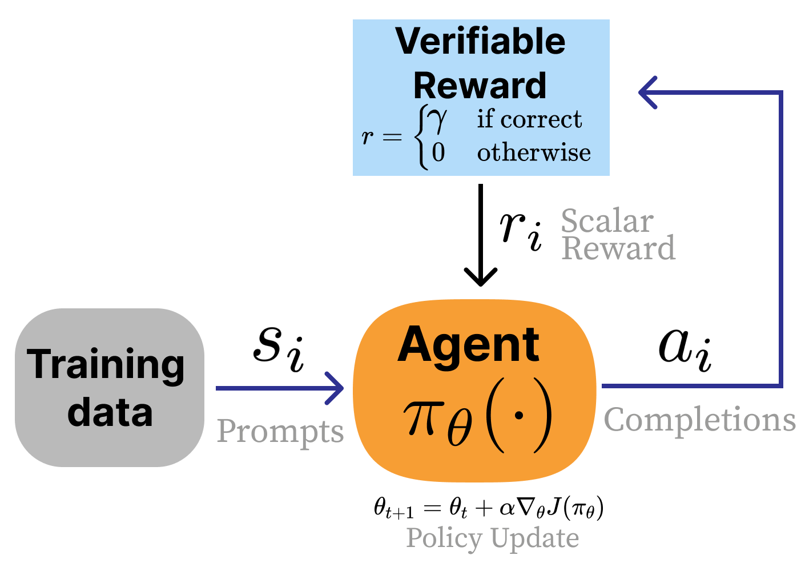
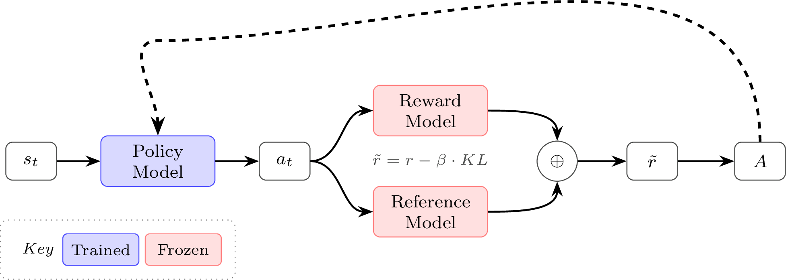
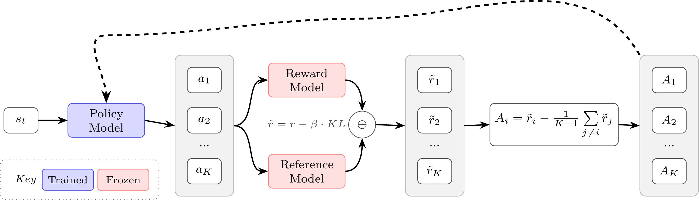

# 第 3 讲：RL 动机与数学

> 对应课程：第 3 讲 —— RL 动机与数学 · 第 6 章第 1 部分 · 视频/PDF/幻灯片/源文件见 [rlhfbook.com/course](https://rlhfbook.com/course)

本章介绍面向语言模型的强化学习（RL）的数学与理论。下一章将把这些算法变成可运行的代码。我们聚焦**策略梯度**家族——REINFORCE、REINFORCE Leave-One-Out（RLOO）、近端策略优化（PPO）、组相对策略优化（GRPO），以及最近的变体如组序列策略优化（GSPO）和截断重要性采样策略优化（CISPO）——因为它们是现代基于人类反馈的强化学习（RLHF）和新兴推理时代里的核心算法。

## 为什么 RL 重要

在整个后训练流程中，RL 位于指令微调与奖励模型训练之后。策略（即被训练的模型）生成补全，奖励模型为其打分，RL 优化器利用这些分数更新策略参数。在讲完监督微调、奖励模型和拒绝采样之后，我们现在加入基于梯度的优化步骤。


RL 的实现比拒绝采样或直接对齐方法更复杂，但它带来的好处难以量化却被广泛观察到：它可以磨平模型输出的粗糙边缘、改善格式、使生成结果更兼容 vLLM 等 serving 框架，并且能在不压制通用能力的前提下针对狭窄的提示分布进行改进。RL 损失稳健、可扩展、灵活，这正是它在最初那批 RLHF 工作之后开启大量新实验方向的原因。

更重要的是，RL 如今已成为训练最强模型的**承重步骤**。OpenAI o1、DeepSeek R1 等推理模型都是用这些相同算法在可验证奖励上训练出来的。当前领域由两个缩放思想主导：

- **训练时计算缩放**：通过 RL 投入更多训练计算，推理能力随之提升。
- **测试时计算缩放**：推理时生成更长的思维链。


同样的算法支撑着 RLHF 与**可验证奖励强化学习（RLVR）**。在 RLHF 中，奖励模型对主观质量打分；在 RLVR 中，验证函数检查数学或代码的正确性。策略梯度机制完全相同，只是奖励来源不同。推理相关的技巧将在后续课程中深入讲解。



## RL 基础回顾

### 经典 RL 与 RLHF 的对比

在经典 RL 中，智能体在一个马尔可夫决策过程（MDP）$(\\mathcal{S}, \\mathcal{A}, P, r, \\gamma)$ 中交互。奖励 $r(s, a)$ 是来自环境的已知函数，目标是最大化累积折扣回报：

$$J(\\pi) = \\mathbb{E}\_{\\tau \\sim p\_\\pi}\\!\\left[\\sum\_{t} \\gamma^t r(s\_t, a\_t)\\right].$$

在 RLHF 中没有环境。提示从数据集中采样，奖励是从人类偏好中学习得到的。奖励通常是**响应级别**的，并且通过与参考模型的 KL 散度惩罚进行正则化：

$$J(\\pi) = \\mathbb{E}\\left[ r\_\\theta(x, y) \\right] - \\beta \\, D\_{\\text{KL}}\\!\\left(\\pi \\| \\pi\_{\\text{ref}}\\right).$$


### 符号约定

本章采用 RL 文献中的 $(s, a)$ 记号：$s$ 表示状态，$a$ 表示动作。在语言模型语境中，你也会常看到 $(x, y)$，其中 $x$ 是提示，$y$ 是补全。$(s, a)$ 框架更通用——这些算法本就是为顺序决策问题设计的——但许多 RLHF 实现把整个补全视为单个动作，因此 $(x, y)$ 同样合理。我们用 $r\_t$ 表示每步奖励，$R(\\tau)$ 表示轨迹回报，$\\rho\_t$ 表示重要性采样比率。

### 语言模型作为回合制 MDP

| MDP 概念 | 语言模型 |
|---------|---------|
| 状态 $s\_t$ | 提示 + 已生成词元：$(x, y\_{<t})$ |
| 动作 $a\_t$ | 下一个词元 $y\_t$ |
| 转移 | 确定性：把词元追加到序列 |
| 策略 $\\pi\_\\theta(a\_t \\mid s\_t)$ | 语言模型下一词元分布 |
| 回合 | 一个提示 → 一个补全 |
| 终止奖励 | 奖励模型分数或验证器输出 |
| 折扣 $\\gamma$ | 通常为 $1.0$（无折扣） |

有两种视角。在**词元级**视角中，每个词元都是一个独立动作；PPO 配合广义优势估计（GAE）采用这种视角。在**序列级**视角中，整个补全是一个动作；REINFORCE 和 GRPO 采用这种视角。

### 我们在优化什么？

我们选择策略参数 $\\theta$，使其在当前策略下的期望奖励最大。设 $p\_\\theta(\\tau)$ 为策略诱导的轨迹分布，则目标为

$$J(\\theta) = \\mathbb{E}\_{\\tau \\sim p\_\\theta}[R(\\tau)].$$

实践中，我们通过采样轨迹来估计这个期望：

$$J(\\theta) \\approx \\frac{1}{N}\\sum\_{i=1}^{N} R(\\tau\_i), \\qquad \\tau\_i \\sim p\_\\theta.$$

本章剩余部分就是构造一个能优化该期望的梯度。

### 策略梯度如何工作

核心更新具有如下直观形式：

$$\\Delta \\theta \\propto \\Psi\_t \\, \\nabla\_\\theta \\log \\pi\_\\theta(a\_t \\mid s\_t).$$

它可以同时回答两个问题：

- $\\nabla\_\\theta \\log \\pi\_\\theta(a\_t \\mid s\_t)$ 回答**哪个动作？**它指向参数空间中使 $a\_t$ 更可能的方向。
- $\\Psi\_t$ 回答**有多好？**它是一个标量，给结果打分。正值表示加强，负值表示抑制，绝对值表示强度。

两者相乘意味着：若 $\\Psi\_t > 0$，就更新参数使 $a\_t$ 更可能出现；若 $\\Psi\_t < 0$，则让它更不可能出现。本章后续内容都是关于如何选择一个聪明的 $\\Psi\_t$。

一般的策略梯度方程为

$$\\nabla\_\\theta J(\\theta) = \\mathbb{E}\_{\\tau \\sim p\_\\theta}\\!\\left[\\sum\_{t=0}^{T} \\Psi\_t \\nabla\_\\theta \\log \\pi\_\\theta(a\_t \\mid s\_t)\\right].$$

$\\Psi\_t$ 的选择决定了方差、偏差和计算代价。

### 关键 RL 量

以下三个量会反复出现：

**价值函数** $V(s)$：从状态 $s$ 出发的期望未来回报，

$$V(s) = \\mathbb{E}\\big[G\_t \\mid S\_t = s\\big] \\quad \\text{其中 } G\_t = \\sum\_{k=0}^{\\infty} \\gamma^k r\_{t+k}.$$

**动作价值函数** $Q(s, a)$：在状态 $s$ 采取动作 $a$ 后的期望回报，

$$Q(s, a) = \\mathbb{E}[G\_t \\mid S\_t = s, A\_t = a].$$

**优势函数** $A(s, a) = Q(s, a) - V(s)$：动作 $a$ 比该状态下平均动作好多少？正优势加强，负优势抑制，零优势不更新。在 RLHF 中，通常取 $\\gamma = 1$，因为优化单位是整个补全。

### 学习信号 $\\Psi\_t$ 的选择

Schulman 等人 2015 年列出了几种常见选择（奖励也可乘以折扣 $\\gamma$）：

| | $\\Psi\_t$ | 说明 | 方差 | 偏差 |
|:-:|-----------|-------------|:--------:|:----:|
| 1. | $R(\\tau) = \\sum\_{t=0}^{T} r\_t$ | 整条轨迹奖励 | 最高 | 无 |
| 2. | $\\sum\_{t'=t}^{T} r\_{t'}$ | 从 $t$ 开始的未来回报，即 $G\_t$ | 高 | 无 |
| 3. | $G\_t - b(s\_t)$ | 带基线的回报 | 较低 | 无 |
| 4. | $Q^{\\pi}(s\_t, a\_t)$ | 状态-动作价值函数 | 中 | 取决于估计 |
| 5. | $A^{\\pi}(s\_t, a\_t) = Q - V$ | 优势函数 | 低（价值函数准确时） | 无 |
| 6. | $r\_t + \\gamma V(s\_{t+1}) - V(s\_t)$ | 时序差分残差 | 低 | 有一些 |

**基线** $b(s\_t)$ 是任意仅依赖于状态的函数，从奖励信号中减去以降低方差。下面将证明，这不会改变期望梯度。

## 策略梯度的推导

### 对期望求导

我们想要 $\\nabla\_\\theta J(\\theta)$。写成积分形式：

$$J(\\theta) = \\mathbb{E}\_{\\tau \\sim p\_\\theta}[R(\\tau)] = \\int\_\\tau p\_\\theta(\\tau) R(\\tau) \\, d\\tau.$$

直接求导得

$$\\nabla\_\\theta J(\\theta) = \\int\_\\tau \\nabla\_\\theta p\_\\theta(\\tau) R(\\tau) \\, d\\tau.$$

我们可以从 $p\_\\theta(\\tau)$ 采样轨迹，但不能从 $\\nabla\_\\theta p\_\\theta(\\tau)$ 采样，因为后者不是概率分布。推导的目标就是把这个式子变成可采样的形式。

### 对数导数技巧

把对数导数恒等式代入梯度：

$$
\\begin{aligned}
\\nabla\_\\theta J(\\theta)
&= \\int\_\\tau \\nabla\_\\theta p\_\\theta(\\tau) R(\\tau) \\, d\\tau
&& \\text{对目标求导} \\\\
&= \\int\_\\tau p\_\\theta(\\tau) R(\\tau) \\nabla\_\\theta \\log p\_\\theta(\\tau) \\, d\\tau
&& \\text{对数导数恒等式} \\\\
&= \\mathbb{E}\_{\\tau \\sim p\_\\theta}\\!\\left[R(\\tau) \\nabla\_\\theta \\log p\_\\theta(\\tau)\\right]
&& \\text{期望形式}。
\\end{aligned}
$$

唯一不明显的步骤是恒等式本身：

$$
\\begin{aligned}
\\nabla\_\\theta \\log p\_\\theta(\\tau)
&= \\frac{\\nabla\_\\theta p\_\\theta(\\tau)}{p\_\\theta(\\tau)} \\\\
\\Rightarrow \\quad \\nabla\_\\theta p\_\\theta(\\tau)
&= p\_\\theta(\\tau) \\nabla\_\\theta \\log p\_\\theta(\\tau).
\\end{aligned}
$$

这就是**对数导数技巧**，来自 $\\log$ 的链式法则。它把概率的梯度改写成对数概率的梯度，更便于处理。

$p\_\\theta(\\tau)$ 去哪了？它变成了期望里的**采样分布**：

$$\\int p\_\\theta(\\tau) f(\\tau)\\, d\\tau = \\mathbb{E}\_{\\tau \\sim p\_\\theta}[f(\\tau)].$$

蒙特卡洛通过从策略采样轨迹来估计这个期望：

$$\\mathbb{E}\_{\\tau \\sim p\_\\theta}[f(\\tau)] \\approx \\frac{1}{N}\\sum\_{i=1}^{N} f(\\tau\_i), \\qquad \\tau\_i \\sim p\_\\theta.$$

因此代码里没有显式的 $p\_\\theta(\\tau\_i)$ 项：更可能的轨迹自然在采样批次中出现得更频繁。采样轨迹负责采样，损失代码负责 $R(\\tau\_i)\\,\\nabla\_\\theta \\log p\_\\theta(\\tau\_i)$。

### 展开轨迹对数概率

轨迹概率可以分解为

$$p\_\\theta(\\tau) = d\_0(s\_0) \\prod\_{t=0}^{T} \\pi\_\\theta(a\_t \\mid s\_t) \\, p(s\_{t+1} \\mid s\_t, a\_t).$$

取对数：

$$\\log p\_\\theta(\\tau) = \\log d\_0(s\_0) + \\sum\_{t=0}^{T} \\log \\pi\_\\theta(a\_t \\mid s\_t) + \\sum\_{t=0}^{T} \\log p(s\_{t+1} \\mid s\_t, a\_t).$$

对语言模型来说，这就是熟悉的自回归形式：序列对数概率等于词元对数概率之和。现在对 $\\theta$ 求导：

- $\\nabla\_\\theta \\log d\_0(s\_0) = 0$ —— 初始状态分布不依赖 $\\theta$。
- $\\nabla\_\\theta \\log p(s\_{t+1} \\mid s\_t, a\_t) = 0$ —— 环境动态不依赖 $\\theta$。
- 只有 $\\nabla\_\\theta \\log \\pi\_\\theta(a\_t \\mid s\_t)$ 保留下来。

因此

$$\\nabla\_\\theta \\log p\_\\theta(\\tau) = \\sum\_{t=0}^{T} \\nabla\_\\theta \\log \\pi\_\\theta(a\_t \\mid s\_t).$$

在语言模型代码中，这就是为什么反复看到如下模式：

```python
seq_log_probs = (token_log_probs * completion_mask).sum(dim=-1)
loss = -(seq_log_probs * advantages).mean()
loss.backward()
```

自动微分把求和后的对数概率转换成各词元梯度的对应之和。

### 从全回报到未来奖励

时刻 $t$ 的动作无法影响过去的奖励。因此，我们可以把每个词元的权重从整条轨迹奖励 $R(\\tau)$ 换成从 $t$ 开始的未来回报 $G\_t = \\sum\_{t'=t}^{T} r\_{t'}$：

$$\\nabla\_\\theta J = \\mathbb{E}\_{\\tau \\sim p\_\\theta}\\!\\left[\\sum\_{t=0}^{T} G\_t \\nabla\_\\theta \\log \\pi\_\\theta(a\_t \\mid s\_t)\\right].$$

这不会改变期望梯度，但去除了当前动作无法影响的过去奖励带来的噪声。这就是上表中从选项 1 到选项 2 的过渡。

### 基线保持无偏性

原始回报的方差很大：同一动作可能因为后续采样的动作不同而出现在总奖励差异巨大的轨迹中。基线的作用是**居中**这个噪声信号：不问“回报高吗”，而问“比该状态的预期高还是低”。

使用居中回报：

$$\\Psi\_t = G\_t - b(s\_t),$$

其中 $b(s\_t)$ 只依赖于状态，不依赖于采样的动作。减去基线不会改变期望梯度：

$$
\\mathbb{E}[(G\_t - b(s)) \\nabla\_\\theta \\log \\pi\_\\theta(a \\mid s)]
= \\mathbb{E}[G\_t \\nabla\_\\theta \\log \\pi\_\\theta(a \\mid s)]
\\- \\mathbb{E}[b(s) \\nabla\_\\theta \\log \\pi\_\\theta(a \\mid s)].
$$

第一项是原始估计量。第二项消失：

$$
\\begin{aligned}
\\mathbb{E}[b(s) \\nabla\_\\theta \\log \\pi\_\\theta(a \\mid s)]
&= b(s) \\cdot \\sum\_a \\pi\_\\theta(a \\mid s) \\nabla\_\\theta \\log \\pi\_\\theta(a \\mid s) \\\\
&= b(s) \\cdot \\sum\_a \\nabla\_\\theta \\pi\_\\theta(a \\mid s) \\\\
&= b(s) \\cdot \\nabla\_\\theta \\underbrace{\\sum\_a \\pi\_\\theta(a \\mid s)}\_{= 1} \\\\
&= 0.
\\end{aligned}
$$

归一化分布的梯度之和为零，所以我们可以任意减去一个状态函数作为基线。这就是选项 3–5 能降低方差而不引入偏差的原因。

### 策略梯度推导总结

把各部分拼起来：

$$
\\begin{aligned}
J(\\theta)
&= \\mathbb{E}\_{\\tau \\sim p\_\\theta}[R(\\tau)]
&& \\text{目标} \\\\
\\nabla\_\\theta J(\\theta)
&= \\int\_\\tau \\nabla\_\\theta p\_\\theta(\\tau) R(\\tau)\\, d\\tau
&& \\text{求导} \\\\
&= \\mathbb{E}\_{\\tau \\sim p\_\\theta}\\!\\left[\\sum\_{t=0}^{T} \\Psi\_t \\nabla\_\\theta \\log \\pi\_\\theta(a\_t \\mid s\_t)\\right]
&& \\text{最终估计量}。
\\end{aligned}
$$

- 对数导数技巧把 $\\nabla p\_\\theta(\\tau)$ 变成可采样的期望。
- 展开 $\\log p\_\\theta(\\tau)$ 得到词元对数概率之和。
- $\\Psi\_t$ 是学习信号：回报、优势或时序差分估计。
- 代码实现：采样轨迹，求词元对数概率，按 $\\Psi\_t$ 加权，取平均。

## 面向语言模型的 RLHF 连接

在深入具体算法之前，先回顾它们所嵌入的完整 RLHF 设置。指令微调和奖励模型训练之后，RL 步骤用学到的奖励信号更新策略。


### 参考模型与 KL 正则化

**参考模型** $\\pi\_\\text{ref}$ 是 RL 训练开始时策略的冻结副本，通常是 SFT 检查点。它的作用是锚定策略，防止优化过程中漂移过远。没有它，策略可能利用奖励模型的缺陷，找到高分但退化或重复的输出——这就是**奖励黑客**现象。

KL 惩罚衡量当前策略与参考策略在每个词元上的偏离：

$$\\text{KL}\_t = \\log \\pi\_\\theta(a\_t \\mid s\_t) - \\log \\pi\_\\text{ref}(a\_t \\mid s\_t).$$

实践中：先用 $\\pi\_\\theta$ 生成补全，再对同样的词元分别计算 $\\pi\_\\theta$ 和 $\\pi\_\\text{ref}$ 的对数概率，相减得到每词元 KL。塑形后的奖励为中间词元 $\\tilde{r}\_t = -\\beta \\, \\text{KL}\_t$，最后一个词元 $\\tilde{r}\_T = R(\\tau) - \\beta \\, \\text{KL}\_T$。

### RLHF 与 RLVR 中的 KL

在 **RLHF** 中，KL 惩罚至关重要，因为奖励模型是学出来的代理，策略会利用它的任何不完美之处。在 **RLVR** 中，奖励是可验证的，KL 往往减小或完全去掉；奖励是 ground truth，利用空间更小。DeepSeek R1 等一些 RLVR 设置甚至完全去掉参考模型以节省显存。奖励信号越可靠，KL 正则化的需求越低。

### 两个“旧”策略

不要把 $\\pi\_{\\theta\_\\text{old}}$ 与 $\\pi\_\\text{ref}$ 混淆：

| | $\\pi\_{\\theta\_\\text{old}}$ | $\\pi\_\\text{ref}$ |
|---|---|---|
| 含义 | 上一次 rollout 时的策略 | RL 训练开始时的策略（SFT 检查点） |
| 是否更新 | 每批次更新（或每 $K$ 步） | 从不更新（冻结） |
| 用途 | 重要性采样比率 $\\rho\_t$ | KL 惩罚 |
| 若去掉 | 必须每批次只走一步梯度（同策略） | 奖励黑客风险 |

某些实现中，“旧对数概率”仅指生成时刻的对数概率；模型在被更新后，这些对数概率就相当于来自一个旧版本。

## REINFORCE

REINFORCE 由 Williams 1992 年提出，是最简单的策略梯度实例。它是**蒙特卡洛形式**：采样轨迹、计算回报、用采样回报加权对数概率梯度。其名字是一个反向缩写，代表 “REward Increment = Nonnegative Factor X Offset Reinforcement X Characteristic Eligibility”。三个组成部分是：

1. **非负因子**（$\\alpha$）：学习率。
2. **偏移强化**（$G\_t - b(s\_t)$）：居中回报，提高稳定性。
3. **特征资格**（$\\nabla \\log \\pi$）：把标量奖励归因到每个参数。

更新规则为

$$\\Delta\\theta = \\alpha \\, (G\_t - b(s\_t)) \\nabla\_\\theta \\log \\pi\_\\theta(a\_t \\mid s\_t).$$

没有基线时，梯度用原始回报 $G\_t$ 加权每个动作。这无法判断动作比预期更好还是更差，只知道整体结果如何。方差很大，因为原始回报混合了动作质量与状态质量。

减去基线 $b(s)$ 后信号被居中。因为 $b(s)$ 不依赖于具体采样的动作，它可以提出并抵消：

$$\\mathbb{E}\_{a \\sim \\pi(\\cdot \\mid s)}[b(s) \\nabla\_\\theta \\log \\pi\_\\theta(a \\mid s)] = 0.$$

期望梯度不变，但方差显著下降。

完整的 REINFORCE 梯度因此为

$$\\nabla\_\\theta J(\\theta) = \\mathbb{E}\_{\\tau \\sim p\_\\theta}\\!\\left[\\sum\_{t=0}^{T} (G\_t - b(s\_t)) \\nabla\_\\theta \\log \\pi\_\\theta(a\_t \\mid s\_t)\\right].$$

常见基线包括批次平均奖励、近期奖励移动平均，以及学到的价值函数 $V\_\\phi(s)$。基础 REINFORCE 不需要 critic；加入学习价值函数可降低方差，但引入了训练第二个模型的复杂性，向 actor-critic 方法（如 PPO）靠拢。



## REINFORCE Leave-One-Out（RLOO）

RLOO 由 Ahmadian 等人 2024 和 Wang 等人 2024 等研究推广，它使用留一法基线。核心思想是：对每个提示采样 $K$ 个补全，用其余 $K-1$ 个奖励的平均作为基线：

$$b(s, a\_k) = \\frac{1}{K-1}\\sum\_{i=1,\\, i \\neq k}^{K} R(s, a\_i).$$

补全 $k$ 的优势为

$$\\hat{A}(s, a\_k) = R(s, a\_k) - b(s, a\_k).$$

这是一个**逐提示**基线，能自然捕捉提示难度：困难提示的所有补全奖励都低，基线也低。与无 critic 的 REINFORCE 一样，同一个序列级优势被广播到补全的每个词元。

例如，$K=4$、奖励为 $[0.8, 0.3, 0.6, 0.5]$ 时：

| 补全 | 奖励 | 基线（其余平均） | 优势 |
|:----------:|:------:|:------------------------:|:---------:|
| 1 | 0.8 | $(0.3 + 0.6 + 0.5)/3 = 0.467$ | $+0.333$ |
| 2 | 0.3 | $(0.8 + 0.6 + 0.5)/3 = 0.633$ | $-0.333$ |
| 3 | 0.6 | $(0.8 + 0.3 + 0.5)/3 = 0.533$ | $+0.067$ |
| 4 | 0.5 | $(0.8 + 0.3 + 0.6)/3 = 0.567$ | $-0.067$ |

最好的补全 1 被加强，最差的补全 2 被抑制，补全 3 和 4 得到小幅更新。

RLOO 就是 REINFORCE 加上一个聪明的逐提示留一法基线。两者都是后续算法的基础：它们与 GRPO 等分组补全算法直觉相通，不需要价值函数，实现简单，实践中表现强劲。



## 近端策略优化（PPO）

### 为什么用 PPO？

本章所有算法都是**同策略**算法：每批次用当前策略生成新轨迹，然后在这些轨迹上更新。这与 DQN 等把经验存起来回放的**异策略**方法不同。

原始策略梯度对步长敏感：步长太大策略会崩溃，步长太小训练极慢。Schulman 等人 2015 年提出的 TRPO 用硬信任域约束解决了这个问题，但需要昂贵的二阶优化。Schulman 等人 2017 年提出的 PPO 用一个简单的截断目标获得类似 TRPO 的稳定性。因为截断使更新保守，可以在一批 rollout 上安全地多次梯度更新，提高样本效率。

### 约束更新与重要性采样

大步长梯度可能毁掉策略。解决方法是**信任域**：限制单次更新中策略能移动多远。为了对一批数据多次更新，定义**重要性采样比率**

$$\\rho\_t(\\theta) = \\frac{\\pi\_\\theta(a\_t \\mid s\_t)}{\\pi\_{\\theta\_\\text{old}}(a\_t \\mid s\_t)}.$$

- 若 $\\rho\_t = 1$：新旧策略在该动作上一致。
- 若 $\\rho\_t > 1$：新策略赋予更高概率。
- 若 $\\rho\_t < 1$：新策略赋予更低概率。

该比率重新加权旧策略样本，以估计新策略的梯度。把它代入策略梯度形式就得到一个代理目标。

### PPO 的截断目标

PPO 通过截断比率防止过大更新：

$$J(\\theta) = \\mathbb{E}\_t\\!\\left[\\min\\!\\left(\\rho\_t(\\theta) \\hat{A}\_t,\\; \\text{clip}(\\rho\_t(\\theta),\\, 1-\\varepsilon,\\, 1+\\varepsilon)\\, \\hat{A}\_t\\right)\\right],$$

其中 $\\varepsilon$ 通常取 $0.1$–$0.2$。$\\min$ 选择**更保守**的估计。

#### 正优势（$\\hat{A}\_t > 0$）

动作优于平均水平，我们想增加其概率：

1. $\\rho\_t < 1 - \\varepsilon$：新策略下该动作更不可能。目标为 $\\rho\_t \\hat{A}\_t$，正常梯度向上推。
2. $1 - \\varepsilon \\leq \\rho\_t \\leq 1 + \\varepsilon$：概率大致相同。目标为 $\\rho\_t \\hat{A}\_t$，正常梯度向上推。
3. $\\rho\_t > 1 + \\varepsilon$：新策略下该动作已经更可能。目标为 $(1+\\varepsilon)\\hat{A}\_t$，梯度为**零**——被**截断**。

#### 负优势（$\\hat{A}\_t < 0$）

动作劣于平均水平，我们想减小其概率：

1. $\\rho\_t < 1 - \\varepsilon$：新策略下该动作已经更不可能。目标为 $(1-\\varepsilon)\\hat{A}\_t$，梯度为**零**——被**截断**。
2. $1 - \\varepsilon \\leq \\rho\_t \\leq 1 + \\varepsilon$：概率大致相同。目标为 $\\rho\_t \\hat{A}\_t$，正常梯度向下推。
3. $\\rho\_t > 1 + \\varepsilon$：新策略下该动作更可能。目标为 $\\rho\_t \\hat{A}\_t$，正常梯度向下推。

#### 零优势（$\\hat{A}\_t = 0$）

动作与预期一样好。损失为零，不更新。

#### 截断总结

| 优势 | 信任域内 | 信任域外 |
|-----------|-------------------|---------------------|
| $\\hat{A}\_t > 0$ | 正常梯度（加强） | 若 $\\rho\_t > 1+\\varepsilon$ 则梯度为零 |
| $\\hat{A}\_t < 0$ | 正常梯度（抑制） | 若 $\\rho\_t < 1-\\varepsilon$ 则梯度为零 |
| $\\hat{A}\_t = 0$ | 不更新 | 不更新 |

截断按优势符号单侧生效：当策略已朝有利方向移动足够远时，它限制进一步移动，但不会阻止向不利方向的修正。


### 价值函数（critic）

PPO 同时训练一个**价值函数** $V\_\\phi(s)$。它预测从状态 $s\_t$ 出发的期望未来回报：

$$V\_\\phi(s\_t) = \\mathbb{E}\\left[\\sum\_{k=0}^{T-t} \\gamma^k r\_{t+k} \\;\\middle|\\; s\_t\\right].$$

它有独立参数 $\\phi$（通常从奖励模型或 SFT 模型初始化），在每个词元位置预测扣除 KL 后的未来回报，并通过 MSE 损失拟合扣除 KL 后的回报：

$$\\mathcal{L}\_V = \\frac{1}{2}(V\_\\phi(s\_t) - G\_t)^2.$$

价值函数作为优势估计的学习基线。

### PPO-RLHF 如何获得词元级信用

PPO 风格的 RLHF 通常从整个补全的一个标量奖励出发。把它变成词元级训练信号需要三步：

1. **KL 惩罚塑形中间词元**：在每个词元 $t$ 从奖励中减去 $\\beta \\cdot \\text{KL}\_t$。
2. **最后一个词元获得 RM 分数**：$r\_T = R(\\tau) - \\beta \\, \\text{KL}\_T$，其余词元 $r\_t = -\\beta \\, \\text{KL}\_t$。
3. **GAE 反向传播信用**：价值函数加 TD 残差从这些塑形奖励中分配每词元优势。

这就是 PPO-RLHF 把序列级奖励变成词元级训练信号的方式。

### 优势估计与时序差分残差

最简单的优势是

$$\\hat{A}\_t = G\_t - V\_\\phi(s\_t).$$

优势之所以有帮助，是因为它们**居中**了信号——我们问“这个动作比平均水平好多少”，而不是“总回报有多高”——并且通过每词元价值实现了**信用分配**。

时序差分（TD）残差衡量实际回报超出价值预测的部分：

$$\\delta\_t^V = r\_t + \\gamma V\_\\phi(s\_{t+1}) - V\_\\phi(s\_t).$$

这是 1 步优势估计：方差低（使用了学到的 $V\_\\phi$），但可能有高偏差（若 $V\_\\phi$ 不准确）。

### 广义优势估计（GAE）

可以扩展到 $K$ 步：

$$
\\begin{aligned}
\\hat{A}\_t^{(1)} &= \\delta\_t^V && \\text{（1 步：方差低，偏差高）} \\\\
\\hat{A}\_t^{(2)} &= \\delta\_t^V + \\gamma \\delta\_{t+1}^V && \\text{（2 步）} \\\\
\\hat{A}\_t^{(k)} &= \\sum\_{l=0}^{k-1} \\gamma^l \\delta\_{t+l}^V && \\text{（$k$ 步：方差更高，偏差更低）。}
\\end{aligned}
$$

当 $k \\to \\infty$ 时，恢复完整蒙特卡洛优势 $G\_t - V\_\\phi(s\_t)$（无偏，方差最高）。

GAE 对所有 $K$ 步估计做指数加权平均：

$$\\hat{A}\_t^{\\text{GAE}} = \\sum\_{l=0}^{\\infty} (\\gamma\\lambda)^l \\delta\_{t+l}^V,$$

其中 $\\lambda \\in [0, 1]$ 控制偏差-方差权衡：

| $\\lambda$ | 行为 | 方差 | 偏差 |
|:---------:|----------|:--------:|:----:|
| $0$ | 纯 TD（1 步） | 最低 | 最高 |
| $0.95$ | LLM 常见默认值 | 平衡 | 平衡 |
| $1$ | 蒙特卡洛优势 | 最高 | 无 |

对语言模型，$\\gamma$ 通常取 $1.0$（无折扣）。

### PPO-RLHF 的完整策略目标

PPO-RLHF 的高层目标把 PPO 的截断目标与 KL 正则化结合：

$$J(\\theta) \\approx L^{CLIP}(\\theta) - \\beta \\, D\_{\\text{KL}}\\!\\left[\\pi\_\\theta \\| \\pi\_{\\text{ref}}\\right].$$

这里有两层正则化：

1. **截断**限制每批次策略移动多远（信任域）。
2. **KL 惩罚**限制训练过程中相对参考策略的总漂移。

两者目的不同，并不冗余。

### PPO 训练循环与显存

PPO 训练循环如下：

1. **生成**：采样提示，用当前策略 $\\pi\_\\theta$ 生成补全。
2. **打分**：用奖励模型和来自 $\\pi\_\\text{ref}$ 的 KL 惩罚计算奖励。
3. **估计优势**：用学到的价值函数 $V\_\\phi$ 计算 GAE。
4. **更新**（$K$ 个 epoch）：在同一批次上做截断策略梯度更新和价值函数损失更新。
5. **重复**：新批次，同步 $\\pi\_{\\theta\_\\text{old}} \\leftarrow \\pi\_\\theta$。

典型值是每重新生成前做 $K=2$–$4$ 次梯度更新。

PPO 在显存中需要**四个**模型：

| 模型 | 作用 | 是否更新 |
|-------|---------|:--------:|
| 策略 $\\pi\_\\theta$ | 生成补全 | 是 |
| 价值函数 $V\_\\phi$ | 估计每词元期望回报 | 是 |
| 参考策略 $\\pi\_\\text{ref}$ | KL 惩罚锚点 | 冻结 |
| 奖励模型 $r\_\\psi$ | 为补全打分 | 冻结 |

这很耗显存——正是 GRPO 等更简单替代方案的重要动机。


## GRPO 与现代变体

### GRPO

组相对策略优化（GRPO）由 Shao 等人 2024 年在 DeepSeekMath 中提出，现已成为语言模型 RL 的常用算法。它保留 PPO 的截断目标，但完全去掉价值函数。

**核心思想**：对每个提示采样 $G$ 个补全，用组内奖励统计作为基线。不需要学习 critic。这使 GRPO 比 PPO 更易实现和调试、更省显存（少一份模型），并且天然适合 RLVR——那里验证信号清晰、奖励方差大（例如正确性为 0 或 1）。DeepSeek R1 及其追随者让 GRPO 广为人知。

对 $G$ 个奖励 $R\_1, \\ldots, R\_G$，优势为

$$\\hat{A}\_i = \\frac{R\_i - \\text{mean}(R\_1, \\ldots, R\_G)}{\\text{std}(R\_1, \\ldots, R\_G)}.$$

这是 z-score 归一化：高于平均的补全得正优势，低于平均的得负优势。补全 $i$ 中的每个词元获得**相同**的优势（序列级，而非词元级）。

GRPO 目标为

$$J(\\theta) = \\frac{1}{G}\\sum\_{i=1}^{G}\\frac{1}{|a\_i|}\\sum\_{t=1}^{|a\_i|}\\!\\left(\\min\\!\\left(\\rho\_{i,t} \\hat{A}\_i,\\, \\text{clip}(\\rho\_{i,t}, 1-\\varepsilon, 1+\\varepsilon) \\hat{A}\_i\\right) - \\beta \\, D\_{\\text{KL}, i,t}\\right),$$

其中截断是**逐词元**的，$\\rho\_{i,t} = \\frac{\\pi\_\\theta(a\_{i,t} \\mid s\_t)}{\\pi\_{\\theta\_\\text{old}}(a\_{i,t} \\mid s\_t)}$，但 $\\hat{A}\_i$ 在整个补全内共享。

### GRPO 与 PPO 对比

| | **PPO** | **GRPO** |
|---|---------|----------|
| 价值函数 | 学习 $V\_\\phi$ | 无 |
| 优势 | 通过 GAE 词元级 | 序列级，组内 z-score |
| KL 惩罚 | 在奖励中（优势之前） | 在损失中（默认，可选） |
| 显存中模型数 | 4（策略、价值、参考、RM） | 3（策略、参考、RM）或去掉 KL 时 2 |
| 复杂度 | 较高 | 较低 |
| 常用于 | 通用 RLHF | 推理 / RLVR（DeepSeek R1） |

GRPO 就是 PPO 去掉价值函数，用统计基线替代。

### RLOO 与 GRPO 对比

两者都对每个提示生成多个补全。关键区别在于 GRPO 的 PPO 风格截断：

| | **RLOO** | **GRPO** |
|---|---------|----------|
| 基线 | 留一法均值 | 组内均值（z-score） |
| 更新方式 | REINFORCE（无截断） | PPO 风格截断比率 |
| KL 惩罚 | 可选（在奖励中） | 在损失中（默认，可选） |
| 优势 | $R\_k - \\frac{1}{K-1}\\sum\_{j \\neq k} R\_j$ | $\\frac{R\_i - \\text{mean}}{\\text{std}}$ |

两者原则相同（与同组其他样本比较），实现不同。若去掉标准差归一化，GRPO 风格的优势估计与 RLOO 只相差一个常数缩放。

### GSPO

组序列策略优化（GSPO）由 Zheng 等人 2025 年提出，解决一个数值问题：在长序列上聚合逐词元重要性比率不稳定，单个词元的大比率可能主导整个更新。

GSPO 使用几何均值——每个响应一个长度归一化的重要性权重：

$$\\rho\_i(\\theta) = \\exp\\!\\left(\\frac{1}{|a\_i|}\\sum\_{t=1}^{|a\_i|} \\log \\frac{\\pi\_\\theta(a\_{i,t} \\mid s)}{\\pi\_{\\theta\_\\text{old}}(a\_{i,t} \\mid s)}\\right).$$

几何均值在任何序列长度下都保持合理的数值范围。完整目标与 GRPO 类似，但用序列级比率：

$$J\_{\\text{GSPO}}(\\theta) = \\frac{1}{G} \\sum\_{i=1}^G \\min\\!\\left( \\rho\_i(\\theta) \\hat{A}\_i,\\, \\text{clip}(\\rho\_i(\\theta), 1-\\varepsilon, 1+\\varepsilon) \\hat{A}\_i \\right).$$

截断范围 $\\varepsilon$ 现在作用于逐词元平均尺度，使不同长度补全的约束可比。

### CISPO

截断重要性采样策略优化（CISPO）由 MiniMax 2025 年提出，它截断的是**重要性权重本身**，而非目标，并使用 stop-gradient：

$$J\_{\\text{CISPO}}(\\theta) = \\sum\_{i,t} \\text{sg}\\!\\left(\\hat{\\rho}\_{i,t}\\right) A\_{i,t} \\log \\pi\_\\theta(a\_{i,t} \\mid s\_t),$$

$$\\hat{\\rho}\_{i,t} = \\text{clip}\\!\\left(\\frac{\\pi\_\\theta(a\_{i,t} \\mid s\_t)}{\\pi\_{\\theta\_\\text{old}}(a\_{i,t} \\mid s\_t)},\\; 1-\\varepsilon^{-},\\; 1+\\varepsilon^{+}\\right).$$

与 PPO 的关键区别是：每个词元仍然获得梯度信号，权重只限制信号被放大的程度。非对称边界（$\\varepsilon^{+} > \\varepsilon^{-}$）允许更积极的增加奖励的更新，鼓励探索。


## 算法比较

在大多数 RLHF 设置中，数据质量和奖励信号质量占主导；算法选择主要影响稳定性、效率和工程负担。所有方法都优化同一个策略梯度目标：

$$\\nabla\_\\theta J(\\theta) = \\mathbb{E}\_{\\tau \\sim p\_\\theta}\\!\\left[\\sum\_t \\Psi\_t \\nabla\_\\theta \\log \\pi\_\\theta(a\_t \\mid s\_t)\\right].$$

它们的差异在于：

1. **$\\Psi\_t$ 是什么**：总回报、优势、组归一化优势。
2. **如何限制更新**：无截断（REINFORCE）、目标截断（PPO/GRPO/GSPO）、权重截断加 stop-gradient（CISPO）。
3. **显存与计算**：2–4 个模型，是否训练价值函数。

各算法的核心损失函数总结如下：

$$
\\begin{aligned}
\\textbf{REINFORCE：}\\quad & -\\frac{1}{T}\\sum\_{t=1}^{T}\\log \\pi\_\\theta(a\_t\\mid s\_t)\\,\\big(G\_t - b(s\_t)\\big) \\\\[6pt]
\\textbf{RLOO：}\\quad & -\\frac{1}{K}\\sum\_{i=1}^{K}\\sum\_t \\log \\pi\_\\theta(a\_{i,t}\\mid s\_{i,t})\\left(R\_i-\\frac{1}{K-1}\\sum\_{j\\neq i}R\_j\\right) \\\\[6pt]
\\textbf{CISPO：}\\quad & -\\sum\_{i,t} \\mathrm{sg}(\\hat{\\rho}\_{i,t})\\, A\_{i,t} \\log \\pi\_\\theta(a\_{i,t}\\mid s\_{i,t}), \\quad \\hat{\\rho}\_{i,t} = \\mathrm{clip}(\\rho\_{i,t}, 1-\\varepsilon, 1+\\varepsilon) \\\\[6pt]
\\textbf{PPO：}\\quad & -\\frac{1}{T}\\sum\_{t=1}^{T}\\min\\!\\big(\\rho\_t A\_t,\\ \\mathrm{clip}(\\rho\_t,1-\\varepsilon,1+\\varepsilon)\\, A\_t\\big), \\quad \\rho\_t = \\frac{\\pi\_\\theta(a\_t\\mid s\_t)}{\\pi\_{\\theta\_\\text{old}}(a\_t\\mid s\_t)} \\\\[6pt]
\\textbf{GRPO：}\\quad & -\\frac{1}{G}\\sum\_{i=1}^{G}\\min\\!\\big(\\rho\_i A\_i,\\ \\mathrm{clip}(\\rho\_i,1-\\varepsilon,1+\\varepsilon)\\, A\_i\\big), \\quad A\_i = \\frac{r\_i-\\mathrm{mean}(r\_{1:G})}{\\mathrm{std}(r\_{1:G})} \\\\[6pt]
\\textbf{GSPO：}\\quad & -\\frac{1}{G}\\sum\_{i=1}^{G}\\min\\!\\big(\\rho\_i A\_i,\\ \\mathrm{clip}(\\rho\_i,1-\\varepsilon,1+\\varepsilon)\\, A\_i\\big), \\quad \\rho\_i = \\left(\\frac{\\pi\_\\theta(a\_i\\mid s)}{\\pi\_{\\theta\_\\text{old}}(a\_i\\mid s)}\\right)^{1/|a\_i|}
\\end{aligned}
$$

核心 RL 损失函数的一页速查表见 [rlhfbook.com/rl-cheatsheet](https://rlhfbook.com/rl-cheatsheet)。

## 要点小结

- RL 如今是训练最强语言模型的承重步骤，包括用 RLVR 训练的推理模型。同样的策略梯度算法支撑 RLHF 与 RLVR，区别仅在于奖励来源。
- 策略梯度更新把学习信号 $\\Psi\_t$ 与对数策略梯度相乘。数学上归结为采样轨迹、求词元对数概率之和，并按结果好坏加权。
- 对数导数技巧和把 $\\log p\_\\theta(\\tau)$ 展开为策略对数概率之和，是使策略梯度对语言模型可采样的两大支柱。
- 基线能在不引入偏差的情况下降低方差，因为任何状态依赖函数在策略梯度下的期望得分都是零。
- REINFORCE 是最简单的蒙特卡洛策略梯度。RLOO 用多补全的逐提示留一法基线对其改进。
- PPO 增加学习价值函数和截断重要性采样比率，使每批次可多次更新且稳定。GAE 在估计优势时平衡偏差与方差。
- GRPO 完全去掉价值函数，使用组相对 z-score 优势，实现更简单、更省显存；在推理和 RLVR 中尤其流行。
- GSPO 和 CISPO 等近期变体解决大规模训练中的数值与信用分配问题，但底层策略梯度形式不变。
- 实践中，数据质量、奖励信号质量和细致的工程（损失聚合、KL 处理、优势归一化）通常比具体算法选择更重要。
