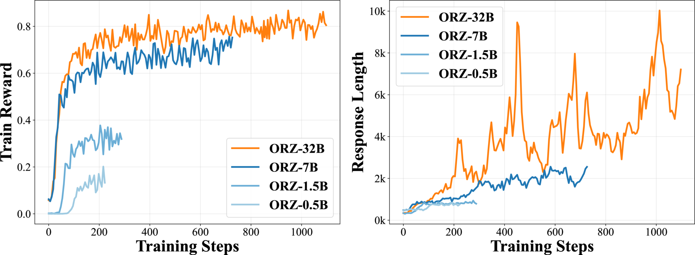
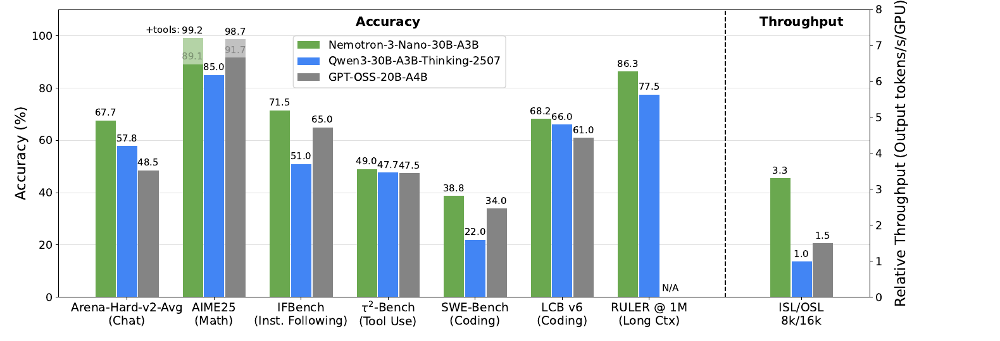

# 第 5 讲：推理模型的崛起

> 对应课程：第 5 讲 —— 推理模型的崛起 · 第 7 章 · 视频/PDF/幻灯片/源文件见 [rlhfbook.com/course](https://rlhfbook.com/course)

推理模型与测试时计算缩放（inference-time scaling）在 2024 年末至 2025 年间带来了语言模型能力的最大单次跃升。核心思想很简单：允许模型在推理时消耗更多计算，通常是在给出最终答案前输出一段较长的思维链，并用强化学习训练它把这部分额外计算用在刀刃上。训练配方与前面课程介绍的 RLHF 流程并无本质不同——PPO、GRPO、奖励模型、KL 正则化、拒绝采样都会出现——但奖励来源从学习人类偏好变成了可验证的正确性信号。这一变化被称为**可验证奖励强化学习（RLVR）**，它使后训练本身成为一条独立的缩放定律，并引发了整个行业对“会思考”模型的竞赛。

本章回顾这一转变。我们先比较 RLHF 与 RLVR，再梳理 2025 年推理浪潮中的标志性模型、让它们行之有效的实现技巧，以及下一阶段尚未解决的开放问题。

## 从 RLHF 到 RLVR

在 2016 年 NeurIPS 上，Yann LeCun 提出了一个著名的比喻：如果智能是一块蛋糕，蛋糕的主体是无监督或自监督学习，糖衣是监督学习，顶端的樱桃是强化学习（LeCun，引自 Synced 2019）。对现代语言模型而言，这个比喻几乎完整了：互联网规模的自监督预训练是蛋糕主体，面向指令遵循的监督微调是糖衣，最后的 RL 阶段——先 RLHF、再 RLVR——是顶端的樱桃。唯一需要修正的是，在如今涌现的 agentic 系统中，RL 这颗樱桃消耗的算力可能远超比喻所暗示的，尽管训练循环的形状保持不变。

RLHF 与 RLVR 的主要区别在于奖励如何获得。RLHF 用学习得到的奖励模型对主观质量打分：有用性、清晰度、风格、安全性。RLVR 则用验证器检查答案是否正确。

对比一下。对于 RLHF 提示

> 用经济学解释机会成本。

打分需要判断清晰度、准确性、完整性和语气，不存在唯一正确的补全。用基于人类偏好训练出的奖励模型是自然选择。

而对于 RLVR 提示

> 20 以下所有素数之和是多少？

一个简单的规则即可判定成败：

```
extracted_answer == 77 → Reward = 1
```

或者对代码：

> 写一个 Python 函数 `fib(n)`，返回第 n 个斐波那契数。

```python
assert fib(10) == 55
```

全部测试通过则奖励为 1，否则为 0。后训练算法相同，变化的是奖励函数以及随之而来的直觉。

RLVR 开启了推理模型的大门。由于正确性可以自动检查，模型可以在同一批问题上进行数千步梯度更新，反复 revisit 这些问题。每一次 revisit 都会采样到新的推理轨迹，而 RL 目标会提高最终导向正确答案的轨迹的概率。RLHF/RLVR 的清晰二分只是教学上的：前沿系统如今混合了主观奖励、评分细则、工具输出和可验证分数，但可验证的核心才是 2025 年推理爆发的根源。

## RLVR 反馈循环

RLVR 循环在结构上与 RLHF 完全相同。采样提示，策略生成补全，计算奖励，更新策略。唯一区别是用验证函数替代了奖励模型。


对数学题，验证器通常从 `\boxed{}` 表达式或特殊 `<answer>` 词元中提取最终答案。对代码，验证器执行单元测试。对指令遵循任务，验证器可能把结构化输出与规范进行比对。奖励通常是二元的：正确或错误。有些系统按通过测试数的比例给部分奖励，但主流配方仍是在补全末尾给出稀疏的 0/1 信号。

由于奖励稀疏且只在终止时给出，优势估计很简单。例如 GRPO 对每个提示采样 $G$ 个补全，计算它们 0/1 奖励的均值和标准差，再对每个补全中的每个词元使用 z-score 后的优势。rollout 组自身就提供了基线，因此不需要学习价值函数。

### 结果奖励与过程奖励

RLVR 中占主导的奖励是**结果奖励**：在补全末尾给出一个 0/1 分数。结果奖励计算便宜，且不易在单题层面被钻空子，但它不奖励部分进展，长轨迹容易像随机游走。

另一种选择是**过程奖励模型（PRM）**，它对推理轨迹的每一步打分。这一思想由 "Let's verify step by step"（Lightman 等人 2024）推广：不仅判断最终答案，还训练一个模型来标注每个中间步骤是否正确。PRM 能改善信用分配、提高样本效率，但构建成本高，需要步骤级标注；而且策略可能学会生成对 PRM 看起来好、却并不导向正确答案的步骤。到 2025 年，结果奖励 RLVR 仍是开放推理配方的主力，PRM 更多用于测试时重排或作为研究探针。

## RL 训练与测试时计算缩放

推理模型由两种缩放共同推动。

**训练时计算缩放**指在 RL 训练中投入更多算力。更多梯度步、更多 rollout、更精心筛选的问题都会改进策略。OpenAI 的 o1 展示了这条缩放定律：随着 RL 训练算力增加，高难度数学和编程基准上的表现提升（OpenAI 2024）。


**测试时计算缩放**指在生成时投入更多算力。模型输出更长的思维链、尝试多种策略，或采样多个答案再聚合。OpenAI 的 o1 也表明，对固定训练后的策略，允许推理时使用更多思考词元会提高准确率（OpenAI 2024）。


两者深度耦合。RL 训练教会模型如何利用长推理预算；长推理预算又为 RL 提供了更丰富的行为空间去强化。这与 RLHF 早期观察到的长度偏差不同——当时人类偏好训练有时会为了增加长度而提高回复平均长度，收益却很有限（Singhal 等人 2023）。在推理模型中，更长的思考与更好的答案相关，因为模型学会了把计算分配给困难的子问题。

## 思考词元长什么样

标准模型会直接回答。面对

> 20 以下所有素数之和是多少？

它可能回答：

> 20 以下的素数是 2、3、5、7、11、13、17、19，它们的和是 77。

而推理模型会先输出一个 `<think>` 块：

> `<think>` 我需要找出 20 以下的所有素数。从 2 开始：2 是素数。3 是素数。4=2×2，不是素数。5 是素数……把它们相加：2+3=5，5+5=10，10+7=17，17+11=28，28+13=41，41+17=58，58+19=77。`</think>`
>
> 答案是 $\\boxed{77}$。

对简单问题这看起来浪费。但对困难的竞赛数学题或多步骤编程任务，思考阶段可能长达数千词元。`<think>` 词元在大多数产品中不对用户展示，但它们是模型生成的一部分，会消耗上下文长度、推理算力和训练显存。

## 关键评估指标与算法

推理评估由两个指标主导。

**pass@1** 是每道题只采样一次时的准确率，衡量模型一次答对的能力。

**pass@K** 生成 $K$ 个独立补全，报告其中是否有任何一个正确，衡量覆盖率或采样能达到的上界。若 $n$ 次尝试中有 $c$ 次正确，则无偏估计量为

$$
\\widehat{\\mathrm{pass@}k}=1-\\frac{\\binom{n-c}{k}}{\\binom{n}{k}}。
$$

2025 年推理文献中还有两个经常出现的算法术语。

**DAPO**（Dynamic Advantage Policy Optimization）由 Yu 等人 2025 年提出，是 GRPO 的一种放松截断变体。它放宽上截断边界，以免有前景的探索性更新被截掉。

**CISPO**（Clipped Importance Sampling Policy Optimization）由 MiniMax 在 MiniMax-M1 中提出（MiniMax 2025），它截断的是重要性采样权重而非逐词元策略比率，并对截断后的权重使用 stop-gradient，使每个词元仍能收到信号，同时限制更新幅度。

## 推理模型的寒武纪大爆发

RLVR 的核心思想在 o1 和 R1 使其主流化之前就已经被探索。STaR（Zelikman 等人 2022）和 Quiet-STaR（Zelikman 等人 2024）利用真实答案奖励来引导思维链推理：采样大量理由，保留导向正确答案的理由，并在其上微调。TRICE（Hoffman 等人 2023）用受马尔可夫链蒙特卡洛启发的期望最大化过程优化推理轨迹。VinePPO（Kazemnejad 等人 2024）在 GSM8K 和 MATH 上用二元数学奖励运行 PPO，依赖大量 rollout 和蒙特卡洛信用分配。Tülu 3（Lambert 等人 2024）则证明，面向数学正确性的 PPO 可以在不破坏通用能力的前提下应用。

这些工作奠定了模块。2025 年的模型把这些模块放大并简化了配方。

### 为什么 RL 现在奏效？

三个因素汇合。

**稳定性更可控。** RL 仍然脆弱——熵崩溃、损失尖峰、长程信用分配仍是核心研究问题——但工具链和配方已经足够成熟，可以广泛采用。TRL（von Werra 等人 2020）、Open Instruct（Lambert 等人 2024）、veRL（Sheng 等人 2025）和 OpenRLHF（Hu 等人 2024）等框架降低了进入门槛。

**基座模型足够强。** 多个来源指出，RL 推理训练直到大约 2024 年前后的领先模型出现后才变得可行。模型需要达到一定的能力下限，才能从在难题上进行数千步梯度更新中获益。

**可验证领域提供干净信号。** 数学和代码给出明确奖励。策略要么通过单元测试，要么不通过。这规避了 RLHF 中常见的许多奖励黑客问题——在那里，学出的奖励模型可能被钻空子。但可验证奖励也并非完全免疫操纵。近期工作如 "LLMs Gaming Verifiers"（Helff 等人 2026）表明，当验证函数有可被利用的结构时，RLVR 仍会导致奖励黑客，例如生成在格式上匹配验证器期望、数学上却不正确的答案。验证与反验证的军备竞赛仍在继续。

### DeepSeek R1（2025 年 1 月 20 日）：催化剂

DeepSeek R1（Guo 等人 2025）是对 OpenAI o1 的一次出人意料的快速开源复现。它的重要性来自三点。

**R1-Zero** 表明，直接在基座模型上进行纯 RL，无需监督微调热启动，就能在规模上诱导出思维链推理。训练奖励曲线显示，随着 RL 持续，推理行为自发涌现。


**完整的 R1 配方** 是冷启动 SFT、大规模 RL、再蒸馏出更小的模型。冷启动稳定早期训练分布，大规模 RL 提升推理能力，蒸馏把行为迁移到更小更快的模型。

**开源发布** 让整个产业看清了配方。尽管训练数据未公开，技术报告提供了足够细节，使得开放复现在几周内跟上。

### Kimi 1.5（2025 年 1 月 20 日）：扩展课程

Kimi 1.5 与 R1 同周发布，强调 RL 规模与课程（Kimi Team 2025）。报告指出，它在中英文推理数据上采用 PPO/GRPO 风格的 RL，通过难度调度和在线过滤保持梯度有效，并渐进式延长长度以抑制过度思考同时允许长思维链。Kimi 1.5 未以开放权重发布，但其训练动态图被广泛引用为证据——在 RL 过程中准确率与回复长度同步增长。


### Open-Reasoner-Zero（2025 年 2 月 18 日）：极简复现

Open-Reasoner-Zero（Hu 等人 2025）是首个公开数据集与代码的 R1 风格基座模型 RL 运行。它使用普通 PPO 配合 GAE（$\\lambda=1$、$\\gamma=1$）、简单的规则奖励、无 KL 惩罚。3 月的扩展版增加了更简单的脚本和 12.9 万道精选问题。这项工作很重要，因为它证明 R1-Zero 的结果无需专有基础设施即可复现。



### Qwen 3（2025 年 4 月 29 日）：混合推理器

Qwen 3（Yang 等人 2025）成为新的开放权重标准。其标志性特性是可切换思考模式：`/think` 与 `/no_think` 让用户开关推理。训练这种混合模型被证明很困难——多数实验室称之为头疼问题——但该发布为后续开放模型设定了预期。Qwen 3 还引入了思考预算长度控制，并对较小变体使用强到弱蒸馏：先用异策略输出，再在同策略下进行教师 logits 匹配。Llama-Nemotron（Bercovich 等人 2025）是另一个可切换的开放权重推理模型，发布了后训练数据和代码库，但遵循不同配方。


### MiMo（2025 年 4 月 30 日）：端到端推理管线

小米的 MiMo（Xia 等人 2025）报告了从预训练到后训练的完整管线。面向推理的优化从预训练就开始了：25T 词元的三阶段数据混合，以及预训练期间的多词元预测（MTP）。后训练使用多领域 RL，防止在单一任务类型上过度优化。MiMo 还因公开了后训练中的清晰中间检查点而引人注目，让外部研究者能观察模型如何演化。


### OpenThoughts 3（2025 年 6 月 5 日）：SFT 数据配方依然重要

OpenThoughts 3（Guha 等人 2025）表明，开放推理数据和精心蒸馏仍然重要。它发布了 120 万条涵盖数学、代码和科学的公开样例，从 QwQ-32B 轨迹蒸馏而来，并记录了超过 1000 次受控数据管线实验。OpenThinker3-7B 仅凭监督微调就达到了很强的推理性能。这项工作强调，社区需要更多投入来构建高质量开放推理轨迹，并理解什么样的教师轨迹才是好的。


### MiniMax-M1（2025 年 6 月 16 日）：一篇有趣的 RL 论文

MiniMax-M1（MiniMax 2025）贡献了两个持久的想法。第一，CISPO 截断重要性采样权重而不是丢弃高更新词元，这一算法选择在后续工作中延续。第二，论文引入了如今著名的 FP32 LM 头训练-推理不匹配图：训练时以低精度运行语言模型头会使逐词元概率与推理时计算的概率发散，从而破坏 RL 稳定性；仅将 LM 头上 cast 到 FP32 就能重新对齐两种分布。


### GLM-4.5（2025 年 7 月 28 日）：推理向 agentic 工作扩展

GLM-4.5（GLM-4.5 Team 2025）是较早重点强调 agentic 行为的报告之一。它是一个 355B 总参数、32B 激活参数的 MoE 模型，支持思考与直接回复两种模式，后训练采用专家模型迭代加 RL，分别针对 agent、推理和通用对话能力。


### Olmo 3 Think（2025 年 11 月 20 日）：完全开放的推理模型

Olmo 3 Think（Team Olmo 2025）代表了推理模型生命周期最全面的开放文档。发布内容包括各阶段、检查点、数据、基础设施细节和超参数。伴随报告还包含有趣的 DPO 发现和消融。对于希望研究推理模型如何构建而不仅是使用最终成品的研究者来说，Olmo 3 是当前参考。


### DeepSeek V3.2（2025 年 12 月 1 日）：推理走向 agentic

DeepSeek V3.2（DeepSeek-AI 2025）把 R1 配方推向工具调用和 agent 环境。它是 V3.2-Exp 的开放权重 MoE 继任者，将思考直接集成到工具使用中，而非把推理当作独立模式，并包含面向极致推理性能的 Speciale 变体。


### Nemotron 3 Nano（2025 年 12 月 15 日）：高效的 agentic 推理

Nemotron 3 Nano（NVIDIA 2025）是另一项非常开放的发布，总参数 316 亿，每次前向约 32 亿激活。它采用混合 Mamba-Transformer MoE 架构，后训练使用 SFT、多环境 RLVR 和 RLHF。该发布为 2026 年更强的美国开放权重模型铺了路。



### MiMo-V2-Flash（2025 年 12 月 16 日）：多教师蒸馏为一体

MiMo-V2-Flash（LLM-Core Xiaomi 2025）引入了多教师同策略蒸馏（MOPD）。该配方按领域训练专家教师——数学、代码、搜索、推理——然后把它们蒸馏进单个学生。学生从密集的逐词元奖励中学习，而非序列级结果奖励，这更样本高效，并使学生能在每个领域都匹配最强的教师。底层模型是一个为快速 rollout 设计的 309B/15B MoE，但后训练配方才是主角。


### 近期开放模型

到 2026 年初，前沿已从纯推理模型转向长程、工具调用的 agent 基底。美国方面包括 NVIDIA Nemotron 3 Super（2026 年 3 月），120B/12B MoE，带 LatentMoE、MTP 和原生 NVFP4 预训练，开放检查点、训练数据和配方；以及 Arcee Trinity-Large-Thinking（2026 年 4 月），面向长程多轮工具调用的前沿推理模型，Apache 2.0 权重。

中国方面的进展同样迅速。Kimi K2.5（2026 年 1 月）和 K2.6（2026 年 4 月）强调原生多模态与 agent 集群，然后是更强的长程编程。GLM-5（2026 年 2 月）和 GLM-5.1（2026 年 4 月）聚焦 agentic 工程和更长自主运行。DeepSeek V4 Preview（2026 年 4 月）提供开放 Pro 和 Flash 模型，具备双推理模式、高效架构创新和 100 万词元上下文。

这一格局告诉我们几件事。第一，RLVR 的基础在几个月内就被开源代码库和数据复现。第二，从数学和代码推理到 agentic 模型的转变非常快。第三，尤其是中国实验室在使长上下文推理更高效方面做了大量模型层创新。第四，FP32 LM 头、CISPO 风格损失、批次级优势归一化等持久基础出现得很快，但需要大量调参才能稳定收敛。

## 常见实现模式

2025 年的推理报告共享一套惊人一致的配方决策。以下列表是已记录实践的快照，并非最优配方的断言。

### 离线难度过滤

模型只能从有时成功、有时失败的问题中学习。如果当前策略对某道题的通过率是 0% 或 100%，不同补全之间的梯度为零。因此许多项目会对每个训练提示预采样 $N$ 个补全——常为 $N=16$——只保留通过率在 20%-80% 之间的题目。Seed-Thinking 1.5、Open-Reasoner-Zero、Phi-4 Reasoning、INTELLECT-2、MiMo、Skywork OR-1 和 Olmo 3 都采用了这种方式。

### 在线过滤与课程

即使过滤后，也不是每道题在训练各阶段都有用。在线过滤跳过已变得太简单或太难的题目，课程调度器把更难的题目留到后面。Kimi 1.5、Magistral、Llama-Nemotron、INTELLECT-2 和 MiMo 都使用了这一做法。

### 零梯度过滤与主动采样

若某提示的 $G$ 个补全全部通过或全部失败，组内优势为零，该提示对梯度无贡献。Olmo 3 会丢弃这些组并用新提示重新填充批次，使损失曲线更干净、训练更稳定。

### KL 惩罚：先去掉，再回归

单轮数学 RLVR 常把 KL 系数 $\\beta$ 设为 0，因为可验证奖励能抵抗过度优化。Magistral、Open-Reasoner-Zero 和 Skywork OR-1 都这样做。但长程、异策略 agentic 训练为了稳定性又开始重新引入 KL 或参考项，如 Cursor Composer 2。

### 放松与非对称截断

标准 PPO/GRPO 围绕 1 对称截断重要性采样比率。推理模型常放松上界，以保留有前景的探索性更新。DAPO（Yu 等人 2025）是典型代表；Magistral、INTELLECT-2 等也采用了类似思想。

### CISPO

MiniMax-M1（MiniMax 2025）引入了 CISPO，ScaleRL（Khatri 等人 2025）在其缩放研究中把它选为最佳损失。回顾第 3 讲，重要性采样与截断是在一批 rollout 上多次梯度更新的核心工具。CISPO 把截断应用于权重而非目标，限制更新幅度，同时不会把探索性词元的梯度归零。

### 归一化选择

优势与损失如何平均会悄悄改变目标。Magistral 和 MiMo 在整个批次上归一化优势，而非按提示组，以免少数极简单或极难的提示主导。Dr. GRPO（Liu 等人 2025）主张按总词元数平均损失而非按序列平均，以消除长度偏差。第 4 讲详细讨论了逐词元与逐序列损失聚合的权衡。

### 格式奖励

为了让推理轨迹可预测，许多模型会为有效的 `<think>` 块和可提取的最终答案给予小额奖励。这些奖励关乎可用性，而非正确性。DeepSeek R1、Open-Reasoner-Zero、Magistral 和 Skywork OR-1 都使用了格式奖励。

### 语言一致性奖励

多语言推理模型有时会在轨迹中切换语言，影响可读性。DeepSeek R1 和 Magistral 加入了语言一致性奖励，惩罚轨迹内部的语言切换。

### 长度控制

长推理链有用，但无限长度浪费算力，也可能意味着过度思考。Kimi 1.5 渐进式延长最大训练长度，迫使模型先在较短预算内有效推理，再进入更长轨迹。INTELLECT-2 全程使用较小的长度惩罚。其他项目用过超长过滤来保证吞吐。

### 推理成为瓶颈

长且长度变化大的补全意味着，learner GPU 在 rollout 工作者生成时会空闲。Olmo 3 报告 learner GPU 约 75% 时间空闲，推理算力是训练算力的 5-14 倍。这种不平衡正是异步与异策略训练成为标准的原因。

### 异策略与异步更新

actor 持续生成补全，learner 消费略陈旧的 rollout。rollout 比当前策略落后几步，但吞吐大幅提升，因为计算得到更好利用。Seed-Thinking 1.5 和 INTELLECT-2 使用了这一模式；Olmo 3 做了详细记录。


### 测试时计算缩放

并行测试时计算能显著提升准确率。最简单形式是对 $K$ 个独立样本做多数投票，DeepSeek R1 和 Phi-4 Reasoning 都用过。更高级的形式是用选择模型挑出最佳答案，如 DeepSeek-GRM（Liu 等人 2025）。pass@K 与 pass@1 的差距衡量了更好聚合能带来多大提升空间。

测试时缩放不限于 RL 训练出的模型。`s1` 工作（Muennighoff 等人 2025）表明，小模型经过精选推理轨迹微调后，可通过提示词中的“等待”词元控制思考长度，无需大规模 RL 就能取得很强表现。一般规律是：更多推理计算只在模型学会利用它时才有效；训练配方与推理配方是同一枚硬币的两面。

### 文本-only RL 提升多模态性能

一个令人惊讶的发现：对多模态模型先进行文本-only 推理 RL，可以提升它在视觉任务上的表现。MiMo-VL 和 Magistral 都报告了这一效应。

### 中间训练决定 RL 天花板

预训练数据的构成限制了 RL 能达到的高度。MiMo 表明，增加预训练中数学和代码的比例会提高后训练 RL 能达到的天花板。预训练并未死亡；它决定了 RL 运行的基底。

## 开放问题

仍有若干问题未解决。

- RL 训练是在**发现**新能力，还是只是**激发**预训练中已潜藏的能力？
- 没有更好的预训练数据，推理训练能走多远？
- agentic RL——工具调用加推理——是否需要根本不同的配方？
- 能否系统研究 RL 推理的缩放性质？ScaleRL（Khatri 等人 2025）是早期尝试。
- 1 年、2 年、5 年和 10 年后，预训练与 RL 之间的算力分配会是什么样子？

## RL 训练库

一个健康的开源训练库生态支撑了这一研究。

- **slime** —— 基于 SGLang 的 RL 缩放后训练框架，用于 GLM 模型线。
- **SkyRL** —— 模块化全栈 RL 库，支持异步与多轮 agent 工作流。
- **veRL** —— 来自 HybridFlow 工作的灵活生产级 RL 训练库（Sheng 等人 2025）。
- **OpenRLHF** —— 基于 Ray 的 RLHF 与 RLVR 训练框架（Hu 等人 2024）。
- **TRL** —— Hugging Face 的后训练库，提供易用的 trainer API（von Werra 等人 2020）。
- **Open Instruct** —— Ai2 的开放后训练配方与研究代码（Lambert 等人 2024）。

## 要点小结

- 推理模型使用与 RLHF 相同的策略梯度算法训练，但奖励来自验证函数而非学习得到的奖励模型。这一范式称为**可验证奖励强化学习（RLVR）**。
- RLVR 之所以有效，是因为数学和代码提供明确的正确性信号，使模型能在同一批问题上训练数千步，并学会生成有用的思维链。
- 两条缩放定律推动该领域：通过更多 RL 算力实现的训练时缩放，以及通过推理时更长思维链实现的测试时缩放。
- 2025 年的推理浪潮由 DeepSeek R1 引爆，包括 Kimi 1.5、Open-Reasoner-Zero、Qwen 3、MiMo、OpenThoughts 3、MiniMax-M1、GLM-4.5、Olmo 3 Think、DeepSeek V3.2、Nemotron 3 Nano 和 MiMo-V2-Flash。到 2026 年，前沿已转向长程、工具调用的 agent 基底。
- 常见配方决策包括离线与在线难度过滤、去掉或重新引入 KL 惩罚、放松截断、CISPO、批次级归一化、格式与语言一致性奖励、长度控制，以及异步异策略训练。
- 开放问题包括 RL 是在发现还是仅激发推理、没有更好预训练数据时 RL 能走多远、agentic RL 的配方会是什么样，以及预训练与 RL 的算力分配将如何演化。
