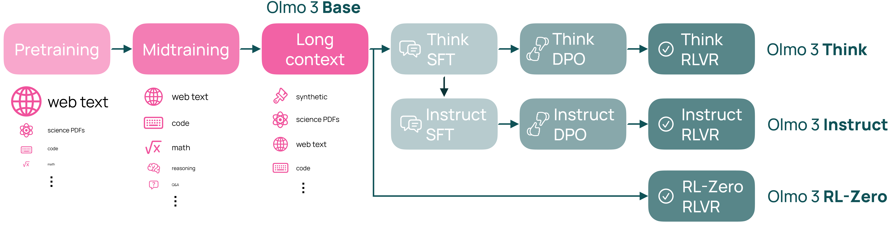
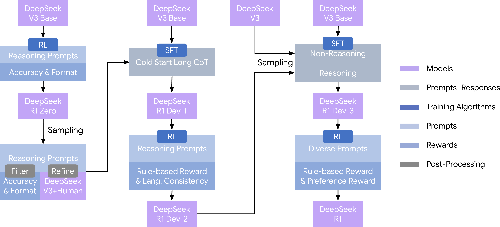

> 对应讲座：Conversation 1 — 2026 年前沿后训练配方（与 Finbarr Timbers 对谈）· 观看/讲义/幻灯片/源码见 [rlhfbook.com/course](https://rlhfbook.com/course)

# Conversation 1：2026 年前沿后训练配方

本章提炼了与 Finbarr Timbers 关于 2026 年前沿实验室如何构建语言模型的对谈。核心观点简单却影响深远：后训练配方的*形态*在 2026 年之前的一年里发生的变化，比此前三年的总和还要大。我们将从经典的三步 RLHF 配方讲起，经过推理强化学习的兴起，最终聚焦于在前沿实践中涌现出的新整合模式——多教师同策略蒸馏（Multi-teacher On-Policy Distillation，MOPD）。

本章围绕"配方"而非单个算法展开。所谓配方，是指将基础模型转化为产品所使用的一整套数据、优化器和模型的完整流程。理解配方之所以重要，是因为相同的一组算法构件——监督微调（SFT）、直接偏好优化（DPO）、近端策略优化（PPO）、GRPO、拒绝采样——在不同的顺序、规模和专家能力整合方式下，会产出截然不同的模型。

## 后训练配方的四个阶段

过去五年可以概括为四个配方时代：

- **2022–2023：经典三步配方。** InstructGPT（Ouyang et al. 2022）确立了 SFT → 奖励模型 → PPO 的标准流程。ChatGPT 使这一配方广为人知，此后很长一段时间内，大多数开源复现工作都以此为目标。
- **2024：多阶段复杂配方与更简优化器。** Llama 3（Dubey et al. 2024）和 Tülu 3（Lambert et al. 2024）表明，多轮拒绝采样、SFT 和直接偏好优化能够达到甚至超越单阶段在线 RL 的效果。闭源实验室 meanwhile 在并行运行更多 RLHF 阶段。
- **2025：推理 RL 成为核心。** DeepSeek R1（Guo et al. 2025）证明，大规模可验证奖励强化学习（RLVR）可以成为能力增长的主要驱动力，而 SFT 主要用于蒸馏和精炼 RL 发现的行为。
- **2026：拆分与整合。** 领先的开源配方开始训练多个领域专家模型，再将它们合并回一个最终模型。整合步骤就是 MOPD。

这一演进并非一个配方平滑替代另一个。每个时代都为工具箱增添了新工具。SFT 和拒绝采样从未消失，只是在更长的流程中被重新定位。真正改变的是哪个阶段消耗最多算力，以及哪个阶段被视为最终模型的能力来源。

## MOPD 之前的经典配方

### InstructGPT：SFT、奖励模型、PPO

InstructGPT 配方（Ouyang et al. 2022）是大多数后续工作遵循或反思的模板。它包含三个阶段：

1. **监督微调**：在人类演示数据上训练，使模型学会问答格式。
2. **奖励模型训练**：在人类偏好的成对比较上训练，用于给补全打分。
3. **PPO**：针对奖励模型进行优化，并加入 KL 惩罚使策略靠近 SFT 检查点。

第三阶段的优化目标是大家熟悉的 KL 正则化奖励最大化：

$$J(\\pi) = \\mathbb{E}\_{x \\sim \\mathcal{D},\\, y \\sim \\pi(\\cdot \\mid x)}\\big[r\_\\phi(x, y)\\big] - \\beta \\mathcal{D}\_{\\mathrm{KL}}\\big(\\pi(\\cdot \\mid x) \\,\\|\\, \\pi\_{\\mathrm{ref}}(\\cdot \\mid x)\\big).$$

这一形式在后训练中以各种变体反复出现。DPO 将其重新推导为直接偏好损失；RLVR 用精确验证器替代奖励模型；MOPD 则用教师分布替代奖励模型。

### Llama 2：迭代 RLHF 与专用奖励模型

Llama 2（Touvron et al. 2023）将领域推向多阶段迭代 RLHF。每一轮都结合了拒绝采样和 PPO，并且项目训练了两个奖励模型——一个用于有用性，一个用于安全性——而非一个。

有用性/安全性的拆分体现了一个更通用的设计原则：当单一优化目标必须平衡相互冲突的目标时，分别训练多个模型再组合往往更干净。

### Llama 3：奖励模型作筛选器，DPO 作优化器

Llama 3（Dubey et al. 2024）最清晰地记录了一种保留奖励模型但不用它做在线 RL 的配方。每一轮对每个提示采样 $K$ 个补全，用奖励模型筛选后，执行拒绝采样 SFT，再接 DPO。该配方迭代六轮，每轮最优检查点作为下一轮起点。

Llama 3 的启示在于，同样的三步原料可以被重新排列。奖励模型变成了数据质量筛选器，而 DPO 这种更简单的离线算法成为最终优化器。

### Tülu 3：SFT → DPO → RLVR

Tülu 3（Lambert et al. 2024）为开源模型形式化了一个更简单的三阶段配方：精选提示 → SFT → DPO → RLVR。RLVR 这个缩写——可验证奖励强化学习——正是在这篇论文中提出的。RLVR 阶段按提示数量看很小，但每个提示的采样和验证消耗大量算力。

Tülu 3 还展示了 RL 可以"外科手术式"地应用：仅在数学提示上训练，仍能提升或保持广泛能力。这暗示了领域专用 RL 阶段可以与通用能力训练解耦。

### Olmo 3：对 Tülu 配方的推理升级

Olmo 3（Team Olmo et al. 2025）保留了 Tülu 3 的主干，但增加了显式的推理分支。流程在中期训练后拆分为思维（think）、指令（instruct）和 RL-Zero 三条轨道，每条轨道都运行自己的 SFT → DPO → RLVR 序列，最后合并。

这种分支结构是迈向专业化的又一步：不同能力在独立流中训练，再合并。

### DeepSeek R1：RL 居于核心

DeepSeek R1（Guo et al. 2025）是推理模型的里程碑式配方，包含四个阶段：

1. **R1-Zero**：在基础模型上纯 GRPO RL，无 SFT，用于*激发*推理行为，而非作为产品。
2. **冷启动 SFT**：在 R1-Zero 产出的、经过严格筛选的推理轨迹上训练。
3. **推理 RL**：训练至收敛。
4. **拒绝采样 SFT** 接最终混合 RL 阶段，平衡可验证推理奖励与通用偏好奖励。

这里的反转很重要。在 InstructGPT 中，RL 是 SFT 之上的最后润色；而在 R1 中，RL 发现核心推理行为，SFT 则用于蒸馏、稳定和泛化该行为。

### DeepSeek 自身在 V3 之后的演进

DeepSeek 从 V3 到 R1 再到一系列专家变体，发展迅速：

- **V3**（2024 年 12 月）：SFT + GRPO RL。
- **R1**（2025 年 1 月）：多阶段 RL；推理能力涌现。
- **V3.1**（2025 年 8 月）：单一模型中的混合思考/非思考模式。
- **V3.2**（2025 年 12 月）：六个经 RL 训练的专家，经 SFT 蒸馏后进入单一混合 GRPO 阶段。
- **V4**（2026 年 4 月）：十余个领域专家通过 MOPD 整合。

V3.2 的设计已经是"专家训练后合并"的配方；V4 则将 SFT 合并替换为 MOPD。

## MOPD：2026 年的整合模式

**多教师同策略蒸馏（MOPD）** 是 2026 年前沿实践中涌现的整合模式，包含三个阶段：

1. 训练 $N$ 个领域专家教师。每个教师都通过熟悉的配方产出：在单一领域（如数学、代码、推理或智能体任务）上做 SFT，然后接 RL。
2. 训练一个通用学生模型，采样*其自身*的采样轨迹。
3. 在每条采样轨迹上，将学生词元分布与对应教师词元分布之间的反向 KL 散度最小化。

关键短语是"同策略"。学生不是在静态的教师输出上训练，而是从自身策略生成补全，教师只在学生实际访问的状态上提供反馈。这弥合了训练与推理之间的暴露偏差鸿沟（Kim & Rush 2016；Agarwal et al. 2024；Ross et al. 2011）。

### MOPD 优化目标

设 $s$ 为提示，$a = (a\_1, \\ldots, a\_L)$ 为当前学生模型 $\\pi\_\\theta$ 采样的补全，$s\_t = (s, a\_{<t})$ 为第 $t$ 步的词元级状态。设 $\\pi\_{T\_k}$ 为第 $k$ 个教师，$w\_k(s)$ 为该教师对提示 $s$ 的混合权重，满足 $\\sum\_k w\_k(s) = 1$。MOPD 损失为：

$$\\mathcal{L}\_{\\mathrm{MOPD}}(\\theta) = \\mathbb{E}\_{s,\\, a \\sim \\pi\_\\theta(\\cdot \\mid s)} \\sum\_t \\sum\_k w\_k(s) \\, \\mathcal{D}\_{\\mathrm{KL}}\\big(\\pi\_\\theta(\\cdot \\mid s\_t) \\,\\|\\, \\pi\_{T\_k}(\\cdot \\mid s\_t)\\big).$$

这是一个反向 KL 目标：期望在学生策略下采样，且学生分布位于 KL 的左侧。反向 KL 倾向于让学生质量集中在教师高概率词元上，而不是覆盖教师全部分布。在实践中，它通常比离线蒸馏所用的前向 KL（交叉熵）产生更清晰、更高质量的生成结果。

一种密切相关的实现将逐词元对数概率差距作为 RL 算法中的优势函数（Lu 2025）。对于状态 $s\_t$ 下采样的词元 $a\_t$：

$$A\_t^{\\mathrm{OPD}} = \\log \\pi\_T(a\_t \\mid s\_t) - \\log \\pi\_\\theta(a\_t \\mid s\_t).$$

教师评分高于学生的词元获得正优势，学生评分高于教师的词元获得负优势。教师因此提供密集的逐词元反馈。

### 从离线知识蒸馏到同策略蒸馏

传统知识蒸馏（Hinton et al. 2015）训练学生匹配教师的软输出分布。应用于语言模型后，发展为序列级蒸馏（Kim & Rush 2016）：教师离线生成高概率序列，学生通过交叉熵学习复现它。

离线蒸馏有一个广为人知的局限：学生在教师轨迹 $u \\sim \\pi\_T$ 上训练，但推理时却在自身策略 $\\pi\_\\theta$ 下展开。测试时访问的前缀与训练时见过的不同，错误会累积。这正是模仿学习中被分析过的暴露偏差问题（Ross et al. 2011）。同策略蒸馏通过从学生采样并在其访问的状态上监督，修复了这种失配。

MOPD 将同策略蒸馏扩展到多个教师。各领域专家教师在其专长领域可能比任何单一整体模型强得多，而学生只在相关提示上向对应教师学习。

## MOPD 为何在 2026 年涌现

三股力量推动了领域走向 MOPD。

**RL 变得昂贵且充满冲突。** 在单一 RL 阶段中混合数学、代码、推理和智能体任务，最终会在能力之间产生取舍。对代码有利的奖励或验证器可能损害对话风格；推理目标可能让简单问题变得冗长。将各领域分开，可以让每次 RL 只优化一个目标。

**专家模型制作成本低且组织上可扩展。** 单一领域的 SFT+RL 流程已被充分理解，易于并行化，也易于调试。随着后训练成为模型开发的最大部分，将其拆分为独立的专家团队是重大的运营优势。

**同策略蒸馏趋于成熟。** RLVR 的复兴带来了基础设施、算法和直觉，使人们能够从模型自身的采样轨迹中训练模型。MOPD 将这套机制用于合并教师，而非优化奖励模型。

结果是配方复杂度从*深度*转向*广度*。早期配方有多个相同整体模型的迭代轮次；MOPD 配方的迭代轮次更少，但需要合并更多不同的专家模型。

## 2026 年前沿实践

### MiMo Flash v2：MOPD 的起点

小米的 MiMo-V2-Flash（LLM-Core Xiaomi 2025）是第一份清晰地将 MOPD 作为最终整合步骤来阐述的技术报告。其配方为：

- 第一阶段：通用 SFT。
- 第二阶段：训练约六个领域专家教师，使用标准后训练配方。
- 第三阶段：通过 MOPD 合并为单一学生。

其创新在于用"从专家蒸馏"替代单一的整体 RL 阶段。MiMo Flash v2 还证明，MOPD 可以在不牺牲通用能力的前提下推动专业领域的前沿。

### Nemotron 3 Ultra：两轮、多位教师

NVIDIA 的 Nemotron 3 Ultra（NVIDIA 2026）将 MOPD 运行了*两轮*，拥有十余个覆盖推理、代码、数学和智能体任务的教师。第一轮 MOPD 产生更强的学生；再用该学生生成或训练新教师，然后进行第二轮 MOPD 整合。

多轮结构很重要，因为第一轮产出的学生已经优于起始基础模型。用它生成同策略数据供第二轮使用，可以让教师监督一个能力更强的策略，从而可能进一步榨取收益。

### MAI-Thinking-1：一个非 MOPD 的反例

MAI-Thinking-1（Microsoft 2026）更接近 DeepSeek R1 而非 V4。其配方在中期训练基础上进行三次专家 RL"爬升"，然后通过轨迹蒸馏 SFT 合并爬升结果，最后再进行一次最终 RL 爬升。它没有使用同策略 MOPD。

这是一个有益的提醒：MOPD 并非通用。实验室仍在探索"专家训练后合并"的设计空间，而最佳合并机制——同策略蒸馏、轨迹蒸馏 SFT 或其他方法——取决于目标能力组合。

### Kimi K2.5：智能体与多模态 RL

Kimi K2.5（Kimi Team 2025）走了另一条路：先做纯文本 SFT，然后在代码、视觉、推理和智能体任务上进行联合文本-视觉 RL。报告中没有提到 MOPD。

K2.5 表明 2026 年的前沿尚未收敛。有些实验室押注领域专家加 MOPD；另一些则押注大规模多模态 RL 和智能体训练环境。

### GLM-5：按能力分阶段的 RL

GLM-5（GLM-5 Team 2026）也使用 MOPD，但在此之前有更复杂的三阶段 RL 流程：SFT、推理 RL、智能体 RL、通用 RL，并在各阶段之间进行跨阶段蒸馏。

GLM-5 说明 MOPD 可以与顺序 RL 结合。模型先经过面向能力分阶段的 RL 阶段，MOPD 作为后期整合或蒸馏步骤出现。

## 数据、合成数据与蒸馏视角

MOPD 处于两大趋势交汇处：合成数据作用日益增大，以及教师-学生蒸馏的复兴。

现代前沿流程由合成数据主导。指令微调的补全从更强的模型蒸馏而来；偏好对由 LLM-as-a-judge 系统生成；推理轨迹从 RL 采样轨迹中筛选和打磨。关于合成数据必然导致模型崩溃的担忧（Shumailov et al. 2024）已被证据缓和：混合真实数据、使用多样化教师以及积极过滤可以避免崩溃（Gerstgrasser et al. 2024；Feng et al. 2024）。

MOPD 是一种*蒸馏*，但它不是早期那种离线序列蒸馏。离线蒸馏一次性生成教师输出，用交叉熵训练学生匹配。MOPD 则采样学生轨迹，并在访问状态上用反向 KL 将学生分布与教师分布对齐。从离线到同策略的 conceptual move，正是 RLVR 以来推动后训练发展的同一转变。

MOPD 中的教师本身也通常用合成数据训练。数学专家可能在筛选后的 OpenThoughts 轨迹上训练（Guha et al. 2025）；代码专家使用编译器验证样本；智能体专家使用其他模型产出的工具使用轨迹。因此，MOPD 将多个合成数据配方合并到一个最终模型中。

这也与 AI 反馈有关。宪法 AI（Bai et al. 2022）和 RLAIF（Lee et al. 2023）表明，语言模型可以替代人类标注者进行偏好标注。人类与 AI 反馈的混合路由（Miranda et al. 2025）说明，最优数据混合取决于领域。MOPD 在模型层面继承了这一逻辑：不同领域由不同教师服务，最终模型是它们专长的加权混合。

## 评估、扩展与关注重点

对谈强调，配方不仅是学术选择，也是扩展和评估选择。

**扩展。** 后训练算力已成为与预训练和推理并列的主要扩展维度。MOPD 扩展*广度*：更多教师、更多领域、更多并行专家 RL 运行。DeepSeek R1 及其后继者扩展*深度*：在更难问题上进行更长的推理 RL。两个方向都消耗大量算力，最佳配方会结合两者。

**评估。** 随着配方更复杂，评估也更困难。单一综合分数会掩盖推理、代码、对话、安全性和工具使用之间的取舍。正确的评估应覆盖配方触及的所有领域，并使用足够难的留出提示来区分真实能力与记忆。可验证任务使评估更简单；开放式对话和智能体任务则更难。LLM-as-a-judge 已是标准做法，但评判者偏差仍是一个问题。

**关注重点。** 当前配方中有三个设计决策似乎最重要：

1. **何时专业化。** 有些能力最适合通过领域专用 RL 添加，另一些则更适合广泛的 SFT 或通用 RL。这一决定决定了是否根本需要 MOPD。
2. **如何合并。** 同策略反向 KL 是一种合并机制；轨迹蒸馏 SFT 是另一种。选择会影响最终模型保留多少每位教师的风格，以及它对分布外提示的鲁棒性。
3. **多少教师。** Nemotron 3 Ultra 和 DeepSeek V4 使用十余个；MiMo Flash v2 使用约六个。合适数量取决于领域边界的粒度以及训练每位教师的成本。

## 要点小结

- 后训练配方从经典三步 InstructGPT 流程（SFT → 奖励模型 → PPO），经过 2024 年的多阶段复杂配方、2025 年以推理 RL 为核心的配方，发展到 2026 年的"专家训练后合并"配方。
- **多教师同策略蒸馏（MOPD）** 已成为 2026 年的标志性整合模式：训练领域专家教师，从单一学生采样采样轨迹，并最小化学生与对应教师词元分布之间的反向 KL 散度。
- MOPD 由三股力量驱动：整体 RL 在跨领域时变得昂贵且冲突；专家模型可并行化且组织上可扩展；同策略蒸馏在 RLVR 复兴中趋于成熟。
- MOPD 优化目标是学生采样轨迹上的反向 KL 损失，并带有逐提示教师权重：$\\mathcal{L}\_{\\mathrm{MOPD}} = \\mathbb{E}\_{s, a \\sim \\pi\_\\theta} \\sum\_t \\sum\_k w\_k(s) \\mathcal{D}\_{\\mathrm{KL}}(\\pi\_\\theta(\\cdot \\mid s\_t) \\,\\|\\, \\pi\_{T\_k}(\\cdot \\mid s\_t))$。
- 2026 年的领先配方对 MOPD 的使用方式各不相同：MiMo Flash v2 首次提出；Nemotron 3 Ultra 用十余个教师迭代两轮；MAI-Thinking-1 改用轨迹蒸馏 SFT；Kimi K2.5 走大规模多模态 RL；GLM-5 将顺序 RL 阶段与 MOPD 结合。
- MOPD 是一种同策略蒸馏，不同于离线序列蒸馏。它通过在自身采样轨迹上监督学生，弥合暴露偏差。
- 合成数据与蒸馏与现代配方密不可分：教师常在合成轨迹上训练，MOPD 将多个合成数据流程合并到一个模型中。
- 配方选择本质上是扩展和评估选择：它决定算力投向何处、能力如何取舍，以及最终模型如何验证。
