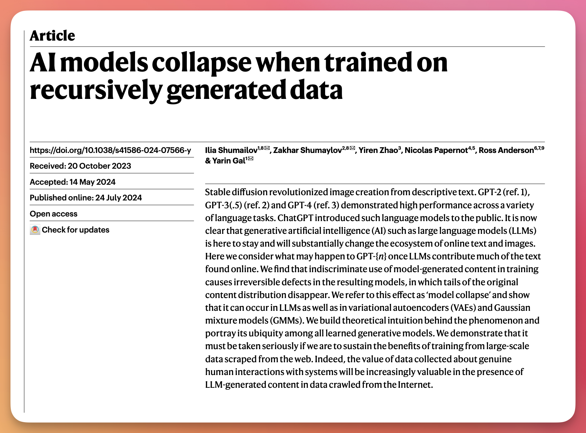
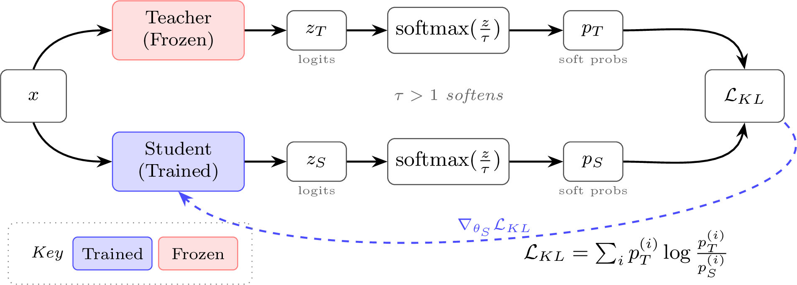
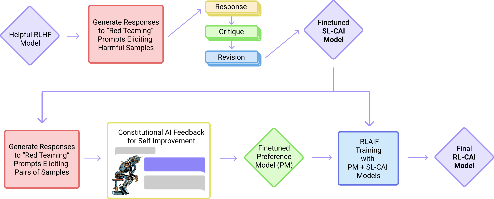

> 对应课程：第 7 讲 —— 合成数据与现代后训练方法 · 第 12 章 · 视频/PDF/幻灯片/源码见 [rlhfbook.com/course](https://rlhfbook.com/course)

# 第 7 讲：合成数据与现代后训练方法

在 RLHF 最初被用于训练大语言模型时，人类数据是高质量回复与可靠反馈的唯一可行来源。人类撰写示范、选择偏好补全、提供分数。随着模型能力提升，这一假设迅速瓦解。如今，**合成数据**——即全部或部分由另一个 AI 模型生成的训练数据——几乎渗透到后训练的每个阶段：撰写提示、生成补全、标注偏好、过滤劣质样本、为强化学习验证答案。在许多场景下，它比人工收集更便宜、更快、更可扩展，在某些场景下甚至质量更高。

本章将概述合成数据如何取代或扩展后训练流水线，并推导出同策略蒸馏作为现代师生训练的技术核心。我们会涵盖宪法 AI、AI 反馈、基于评分细则的奖励、多教师蒸馏与自蒸馏。读完本章后，你应该能够：

- 解释合成数据为何成为主流，以及人类数据在何处仍然重要；
- 区分"蒸馏"的技术含义与口语含义；
- 从交叉熵推导出序列级蒸馏，并将其与监督微调联系起来；
- 写出同策略蒸馏目标、解释反向 KL，并给出逐词元优势函数；
- 描述宪法 AI 及其如何同时生成 SFT 数据与偏好数据；
- 为没有可验证答案的任务设计一个简单的评分细则用于 RL 训练。

## 合成数据是什么、位于何处

**合成数据**是指全部或部分由另一个 AI 模型生成的、用于训练 AI 模型的数据。这个定义故意很宽泛：强模型可以从种子示例生成新提示（Wang et al. 2023）、改写或扩展已有提示、为监督微调生成补全（NuminaMath 7B TIR 2024）、为 RLHF 标注成对偏好（Cui et al. 2023）、过滤低质量输出（Li et al. 2024），或者验证答案作为 RL 的奖励。同一个模型家族常常在一条流水线里承担多个角色。


后训练流水线仍然是我们之前见过的五步骨架——收集提示、生成补全、收集偏好、打分奖励、清洗所有数据——但合成数据如今已流入每个环节。这也是为什么"后训练"这个词在现代讨论中部分取代了"RLHF"：数据循环已经比单一的人类偏好阶段丰富得多。

### 合成数据为何占据主导

三股力量推动了这一转变。

**成本与迭代速度。** 一条人类偏好数据每个提示大约 1–10 美元甚至更高；而使用 GPT-4o 等前沿模型的 AI 反馈每个提示不到 0.01 美元。人工成本大致保持不变，而模型性价比持续提升。因此，合成数据让许多原本无力承担 RLHF 实验的群体也能参与进来。

**能力阈值。** 合成数据只有在 GPT-4 级别的模型出现后才变得可靠（OpenAI 2023）。Llama 2 和 GPT-3.5-Turbo 在生成或监督高质量训练数据方面还不够稳定。在 GPT-3.5 到 GPT-4 的跨越中，LLM 作为裁判的能力出现了：前沿模型变得足够稳健，能够以与人类判断相关的方式对输出进行评分、比较和批评。

**重心转移。** 如今的前沿模型需要合成数据才能达到最佳性能。蒸馏——把强模型的能力迁移到学生模型的一般过程——已成为扩展后训练的默认方法，尤其在推理和智能体场景中。

### 人类数据与合成数据的平衡

合成数据并非在所有环节都取代了人类数据。

- **指令数据（SFT）**。合成数据已基本胜出。对于标准指令遵循任务，强模型大规模生成的补全质量如今已高于大多数人类写作者。
- **偏好数据（RLHF）**。情况更复杂。学术研究表明合成偏好可以与人类标签相媲美，但前沿实验室仍把人类偏好数据视为竞争壁垒。
- **评估**。LLM 作为裁判可以低成本扩展打分，但底层基准和真实标签仍然需要人类创建和校准。

规律是：在模型已经超越人类可靠性的地方，合成数据占主导；而在能力前沿、建立真实基准以及开辟新方向时，人类数据仍然必不可少。

### 模型坍缩：一个过时的担忧

对合成数据的常见批评是**模型坍缩**：反复在模型自身生成上训练会逐渐收窄有效训练分布（Shumailov et al. 2024）。随着多样性下降，稀有事实和风格被低估，小错误在迭代中累积，泛化性能随之下降。



坍缩是真实存在的现象，但它主要是*未经过滤、单一模型、自训练循环*的失败。在实践中，通过混合真实或人类数据、使用多样化教师模型、去重以及强质量过滤，可以避免坍缩。证据表明，合成数据可以且应当大规模使用，而不会出现最强坍缩叙事所暗示的灾难性退化（Gerstgrasser et al. 2024；Feng et al. 2024）。

### 经典合成数据集及其规模

几个数据集标志着合成后训练的不同时代：

| 数据集 | 提示数 | 词元数（约） |
| :--- | :---: | :---: |
| **Stanford Alpaca**（Taori et al. 2023） | 52K | ~10M |
| **Tülu 3**（Lambert et al. 2024） | ~1M | ~500M |
| **OpenThoughts 3**（Guha et al. 2025） | 1.2M | ~10B |

**UltraFeedback**（Cui et al. 2023）是首个有影响力的合成偏好数据集，并助推了 DPO 的兴起。**Stanford Alpaca** 是最早的对话式 SFT 数据集之一。**Tülu 3** 是一个覆盖广泛技能、用于 RL 前 SFT 的数据集。**OpenThoughts 3** 是用于训练推理模型的大型合成推理数据集。增长幅度惊人：按词元数算，Alpaca 比 OpenThoughts 3 小两个数量级，这既反映了提示数量的增加，也反映了补全长度的大幅增长。

## 基于合成数据的蒸馏

"蒸馏"这个词有两种用法。

**技术意义上的知识蒸馏**（Hinton et al. 2015）训练一个较小的*学生*模型去匹配较强*教师*的完整输出分布——即*软*标签，覆盖每个类别或词元，而不是 one-hot 目标。损失是教师分布与学生分布之间的 KL 散度。



**口语意义上的蒸馏**简单地说就是"用强模型的输出去训练弱模型"。当人们说某个模型"从 GPT/Claude 蒸馏"时，指的就是这个含义。两者有重叠，但口语含义在现代后训练中更为常见。


在实践中，蒸馏扮演两个角色。第一，它是贯穿整个流水线的*数据引擎*：为 SFT 生成补全、构造偏好对、提供批评和验证信号。第二，它是*技能迁移*工具：实验室先训练一个大型内部模型（如 Claude Opus、Gemini Ultra 或内部推理检查点），再将其数学、代码或对齐等具体能力蒸馏到较小的发布模型中。开源模型经常把闭源 API 的能力蒸馏到开放权重中（Tunstall et al. 2024），而少量来自强模型的高质量数据即使样本极少也能驱动对齐（Zhou et al. 2023；Muennighoff et al. 2025）。

推理模型让简单的 API 蒸馏故事变得复杂。要蒸馏推理能力，你需要*推理轨迹*，而闭源 API 不再返回这些轨迹。因此蒸馏转向了开源模型（权重可以暴露完整轨迹），或者转向更激进地恢复隐藏轨迹的尝试。

## 从离线蒸馏到同策略蒸馏

随着后训练向推理和智能体模型发展，蒸馏的技术文献重新活跃起来。采用新型知识蒸馏训练的领先模型包括 Qwen3（Yang et al. 2025）、MiMo-V2-Flash、DeepSeek-V4-Pro 和 GLM-5（GLM-5 Team 2026）。本节从经典 Hinton 框架推导出现代同策略形式。

### 符号约定

设：

- $s$ 为源提示；
- $u = (u\_1, \\ldots, u\_J)$ 为从*教师*采样得到的完整输出序列；
- $\\mathcal{V}$ 为输出词表；
- $q$ 为教师的下一个词元分布；
- $p$ 为学生的下一个词元分布。

我们刻意用 $u$ 表示教师轨迹，并用 $a$ 保留给学生采样的补全。$u$ 与 $a$ 的区分正是"同策略"的核心所在。

### 词级（逐词元）蒸馏

经典的 Hinton 软标签思想应用于每个词元位置即为（Kim & Rush 2016）：

$$
\\mathcal{L}\_{\\mathrm{WORD\\text{-}KD}}
= -\\sum\_{j=1}^{J}\\sum\_{k=1}^{|\\mathcal{V}|}
q(u\_j = k \\mid s, u\_{<j})\\,\\log p(u\_j = k \\mid s, u\_{<j}).
$$

在每个位置，学生都要匹配教师在整张词表上的完整下一个词元分布。内层求和遍历每个可能的词元，但损失本身仍然廉价：其复杂度为 $O(J\\,|\\mathcal{V}|)$，与普通交叉熵相同，因为教师概率已经计算完毕。真正困难的是匹配*完整序列*。

### 序列级蒸馏

序列级蒸馏通过将教师对完整序列分布 $\\mathcal{U}$ 近似为单个高概率教师输出 $\\hat{u}$ 的点质量来绕过不可行求和，$\\hat{u}$ 通常通过束搜索获得：

$$
\\begin{aligned}
\\mathcal{L}\_{\\mathrm{SEQ\\text{-}KD}}(s)
&= -\\sum\_{u \\in \\mathcal{U}} q(u \\mid s)\\log p(u \\mid s) && \\text{不可行}\\\\
&\\approx -\\log p(\\hat{u} \\mid s) && \\text{教师近似为点质量}\\\\
&= -\\sum\_{j=1}^{|\\hat{u}|}\\log p(\\hat{u}\_j \\mid s, \\hat{u}\_{<j}) && \\text{自回归分解}。
\\end{aligned}
$$

SEQ-KD 是通向现代方法的一步：教师生成新数据，学生用标准监督学习训练。我们称之为*离线*蒸馏，因为教师输出是提前生成的。早期成功的离线蒸馏模型包括分类器风格的 DistilBERT（Sanh et al. 2019）和 TinyBERT（Jiao et al. 2020），它们推动了这一思想，尽管它们本身并非自回归序列蒸馏器。

### 交叉熵即前向 KL

回忆教师 $q$ 与学生 $p$ 的交叉熵：

$$
H(q,p) = -\\sum\_z q(z)\\log p(z).
$$

加上并减去 $\\sum\_z q(z)\\log q(z)$：

$$
\\begin{aligned}
H(q,p)
&= -\\sum\_z q(z)\\log q(z) + \\sum\_z q(z)\\log q(z) - \\sum\_z q(z)\\log p(z)\\\\
&= H(q) + \\sum\_z q(z)\\log\\frac{q(z)}{p(z)}\\\\
&= H(q) + D\_{\\mathrm{KL}}(q\\,\\|\\,p)。
\\end{aligned}
$$

因为 $H(q)$ 不依赖于学生，最小化交叉熵等价于最小化前向 KL：

$$
\\min\_p H(q,p) \\;\\equiv\\; \\min\_p D\_{\\mathrm{KL}}(q\\,\\|\\,p)。
$$

这就是离线蒸馏与在教师生成文本上做 SFT 的 KL 方向：教师有质量的地方，学生也必须有质量。

### 离线蒸馏中的暴露偏差

离线 KD 采样教师轨迹 $u \\sim \\pi\_T$，并最小化逐词元前向 KL：

$$
\\mathcal{L}\_{\\mathrm{KD}}(\\theta)
= \\mathbb{E}\_{s \\sim \\mathcal{D},\\, u \\sim \\pi\_T(\\cdot \\mid s)}
\\sum\_t D\_{\\mathrm{KL}}\\!\\left(\\pi\_T(\\cdot \\mid s, u\_{<t}) \\,\\|\\, \\pi\_\\theta(\\cdot \\mid s, u\_{<t})\\right)。
$$

然而在测试时，学生按照自己的策略展开：

$$
\\mathcal{L}\_{\\mathrm{eval}}(\\theta)
= \\mathbb{E}\_{s \\sim \\mathcal{D}\_{\\mathrm{test}},\\, a \\sim \\pi\_\\theta(\\cdot \\mid s)}\\ \\ell\_{\\mathrm{task}}(s, a)。
$$

由于 $\\pi\_T \\neq \\pi\_\\theta$，训练前缀与测试前缀来自不同的状态分布。这种训练-测试不匹配就是**暴露偏差**（Arora et al. 2022；Song & Zheng 2026）。一个次优词元就可能让学生稍微偏离训练分布；由于它从未在训练中见过这个前缀，就更容易再次犯错。

### DAgger 类比

同策略蒸馏与模仿学习有关。DAgger 让智能体在自己的采样轨迹上训练，由神谕（教师）标注它*本该采取*的动作（Ross et al. 2011）。假设学生在教师诱导的状态上以每步误差 $\\epsilon$ 匹配教师：

$$
\\mathbb{E}\_{s\_t \\sim d\_{\\pi\_T}}\\!\\left[\\mathbb{I}\\!\\left(\\pi\_\\theta(s\_t) \\neq \\pi\_T(s\_t)\\right)\\right] \\leq \\epsilon。
$$

监督式模仿学习分析表明，沿长度为 $L$ 的学生轨迹累积的期望损失可能按平方增长：

$$
\\mathbb{E}\_{a \\sim \\pi\_\\theta(\\cdot \\mid s)}\\!\\left[\\sum\_{t=1}^{L} \\ell\\!\\left(s, a\_{<t}\\right)\\right] \\leq O(\\epsilon L^2)。
$$

对 LLM 而言，这更像一种类比而非定理：词元损失是分布意义上的（KL），而不是 0-1 动作分歧。但直觉仍然成立。现代补全常常跨越数千词元，因此误差累积是一个真实的失效模式。

### 同策略蒸馏目标

同策略蒸馏的核心转变是：从*学生*采样，并在学生自己访问过的状态上用教师监督它。设 $a = (a\_1, \\ldots, a\_L)$ 从学生 $\\pi\_\\theta(\\cdot \\mid s)$ 采样，$s\_t = (s, a\_{<t})$，教师 $\\pi\_T$ 固定。目标为：

$$
\\boxed{
\\mathcal{L}\_{\\mathrm{OPD}}(\\theta)
= \\mathbb{E}\_{s,\\, a \\sim \\pi\_\\theta(\\cdot \\mid s)}
\\sum\_t D\_{\\mathrm{KL}}\\!\\left(\\pi\_\\theta(\\cdot \\mid s\_t) \\,\\|\\, \\pi\_T(\\cdot \\mid s\_t)\\right)
}
$$

现在它处于策略梯度的采样框架中：交替生成与更新。从学生采样也把 KL 方向从前向翻转为反向。

### 前向 KL 与反向 KL

KL 的期望来自左侧分布。离线 KD / SFT 使用教师：

$$
D\_{\\mathrm{KL}}(\\pi\_T \\,\\|\\, \\pi\_\\theta)
= \\mathbb{E}\_{z \\sim \\pi\_T}\\!\\left[\\log\\frac{\\pi\_T(z)}{\\pi\_\\theta(z)}\\right]。
$$

这是**质量覆盖型**：只要教师有质量而学生趋于零，损失就会爆炸，因此学生必须覆盖教师可能说的一切。

同策略蒸馏使用学生：

$$
D\_{\\mathrm{KL}}(\\pi\_\\theta \\,\\|\\, \\pi\_T)
= \\mathbb{E}\_{z \\sim \\pi\_\\theta}\\!\\left[\\log\\frac{\\pi\_\\theta(z)}{\\pi\_T(z)}\\right]。
$$

这是**模态追寻型**：学生只在自己放置了概率而教师不认可的地方受惩罚，因此它会坍缩到教师的模态上。反向 KL 为何常常更优，将在第 10 讲和第十五章进一步讨论。

### 将 KD 用作 RL 优势

近期实现直接把逐词元反向 KL 距离作为奖励（Lu 2025）。状态 $s\_t$ 处的反向 KL 是对学生采样词元的期望：

$$
D\_{\\mathrm{KL}}\\!\\left(\\pi\_\\theta(\\cdot \\mid s\_t) \\,\\|\\, \\pi\_T(\\cdot \\mid s\_t)\\right)
= \\mathbb{E}\_{a\_t \\sim \\pi\_\\theta(\\cdot \\mid s\_t)}\\!\\left[\\log \\pi\_\\theta(a\_t \\mid s\_t) - \\log \\pi\_T(a\_t \\mid s\_t)\\right]。
$$

实践中我们从不遍历整张词表。单个采样词元即可给出该 KL 的无偏估计 $\\hat{D}\_{\\mathrm{KL}}$（Schulman 2020），而逐词元优势函数即其负值：

$$
A\_t^{\\mathrm{OPD}}
= -\\hat{D}\_{\\mathrm{KL}}
= \\log \\pi\_T(a\_t \\mid s\_t) - \\log \\pi\_\\theta(a\_t \\mid s\_t)。
$$

教师更可能采样的词元获得正优势函数值，教师更不可能的词元获得负优势函数值。这个式子看起来像是前向 KL 项，但让它成为*反向* KL 的关键在于 $a\_t \\sim \\pi\_\\theta$ 的采样方式，而非符号。教师的 log-prob 差距提供了密集的逐词元反馈，可能比稀疏的可验证奖励或单一奖励模型分数更有信息。它天然可以嵌入现代 RL 机制，例如与 GRPO 的组级归一化结合使用。

### 多教师同策略蒸馏

一个学生可以由多个教师监督——数学或代码领域的专家模型，或较早的检查点——每个教师拥有随提示变化的混合权重 $w\_k(s)$，满足 $\\sum\_k w\_k(s)=1$（MiMo-V2-Flash 2025）：

$$
\\mathcal{L}\_{\\mathrm{MOPD}}(\\theta)
= \\mathbb{E}\_{s,\\, a \\sim \\pi\_\\theta(\\cdot \\mid s)}
\\sum\_t \\sum\_k w\_k(s)\\, D\_{\\mathrm{KL}}\\!\\left(\\pi\_\\theta(\\cdot \\mid s\_t) \\,\\|\\, \\pi\_{T\_k}(\\cdot \\mid s\_t)\\right)。
$$

在大规模后训练中，这使得不断壮大的组织可以分工：多个团队训练专家教师模型，最终再蒸馏到一个学生模型中，DeepSeek-V4-Pro 和 MiMo-V2-Flash 都报告了这种用法。

### 自蒸馏与特权信息

在绝对前沿，可能没有更强的模型可供蒸馏。**同策略自蒸馏（OPSD）**通过让教师成为*带有特权信息的同一个模型*来绕过这个问题——这个提示是学生在前向推理时看不到的（Zhao et al. 2026）。自蒸馏梯度告诉模型：提示之后的那些词元是错误，从而通过 OPD 风格的损失吸收教训。

Cursor 的 Composer 2.5 在 Kimi K2.5 基础上用这种方式训练（Cursor Team 2026）。一个评判模型根据常见错误列表检查 RL 轨迹，发现错误时就在序列中插入一个提示——这是测试时看不到的特权信息——然后模型对自己带提示的续写取 KD 损失，学习在不依赖提示的情况下达到该续写。如何最好地构造这些提示是一个活跃领域，通常被称为*特权信息*蒸馏（Penaloza et al. 2026）。


一个注意事项：逐词元 KD 要求学生与教师共享同一个分词器。这在后训练方法中并不常见，也是 OPD 在实验室内部模型家族中尤为兴盛的部分原因。

## AI 反馈

RLHF 兴起后不久，**基于 AI 反馈的强化学习（RLAIF）**就出现了：用 AI 来近似人类数据环节，最初是从成对偏好开始（Lee et al. 2023；Sharma et al. 2024；Castricato et al. 2024）。经过早期关于它是否能媲美人类数据的争论后，RLAIF 已成为许多学术和工业流水线的默认选择。

### 成本与权衡

成本是最明显的优势。一条人类偏好数据每个提示可能花费 1–10 美元甚至更高；而使用 GPT-4o 等模型的 AI 反馈每个提示不到 0.01 美元。这让更广泛的群体能够进行 RLHF 实验。

性能上的权衡常被描述为偏差-方差故事：

- **人类数据**是*高噪声、低偏差*。收集和过滤困难，但处理得当后信号可靠。
- **合成偏好数据**是*低噪声、高偏差*。更容易起步，但可能携带被系统性地 baked into 数据的二阶效应。

早期工作声称 AI 反馈可以完全替代人类数据，尤其在对话任务上（Lee et al. 2023；Cui et al. 2023；Yuan et al. 2024）。后期工作则更加细致：在更广泛的评估集上，包括推理任务，最佳策略是把困难数据点路由给人类标注，大部分数据交给 AI（Miranda et al. 2025；Xu et al. 2025）。尚无研究覆盖所有领域的最优人机比例，前沿实验室仍把人类偏好数据视为重要壁垒。

### 专用评判模型

如果 AI 反馈是核心环节，是否应该训练一个专用的评判模型？证据并不一致。LLM 可能是不一致的评估者（Wang et al. 2023），并表现出**自偏好偏差**——偏向自己的生成而非其他模型的生成（Panickssery et al. 2024）。专用评判模型如 Prometheus 2（Kim et al. 2024）虽已存在，但在已记录的后训练配方中并未被广泛采用。当前的平衡点是：前沿模型本身已经过大量评判任务训练，因此除非任务涉及公共互联网上不存在的私有数据，否则通常不需要单独训练评判模型。

## 宪法 AI

**宪法 AI（Constitutional AI, CAI）**是有记录以来最早大规模使用合成数据进行 RLHF 训练的方法（Bai et al. 2022）。这篇论文也创造了 RLAIF 这个术语，曾引起一些混淆。关系很简单：CAI 是催生 RLAIF 整个领域的早期例子；CAI $\\subset$ RLAIF。



**宪法** $\\mathcal{C}$ 是一套人工撰写的原则，例如"这个回答是否在鼓励暴力？"或"这个回答是否真实？"CAI 以两阶段方式生成合成数据。

### 第一阶段：批评与改写

模型反复从 $\\mathcal{C}$ 中采样原则 $c\_i$，并根据 $c\_i$ 改写对提示 $x$ 的最新输出 $y^i$：

$$
\\{c\_0, c\_1, \\ldots, c\_{n-1}\\}\\;\\longrightarrow\\;\\{y^0, y^1, \\ldots, y^n\\}
\\qquad\\Longrightarrow\\qquad
\\text{SFT 样本 } (x, y^n)。
$$

然后在精炼后的数据集上微调模型。这种批评-改写方法如今已广泛用于数据过滤和合成数据生成，超出了 CAI 本身。

### 第二阶段：AI 偏好标签

偏好数据的构造方式类似但更简单：向反馈模型提供提示 $x$、一组原则 $\\{c\_0, \\ldots, c\_n\\}$ 以及两个标注为 A/B 的补全 $y\_0, y\_1$。模型选择哪个回答质量更高、更符合原则。随后用这些合成偏好进行标准 RLHF——这就是 RLAIF。

早期实现会用提示 "The answer is: " 并读取 A/B 中概率更高的词元；现代版本则使用**生成式奖励模型**——先解释理由再选择（Mahan et al. 2024），这与原则引导的奖励模型密切相关（Sun et al. 2024）。

### 相关方向

OpenAI 的**模型规范**（OpenAI 2024）阐述了模型的预期行为，并探索让模型直接引用该文档的方法，这与 CAI 是近亲。OpenAI 还用**审慎对齐（Deliberative Alignment）**训练推理模型，让模型在回答前先对安全策略进行推理（Guan et al. 2024）。Anthropic 持续更新 Claude 的宪法，开源社区也在开源数据集上复现 CAI（Lambert et al. 2024）。

## 评分细则：针对提示的 AI 反馈

随着领域寻找将强化学习扩展到无可验证奖励领域的方法，AI 反馈在训练中的作用在 2024 年末到 2025 年迅速扩大。**评分细则**的想法应运而生：为提示写下接近可验证的标准，生成多个回答，然后用 RL 朝着最佳回答更新。评分细则如今在科学推理和事实性方面带来了可衡量的提升（Gunjal et al. 2025；Viswanathan et al. 2025；Rezaei et al. 2025；Liu et al. 2025）。

### 评分细则示例

对于没有唯一正确答案的提示，评分细则根据带标签的标准逐项打分（Liu et al. 2025）：

```text
Prompt: 作为博物馆策展人，请为"古代世界之谜"展览推荐五件冷门文物……

Rubric:
1. 恰好列出五件不同的文物。                          [Hard Rule]
2. 每件来自不同文化和时代。                          [Hard Rule]
3. 简要描述每件文物的历史意义。                      [Hard Rule]
6. 表达清晰、结构良好。                              [Principle]
8. 使用引人入胜的语言，激发好奇心。                  [Principle]
```

`[Hard Rule]` 项目是原子的、必须通过的检查项；`[Principle]` 项目是较软的质量标准。评分细则的各子项通常带权重，共同决定最终分数。

### 逐提示生成

评分细则通常按提示生成，以保证质量并防止过度优化。一个领域级的基础评分细则会由监督语言模型针对每个具体提示进行精炼（Gunjal et al. 2025）。一个用于科学任务的元提示（此处为截断示例）可能要求生成 7–20 个评分项，每项包含标题、描述和权重，并分为 Essential、Important、Optional、Pitfall 四类。Essential/Important/Optional 的权重为正，Pitfall 的权重为负。

### 评分细则的发展方向

基于评分细则的 RL 是 AI 反馈驱动训练的前沿，正在扩展到高级指令遵循（He et al. 2025）、深度研究智能体（Shao et al. 2025）、深度研究智能体评估（Sharma et al. 2025）以及带结构化清单的长文本生成（Ruan et al. 2025）。

## 要点小结

- 合成数据是指全部或部分由另一个 AI 模型生成的训练数据。在现代后训练中，它已贯穿提示、补全、偏好、奖励和过滤等环节。
- 在模型超越人类可靠性的地方（SFT、评估打分），合成数据占主导；而在能力前沿、真实基准建设和某些被视为壁垒的偏好信号上，人类数据仍然重要。
- 模型坍缩是未过滤自训练的真实风险，但可通过混合真实数据、使用多样化教师、去重和质量过滤来缓解。
- "蒸馏"有技术含义（师生 KL 匹配）和口语含义（用强模型输出训练弱模型）。
- 序列级蒸馏用点质量近似教师序列分布，退化为对教师生成文本做 SFT；最小化交叉熵等价于最小化前向 KL $D\_{\\mathrm{KL}}(\\pi\_T \\|\\, \\pi\_\\theta)$。
- 离线 KD 存在暴露偏差：学生在教师前缀上训练，却在测试时按自己的分布行动。
- 同策略蒸馏从学生采样，最小化反向 KL $D\_{\\mathrm{KL}}(\\pi\_\\theta \\|\\, \\pi\_T)$；可表示为逐词元 RL 优势函数 $A\_t^{\\mathrm{OPD}} = \\log \\pi\_T(a\_t \\mid s\_t) - \\log \\pi\_\\theta(a\_t \\mid s\_t)$。
- 多教师同策略蒸馏混合专家教师；自蒸馏在不存在更强教师时利用特权提示。
- RLAIF 用 AI 标签替代或补充人类偏好标签；宪法 AI 是最早的大规模例子，用宪法生成 SFT 改写和偏好数据。
- 评分细则把质量分解为带权重的、针对提示的具体标准，从而将 AI 反馈扩展到没有可验证答案的任务。

## 参考文献

- Agarwal, R., Vieillard, N., Zhou, Y., Stanczyk, P., Ramos Garea, S., Geist, M., & Bachem, O. (2024). On-policy distillation of language models: Learning from self-generated mistakes. *The Twelfth International Conference on Learning Representations*.
- Arora, K., El Asri, L., Bahuleyan, H., & Cheung, J. C. K. (2022). Why exposure bias matters: An imitation learning perspective of error accumulation in language generation. *Findings of the Association for Computational Linguistics: ACL 2022*, 700–710.
- Bai, Y., Kadavath, S., Kundu, S., Askell, A., Kernion, J., Jones, A., Chen, A., Goldie, A., Mirhoseini, A., McKinnon, C., & others. (2022). Constitutional AI: Harmlessness from AI feedback. *arXiv preprint arXiv:2212.08073*.
- Beeching, E., Huang, S. C., Jiang, A., Li, J., Lipkin, B., Qina, Z., Rasul, K., Shen, Z., Soletskyi, R., & Tunstall, L. (2024). NuminaMath 7B TIR. *Hugging Face repository*.
- Castricato, L., Lile, N., Anand, S., Schoelkopf, H., Verma, S., & Biderman, S. (2024). Suppressing Pink Elephants with Direct Principle Feedback. *arXiv preprint arXiv:2402.07896*.
- Cui, G., Yuan, L., Ding, N., Yao, G., Zhu, W., Ni, Y., Xie, G., Liu, Z., & Sun, M. (2023). UltraFeedback: Boosting language models with high-quality feedback.
- Cursor Team. (2026). Introducing Composer 2.5. *Cursor Blog*.
- Feng, Y., Dohmatob, E., Yang, P., Charton, F., & Kempe, J. (2024). Beyond model collapse: Scaling up with synthesized data requires reinforcement. *ICML 2024 Workshop on Theoretical Foundations of Foundation Models*.
- Gerstgrasser, M., Schaeffer, R., Dey, A., Rafailov, R., Sleight, H., Hughes, J., Korbak, T., Agrawal, R., Pai, D., Gromov, A., & others. (2024). Is model collapse inevitable? Breaking the curse of recursion by accumulating real and synthetic data. *arXiv preprint arXiv:2404.01413*.
- GLM-5 Team, Zeng, A., Lv, X., Hou, Z., Du, Z., Zheng, Q., & others. (2026). GLM-5: From Vibe Coding to Agentic Engineering. *arXiv preprint arXiv:2602.15763*.
- Gu, Y., Dong, L., Wei, F., & Huang, M. (2024). MiniLLM: Knowledge distillation of large language models. *The Twelfth International Conference on Learning Representations*.
- Guan, M. Y., Joglekar, M., Wallace, E., Jain, S., Barak, B., Heylar, A., Dias, R., Vallone, A., Ren, H., Wei, J., & others. (2024). Deliberative alignment: Reasoning enables safer language models. *arXiv preprint arXiv:2412.16339*.
- Guha, E., Marten, R., Keh, S., & others. (2025). OpenThoughts: Data recipes for reasoning models. *arXiv preprint arXiv:2506.04178*.
- Gunjal, A., Wang, A., Lau, E., Nath, V., He, Y., Liu, B., & Hendryx, S. (2025). Rubrics as Rewards: Reinforcement Learning Beyond Verifiable Domains. *arXiv preprint arXiv:2507.17746*.
- He, Y., Li, W., Zhang, H., Li, S., Mandyam, K., Khosla, S., Xiong, Y., Wang, N., Peng, X., Li, B., & others. (2025). AdvancedIF: Rubric-based benchmarking and reinforcement learning for advancing LLM instruction following. *arXiv preprint arXiv:2511.10507*.
- Hinton, G., Vinyals, O., & Dean, J. (2015). Distilling the knowledge in a neural network. *arXiv preprint arXiv:1503.02531*.
- Jiao, X., Yin, Y., Shang, L., Jiang, X., Chen, X., Li, L., Wang, F., & Liu, Q. (2020). TinyBERT: Distilling BERT for natural language understanding. *arXiv preprint arXiv:1909.10351*.
- Kim, S., Suk, J., Longpre, S., Lin, B. Y., Shin, J., Welleck, S., Neubig, G., Lee, M., Lee, K., & Seo, M. (2024). Prometheus 2: An open source language model specialized in evaluating other language models. *Conference on Empirical Methods in Natural Language Processing (EMNLP)*.
- Kim, Y., & Rush, A. M. (2016). Sequence-level knowledge distillation. *Proceedings of the 2016 Conference on Empirical Methods in Natural Language Processing*, 1317–1327.
- Lambert, N., Morrison, J., Pyatkin, V., Huang, S., Ivison, H., Brahman, F., Miranda, L. J. V., Liu, A., Dziri, N., Lyu, S., & others. (2024). Tülu 3: Pushing frontiers in open language model post-training. *arXiv preprint arXiv:2411.15124*.
- Lambert, N., Schoelkopf, H., Gokaslan, A., Soldaini, L., Pyatkin, V., & Castricato, L. (2024). Self-directed synthetic dialogues and revisions technical report. *arXiv preprint arXiv:2407.18421*.
- Lee, H., Phatale, S., Mansoor, H., Lu, K. R., Mesnard, T., Ferret, J., Bishop, C., Hall, E., Carbune, V., & Rastogi, A. (2023). RLAIF: Scaling reinforcement learning from human feedback with AI feedback.
- Li, M., Zhang, Y., He, S., Li, Z., Zhao, H., Wang, J., Cheng, N., & Zhou, T. (2024). Superfiltering: Weak-to-strong data filtering for fast instruction-tuning. *Annual Meeting of the Association for Computational Linguistics (ACL)*.
- Liu, T., Xu, R., Yu, T., Hong, I., Yang, C., Zhao, T., Wang, H., & others. (2025). OpenRubrics: Towards scalable synthetic rubric generation for reward modeling and LLM alignment. *arXiv preprint arXiv:2510.07743*.
- LLM-Core Xiaomi. (2025). MiMo-V2-Flash Technical Report.
- Lu, K. (2025). On-Policy Distillation. *Thinking Machines Lab: Connectionism*.
- Mahan, D., Phung, D. V., Rafailov, R., Blagden, C., Lile, N., Castricato, L., Franken, J.-P., Finn, C., & Albalak, A. (2024). Generative reward models.
- Miranda, L. J. V., Wang, Y., Elazar, Y., Kumar, S., Pyatkin, V., Brahman, F., Smith, N. A., Hajishirzi, H., & Dasigi, P. (2025). Hybrid preferences: Learning to route instances for human vs. AI feedback. *Proceedings of the 63rd Annual Meeting of the Association for Computational Linguistics (Volume 1: Long Papers)*, 7162–7200.
- Muennighoff, N., Yang, Z., Shi, W., Li, X. L., Fei-Fei, L., Hajishirzi, H., Zettlemoyer, L., Liang, P., Candès, E., & Hashimoto, T. (2025). s1: Simple test-time scaling. *arXiv preprint arXiv:2501.19393*.
- OpenAI. (2023). GPT-4 technical report. *arXiv preprint arXiv:2303.08774*.
- OpenAI. (2024). Introducing the Model Spec.
- Panickssery, A., Bowman, S., & Feng, S. (2024). LLM evaluators recognize and favor their own generations. *Advances in Neural Information Processing Systems*.
- Penaloza, E., Vattikonda, D., Gontier, N., Lacoste, A., Charlin, L., & Caccia, M. (2026). Privileged Information Distillation for Language Models. *arXiv preprint arXiv:2602.04942*.
- Rezaei, M. H., Vacareanu, R., Wang, Z., Wang, C., Liu, B., He, Y., & Akyürek, A. F. (2025). Online Rubrics Elicitation from Pairwise Comparisons. *arXiv preprint arXiv:2510.07284*.
- Ross, S., Gordon, G., & Bagnell, D. (2011). A reduction of imitation learning and structured prediction to no-regret online learning. *Proceedings of the Fourteenth International Conference on Artificial Intelligence and Statistics*, 627–635.
- Ruan, J., Nair, I., Cao, S., Liu, A., Munir, S., Pollens-Dempsey, M., Chiang, T., Kates, L., David, N., Chen, S., & others. (2025). ExpertLongBench: Benchmarking language models on expert-level long-form generation tasks with structured checklists. *arXiv preprint arXiv:2506.01241*.
- Sanh, V., Debut, L., Chaumond, J., & Wolf, T. (2019). DistilBERT, a distilled version of BERT: Smaller, faster, cheaper and lighter. *arXiv preprint arXiv:1910.01108*.
- Sharma, A., Keh, S., Mitchell, E., Finn, C., Arora, K., & Kollar, T. (2024). A critical evaluation of AI feedback for aligning large language models. *Advances in Neural Information Processing Systems (NeurIPS)*.
- Sharma, M., Zhang, C. B. C., Bandi, C., Wang, C., Aich, A., Nghiem, H., Rabbani, T., Htet, Y., Jang, B., Basu, S., & others. (2025). ResearchRubrics: A benchmark of prompts and rubrics for evaluating deep research agents. *arXiv preprint arXiv:2511.07685*.
- Shao, R., Asai, A., Shen, S. Z., Ivison, H., Kishore, V., Zhuo, J., Zhao, X., Park, M., Finlayson, S. G., Sontag, D., & others. (2025). DR Tulu: Reinforcement learning with evolving rubrics for deep research. *arXiv preprint arXiv:2511.19399*.
- Shumailov, I., Shumaylov, Z., Zhao, Y., Papernot, N., Anderson, R., & Gal, Y. (2024). AI models collapse when trained on recursively generated data. *Nature*, 631(8022), 755–759.
- Song, M., & Zheng, M. (2026). A survey of on-policy distillation for large language models. *arXiv preprint arXiv:2604.00626*.
- Sun, Z., Shen, Y., Zhang, H., Zhou, Q., Chen, Z., Cox, D., Yang, Y., & Gan, C. (2024). SALMON: Self-alignment with principle-following reward models. *The Twelfth International Conference on Learning Representations*.
- Taori, R., Gulrajani, I., Zhang, T., Dubois, Y., Li, X., Guestrin, C., Liang, P., & Hashimoto, T. B. (2023). Stanford Alpaca: An instruction-following LLaMA model. *GitHub repository*.
- Tunstall, L., Beeching, E., Lambert, N., Rajani, N., Rasul, K., Belkada, Y., Huang, S., Von Werra, L., Fourrier, C., Habib, N., & others. (2024). Zephyr: Direct distillation of LM alignment. *First Conference on Language Modeling*.
- Viswanathan, V., Sun, Y., Ma, S., Kong, X., Cao, M., Neubig, G., & Wu, T. (2025). Checklists are better than reward models for aligning language models. *arXiv preprint arXiv:2507.18624*.
- Wang, P., Li, L., Chen, L., Cai, Z., Zhu, D., Lin, B., Cao, Y., Liu, Q., Liu, T., Sui, Z., & others. (2023). Large language models are not fair evaluators. *Annual Meeting of the Association for Computational Linguistics (ACL)*.
- Wang, Y., Kordi, Y., Mishra, S., Liu, A., Smith, N. A., Khashabi, D., & Hajishirzi, H. (2023). Self-instruct: Aligning language models with self-generated instructions. *Annual Meeting of the Association for Computational Linguistics (ACL)*.
- Xu, Y., Chakraborty, T., Kıcıman, E., Aryal, B., Rodrigues, E., Sharma, S., Estevao, R., de Luis Balaguer, M. A., Wolk, J., Padilha, R., & others. (2025). RLTHF: Targeted human feedback for LLM alignment. *International Conference on Machine Learning (ICML)*.
- Yang, A., Li, A., Yang, B., Zhang, B., Hui, B., Zheng, B., Yu, B., Gao, C., Huang, C., Lv, C., & others. (2025). Qwen3 technical report. *arXiv preprint arXiv:2505.09388*.
- Yuan, W., Pang, R. Y., Cho, K., Li, X., Sukhbaatar, S., Xu, J., & Weston, J. (2024). Self-Rewarding Language Models. *International Conference on Machine Learning (ICML)*.
- Zhao, S., Xie, Z., Liu, M., Huang, J., Pang, G., Chen, F., & Grover, A. (2026). Self-Distilled Reasoner: On-policy self-distillation for large language models. *arXiv preprint arXiv:2601.18734*.
- Zhou, C., Liu, P., Xu, P., Iyer, S., Sun, J., Mao, Y., Ma, X., Efrat, A., Yu, P., Yu, L., & others. (2023). LIMA: Less is more for alignment. *Advances in Neural Information Processing Systems*, 36, 55006–55021.
