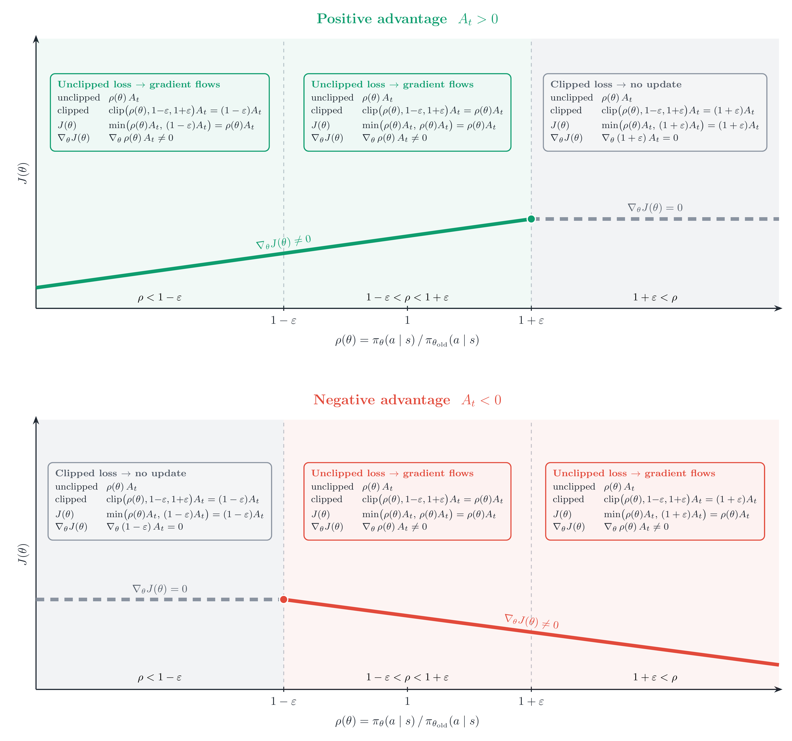

> 对应讲座：问答 2 —— 第 5–7 讲读者提问 · 观看/PDF/幻灯片/源码见 [rlhfbook.com/course](https://rlhfbook.com/course)

# 问答 2：高级推导订正、延伸资源与符号陷阱

本章汇集 GitHub、Discord 与 YouTube 评论中对第 5–7 讲的订正与提问，在进入课程后半段之前修正推导、补充资源并澄清符号。

## 数学订正

### 订正：第 7 讲“KD 作为 RL 优势”幻灯片

有观众指出 on-policy 蒸馏优势少了一个因子。状态 $s\_t$ 处的 reverse KL 是对**学生采样 token**的期望：

$$ D\_{\\mathrm{KL}}\\!\\left(\\pi\_\\theta(\\cdot \\mid s\_t) \\,\\|\\, \\pi\_T(\\cdot \\mid s\_t)\\right) = \\mathbb{E}\_{a\_t \\sim \\pi\_\\theta(\\cdot \\mid s\_t)}\\!\\left[\\log \\pi\_\\theta(a\_t \\mid s\_t) - \\log \\pi\_T(a\_t \\mid s\_t)\\right] $$

由于 $a\_t \\sim \\pi\_\\theta$，单个采样 token 给出完整 KL 的无偏估计 $\\hat{D}\_{\\mathrm{KL}}$，优势即其相反数：

$$ A\_t^{\\mathrm{OPD}} = -\\hat{D}\_{\\mathrm{KL}} = -\\left(\\log \\pi\_\\theta(a\_t \\mid s\_t) - \\log \\pi\_T(a\_t \\mid s\_t)\\right) = \\log \\pi\_T(a\_t \\mid s\_t) - \\log \\pi\_\\theta(a\_t \\mid s\_t) $$

旧幻灯片把“$=$”直接写到完整 $D\_{\\mathrm{KL}}$，实际上只在期望意义下相等。另外，$\\log \\pi\_T - \\log \\pi\_\\theta$ 看起来像 forward KL，但由于期望取自学生分布 $\\pi\_\\theta$，它是 **reverse** KL。

### 订正：KL 散度不是“距离”（第 0 讲）

KL 散度**不对称**（$D\_{\\mathrm{KL}}(P\\|Q)\\neq D\_{\\mathrm{KL}}(Q\\|P)$）且**不满足三角不等式**，因此不是度量。在后训练团队里，“KL 距离”是常见的口语说法，表示“模型改变了多少”，但技术上它是散度：

$$ D\_{\\mathrm{KL}}(P\\|Q) = H(P,Q) - H(P) \\ge 0 $$

其中 $H(P)$ 是来自 $P$ 的数据的最短期望码长，$H(P,Q)$ 是用为 $Q$ 设计的码对 $P$ 编码的代价。没有码能比匹配真实 $P$ 的码更短，所以 KL 衡量的是**额外编码代价**，而非对称距离。

### 阅读：实践中如何估计 KL

RL 中很少精确计算 KL，通常用采样 token 估计。John Schulman 关于 $k\_1 / k\_2 / k\_3$ 估计器的笔记是每个使用 KL 惩罚的人必读的资料：[joschu.net/blog/kl-approx.html](http://joschu.net/blog/kl-approx.html)。

### 订正：Bradley-Terry 损失推导（第 2 讲 / 第 5 章）

奖励模型损失的单样本推导很干净：

$$
\\begin{aligned}
\\theta^\*
&= \\arg\\max\_\\theta \\; P(y\_c > y\_r \\mid x) \\\\
&= \\arg\\max\_\\theta \\; \\frac{\\exp(r\_\\theta(y\_c \\mid x))}{\\exp(r\_\\theta(y\_c \\mid x)) + \\exp(r\_\\theta(y\_r \\mid x))} \\\\
&= \\arg\\max\_\\theta \\; \\sigma\\!\\left(r\_\\theta(y\_c \\mid x) - r\_\\theta(y\_r \\mid x)\\right) \\\\
&= \\arg\\max\_\\theta \\; \\log \\sigma(\\Delta) \\\\
\\Rightarrow\\quad \\mathcal{L}(\\theta) &= -\\log \\sigma(\\Delta)
\\end{aligned}
$$

其中 $\\Delta = r\_\\theta(y\_c \\mid x) - r\_\\theta(y\_r \\mid x)$。但最后一步只在**逐样本**意义下成立。训练是在数据集上进行的，且 $\\mathbb{E}[P] \\neq \\mathbb{E}[\\log P]$，因此必须先取对数再平均：

$$ \\theta^\* = \\arg\\max\_\\theta \\mathbb{E}\_{(x, y\_c, y\_r) \\sim D}\\!\\left[\\log \\sigma(\\Delta)\\right] = \\arg\\min\_\\theta \\mathbb{E}\\!\\left[-\\log\\sigma(\\Delta)\\right] $$

## 延伸学习资源

### “能提供编程与数学作业吗？”

可以。书中有五章末尾附有*建议实验*：配套 [`code/`](https://github.com/natolambert/rlhf-book/tree/main/code) 库中的可运行代码，每个实验都有可调参数和待回答问题。

- [第 4 章 · 指令微调](https://rlhfbook.com/c/04-instruction-tuning.html#suggested-experiments) —— 对 OLMo-2-1B 基座模型做 SFT，观察 base→assistant 的转变。
- [第 5 章 · 奖励模型](https://rlhfbook.com/c/05-reward-models.html#suggested-experiments) —— 在 UltraFeedback 上训练 Bradley-Terry RM，观察奖励间隔。
- [第 6 章 · 策略梯度](https://rlhfbook.com/c/06-policy-gradients.html#suggested-experiments) —— 用 Qwen3-1.7B 在 `reasoning-gym` 任务上跑 GRPO。
- [第 8 章 · 直接对齐](https://rlhfbook.com/c/08-direct-alignment.html#suggested-experiments) —— 在偏好数据上跑 DPO / IPO（离线，最容易上手）。
- [第 9 章 · 拒绝采样](https://rlhfbook.com/c/09-rejection-sampling.html#suggested-experiments) —— 完整的 GSM8K 生成→打分→微调→评估流水线。

建议从**第 8 章（DPO）**或**第 4 章（SFT）**开始：二者都离线运行，无需奖励模型服务器或 rollout 循环。想检验数学掌握程度，可直接看讲座推导（第 6 讲的 DPO、第 3–4 讲的策略梯度），它们就是现成的习题解答。

### 另一个资源

[rlhfbook.com/library](https://rlhfbook.com/library) 让你并排阅读同一提示经过指令微调与 RLHF 后模型给出的回答，直观看到 base → assistant → aligned 的转变。

## RL 算法与符号

### 第 6 章的符号陷阱

一位细心读者发现策略梯度章节存在三处符号不一致。

**陷阱 1：奖励索引。** 章节开头采用 Sutton & Barto 索引——$(S\_t, A\_t)$ 之后的奖励是 $R\_{t+1}$——但后续公式又切换为零索引 $r\_t$：

$$ R(\\tau) = \\sum\_{t=0}^{T} \\gamma^t R\_{t+1} \\qquad\\longrightarrow\\qquad \\sum\_{t=0}^{\\infty} r\_t \\;,\\;\\; r\_t + \\gamma V(s\_{t+1}) - V(s\_t) $$

修正方法：全文统一使用零索引的小写 $r\_t$。

**陷阱 2：优势加权策略梯度的书写顺序。** 下面写法有歧义：

$$ \\nabla\_\\theta \\log \\pi\_\\theta(a\_t \\mid s\_t)\\, A^{\\pi\_\\theta}(s\_t, a\_t) $$

它读起来像是 $A$ 也依赖 $\\theta$。修正方法是把标量优势提到前面：

$$ A^{\\pi\_\\theta}(s\_t, a\_t)\\, \\nabla\_\\theta \\log \\pi\_\\theta(a\_t \\mid s\_t) $$

优势是分离的标量，只缩放 score-function 梯度，不参与求导。

**陷阱 3：RL 样本来自哪里。** 章节在 $\\mathbb{E}\_{\\tau}[\\cdots]$（未说明来源）与 $\\mathbb{E}\_{\\tau \\sim \\pi\_\\theta}[\\cdots]$（不精确，因为 $\\pi\_\\theta$ 不是轨迹分布）之间来回切换。正确的下标是 $\\tau \\sim p\_\\theta(\\cdot)$，其中

$$ p\_\\theta(\\tau) = d\_0(s\_0)\\prod\_t \\pi\_\\theta(a\_t \\mid s\_t)\\, P(s\_{t+1} \\mid s\_t, a\_t) $$

是由初始状态、策略和环境动力学共同诱导的轨迹分布。

### 为什么 REINFORCE 写成梯度、PPO 写成目标？

REINFORCE 写成**梯度**：

$$ \\nabla\_\\theta J(\\theta) = \\mathbb{E}\\!\\left[\\,\\nabla\_\\theta \\log \\pi\_\\theta(a \\mid s)\\, A\\,\\right] $$

PPO 写成**目标**：

$$ J(\\theta) = \\mathbb{E}\_t\\!\\left[\\min\\!\\left(\\rho\_t A\_t,\\ \\mathrm{clip}(\\rho\_t, 1-\\epsilon, 1+\\epsilon)\\, A\_t\\right)\\right] $$

PPO 的梯度存在，但 $\\min$ 与 $\\mathrm{clip}$ 使其分段：在有效区域内等于 $\\rho\_t A\_t \\nabla\_\\theta \\log \\pi\_\\theta(a\_t \\mid s\_t)$，一旦 $\\rho\_t$ 在受罚侧离开信赖域就变为零。若写成单一表达式需要为每个分支引入指示函数；写成目标函数则隐藏了这一点，让自动微分选择分支。在代码里二者都是一个调用 `.backward()` 的标量损失，因此区别主要是教学上的。

## 要点小结

- KD-as-advantage 幻灯片给出的是 reverse KL 的无偏估计，仅在期望意义下等于完整 KL。
- KL 散度不是度量；它衡量额外编码代价，且不对称。
- Bradley-Terry 奖励损失是数据集上的最大似然，而非单样本概率的简单翻转。
- 五章提供可运行的“建议实验”；从 DPO 或 SFT 入手，因为二者离线即可运行。
- 在策略梯度符号中，保持奖励索引一致，把优势放在梯度外，并从 $p\_\\theta$ 而非 $\\pi\_\\theta$ 采样轨迹。
- REINFORCE 是梯度，PPO 是目标；后者用自动微分更简洁。
