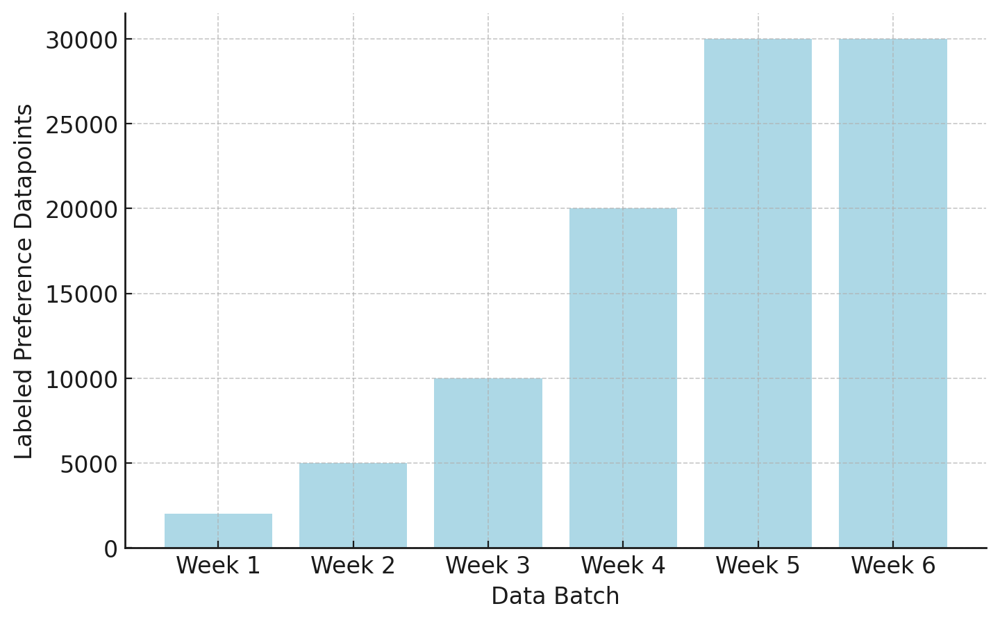

> 对应讲座：第 8 讲 —— 关于“偏好”与偏好数据 · 第 10、11 章 · 观看/PDF/幻灯片/源码见 [rlhfbook.com/course](https://rlhfbook.com/course)

# 第 8 讲：关于“偏好”与偏好数据

到目前为止，后训练中的 SFT 与 RLVR 都有一个“正确”的概念：数学答案、通过的测试、可验证的奖励。偏好则用于**没有正确答案**的场合：哪首诗更好、哪个解释更清楚、哪种语气更友善。随着对齐社区试图优化“人类价值观”这类复杂目标，偏好成为 RLHF 的核心。

本讲追溯“偏好”的来源，论证这一表述为何**并不完美**，然后深入今天模型实际使用的**偏好数据**。

## 第一部分：优化或度量偏好的简短历史

### 多个领域汇聚成 RLHF

RLHF 是哲学、经济学、最优控制与强化学习的交汇点——每个领域对“偏好”都有自己的理解。论文《The History and Risks of Reinforcement Learning and Human Feedback》（Lambert 等，2023）梳理了这些借用关系，并追问借用过程中何处断裂：RLHF 悄悄地把**成本、奖励与偏好**当作可互换的概念，而实际上并非如此。

### 效用：从逻辑到一个数

“选择可以被打分”的观念由来已久：

- **波尔-罗亚尔逻辑**（1662）：决策质量 = 结果按概率加权。
- **边沁的快乐微积分**（19 世纪初）：把人生的一切放在同一把复杂但通用的秤上衡量。
- **Ramsey**，《Truth and Probability》（1931）：首次把偏好与信念一起量化，作为个体进行概率决策的方式。

> “要判断一个人该做什么以获得善或避免恶，不仅要看善或恶本身，还要看它发生或不发生的概率。”——波尔-罗亚尔逻辑，1662

### 冯·诺依曼–摩根斯坦效用定理（1947）

冯·诺依曼与摩根斯坦证明：若偏好满足完备性、传递性、连续性与独立性，则它们可以由一个**效用函数**表示，理性选择即最大化期望效用。这正是 RLHF 用来证明拟合标量奖励合理性的结果。但在 RLHF 中，这些“若”几乎都不成立：偏好会**漂移**，依赖**情境与表述**，在高复杂度下可能**非传递**，而且是**多维的**却被压缩成一个数。

### Bradley–Terry（1952）：从比较到分数

把比较变成分数、并成为奖励建模支柱的统计模型是 Bradley–Terry：

$$ P(y\_w \\succ y\_l \\mid x) = \\sigma\\!\\big(r(x,y\_w) - r(x,y\_l)\\big) = \\frac{e^{\\,r(x,y\_w)}}{e^{\\,r(x,y\_w)} + e^{\\,r(x,y\_l)}} $$

输入成对的人类比较，输出标量奖励。这就是 RLHF 需要**偏好数据**的原因，也是不完美之处进入的地方。

### 一个标量偏好，诸多特征

奖励模型把以下所有压缩进一个数：有用性、诚实、无害、语气、格式、长度、品味；标注者的心理、文化与界面；比较表述所暗示的任何倾向。然后我们对这个数进行高强度优化，这永远不可能完美——总会有权衡。

### 效用理论在何处失效

社会选择与经济学几乎在效用被形式化之初就发现了其局限：

- **阿罗不可能定理**（1950）：不存在能同时满足基本公平准则、把个体偏好聚合成集体偏好的投票规则。
- **Sen**（1973）：选择 ≠ 偏好；显示偏好理论过于单薄。
- **Hirschman**（1984）：人们有“对偏好的偏好”——因此偏好可能无法度量。

如果聚合偏好是难点，那么**社会选择理论**就是对齐的天然视角。2024 年的一篇立场论文主张社会选择应指导如何聚合多样的人类反馈：谁的偏好算数、如何合并相互分歧的标注者，等等。

偏好也不是随时间与情境稳定的对象：它会随时间、情绪与经验漂移，选择受情境与表述塑造，而不只是内在排序。这对“收集一次标注、反复训练”的做法是个问题。

### 另一根源：最优控制与 RL

与此同时，**优化**奖励的机器逐渐成熟：

- **Bellman**（1957）：MDP 与动态规划。
- **Sutton**（1988）：用于信用分配的时序差分学习。
- **Watkins**（1992）：Q-learning。
- **DQN**（2013）与 **AlphaGo / AlphaZero**（2017）：大规模深度 RL 与自我对弈的精通。

这些保证都假设存在**单一、闭式奖励**。而学习到的奖励模型是*移动且带噪的代理*，不是真实奖励。逆强化学习——从行为中学习奖励——在概念上接近，却奇怪地缺席于 RLHF 实践。我们继承了 RL 的优化器，却没有继承其保证。

### 成本 ≠ 奖励 ≠ 偏好

这三者在本体论上**不同**，而现代后训练把它们当作可互换：

- **成本**来自控制：物理、可测、给定，通常有明确的最优性/界限。
- **奖励**来自心理学与 RL 的便利：一个待最大化的标量信号。
- **偏好**是人的、关系的、不稳定的——显然不一定是标量。

把偏好还原为奖励让优化形式变得可行，但也是 RLHF 与偏好数据中许多“无解偏差”的根源。

## 第二部分：偏好数据——实践中的权衡

### 为什么收集偏好数据

**判断**远比**生成**容易：人类（和模型）在能写出更好答案之前，就能可靠地说出两个答案中哪个更好。但把这类数据收集并处理好，是现代后训练流水线中最**不透明**的环节。很少有开放模型随模型一起发布完整开放的人类偏好数据及其收集方法论；最好的例子是 NVIDIA 为开放 Nemotron 模型发布的 **HelpSteer** 数据集。

### 数据收集界面示例

界面塑造了它所捕捉的偏好：

- **研究型数据收集**（Anthropic 早期 Claude 模型）：浏览完整对话后打分。
- **生产环境 A/B 测试**（ChatGPT 用户数据）：并排展示来自不同 beta 模型的两个补全；答案往往非常接近，提醒我们偏好数据充满噪声。
- **带平局的成对比较**（Chatbot Arena 公开评估）：允许平局。
- **单比特**（Ai2 demo；许多其他产品）：点赞/点踩。
- **多选一**（图像模型默认）：从生成图像中选择。

### 排序 vs. 评分

**评分**孤立地给一个补全打分（如 1–5），适合作为元数据。**排序**是相对比较，常用 Likert 量表：早期 Claude 使用 8 点量表；UltraFeedback 把高评分与低评分补全配对。实践中几乎所有人都把成对排序二值化为 chosen/rejected 来训练 Bradley-Terry 损失，评分则留作辅助。

**Likert 量表**把偏好记录为*有序、分级*的判断——不只是谁赢，而是**赢多少**，采用带可选中性中点的对称量表。

| 5 点带平局（LMArena 风格） |  |  |  |  |
|:---:|:---:|:---:|:---:|:---:|
| A 好很多 | A 好一些 | 平局 | B 好一些 | B 好很多 |

| 8 点无平局（早期 Claude） |  |  |  |  |  |  |  |
|:---:|:---:|:---:|:---:|:---:|:---:|:---:|:---:|
| A>>>B | | | A>B | B>A | | | B>>>A |

用多少点、是否允许平局，都是会改变所收集数据的设计选择。

### 结构化（合成）偏好数据

在有结构的领域，可以自动构建偏好对：

- **数学**：正确解 ≻ 错误解。
- **指令遵循（IFEval 风格）**：同一提示采样两次——一次带约束、一次不带——偏好遵守约束的那个。约束由代码检查，因此标注是免费的。

在这些狭窄领域，结构化偏好对可能胜过质量评判式偏好。这是*合成*偏好数据的一种简单形式。

### 超越成对偏好

成对比较是惯例而非法律。替代方案包括：

- **方向性 / 单比特**标签（点赞/点踩），用 Kahneman–Tversky Optimization（KTO）训练。
- **token 级 / 细粒度**反馈：把特定 token 或片段标为好/坏。
- **自然语言**反馈：用书面批评代替标签。

信号更丰富，收集更难，实践中使用并不广泛。

### 采购与合同

获取偏好数据是关系驱动的：供应商产能有限，偏爱大预算与知名品牌。数百万美元被花掉并部分浪费；很少有团队有足够人力充分利用人类数据。合同通常限制部分数据的公开发布。即使只是简单的人类偏好数据，也需要一个稳健、现成的后训练配方来接入。

### 指导数据收集：标注者指令

合同签订后，买方与供应商会就每个任务约定**详细指令**——通常不会公开。最早的*公开*例子之一是 OpenAI 的 **InstructGPT** 标注者指令（2022），数页关于排序**有用、真实、无害**的指导——这才是真正塑造标签的规范。镜像 PDF 见 [rlhfbook.com/assets/instructgpt-instructions.pdf](https://rlhfbook.com/assets/instructgpt-instructions.pdf)。

### 我们购买的数据集：No Robots

在 Hugging Face 的 H4 团队，我们用与大厂相同的方式采购人类数据。**No Robots** 包含 1 万条专家人工撰写的演示，分布与 InstructGPT 一致，由供应商付费制作后开放发布：[hf.co/datasets/HuggingFaceH4/no_robots](https://huggingface.co/datasets/HuggingFaceH4/no_robots)。它来自 **Zephyr** 模型与 **Open LLM Leaderboard** 的时代/团队。

### 偏好*评估*已成为独立生意

2026 年，**Arena**（原 LMArena）在企业 A/B 测试产品上线约 8 个月内，年化收入运行率就达到了约 1 亿美元。

## 第三部分：偏好数据的开放问题

### 数据中的偏差

微妙而系统的偏差会直接从数据进入模型：

- **前缀偏差**——开头 disproportionately 决定标签。
- **谄媚**——附和用户而非坚持正确。
- **冗长**——越长评分越高。
- **格式**——列表与粗体看起来“更好”。
- **奉承 / 空话**——装饰性语言抬高分数。

检测并控制这些偏差是收集高质量偏好数据的核心——它们也正是过度优化放大为模型行为的东西。

### 更高层次的复杂性

- **收集情境**——职场标注会迁移到终端用户吗？付费与志愿者？标注者遵循指令还是自己的价值观？
- **反馈类型**——二元成对真的捕捉到了我们想要的偏好吗？什么结构才贴近人们真实比较的方式？
- **人群与人口统计**——谁在标注？分歧是**噪声还是信号**？
- **这些偏好真的在模型中表达了吗？**

### 未审计的缺口：规范 → 数据 → 行为

RLHF 的*动机*（对齐人类偏好）已经漂移于其*实践*（让模型更有效）。由于工业 RLHF 是封闭的，我们无法检查训练出的模型是否真的反映了给标注者的规范。**Model Spec** 记录了预期行为，但数据 → 行为的链条在很大程度上仍未被审计。许多问题已在合成数据中出现：人类/AI 反馈的平衡、同策略偏好数据。

偏好的本质是该领域最未解决、最人性化的部分——也是一个很好的学术问题。

## 要点小结

- 偏好填补了没有可验证“正确答案”时的空白，但标量奖励表述并不完美。
- RLHF 借鉴哲学、经济学、控制与 RL，把成本、奖励与偏好当作可互换，而实际上并非如此。
- Bradley–Terry 把成对比较变成标量奖励，把诸多特征与偏差压缩进一个数。
- 偏好数据收集不透明，受界面、量表与合同塑造；标注者指令是隐藏的规范。
- 结构化合成偏好与替代方案（KTO、token 级、自然语言反馈）存在但较不常见。
- 谄媚、冗长、格式等偏差会被过度优化放大。
