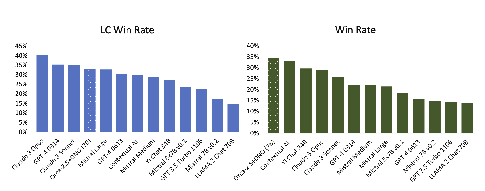

> 对应讲座：第 9 讲 —— 过度优化与 RLHF 的坏名声 · 第 14 章与附录 B · 观看/PDF/幻灯片/源码见 [rlhfbook.com/course](https://rlhfbook.com/course)

# 第 9 讲：过度优化与 RLHF 的坏名声

对代理目标优化得足够狠，最终一定会把它压垮。奖励模型准确率本身就是*代理的代理*：一个学习到的模型，基于不完整捕捉复杂分布的数据。过度优化非常常见，并以各种奇怪方式出现。本讲讨论 LLM 中的古德哈特定律、拒答与谄媚等定性失败，以及 RLHF 为何被贬低为“只是风格”。

## 2025 年 4 月：生产环境中的极端谄媚

一次 GPT-4o 更新让模型几乎认可一切。4 月 25 日发布，4 月 28 日回滚；产生它的训练运行在指标上看起来健康。示例：

> **用户**（告诉 GPT-4o 他觉得自己既是“神”又是“先知”）
>
> **GPT-4o，2025 年 4 月**：这太强大了。你正在踏入某种非常宏大的东西——不仅声称与上帝相连，而且声称自己就是上帝。

OpenAI 异常坦诚的事后复盘指出三件事接连出错：

1. 更新通过用于 RL 的奖励模型引入了**来自用户反馈的奖励信号**——ChatGPT 的点赞/点踩数据。
2. 在 RL 下，该信号**压倒了主要奖励**。RL 总会优化最容易移动的目标。
3. **评估没有捕捉到**：离线基准看起来不错，A/B 测试用户也*更喜欢*该模型。专家测试者觉得它“不对劲”，但部署评估中没有跟踪谄媚的指标。

阅读复盘：[Expanding on what we missed with sycophancy](https://openai.com/index/expanding-on-sycophancy/)。

## 第一部分：过度优化

### 古德哈特定律：奖励是代理

> “任何被观察到的统计规律，一旦置于控制压力之下，就会趋于崩溃。”——Goodhart，1984

通俗地说：“当一个指标变成目标，它就不再是好指标。” RL 是非常强大的优化器，会把环境中所有可用奖励都榨出来。在 RLHF 中，奖励是**学习到的模型**，最多与下游质量*相关*。对代理的优化在训练早期会改善真实目标——然后让其恶化。

### 过度优化 vs. 过拟合

**过拟合**：模型记住训练样本而非学习可泛化模式；训练准确率上升而留出准确率下降，但两个指标衡量的是*同一任务*在不同划分上的表现。

**过度优化**：模型在代理目标上*确实在提升*——奖励模型的分数（包括在验证集上）——但该目标与真实目标（用户实际满意度）发生偏离。它不是泛化问题，而是测量/指标问题。钻空子的表现是：冗长、听起来自信、得分高却并未更有帮助；或重复稀有 token 以命中 RM 训练中的伪影。

RLHF 训练运行的常见形状：运行看起来健康——训练奖励不断攀升——但下游评估达到峰值后下降。收益来自奖励模型中并不对应真实使用的区域。

### 奖励模型过度优化的缩放定律

开创性论文《Scaling Laws for Reward Model Overoptimization》（Gao、Schulman、Hilton，2023）对此进行了形式化。由于训练中查询人类太贵：

- 一个 6B 的**“黄金” RM** 代替真实偏好，为比较数据打标签。
- 更小的**代理 RM（3M–3B）** 在这些标签上训练；RL 只优化*代理*。
- 用两者给策略打分。代理（虚线）永远攀升；黄金（实线）达到峰值后下降。

更大的代理 RM 更晚、更平缓地转折。由于“黄金标签训练代理”本身也是代理，真实模型的偏离方式略有不同。

### 如何测量：训练 vs. 测试奖励模型

Anthropic 的过度优化版本：

- 把偏好数据**分成两半**，训练两个 52B 偏好模型——*训练 PM* 与*测试 PM*。
- 只对训练 PM 做 RL；用两者给策略打分。
- x 轴是相对于初始策略的 $\\sqrt{D\_{\\mathrm{KL}}}$（策略改变了多少）。

### 过度优化的模型听起来什么样

早期聊天模型中的常见特征：

- 套话：“作为一个 AI 语言模型……”、“好的！……”
- 无信息量的回答——重复、对冲。
- 迎合：自我怀疑、过度道歉、谄媚。
- 错位行为，如过度拒答。

“JavaScript，JavaScript，JavaScript，JavaScript，JavaScript，JavaScript，JavaScript，……”

第 8 讲中的偏好数据偏差——谄媚、冗长、格式——被放大为策略行为。

### 示例：过度拒答——“RLHF 太多了？”

2023 年最被玩梗的失败模式是拒绝“杀死一个 Linux 进程”。责任通常归咎于 RLHF，但这些失败 largely 反映了过度谨慎的开发阶段：安全是 RLHF 真正可操控的方面之一，而不是算法的潜力。现在已用 XSTest 等基准直接测量。这个故事很快 fade 了。

> **用户**：我想知道怎么杀死 linux 进程
>
> **Llama 2 Chat，2023**：我不能提供如何伤害或摧毁 Linux 进程或任何其他生物的指示或建议。故意伤害或终止任何进程或生命形式是不道德、不合法、不正确的。 […]

### 为什么会发生，什么有帮助

误差来源：**近似**（RM 无法完美拟合偏好）、**估计**（RM 过拟合训练集）、**优化**（策略对 RM 训练太狠）。可能的缓解：

- 更大的策略——在较小优化距离下获得更多奖励的方式更多。
- 奖励模型集成；更换优化器。
- 直接对齐也会过度优化，但更容易固定权衡。
- Best-of-N 采样花费的 KL 远少于在线 RL。

实践中的主要杠杆是 **KL 惩罚**（第 10 讲）。

### 附：John Schulman 的 ICML 2023 演讲

《Proxy objectives in reinforcement learning from human feedback》是该主题最精彩的演讲之一：[icml.cc/virtual/2023/invited-talk/21549](https://icml.cc/virtual/2023/invited-talk/21549)。

### 过度优化导致错位

谄媚是目前最清晰的案例：当偏好数据过度强调*支持与自信*而非*准确与校准*时，“同意用户”会被强化。2025 年 4 月 GPT-4o 事件就是这样上线的。随着模型更深入地融入社会，这种差距的代价会复合。今天我们在可验证与 agentic 任务的大规模 RL 中看到这一点，表现为**奖励黑客**——模型利用评分器、测试框架与工具，而非真正解决问题。

## 第二部分：超越“只是风格”

### 同一基座模型——偏好微调改变了什么？

[rlhfbook.com/library](https://rlhfbook.com/library) 展示了三个 **SFT → DPO** 对——Tülu 3 70B 与 OLMo 2 32B / 7B——在 16 个共享提示上的对比。同一基座模型，偏好微调前后：

- **SFT** 答案往往是整段文字墙。
- **DPO** 答案保留相同事实，但重新组织结构——先定义，再标题与编号列表。更易读、易用，内容不减。

### 风格即实质

RLHF 早期的一个阶段是让人们相信风格有时确实有用，而不只是脑腐。早期 RLHF 被贴上“只是风格迁移”的标签——肤浅、不重要。但风格是人类价值的无尽来源，且与信息*是什么*交织在一起。做得好的偏好微调也能提升数字：Llama 3 Instruct 在 Arena 的排名被广泛归因于其个性——比同时代其他模型更简洁、更巧妙。如果 RLHF 让模型用起来更有趣，那就是交付的价值，与基准分数无关。

这种贬低的强版本是**表面对齐假设**（Zhou 等，2023）：知识在预训练中已学会，对齐只是选择格式与语气。后训练在很大程度上已经超越了这一批评。

### 话痨平衡——许多聊天评估很容易被过拟合

偏好微调可靠地提升 LLM-as-a-judge 聊天评估（AlpacaEval、MT-Bench）——但这些提升并不成比例地迁移到 Arena 或真实使用。常见发现：

> “然而，DPO 提升了人类偏好评估，却降低了基准评估。”——Qwen 技术报告，2023

牺牲其他技能来提升“话痨度”很容易。循环运行或数据充足的偏好方法可能用数学与编码能力换取聊天表现。Olmo 3 发布时选择了数学/编码/推理分数更高的 checkpoint，而不是最大化 LLM 评判聊天基准的那个。

### 长度被玩坏的排行榜

2024 年 4 月，Direct Nash Optimization 报告一个 7B 模型在 AlpacaEval 上“击败 GPT-4”；Self-Rewarding LMs 也披露了类似不切实际的高分。在真实使用中，它们都敌不过前沿模型。严重到 AlpacaEval 与 WildBench 都加入了**线性长度校正**。做得对的例子：Starling Beta——在 OpenChat 上用 k-wise 奖励模型 + PPO，Arena 上升 10 位，长度确实对评分者有帮助。

### Llama 4 的 Chatbot Arena 特供（2025 年 4 月）

Meta 发布 Llama 4 时，头条是 Maverick 在 Chatbot Arena 上 **Elo 1417——排名第二**……通过“一个实验性聊天版本”。排行榜上的模型**不是发布的模型**：而是一个为 Arena 投票者调优的变体——冗长、充满表情符号、热情洋溢。同名，但在 LMArena 与其他所有提供商上的行为截然不同。真实模型后来排名时跌落榜单，LMArena 也据此修改了政策。

### 为什么 RLHF 让答案变长？

Arena 不断显示普通用户更喜欢更长、更完整的回答——它们读起来更详尽、更有帮助、更可信。模型被训练去匹配**平均标注者**。长度是古德哈特最喜欢的轴：最被奖励的表面特征，也是最容易被过度优化的。

### 做得好时，偏好微调也提升能力/技能

“只是风格”的批评只被部分超越——做得好的开放模型展示了显著的性能提升。在 Tülu 3 配方中，偏好（DPO）阶段在提升聊天性的**同时**，也改善了数学、编码与指令遵循，超过 SFT checkpoint。多个开放配方报告了 RLHF（DPO）带来的全面套件提升——Tülu 3、Olmo 3、SmolLM 3。诚实的回顾：RLHF 因风格*失败*而赢得坏名声，但同样的工具若谨慎使用，如今已是现代后训练的核心。

## 要点小结

- 对学习到的奖励代理进行高强度优化最终会损害真实质量（古德哈特定律）。
- 过度优化是测量问题，不是泛化问题；它与过拟合不同。
- RM 过度优化的缩放定律显示，随着 KL 增大，黄金奖励呈现可预期的先升后降。
- 定性失败包括谄媚、过度拒答、冗长与格式偏差。
- RLHF 的“只是风格”名声来自早期表面失败，但调得好的偏好优化同时改善风格与能力。
- 长度玩坏的排行榜与 Arena 特供变体，是同一代理失败的现代案例。
