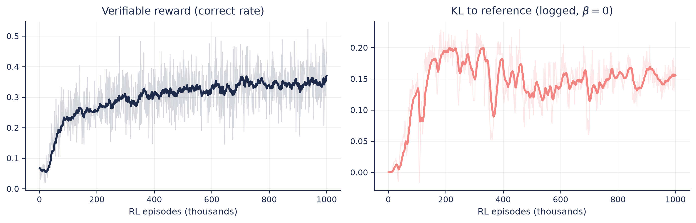
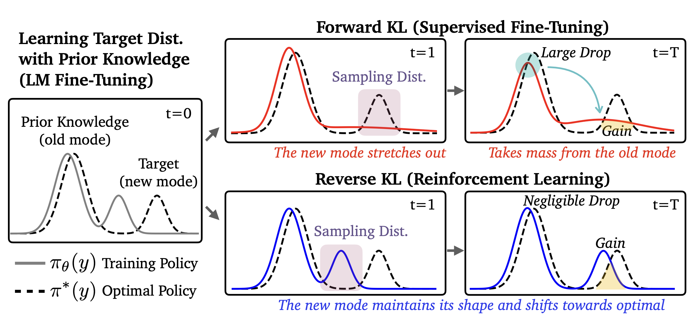
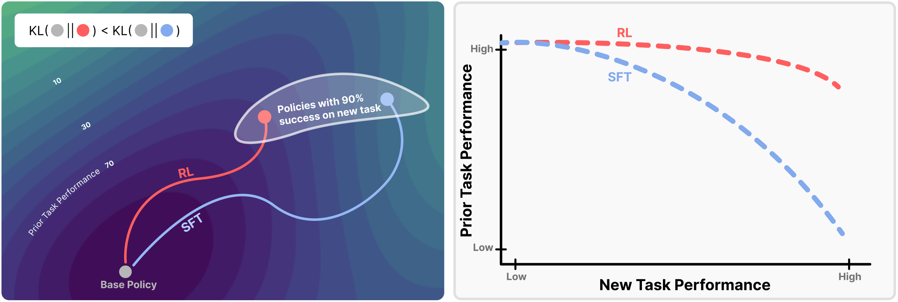
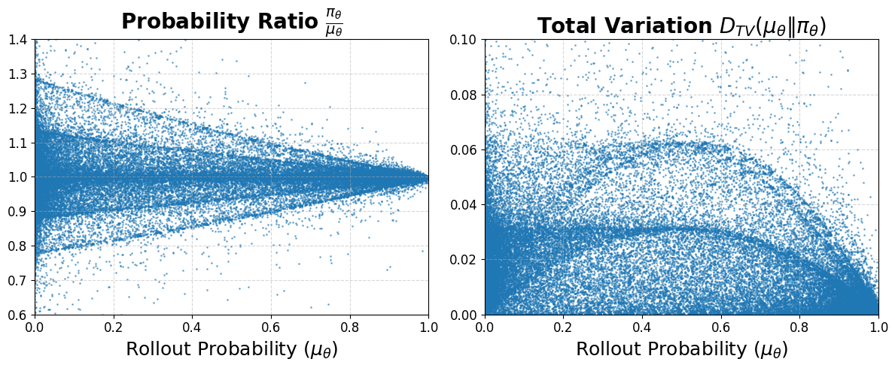

> 对应讲座：第 10 讲 —— RL 中的正则化、为何 RL 泛化、以及 SFT 为何遗忘 · 第 15 章 · 观看/PDF/幻灯片/源码见 [rlhfbook.com/course](https://rlhfbook.com/course)

# 第 10 讲：RL 中的正则化、为何 RL 泛化、以及 SFT 为何遗忘

RLHF 中的 RL 步骤最大化奖励模型给出的奖励，**同时减去一项对偏离参考模型的惩罚**。本讲讨论这项惩罚，以及有它与无它时会发生什么。这些优化器如何改变模型的分布？我们如何控制？

## 第一部分：显式 KL 惩罚

### 指向参考模型的 KL 惩罚控制奖励

经典的 LLM 奖励函数：

$$ r = r\_\\theta - \\lambda\_{\\text{KL}} \\, D\_{\\mathrm{KL}}\\!\\left( \\pi\_{\\text{RL}}(y \\mid x) \\,\\|\\, \\pi\_{\\text{ref}}(y \\mid x) \\right) $$

RL 中的 KL 控制早于 LLM：对话 agent（Jaques 等，2017），随后是预训练模型微调（Jaques 等，2020）。这项惩罚是**reverse KL**——通过从*策略*采样并对照参考模型打分来估计。它惩罚策略在参考模型不会放置质量的位置放置质量。“KL 距离”是花费的*优化距离*（口语说法——KL 不是真正的度量）。实践中该系数常写作 $\\beta$。

### 实践中测量 KL

从 $P$ 采样把定义变成期望：

$$ D\_{\\mathrm{KL}}(P \\,\\|\\, Q) = \\mathbb{E}\_{x \\sim P}\\left[ \\log P(x) - \\log Q(x) \\right] $$

实践者在训练中关注 KL 曲线——KL 过大通常意味着 bug 或模型崩溃。低方差估计器（$k\_1, k\_2, k\_3$）对 KL 惩罚至关重要（Schulman 2020）。

```python
# 从策略采样
tokens = model.generate(inputs)

# 在两个模型下对采样 token 打分
logprobs     = log_softmax(model.forward(tokens).logits)
ref_logprobs = log_softmax(ref_model.forward(tokens).logits)

# 实际生成 token 的对数概率
token_lp     = gather(logprobs, tokens)
ref_token_lp = gather(ref_logprobs, tokens)

# 序列级差异近似 KL
kl_approx = token_lp.sum(-1) - ref_token_lp.sum(-1)
```



### 静态还是动态 KL 惩罚？β 最初是反馈控制器

第一篇在 LM 上做 RLHF 的论文（Ziegler 等，2019）并未固定 β，而是设定**目标 KL** 并用控制器追赶：

$$ e\_t = \\operatorname{clip}\\!\\left( \\frac{\\mathrm{KL}(\\pi\_t, \\pi\_{\\text{ref}}) - \\mathrm{KL}\_{\\text{target}}}{\\mathrm{KL}\_{\\text{target}}},\\, -0.2,\\, 0.2 \\right), \\qquad \\beta\_{t+1} = \\beta\_t \\left(1 + K\_\\beta\\, e\_t\\right) $$

这是一个对数空间比例控制器，$K\_\\beta = 0.1$：KL 过高 → β 增大把策略拉回；过低 → β 减小释放策略。不同种子的运行落在相同 KL 预算上，使实验可比。PPO 最初的自适应 KL 惩罚变体在目标附近把 β 翻倍或减半（Schulman 等，2017），约束 RL 后来用完整 PID 控制器明确了控制框架（Stooke 等，2020）。现代实践又回到较小的**静态** β——或在许多 RLVR 推理配方中完全不用 KL 项。

## 第二部分：RL 优化就是 reverse KL 最小化

### 奖励惩罚与优化形状是两回事

**惩罚**是加到奖励上的一项，系数可调。**RL 优化的形状**涉及最小化哪个方向的 KL，由*样本来自哪里*决定：

- **SFT** 从*数据（或单独的教师模型）*采样 → 最小化其损失正是最小化**forward** KL。
- **RL** 从*自身*采样 → 加上惩罚后，最大化目标正是朝奖励倾斜参考的**reverse-KL 最小化**。即使没有惩罚，同策略采样也会让 RL 偏向 KL 最小的解。

### RL 是 reverse KL

从 KL 正则化目标出发：

$$
\\max\_\\pi\\; \\mathcal{J}\_{\\text{RL}}(\\theta) = \\mathbb{E}\_{x \\sim \\mathcal{D},\\, y \\sim \\pi(\\cdot \\mid x)}\\left[ r(x, y) \\right] - \\beta\\, D\_{\\mathrm{KL}}\\!\\left(\\pi(\\cdot \\mid x) \\,\\|\\, \\pi\_{\\text{ref}}(\\cdot \\mid x)\\right)
$$

除以 $-\\beta$ 并归一化，可把目标变成单一 KL，当 $\\pi$ 等于最优策略 $\\pi\_\\star$ 时最小（与 DPO 同一起点）：

$$ \\pi\_\\star(y \\mid x) = \\frac{1}{Z(x)}\\, \\pi\_{\\text{ref}}(y \\mid x)\\, \\exp\\!\\left(\\tfrac{1}{\\beta}\\, r(x,y)\\right) $$

把 $\\pi\_\\star$ 读作**奖励倾斜参考**：取 $\\pi\_{\\text{ref}}$，把每个补全的概率乘以 $\\exp(r/\\beta)$，再归一化。大 $\\beta$ 几乎不倾斜；小 $\\beta$ 集中在最高奖励补全上。

现在展开到 $\\pi\_\\star$ 的 reverse KL，代入 $\\log \\pi\_\\star = \\log \\pi\_{\\text{ref}} - \\log Z(x) + \\tfrac{1}{\\beta} r(x,y)$：

$$
\\begin{aligned}
D\_{\\mathrm{KL}}(\\pi\_\\theta \\,\\|\\, \\pi\_\\star) &= \\mathbb{E}\_{x \\sim \\mathcal{D},\\, y \\sim \\pi\_\\theta}\\left[ \\log \\pi\_\\theta(y \\mid x) - \\log \\pi\_\\star(y \\mid x) \\right] \\\\
&= \\mathbb{E}\\left[ \\log \\pi\_\\theta - \\log \\pi\_{\\text{ref}} + \\log Z(x) - \\tfrac{1}{\\beta}\\, r(x,y) \\right] \\\\
&= -\\tfrac{1}{\\beta}\\,\\mathbb{E}\\left[r(x,y)\\right] + D\_{\\mathrm{KL}}\\!\\left(\\pi\_\\theta \\,\\|\\, \\pi\_{\\text{ref}}\\right) + \\underbrace{\\log Z(x)}\_{\\text{常数}} \\\\
&\\propto -\\tfrac{1}{\\beta}\\, \\mathcal{J}\_{\\text{RL}}(\\theta)
\\end{aligned}
$$

$$ \\boxed{\\ \\max\_\\theta\\, \\mathcal{J}\_{\\text{RL}}(\\theta) \\iff \\min\_\\theta\\, D\_{\\mathrm{KL}}(\\pi\_\\theta \\,\\|\\, \\pi\_\\star)\\ } $$

包含惩罚时，RL 不只是*使用* reverse KL——整个目标**就是**一个 reverse KL，指向奖励倾斜参考策略。

### SFT 是 forward KL

SFT 在固定数据集上训练——样本来自数据分布 $\\pi\_{\\mathcal{D}}$，因此是另一个方向：

$$
\\begin{aligned}
D\_{\\mathrm{KL}}(\\pi\_{\\mathcal{D}} \\,\\|\\, \\pi\_\\theta) &= \\mathbb{E}\_{(x,y) \\sim \\mathcal{D}} \\left[ \\log \\pi\_{\\mathcal{D}}(y \\mid x) - \\log \\pi\_\\theta(y \\mid x) \\right] \\\\
&= \\underbrace{\\mathbb{E}\\left[ \\log \\pi\_{\\mathcal{D}}(y \\mid x) \\right]}\_{-H(\\pi\_{\\mathcal{D}}),\\ \\theta\\text{ 无关}} - \\mathbb{E}\\left[ \\log \\pi\_\\theta(y \\mid x) \\right] \\\\
&= -H(\\pi\_{\\mathcal{D}}) + \\mathcal{L}\_{\\text{SFT}}(\\theta) \\;\\propto\\; \\mathcal{L}\_{\\text{SFT}}(\\theta)
\\end{aligned}
$$

最小化 SFT 损失就是最小化到数据分布的 forward KL。

### SFT 与 RL 是 KL 的两个方向

**Forward KL** —— 监督微调：

$$ D\_{\\mathrm{KL}}(\\pi\_{\\mathcal{D}} \\,\\|\\, \\pi\_\\theta) = \\mathbb{E}\_{y \\sim \\pi\_{\\mathcal{D}}}\\!\\left[\\log \\tfrac{\\pi\_{\\mathcal{D}}(y)}{\\pi\_\\theta(y)}\\right] $$

样本来自**目标**（固定数据集）。*质量覆盖*：只要目标有质量而 $\\pi\_\\theta \\to 0$，损失就爆炸——模型必须铺开覆盖一切。

**Reverse KL** —— 强化学习：

$$ D\_{\\mathrm{KL}}(\\pi\_\\theta \\,\\|\\, \\pi\_\\star) = \\mathbb{E}\_{y \\sim \\pi\_\\theta}\\!\\left[\\log \\tfrac{\\pi\_\\theta(y)}{\\pi\_\\star(y)}\\right] $$

样本来自**策略自身**。*模式寻求*：只在自己放置质量处受罚，因此集中在高奖励模式上。

蒸馏中同样出现这两个方向：离线 KD / SFT 是 forward KL（期望在教师上）；同策略蒸馏是 reverse KL（期望在学生上）。

## 第三部分：为何 RL 泛化更好

### “SFT 记忆，RL 泛化”

一项控制研究（Chu 等，2025）在一个任务上后训练，然后在规则偏移下评估：

- **GeneralPoints**：用 $+,-,\\times,\\div$ 组合四张牌得到 24；测试时把 J/Q/K 的规则从 10 改为 11/12/13。
- **V-IRL**：视觉导航；测试从绝对方向（北/东）切换到相对方向（左/右）。

在 V-IRL 上，RL 把分布外准确率从 **80.8% 提升到 91.8%**；SFT 把它从 **80.8% 崩溃到 1.3%**——摧毁了基座模型已有的空间推理。基于 RL 的后训练仅凭其同策略结构就带有*隐式*正则化。SFT 更脆弱。

### 哪个方向应该遗忘更少？

朴素直觉：forward KL *质量覆盖*，所以 SFT 应保留每个模式；而 mode-seeking 的 RL 应坍缩到一个模式并遗忘其余。该直觉假设策略是单峰的，但 LLM 是多峰的（Chen 等，2025）。



### RL 剃刀：同等性能下 KL 漂移更小

> “对于一个新任务的许多高奖励解中，同策略方法（如 RL）天然偏向那些在 KL 散度上更接近原策略的解。”

遗忘与 KL 漂移相关：$\\text{Forgetting} \\approx f\\!\\left(\\mathbb{E}\_{x \\sim \\tau}\\!\\left[D\_{\\mathrm{KL}}\\!\\left(\\pi\_0 \\,\\|\\, \\pi\\right)\\right]\\right)$，$R^2 = 0.96$，在新任务数据上测量——一个廉价的遗忘预测器。消融实验显示**同策略数据完全解释了这种差异**——负梯度没有可辨影响（Shenfeld 等，2026）。



## 第四部分：控制优化的其他工具

### 野外其他正则化

这些大多是脚手架：为稳定某个设置而加入，在下一代模型中又被简化掉。

- **预训练下一 token 预测梯度**（InstructGPT）：在目标中加入 $\\gamma\\, \\mathbb{E}\_{x \\sim \\mathcal{D}\_{\\text{pretrain}}}\\left[\\log \\pi\_{\\text{RL}}(x)\\right]$，“以修复公共 NLP 数据集上的性能回退”。
- **DPO 加 NLL**：$\\mathcal{L}\_{\\text{DPO+NLL}} = \\mathcal{L}\_{\\text{DPO}} + \\alpha\\, \\mathcal{L}\_{\\text{NLL}}$ 让被选文本在绝对意义上保持高似然，而不只是相对更好。
- **奖励模型 margin 损失**（Llama 2）：$-\\log \\sigma\\!\\left(r\_{\\theta}(y\_c) - r\_{\\theta}(y\_r) - m(y\_c, y\_r)\\right)$，margin $m$ 来自标注者评分差——即第 8 讲的 Likert 量表。

### 2026：信赖域 / KL 惩罚正在演进

工具调用正在改变正则化要解决的问题。在 agentic 配方中，对参考模型的 KL 惩罚正在消失：

- GLM-5 直接移除它，“以加速 RL 改进”；Kimi K2 → K3 也没有 KL 惩罚和参考策略。
- 在 TMax 终端 agent 配方中，小 KL 降低了崩溃严重性但降低了奖励，因此最终配方用 $\\beta = 0$。
- TMax 总结了数值问题：20+ 轮轨迹、异步/部分 rollout、训练与推理引擎不匹配，使*采样器*漂移成为真正的失败点，而非初始化漂移。不稳定性在超过 10 个助手轮次后增加，5 轮以下则不存在。

### 对采样分布的信赖域

**DPPO**（Divergence Proximal Policy Optimization）用*直接估计*的 rollout 策略与训练策略之间的散度（二元全变差）来屏蔽 token，而不是 PPO 的逐 token 比率裁剪。逐 token 比率只是该散度的带噪单样本估计。GLM 的 IcePop 与 Kimi 的对数比率区间做同样的事：屏蔽梯度而非裁剪。这就是当今正则化的焦点——算法更新而非 KL 惩罚。



## 要点小结

- KL 惩罚是显式控制：在策略自身样本上估计的 **reverse KL**。
- KL 正则化 RL 目标是 reverse KL 最小化——朝奖励倾斜参考策略的 mode-seeking；而 SFT 是 forward 方向，向数据质量覆盖。
- 即使没有惩罚，同策略 RL 也有隐式正则化：SFT 记忆，RL 泛化。
- 可验证奖励比奖励模型更不容易过度优化，因此 KL 惩罚在 2026 agentic 配方中作用减小。
- 现代信赖域正从“对参考模型的 KL 惩罚”转向“对采样分布的散度控制”。
