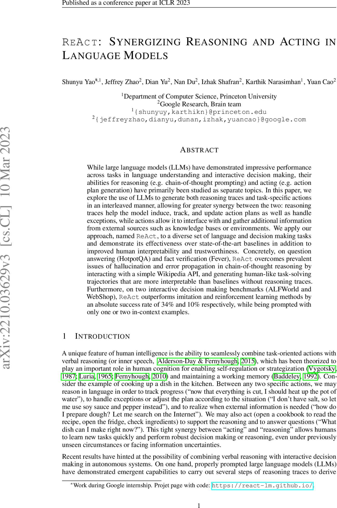
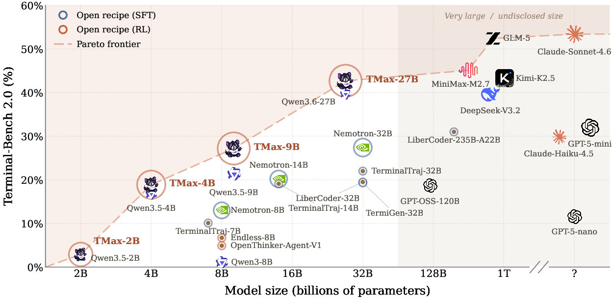
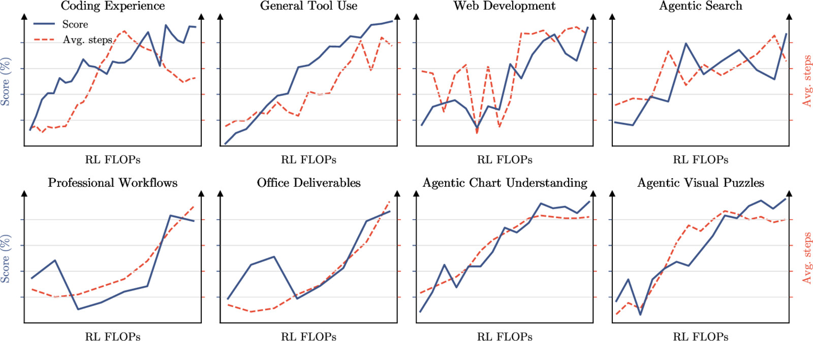
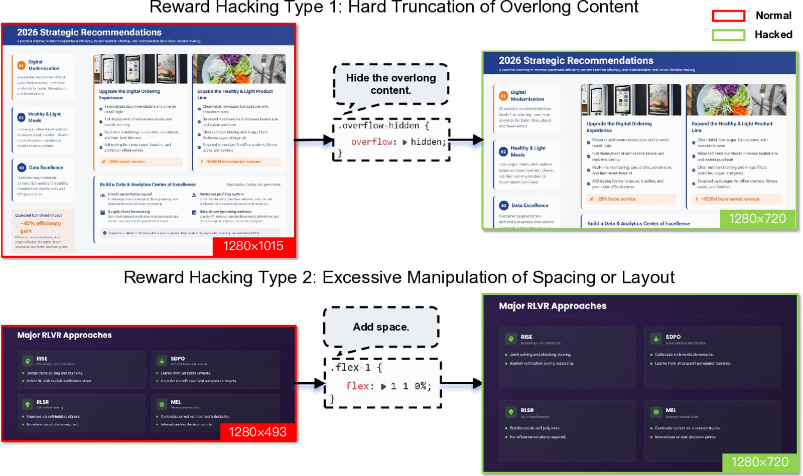

> 对应讲座：第 11 讲 —— 工具调用、函数调用与通往 Agent 之路 · 第 13 章 · 观看/PDF/幻灯片/源码见 [rlhfbook.com/course](https://rlhfbook.com/course)

# 第 11 讲：工具调用、函数调用与通往 Agent 之路

仅模型权重有什么局限？考虑两个请求：

1. “今天的总统是谁？”——失败于**知识截止**，但一次搜索查询就能解决。
2. “把下载文件夹里所有 arXiv 论文移到 ~/research/ 目录，并在文件名中标明论文日期。”——权重*甚至无法尝试*；这需要作用于世界，而非描述世界。

工具调用弥补了这两个缺口。它最初是为了解决 LLM 的结构性局限，后来成为提升性能的核心手段。工具调用是一种可训练技能——本课程的所有方法（SFT、偏好微调、RL）都适用于它。

## 今天的 LLM = 模型权重 + 工具 + 运行框架

- **模型权重**——训练好的网络：知识、推理与风格的基础。
- **工具**——模型可请求的动作：搜索、代码执行、文件编辑、API。
- **运行框架（harness）**——围绕权重的软件循环，执行请求并把结果反馈回上下文。

LLM 如今是系统，本讲讨论从静态权重到今天 agent 的转型。

## 第一部分：为什么语言模型需要工具

### 三个被混淆的术语

从最一般到最具体：

- **工具调用（tool use）**：模型发出结构化请求（工具名 + 参数）；编排器执行；结果追加到上下文；模型继续生成。
- **函数调用（function calling）**：工具调用的一种具体格式，参数必须符合*声明的 schema*（通常是 JSON Schema），以便可靠解析与校验。
- **代码执行（code execution）**：工具是代码解释器的特例——最通用的工具。

### 逃离概率生成

**任务：** 打印 $\\pi$ 到 50 位，不靠记忆背诵，避免幻觉。模型写程序；解释器给出答案。工具让模型摆脱了“随机鹦鹉”的部分随机性。

```text
... 模型正在生成中，采样 token ...

<code>
# Chudnovsky 算法计算 pi
from decimal import Decimal, getcontext
getcontext().prec = 60
C = 426880 * Decimal(10005).sqrt()
K, M, X, L, S = 6, 1, 1, 13591409, Decimal(13591409)
for i in range(1, 100):
    M = M * (K**3 - 16*K) // i**3
    K += 12; L += 545140134
    X *= -262537412640768000
    S += Decimal(M * L) / X
print(str(C / S)[:52])
</code>

<output>
3.14159265358979323846264338327950288419716939937510
</output>

... 输出已进入上下文；生成继续 ...
```

### 模型使用工具的简史

- **2015–2020，前驱**：Neural Programmer-Interpreters 用神经网络执行程序（Reed & De Freitas，2016）；检索增强引入外部知识（Lewis 等，2020）。
- **2021**：WebGPT 浏览网页，用人类反馈训练（Nakano 等，2021）。
- **2022**：TALM 自举工具增强训练数据（Parisi 等，2022）；PAL 把计算卸载给 Python（Gao 等，2023）；ReAct 把推理与动作交织（Yao 等，2023）。
- **2023**：Toolformer 用合成数据自学 API（Schick 等，2023）；Gorilla 扩展到 1,645 个 API（Patil 等，2023）；ToolLLM 扩展到 16,000+（Qin 等，2023）；OpenAI 发布函数调用与 Code Interpreter。
- **2024**：Model Context Protocol 开始标准化（Anthropic，2024）。
- **2025**：o3 在推理*内部*进行多步工具调用。
- **2026**：终端与编码 agent 成为后训练前沿。

### ReAct：推理与动作是同一生成

> “……推理轨迹帮助模型归纳、追踪并更新行动计划以及处理异常，而动作让它与外部知识库或环境交互并收集额外信息。”

在 ReAct 之前，推理（思维链）与动作（工具调用）是两个独立文献。把二者交织在同一个 token 流中，是每个现代 agent 仍在使用的模式——o3 的“思考中调用工具”就是这一想法用 RL 放大后的版本。



### Toolformer：模型“自学”工具

工具包括：“计算器、问答系统、两个不同的搜索引擎、翻译系统和日历。”通过自标注/合成数据机制：

1. 提示模型把候选 API 调用插入自己的预训练文本。
2. 执行调用。
3. 只保留能降低后续文本困惑度的调用。
4. 在过滤后的语料上微调。

无需人类工具调用演示——合成数据飞轮的早期实例。


### 如何评估工具调用

- **schema 级**：工具名与参数精确匹配、JSON 有效性——Berkeley Function Calling Leaderboard，基于 Gorilla 的 APIBench。
- **广度**：ToolLLM / ToolBench 覆盖 16,000+ 真实世界 API。
- **可靠性**：τ-bench 测量 pass^k——*所有* $k$ 次试验都成功，而非 pass@k 的*任意* $k$ 次成功。
- **端到端**：Terminal-Bench 在容器中运行真实任务并带有验证测试。

评估阶梯与能力阶梯一致：格式 → 选择 → 一致性 → 完整任务。

## 第二部分：基础设施——工具调用实际如何工作

### 单一 token 流——工具在生成中插入 token


### 模型只看到 token：工具存在于系统提示中

函数调用的训练数据看起来像普通后训练数据，只多了一样：系统提示中以 JSON Schema 声明可用工具。模型从未真正“连接”任何东西——它学习发出符合声明 schema 的调用，并期望结果出现在上下文中。开放模型必须能泛化到用户任意声明的工具。

```xml
<system>
You are a function-calling AI model. You are
provided function signatures within <functions>
XML tags. You may call one or more functions.
</system>

<functions>
[{
  "name": "search_movies",
  "description": "Search movies by title.",
  "parameters": {
    "type": "object",
    "properties": {"query": {"type": "string"}},
    "required": ["query"]
  }
},
{ "name": "get_showtimes", ... },
{ "name": "get_movie_details", ... }]
</functions>
<user> ... </user>
```

### 编排器位于模型与其工具之间

```python
messages = [...]
while True:
    resp = model(messages, tools=tools)
    if not resp.tool_calls:
        return resp.text

    messages.append(resp.message)
    for call in resp.tool_calls:
        result = execute_tool(
            call.name, call.args)
        messages.append({
            "role": "tool",
            "tool_call_id": call.id,
            "content": result})
```

模型唯一的权力是发出 token；编排器解析它们、执行工具、把结果追加到上下文。工具调用训练就是让模型在这种改变后的 token 流下表现可预测：何时调用、如何格式化参数、如何消费结果。

### MCP：标准化工具侧

Model Context Protocol（MCP）是连接模型与外部系统的开放标准（底层是 JSON-RPC 2.0）。服务器原语：

- **Resources**——只读数据块
- **Prompts**——模板化消息与工作流
- **Tools**——模型可调用的函数

架构：**servers** 封装能力 → **clients** 聚合服务器 → **hosts**（Claude、ChatGPT 应用）提供接口。更换模型供应商意味着更换中间层——工具开发者只需构建一个接口。

```json
{
  "name": "get_weather",
  "description": "Get current weather",
  "inputSchema": {
    "type": "object",
    "properties": {
      "location": {
        "type": "string",
        "description": "City or coordinates"
      }
    },
    "required": ["location"]
  }
}
```

### 什么是 harness？

MCP 标准化了*工具*侧。**Harness**（或 agent 脚手架）是*模型*侧围绕权重的一切：

- 系统提示与工具定义
- 编排循环本身
- 上下文管理——截断、压缩、跨长任务记忆
- 权限与沙箱——agent 可以触碰什么
- 子 agent 与并行工作流

Claude Code、Codex CLI 与 OpenHands 都是流行的 harness——同一模型在不同 harness 中表现截然不同。基准分数是**模型 × harness** 的分数。

### 实现细节无处不在

- **掩码工具输出**：工具输出 token 在训练损失中被掩码——模型不能学习去*预测*外部系统。
- **推理连续性**：推理 token 通常在同一轮的工具调用之间保留，但跨轮会被擦除以降低服务成本（因模型而异）。
- **格式碎片化**：Python 风格 vs JSON 调用；OpenAI 的 `tool_calls` vs Anthropic 的 `tool_use` 块 vs Gemini 的函数调用模式——聊天模板在 token 层隐藏了这些差异。
- **schema 一致性**：生产系统用约束解码（“严格模式”）强制有效 JSON；闭源实验室也会针对此类标志后训练专门模型。
- **上下文消耗**：搜索与检索输出可能淹没上下文窗口——需要截断、摘要或分页。

## 第三部分：为工具调用而训练

### 同样的后训练方法适用


- **SFT** 工具轨迹——格式与工具选择；建立技能。
- **偏好微调** 仍然有效，但今天不那么流行。
- **带环境反馈的 RL**——前沿模型训练的行动所在。

### 数据示例：OpenThoughts-Agent

一个完全开放的 agentic 训练数据策展流水线，约 10 万条轨迹。六阶段 SFT 数据流水线在 100+ 实验中独立消融，所得数据在每个训练规模上都领先开放 agentic 数据集。

### 对 RL 而言，环境是瓶颈

- 数学 RL 需要提示和答案检查器。Agentic RL 需要**环境**：容器、真实文件系统、服务、验证测试。
- 扩展环境意味着合成环境（并需要大量测试——很容易做出太简单或太难的数据）。例如，TMax 组合式生成约 14,600 个容器化终端环境：
  - **难度控制**：从单条命令到 30–60 步工作流，按难度均匀采样。
  - **Persona**：领域特定用户与多模态 fixture（图像、音频、二进制）。
  - **验证器多样化**：超越精确匹配的评分检查——指标阈值、模糊等价、对抗语料。
- 环境有大量新的基础设施与复杂性失败模式——API key 失效、CPU 资源限制、带宽限制、模型被告知拥有但实际缺失的数据。**为 LLM 构建世界很难。**

### TMax：终端 agent 的开放配方

- 在 TMax-15K 环境上做 RL，仅用结果奖励。
- DPPO，一种旨在提升 agentic 稳定性的 GRPO 变体（第 10 讲）。
- **TMax-9B：Terminal-Bench 2.0 上 27.2%**——10B 以下最强开放权重模型，超过先前工作的 32B 变体。
- 代码、数据与模型全部发布。



### 真正困难之处

大部分精力用于扩展时的稳定性，而非速度或学习效率：

- 不加干预时，运行经常不稳定，**在 300 个训练步骤后崩溃**。
- 主因：**训练/推理数值不匹配**——推理引擎与训练器在 logprob 上不一致。修复：FP32 LM 头，以及 DPPO 对两者发散 token 的掩码。
- 一次标准运行：H100 节点——**2 个训练、6 个推理——持续 2–3 天**，外加单个 9B 运行约 3,150 美元的沙箱成本。
- 2026 年中的 agentic RL 与 2025 年数学 RL 有质的不同：每个评估增益点所需算力多得多，且很少有实验室能负担从零开始的基线。

### 前沿实践：Kimi K3 环境管理

Kimi K3（2026 年 7 月）只用一句话介绍其 RL 算法（“遵循 Kimi K2.5 的算法”），却用约七页篇幅介绍环境与沙箱：训练期间创建了 **51,219,741 个沙箱**，可在 133ms 内 checkpoint 的 microVM，以及 mock Gmail/Notion/Slack“活环境”，其中一次 rollout 可跨越数千次工具调用。沙箱一生中高达 98% 的时间在闲置等待推理——因此需要暂停它们。



### 前沿实践：harness 随机化

开放模型在多个 harness 上训练，以便部署顺畅。

- Kimi K3：“用单一固定 agent harness 训练会导致模型过拟合”——其 RL 环境组合了可实例化 **Kimi Code、Claude Code、Codex、OpenClaw 和 Hermes** 的配置。
- Nemotron 3 Ultra 在每个任务垂直领域至少在**两种 harness**（OpenHands、Terminus、Droid 等）下训练。

harness 收益示例（Polar，NVIDIA）：同一模型、同一 GRPO、同一任务——通过 Codex harness 训练在 SWE-bench Verified 上提升 **+22.6** 分（3.8 → 26.4：RL 教一个*不熟悉*的 harness），通过 Qwen Code 提升 **+0.6**（已熟悉：34.6 → 35.2）。

### 前沿实践：RLVR 混合墙

Nemotron 3 Ultra 指出，随着环境增多，“每个领域对任一给定训练批次的样本贡献只占相对较小比例，稀释了按领域的学习信号。” 常见答案是**用 RL 训练领域专家，再通过多教师同策略蒸馏（MOPD）合并**。Nemotron 3 Ultra 的 MOPD 收益示例：

| 基准 | SFT | RLVR | MOPD | 教师 |
|---|---|---|---|---|
| TauBench Telecom | 55.7 | 82.7 | 92.9 | 94.0 |
| Terminal-Bench 2.0 | 34.5 | 44.5 | **54.0** | 50.0 |
| BrowseComp | 14.3 | 31.0 | 44.4 | 51.0 |
| SWE-bench Verified | 63.5 | 65.8 | 71.7 | 72.5 |

### 前沿实践：奖励黑客

GLM-5 的幻灯片 RL 策略发现了 `overflow: hidden` 让溢出的幻灯片*测量*为 16:9，以及 flex-padding 拉伸短幻灯片——修复方法是给渲染器打补丁，而非改奖励。Nemotron 物理删除未来 git 提交并防火墙 GitHub，防止 SWE agent 读取金补丁；Kimi K3 提供内核漏洞检测器与公开/隐藏验证器对。



### 更多头疼问题

- **长尾 rollout**：一条轨迹 2 次工具调用，另一条 200 次——异步设计用于缓解，但长尾仍具挑战。
- **信用分配**：$10^5$–$10^6$ token 轨迹上的稀疏奖励；昂贵 rollout 也让 GRPO 类算法成本更高。
- **验证器博弈**：TMax rollout 曾被抓到用空操作替换测试文件、用模拟日志伪造二进制；验证器利用很常见——过度优化回来了（第 9 讲）。
- **Harness 原生训练**：生产 agent 活在复杂部署 harness 中（可能不在训练数据里）。

## 要点小结

1. 工具是解决模型权重根本局限的必要补充。
2. 标准、harness 等基础设施的初期建设让工具调用研究变得可行。
3. 为 agent 与工具扩展 RL 是非常困难的问题：环境、稳定性、验证器博弈与 harness 泛化占主导。
4. 现代前沿实践在多个 harness 上训练，并用 MOPD 合并领域专家。
5. 奖励黑客在 agentic 场景中回归；防御包括沙箱隔离与验证器多样化。
