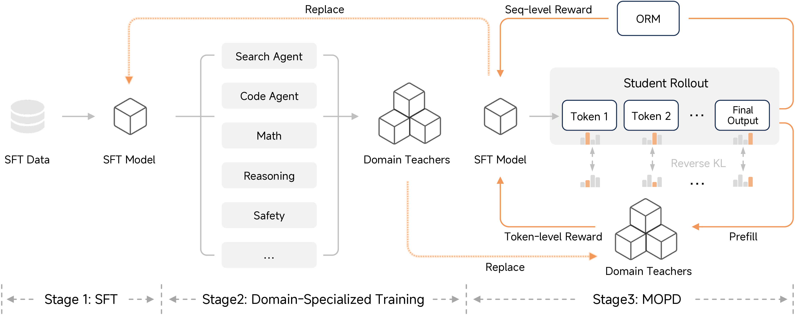

> 对应讲座：问答 3 —— 第 8–11 讲读者提问 · 观看/PDF/幻灯片/源码见 [rlhfbook.com/course](https://rlhfbook.com/course)

# 问答 3：后训练配方演进与实践建议

本章汇集截至第 11 讲的 GitHub、Discord 与 YouTube 评论问题。

## Q1：“能力应该分开训练再合并吗？”

观众提问：

> 如果每种能力都有自己的“模式”，后训练分阶段进行——编码 → 数学 → agentic 工具使用等——一次学一种模式，是否合理？我猜这个直觉在某个地方是错的，因为人们似乎并不真这么做，而是非常注意数据混合。

**回答：** 工业后训练有惊人多的阶段与排序。通常不是按能力排成一条线，而是分叉与合并并存，也有一定的顺序。正在兴起的方式是**并行训练专家教师**，然后用多教师同策略蒸馏（MOPD）把它们合并到一个学生中。见对谈 1（与 Finbarr Timbers）。

### Cascade RL：一种顺序配方

一篇有趣的论文！部分集成进 Nemotron，但未被接受为最先进。

### Cascade RL 2：顺序配方 + 同策略蒸馏

## Q2：“为什么 RLVR 常常省略 KL 惩罚？”

来自第 10 讲评论的追问：

> 似乎 RLVR 的默认做法是完全去掉 KL 项。我的理解是：RLVR 的奖励是可验证的真实答案，因此不会遇到 RLHF 中那种过度优化问题——在 RLHF 中学习到的奖励模型只是代理。这样理解对吗？

**回答：** 总体正确。我们甚至在 Tülu 3 中发现，RLVR 中模型非常擅长选择性更新行为——例如学习数学而不会出现分布外退化。

### 更多 β 选择

**去掉：**

- Open-Reasoner-Zero、Magistral 与 Skywork OR-1 在 $\\beta = 0$ 下运行 RLVR。
- DAPO 明确去掉它，以便长推理链探索。
- GLM-5（2026）：“我们移除 KL 正则项以加速 RL 改进。”

**保留（某种形式）：**

- DeepSeek-R1 的 GRPO 目标包含到参考模型的 $\\beta\\, D\_{\\mathrm{KL}}$ 项。
- Kimi K3 的报告在 RL 目标中从未提及 KL——前沿默认是静默省略。

## Q3：“约 100 万 SFT 提示预算如何随模型规模变化？”

来自第 2 讲评论：

> 你提到一些提示预算的经验法则，例如 SFT 约 100 万条提示。根据你的经验，这个数字如何随被后训练模型的大小变化？

**回答：** 大体上，更大的模型往往需要更少数据（例如 Tülu 3 405B）。它们在 RL 中样本效率更高（按步数计，而非总 GPU 小时），需要更少 SFT 数据（或许多 SFT 数据对它们没帮助）。可以理解为更大模型每项能力需要更少 token，这符合缩放定律。今天这有混淆因素，因为 mid-training 与 SFT 在某些方面几乎无法区分；二者都在模型中播种推理行为。

## Q4：“RL 基本就是带正则项的 SFT？”

来自第 3 讲评论的一个好问题：

> 传统观点认为 RL 适合硬核推理任务，SFT 适合获得结构与格式。但总有新论文说 RL 基本就是带正则项的 SFT，如果用他们正则化的 SFT，就能得到同样结果。这有多可信/可泛化？

**回答：** 前提上：与其说是“SFT 管格式、RL 管理推理”，不如说是**SFT 是基础**（如今非常算力高效），然后 **RL 是模型从此学习更多内容的方式**——在更难的问题上，并适应部署时将使用的 harness。二者目前都无法绕过。不过，随着领域快速发展，**仅用 SFT 也能做出伟大模型**。任何好的数据工作都会让你走得很远。

### 所有损失函数的相似性确实存在

是的——两种更新共享核心项，在策划目标上 SFT 是“全正”特例（DPO 也可证明同样结论）。这种共享代数推动了 iw-SFT、DFT 与统一视角论文。巨大差异在于**负梯度**：RL 把低于基线的样本*压低*——它从自己的错误中学习，而 SFT 结构上做不到；再加上同策略学习对模型进行正则与轻推的力量。

## Q5：“内部轨迹何时应训练进权重，何时用 ICL 处理？”

来自第 7 讲评论：

> 内部轨迹何时应学习进权重，而不是用上下文学习处理？

**回答：** 主要取决于成本、推理量，以及改进在金钱上的价值。构建评估来了解自己所处位置，但假设任何有意义的训练工作至少花费数百万到数千万美元。

## Q6：“仅在蒸馏数据集上持续预训练会让模型变差吗？”

来自第 7 讲评论。

**回答：** “蒸馏数据”这个类别本身不分好坏。取决于教师模型、学生模型、过滤方式、生成流程等。人们既用合成数据持续预训练做出过失败模型，也做出过 SOTA 模型。

## 要点小结

- 后训练配方使用分叉、合并与排序；MOPD 是合并专家的新兴方式。
- RLVR 常去掉 KL 惩罚，因为可验证奖励不易过度优化，但一些前沿配方仍保留某种形式。
- 更大模型通常每项能力需要更少 SFT 数据。
- SFT 与 RL 共享代数，但 RL 增加了负梯度与同策略正则化。
- 在上下文学习与权重更新之间抉择，是成本收益问题。
- 合成/蒸馏数据质量取决于教师、学生、过滤与生成，而非“蒸馏”标签。
