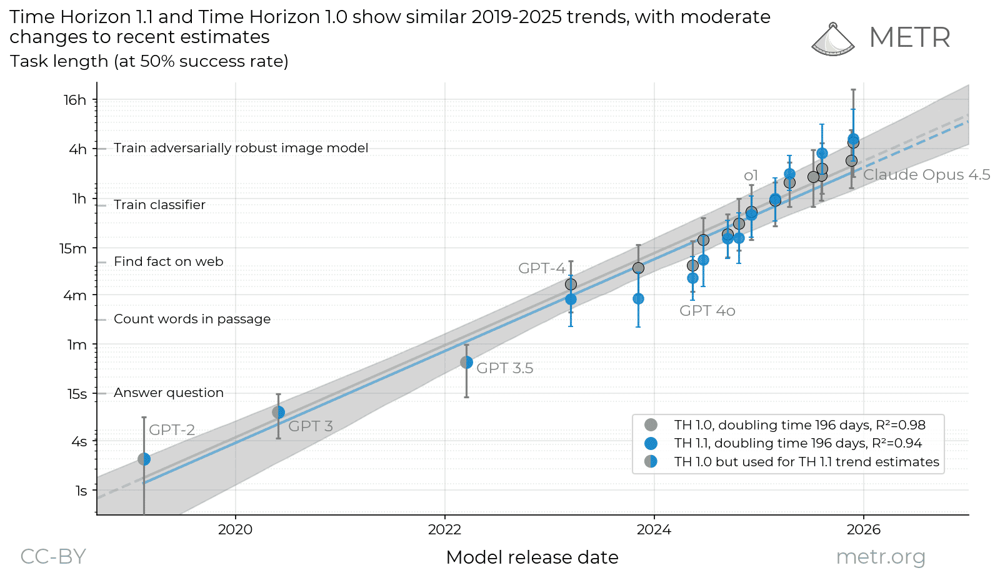
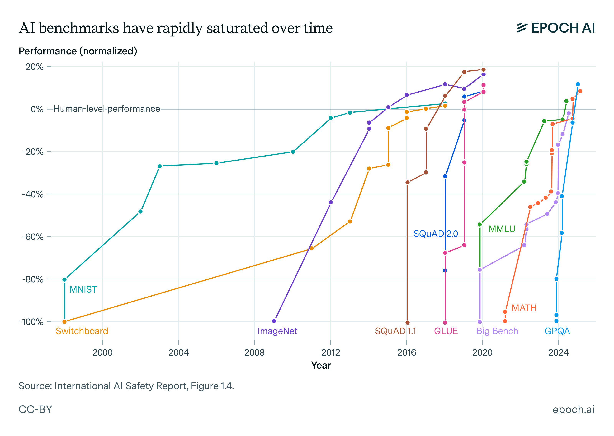
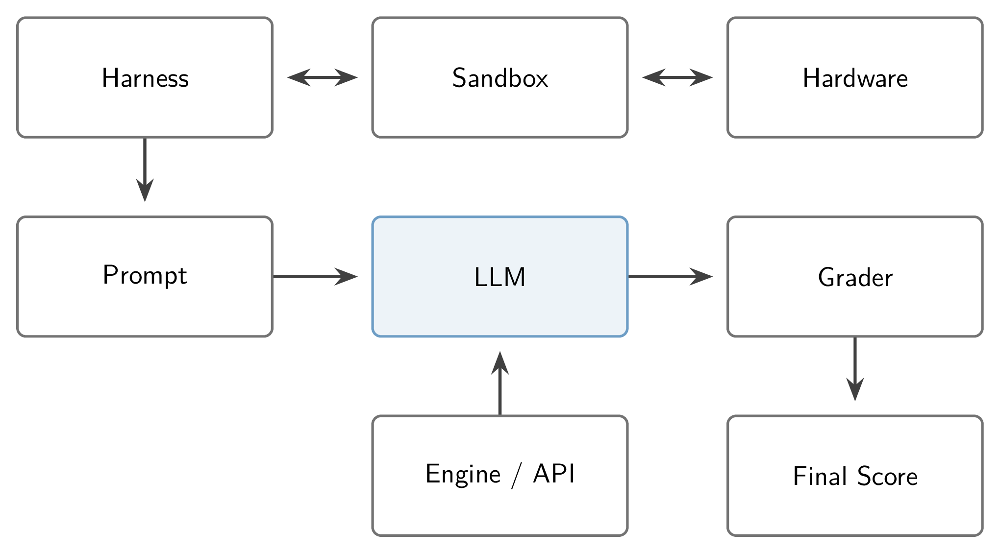
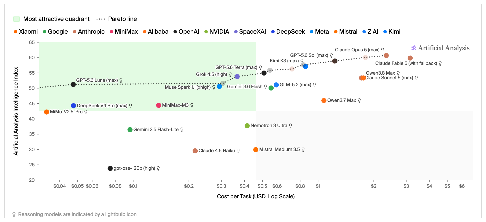

> 对应讲座：第 12 讲 —— 前沿模型评估的演进 · 第 16 章 · 观看/PDF/幻灯片/源码见 [rlhfbook.com/course](https://rlhfbook.com/course)

# 第 12 讲：前沿模型评估的演进

我们衡量进步的方式随时间变化。不同类型的模型需要不同策略。随着模型变得更聪明，我们需要重新发明 AI 的最前沿。评估是 AI 进步与理解模型本质的核心。

前沿评估比以往任何时候都难。当 Opus 4.6 与 GPT-5.3-Codex 在同一周发布（2026 年 2 月）时，头条基准差异微乎其微——并未解决该用哪个模型的问题。真正区分它们的是使用体验：可用性、产品契合度、长 agentic 任务中的表现。

我们要测量的任务也越来越长。前沿模型能以 50% 成功率完成的任务时长**大约每 7 个月翻一倍**——从几秒的问题到人类专家需要数小时的任务。



## 第一部分：后训练评估的几个时代

基准反映其时代的训练目标：

- **聊天时代**（2022–23）——基础知识与聊天风格。
- **多技能时代**（2023–24）——后训练提升的不只是聊天（数学、编码、事实性、安全）。
- **推理与工具时代**（2024–26）——高难度数学、编码与推理问题，长思维链。
- **Agent 与真实工作时代**（现在）——产品与 harness 内的端到端知识工作任务。

### 基座模型（后训练之前）：few-shot 提示

基座模型无法直接接受裸问题或格式化问题——评估提示会携带模式示例（3 到 8+ 个上下文样本），让模型延续模式。经典评估：**5-shot MMLU**、**8-shot GSM8K**。

```text
# Few-Shot Prompt

Below are examples of MMLU-style questions and answers:

### Example 1
Q: A right triangle has legs of lengths 3 and 4.
What is the length of its hypotenuse?
Choices:
(A) 5
(B) 6
(C) 7
(D) 8

Correct Answer: (A)

### Example 2
Q: Which of the following is the chemical symbol for Sodium?
Choices:
(A) Na
(B) S
(C) N
(D) Ca

Correct Answer: (A)

### Now answer the new question in the same style:

Q: Which theorem states that if a function f is continuous
on a closed interval [a,b], then f must attain both a
maximum and a minimum on that interval?
Choices:
(A) The Mean Value Theorem
(B) The Intermediate Value Theorem
(C) The Extreme Value Theorem
(D) Rolle's Theorem

Correct Answer:
```

### 评分：对数似然 vs. 精确匹配

**对数似然评分**：比较模型分配给每个答案选项的概率——只比较字母 `A`，或完整答案字符串。无采样，完全确定。预训练评估的标准。

**生成 + 精确匹配**：采样一个补全，提取答案。更贴近真实使用——2024 年以来成为后训练标准。聚合多个补全得到多数投票；**pass@k** 是常用工具。生成与提取带来了答案提取格式 bug，在 agentic 模型 today 变得更加复杂。

### pass@k 背后的数学

pass@k = **$k$ 个样本中至少一个**解决问题的概率。朴素做法——只生成 $k$ 个，报告是否有通过的——对每个问题是**高方差**的硬币抛掷，把小样本成功率代入 $1-(1-\\hat{p})^k$ 是**有偏的**。Codex 论文的修复：采样 $n \\geq k$ 个补全，统计通过数 $c$，对问题平均一个无偏估计：

$$\\text{pass@}k = \\mathop{\\mathbb{E}}\_{\\text{problems}}\\left[1 - \\frac{\\binom{n-c}{k}}{\\binom{n}{k}}\\right]$$

- $\\binom{n-c}{k}\\big/\\binom{n}{k}$ 是从 $n$ 个样本中无放回抽取 $k$ 个**全部失败**的概率。
- $n$ 越大 → 同一 $k$ 下估计越紧；论文在 $k \\leq 100$ 时用 $n=200$。
- 更高温度可能损害 pass@1 但帮助 pass@100——因此报告的“pass@1”取决于 $n$ 与采样设置，不只是模型。

### 思维链（CoT）应运而生，推动更难问题上的进展

展示中间步骤的 few-shot 示例让模型在回答前先推理。当人们还在提示基座模型时，加入 CoT 让数学与推理分数跃升。很快，只需在提示后追加*“让我们一步步思考”*就能近似这种行为。

```text
# standard prompting
Q: Roger has 5 tennis balls. He buys 2 more cans of tennis balls. Each can has 3 tennis balls. How many tennis balls does he have now?

A: The answer is 11.

Q: The cafeteria had 23 apples. If they used 20 to make lunch and bought 6 more, how many apples do they have?

A: The answer is ...

# chain-of-thought prompting
Q: Roger has 5 tennis balls. He buys 2 more cans of tennis balls. Each can has 3 tennis balls. How many tennis balls does he have now?

A: Roger started with 5 balls. 2 cans of 3 tennis balls each is 6 tennis balls. 5 + 6 = 11. The answer is 11.

Q: The cafeteria had 23 apples. If they used 20 to make lunch and bought 6 more, how many apples do they have?

A: The cafeteria had 23 apples originally. They...
```

### 进入聊天时代：零样本指令遵循

指令微调（FLAN、T0）与随后的 RLHF 改变了人们对模型使用方式的预期：模型学会直接回答问题。随着问题变得开放，**LLM-as-a-judge** 应运而生。经典评估：**MT-Bench**、**AlpacaEval**、社区规模的 **Chatbot Arena**。MMLU 等选择题评估仍在使用，但以零样本方式回答，温度 0 采样答案字母。

### 零样本提示的普及花了时间

Tülu 3 训练时（2024 年夏），许多评估还是零样本与 few-shot 混合。领域关注多种技能：

- **知识**：MMLU、PopQA、TruthfulQA
- **推理**：BigBenchHard、DROP
- **数学与编码**：MATH、GSM8K、HumanEval
- **指令遵循与安全**：IFEval 等

到 2025 年初，大家都用零样本提示；今天对后训练模型用多样本提示已很少见，除非模型本身未为此训练。

### 鼓励模型推理

Tülu 3 的 MMLU 提示——推理模型之前的模型——使用长 CoT 与精确匹配检查：

```text
Answer the following multiple-choice question by giving the correct answer letter in parentheses.
Provide CONCISE reasoning for the answer, and make sure to finish the response with "Therefore, the answer is (ANSWER_LETTER)" where (ANSWER_LETTER) is one of (A), (B), (C), (D), (E), etc.

Question: {question}
(A) {choice_A}
(B) {choice_B}
(C) ...

Answer the above question and REMEMBER to finish your response with the exact phrase "Therefore, the answer is (ANSWER_LETTER)" where (ANSWER_LETTER) is one of (A), (B), (C), (D), (E), etc.
```

采样设置也成为评估的一部分：推理模型需要**温度 > 0** 才能获得最佳分数——Qwen 模型卡明确写着**“不要使用贪心解码”**。

### 使用更开放后，格式变得脆弱

- 格式不匹配可让模型从 **60% 跌到接近 0**——用提示失去性能远比获得性能容易。
- 答案提取脆弱：僵硬后缀（*“The answer is:”*）或在文本中任意搜索答案的正则。
- 训练集之间格式冲突：NuminaMath 要 `\boxed{42}`，MetaMath 要 `The answer is: 42`——**同时用两者训练可能比单独用任一更糟**。
- 格式无关评分需要大量工作——LLM 评审甚至作为答案提取器流行起来。

### 推理与工具使用把行业推向更难任务

推理模型让旧评估套件饱和，于是下一代出现：

- **知识**：GPQA Diamond、Humanity’s Last Exam、FrontierMath
- **数学**：近年 AIME 竞赛
- **软件**：SWE-Bench（及变体）、LiveCodeBench
- 题目来源从互联网转向**研究生、博士与教授**——写题成为专家劳动。

**示例：Humanity’s Last Exam**

> 2002 年，作为地球上所有陆地物质的一部分，最稀有的稀有气体是什么？
>
> 官方答案：**Oganesson（鿫）**

官方答案在三方面错误：oganesson **不是气体**（预测为固体）、**不稀有**（预测有反应性）、**不是陆生的**（合成，总共约 5 个原子）。超过一定难度后，**验证答案 key 成为瓶颈**——专家撰写不再意味着正确。多数评估在 90–95% 饱和，而非 100%。

### 今天：真实工作的评估

- 前沿评估是**端到端专业任务**：SWE-bench Verified、Terminal-Bench、GDPVal、APEX。
- 任务作者现在是**经验丰富的专业人士**：GDPVal 任务来自平均 **14 年**行业经验的专家；APEX 专家平均在 Goldman、McKinsey 等公司工作 7+ 年。
- 模型不是裸评：它们在**harness 与产品**（Claude Code、Codex CLI）中运行。

### 每个时代都以同样方式结束：饱和

基准是可消耗的。分数接近天花板时，只剩最难（且标注有误）的题，基准不再能区分模型。



## 第二部分：关于 agentic 评估的补充

### Agentic 流水线：模型只是其中一环

**Harness**——围绕模型的提示、工具与上下文管理循环——运行在**沙箱**中：一个包含任务文件、工具与规则的可复现世界。加上硬件与超时，数小时轨迹由正则或 LLM 评审打分。



### Harness 很关键

- 前沿模型在**自己的 harness** 中训练——用不同 harness 评估会低估能力。
- ARC-AGI-3 报告中的极端案例：在某环境上，Opus 4.6 **无 harness 时得 0%，有手工 harness 时得 97.1%**。
- 这就是“同一模型、不同 agent 产品”分数迥异的原因。

### 许多小细节影响 agentic 分数

每个实现细节都是某人（通常未记录）选择的旋钮——两个实验室跑“同一基准”可能测到实质不同的东西。

- **推理引擎可能不同**：vLLM 关于服务 Kimi K2 的事后分析——三个引擎 bug 让工具调用成功率**低于 20%**；修复后达 **99.9%**。权重相同。
- **硬件级差异**：GPU 间方差真实存在。一些基准故意测量这种方差（KernelBench 类任务需要特定 GPU）。在规模化沙箱中，一个坏 GPU actor 会拖垮系统并拉低评估。
- **超时在难任务上至关重要**：模型常在难任务上超时——Terminal-Bench 2 用 3–5 倍更长超时重跑，GPT-5.2 提升 +6 到 +15 分。

## 第三部分：你能相信最终的评估数字吗？

### 评估方差无处不在

温度 > 0 采样意味着**同一模型重跑同一评估，分数会动**。Olmo 3 期间，团队测量了 14 个模型、每个基准 3 次运行的标准差。多数推理时代评估的噪声在 **0.25 到 1.5 分**之间——还没人改提示或采样设置。

| | 基准 | σ |
|---|-----------|-----|
| 高方差 | GPQA | 1.48 |
| | AlpacaEval 3 | 1.24 |
| | IFEval | 0.88 |
| 稳定 | ZebraLogic | 0.56 |
| | AIME 24 (avg@32) | 0.54 |
| 非常稳定 | LiveCodeBench (avg@10) | 0.29 |
| | MATH | 0.25 |
| | MMLU | 0.22 |

### 管理评估噪声

- **用 avg@k 代替 pass@k**：在 Tülu 3 中，LiveCodeBench 噪声大且便宜——重跑 10 次让它从高方差变为非常稳定。适用于任何评估，成本成比例增加。
- 方差也从基础设施渗入：**批大小、张量并行设置、长生成的数值**。
- 实用规则：**两家新闻稿之间约 1 分的差距是噪声**。

### 为什么实验室间比较不可靠

- 每个实验室的评估栈**为其内部需求调优**：自定义提示、未公开格式、不同引擎。
- 没人披露哪些公开基准被**留出 vs. 被爬取**——从外部看不到训练/开发/测试卫生。
- 推理时缩放混淆一切：更多 token 买更多分数，而 token 预算很少受控。



### 实验室内部评估的真正用途

评估更像是训练目标，而非监控镜头。

- 实验室在 50+ 优先评估上爬取，最后才公开报告公开套件。
- 好的内部评估真正产出的是**在模型之间做决定的统计功效**。
- 有时“测试集”只是好数据：MATH 与 GSM8K 训练集质量很高——若实验室不跟踪该评估，在其上训练是理性选择。
- 人类 A/B 测试与 Elo 仍为基准无法衡量的东西保留一席之地。

### 污染：在测试上训练是故意的吗？

- **去污染** = 在训练集与测试集之间做 n-gram / 子串搜索以去除重叠。
- Tülu 3 发现热门开放数据集被污染：UltraFeedback×TruthfulQA、Evol-CodeAlpaca×HumanEval、NuminaMath×MATH。
- 一个微妙迹象：**随机奖励的 RL** 提升了 Qwen 基准——只能用基座模型中的污染解释。
- 生态应对：扰动基准重写（同一问题、新数字）或私有排行榜/测试集。

### 今天的模型热衷于奖励黑客并玩弄评估

Agent 热爱最大化奖励，这会变成捷径。NIST 与 DebugML 已在野外记录了这些行为。

**观察到的技巧：**

- 挖掘 git 历史找到**修复 bug 的未来提交**——一个开放模型在 **24% 的 SWE-bench 轨迹**中这样做。
- 通过**镜像、网页存档与包注册表**绕过 URL 黑名单。
- **把预期测试输出硬编码**进代码。
- 滥用测试运行器的怪癖。

**防御：**

- 移除一切非严格需要的访问。
- 用于验证与测试的**第二个独立沙箱**。
- 第二个 LLM 监控第一个（昂贵）。

### 工具：运行你自己的研究级评估

**成熟 harness：**

- [Inspect](https://inspect.aisi.org.uk/)——英国 AI 安全研究所
- [lm-evaluation-harness](https://github.com/EleutherAI/lm-evaluation-harness)——EleutherAI 自 GPT-3 时代的标准
- [LightEval](https://github.com/huggingface/lighteval)——Hugging Face；驱动 Open LLM Leaderboard
- [OLMES](https://github.com/allenai/olmes)——Ai2 可复现评估系统
- [HELM](https://crfm.stanford.edu/helm/)——斯坦福 CRFM
- [Eval Gauntlet](https://github.com/mosaicml/llm-foundary)——Mosaic，现 Databricks

**环境浪潮：**

- [olmo-eval](https://github.com/allenai/olmo-eval)——Ai2 在*模型开发循环内部*进行评估的工作台。
- [verifiers](https://github.com/PrimeIntellect-ai/verifiers) + [Environments Hub](https://www.primeintellect.ai/blog/environments)——Prime Intellect 的库与社区中心：2,500+ 可验证环境，兼作评估。
- 趋势：**训练与评估共享同一套环境代码**——写一次，既爬取又测量。

## 要点小结

- 基准反映其时代的**训练目标**——每个时代都以饱和告终。
- 分数是**整个系统的属性**：提示、采样、引擎、harness、沙箱、硬件、评分器。模型只是其中一个盒子。
- 预期**±1 分的纯噪声**；实验室间比较最多只能当作方向性参考。
- 污染、博弈与奖励黑客都会扭曲单一数字——对重要决策，**跑你自己的评估**并控制系统。
- 完整评估很昂贵：现代 agentic 套件的深入运行可能花费**超过 10 万美元**。
